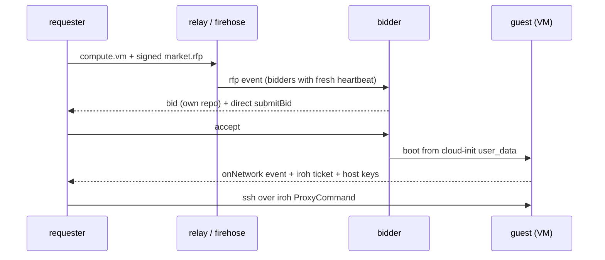
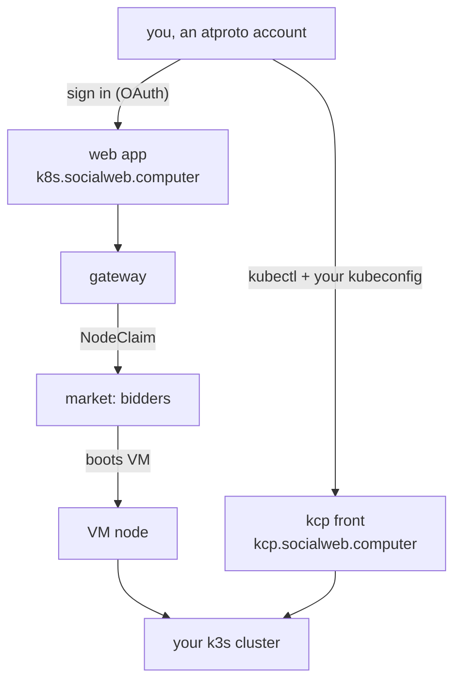
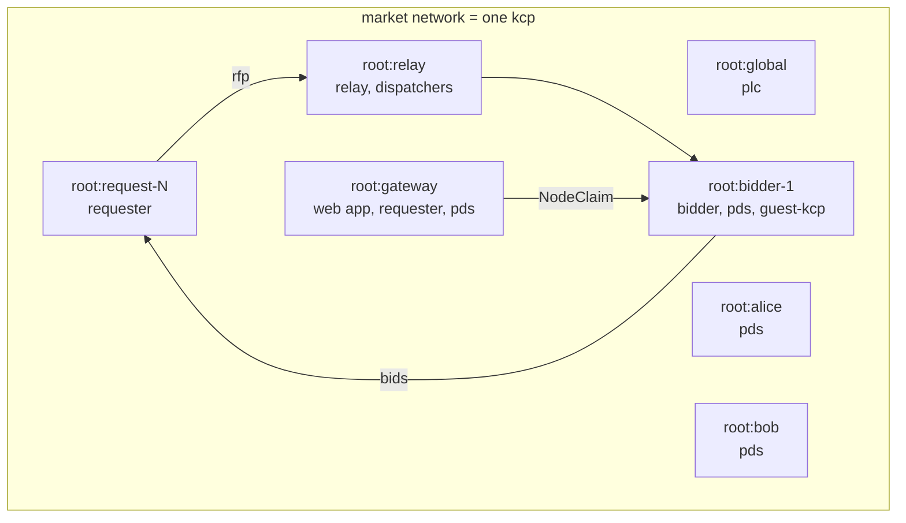
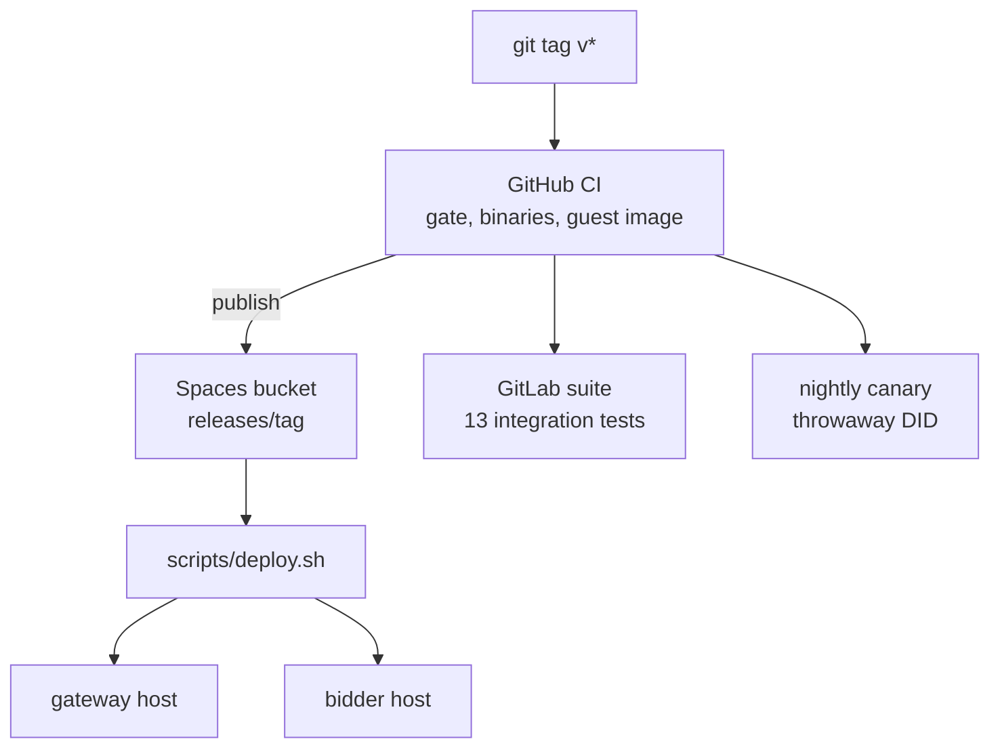
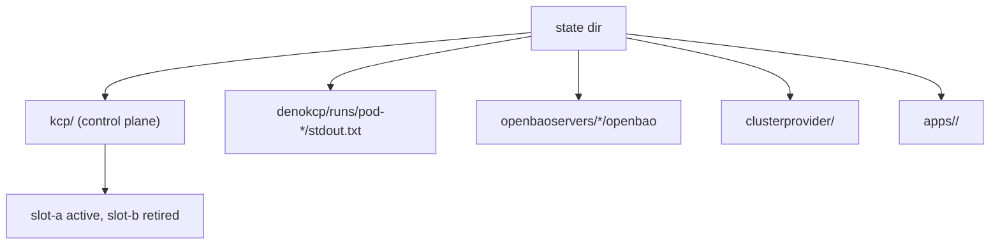

# socialweb-computer-kcp

socialweb-computer-kcp serves virtual Kubernetes clusters. A tenant cluster's k3s nodes are virtual machines rented on the atproto compute market, and the nodes scale to zero while the control plane keeps serving. One atproto account can own several clusters.

One binary, `socialweb-computer`, runs every part of the software. Each running application is a separate instance with its own kcp control plane, a manifest set, and a profile: a requester (`run request`), a bidder, the gateway, a market network, or a local development instance. Application state lives in that instance's kcp as objects such as `ComputeVM`, `ComputeContract`, `NodeClaim`, `DenoPod`, and `HostProcess`.

```mermaid
flowchart TD
  market["atproto market<br/>records in each app's own repo PDS · relay / firehose"]

  subgraph gw["gateway instance · its kcp"]
    g_root["Gateway"]
    subgraph gwstate["state CRDs"]
      g_cl["Cluster · ClusterLink · ClusterClientCertificate"]
      g_nc["NodeClaim · ComputeContract · ComputeVM · GuestIdentityGrant"]
      g_id["MarketIdentity · AtprotoRecord · AtprotoRecordWatch"]
      g_infra["OpenBaoServer · Postgres"]
    end
    subgraph gwcomp["components"]
      g_dp["DenoPods<br/>pds · requester · web app"]
      g_hp["HostProcesses<br/>kcp slot + kine · front · postgres · OpenBao · cluster fronts"]
    end
    g_root --> gwstate
    g_root --> gwcomp
  end

  subgraph bd["bidder instance · its kcp"]
    b_root["MarketBidder"]
    subgraph bdstate["state CRDs"]
      b_bid["Bid · ComputeContract · ComputeVM"]
      b_id["MarketIdentity · AtprotoRecord · AtprotoRecordWatch"]
      b_infra["OpenBaoServer"]
    end
    subgraph bdcomp["components"]
      b_dp["DenoPods<br/>bidder · pds · guest-kcp · policy-engine"]
      b_hp["HostProcesses<br/>kcp slot + kine · front · OpenBao · VM units"]
    end
    b_root --> bdstate
    b_root --> bdcomp
  end

  subgraph rq["requester instance · its kcp (one per run request)"]
    r_root["MarketRequester"]
    subgraph rqstate["state CRDs"]
      r_cc["ComputeContract · ComputeVM"]
      r_id["MarketIdentity · AtprotoRecord · AtprotoRecordWatch"]
    end
    subgraph rqcomp["components"]
      r_dp["DenoPod: request-vm-ssh"]
      r_hp["HostProcesses<br/>kcp slot + kine · front · OpenBao"]
    end
    r_root --> rqstate
    r_root --> rqcomp
  end

  r_id -.->|"rfp · accept"| market
  g_id -.->|"rfp · accept"| market
  b_id -.->|"heartbeat · bid · receipt"| market
  g_nc -.->|"NodeClaim, rented"| market
  b_bid -->|"won, boots"| vm["guest VM<br/>firecracker · scale to zero"]
  b_hp -->|runs| vm
```



One instance is one kcp and its workspaces; there is no kcp inside a kcp. A market network is one kcp with a workspace per child application; prod gives every application its own kcp. A tenant cluster's control plane is k3s, not a kcp.

- Design and decisions: [`docs/ARCHITECTURE.md`](docs/ARCHITECTURE.md)
- Working rules for this repository: [`AGENTS.md`](AGENTS.md)
- Plans and their status: [`docs/plans/`](docs/plans/), [`NEXT.yaml`](NEXT.yaml)

## Contents

- [Pieces, and where each starts](#pieces-and-where-each-starts)
- **How it works**
  - [The RFP flow](#the-rfp-flow)

- **Use the hosted service**
  - [Use the hosted gateway (public service)](#use-the-hosted-gateway-public-service)
  - [Manage a tenant cluster over XRPC](#manage-a-tenant-cluster-over-xrpc)

- **Run your own**
  - [Prerequisites](#prerequisites)
    - [Prepare a bare host](#prepare-a-bare-host)
  - [Install a release binary](#install-a-release-binary)
  - [Run and install a bidder](#run-and-install-a-bidder)
  - [Run the gateway and its web app](#run-the-gateway-and-its-web-app)
  - [Run a market network on one host](#run-a-market-network-on-one-host)
  - [Rent a VM through the RFP flow](#rent-a-vm-through-the-rfp-flow)

- **Develop from source**
  - [Build the socialweb-computer binary](#build-the-socialweb-computer-binary)
  - [Run the integration tests](#run-the-integration-tests)

- **Operate and release**
  - [Deploy a release to production](#deploy-a-release-to-production)
  - [Sign in with OAuth](#sign-in-with-oauth)
  - [Inspect the kcp of an application](#inspect-the-kcp-of-an-application)

- [License](#license)

## Quick paths

```bash
# 1. use the gateway we host: sign in, create a cluster, get a kubeconfig
open https://k8s.socialweb.computer

# 2. rent one VM through the RFP flow, on a host you prepared
socialweb-computer dev up --instance mn1 --profile market-network --bidders 1
echo '[{"path":"/root/x","value":"hello"}]' > secrets.json
socialweb-computer run request --network mn1 --secrets secrets.json --exec 'cat /root/x'
socialweb-computer dev down --instance mn1

# 3. install a bidder from the newest release (see the bidder section for the association)
V=$(curl -fsSL https://api.github.com/repos/publicdomainrelay/socialweb-computer-kcp/tags | jq -r ".[].name" | grep "^v" | sort -V | tail -1)
curl -fsSLO "https://socialweb-computer-kcp.sfo3.digitaloceanspaces.com/releases/$V/binaries/socialweb-computer-linux-amd64"
sudo install -m 0755 socialweb-computer-linux-amd64 /usr/local/bin/socialweb-computer
sudo socialweb-computer install bidder --handle <your atproto handle>
```

## Pieces, and where each starts
| Piece | Use it with | Section |
| --- | --- | --- |
| The gateway we host, as a public service | `https://k8s.socialweb.computer` | [Use the hosted gateway](#use-the-hosted-gateway-public-service) |
| A tenant cluster of that gateway | the web app, or XRPC (`goat`) | [Manage a tenant cluster over XRPC](#manage-a-tenant-cluster-over-xrpc) |
| Your own gateway | `scripts/deploy.sh` on a host you own | [Run the gateway and its web app](#run-the-gateway-and-its-web-app) |
| A bidder | `install bidder` (release binary) | [Run and install a bidder](#run-and-install-a-bidder) |
| A market network on one host | `dev up --profile market-network` | [Run a market network on one host](#run-a-market-network-on-one-host) |
| One VM through the RFP flow | `run request` | [Rent a VM through the RFP flow](#rent-a-vm-through-the-rfp-flow) |
| The whole thing from source | `scripts/build-socialweb-computer.sh` | [Build the socialweb-computer binary](#build-the-socialweb-computer-binary) |
| A release to production | `scripts/deploy.sh` | [Deploy a release to production](#deploy-a-release-to-production) |

## How it works

### The RFP flow


A requester rents a VM by running the RFP flow. The requester posts a `compute.vm` record and a signed `market.rfp`; bidders bid; the requester accepts the winning bid; the winning bidder boots the guest from cloud-init `user_data` that installs the guest agent (sshd, the tunnel subscriber, and the client that reaches the guest). The guest reports an iroh ticket for its sshd with its on-network event; the requester's ssh dials that ticket (`socialweb-computer internal iroh-dial`, `dumbpipe connect`, as the `ProxyCommand`) and checks the host keys the guest reported. The market records go through the relay.

```
requester --market.rfp--> relay/PDS <--bid-- bidder (own kcp: MarketBidder, Bid, ComputeVM)
    | accept                                    | cloud-init user_data
    v                                            v
gateway (own kcp: Gateway, Cluster, NodeClaim)   firecracker VM = k3s node
    tenant k3s apiserver (kine + front) <-------- node joins over the iroh link
```

Every listener behind the edge binds port 0 and reports its bound address into the status of its kcp object, and peers find each other by service name through kcp. Only the stable public entry points (caddy on 443, an application's front) keep a fixed address.

## Use the hosted service

### Use the hosted gateway (public service)
`https://k8s.socialweb.computer` is our production gateway: a public service, no account with us, no API key.

```bash
# 1. open it and sign in with your own atproto account (Bluesky handle and password)
open https://k8s.socialweb.computer

# 2. or do the same steps over XRPC; goat is the Bluesky CLI
go install github.com/bluesky-social/goat@latest
GOAT_USERNAME=<your handle> GOAT_PASSWORD=<your password> goat account login
GW=https://k8s.socialweb.computer AUD=did:web:k8s.socialweb.computer N=com.publicdomainrelay.temp.cluster
call() { local m=$1 nsid=$N.$2; shift 2; goat xrpc $m $GW $nsid "$@" "Authorization:Bearer $(goat account service-auth --aud $AUD --lxm $nsid)"; }
call procedure createCluster name=demo                       # create if missing, start the control plane
call procedure getKubeconfig name=demo ttlSeconds:=28800 | jq -r .kubeconfig > demo.kubeconfig; chmod 600 demo.kubeconfig
KUBECONFIG=demo.kubeconfig kubectl get ns
call procedure deleteCluster name=demo
```

- In the web app, "Create cluster" and "Download kubeconfig" do the same two steps; the kubeconfig there is the file to keep.
- The nodes of the cluster are VMs rented on the market from the bidders the gateway trusts; a cluster with no pods holds no VMs (scale to zero).
- The cluster API is atproto XRPC with your own account's service token: `aud` is the gateway DID, `lxm` the method. See [Manage a tenant cluster over XRPC](#manage-a-tenant-cluster-over-xrpc).
- This is our production instance. It is disposable by design: a deploy may delete every cluster, as [docs/ARCHITECTURE.md](docs/ARCHITECTURE.md) states.



### Manage a tenant cluster over XRPC
The gateway serves the cluster API over atproto XRPC. Every method takes an atproto service JWT: `iss` is your DID, `aud` is the gateway DID, and `lxm` is the method NSID.

Methods (prefix `com.publicdomainrelay.temp.cluster.`):

| Method | What it does |
|---|---|
| `createCluster` | Create the named cluster if it is missing and leave it running, in one call. Idempotent. |
| `getKubeconfig` | Return a kubeconfig. Creates the cluster if it is missing but does not start the control plane. |
| `listClusters` | List the account's clusters. |
| `controlPlaneUp` | Start the control plane. |
| `controlPlaneDown` | Stop the control plane. |
| `deleteCluster` | Delete the cluster. |
| `subscribeClusters` | Stream cluster state as an event stream. |
| `revokeIdentity` | Revoke a cluster identity. |

#### Create a cluster and get a kubeconfig with goat

```bash
go install github.com/bluesky-social/goat@latest
( . ~/.aliceoa_bsky_social_source; GOAT_USERNAME="$ALICE_ATPROTO_HANDLE" GOAT_PASSWORD="$ALICE_ATPROTO_PASSWORD" goat account login )
GW=https://k8s.socialweb.computer AUD=did:web:k8s.socialweb.computer N=com.publicdomainrelay.temp.cluster
call() { local m=$1 nsid=$N.$2; shift 2; goat xrpc $m $GW $nsid "$@" "Authorization:Bearer $(goat account service-auth --aud $AUD --lxm $nsid)"; }
call procedure createCluster name=demo                       # create if missing and start the control plane (idempotent)
call query listClusters | jq '.clusters[] | {name, phase, running}'
call procedure getKubeconfig name=demo ttlSeconds:=28800 | jq -r .kubeconfig > demo.kubeconfig; chmod 600 demo.kubeconfig
KUBECONFIG=demo.kubeconfig kubectl get ns
call procedure controlPlaneDown name=demo; call procedure deleteCluster name=demo
```

`goat xrpc` sends `key=value` as a JSON string and `key:=value` as a JSON number or boolean, so `ttlSeconds` and `noExpiry` take `:=`; `ttlSeconds=28800` is a string and the gateway answers `InvalidRequest`. The kubeconfig holds a client key and an x509 client certificate from the cluster's own OpenBao PKI (CN your DID, O `socialweb.computer:cluster-owners`, default 8 h, at most 24 h via `ttlSeconds`). Plain `kubectl`, no helper. Keep it `0600`, never commit it. `getKubeconfig` on a stopped cluster answers `ClusterNotRunning`: call `createCluster` or `controlPlaneUp` first. `revokeIdentity` and `deleteCluster` end every certificate at once. For a certificate that never expires, call `getKubeconfig name=demo noExpiry:=true`: it lives until you revoke it, delete the cluster, or the cluster CA expires. Cluster phases are `Unavailable`, `Initializing`, `Ready`, and `Draining`.

#### Watch cluster state with subscribeClusters

`com.publicdomainrelay.temp.cluster.subscribeClusters` is an atproto event stream: a `GET` with a websocket upgrade, binary frames, each frame a DRISL-CBOR header then a DRISL-CBOR payload. Authenticate on the upgrade request with the same service JWT (`Authorization: Bearer`, `lxm` = `subscribeClusters`). The account is the token's `iss`. Pass `?name=<cluster>` to watch one cluster.

On connect the stream sends a snapshot (one `#cluster` per cluster, one `#member` per control-plane member, one `#nodeClaim` per claim, each with `snapshot:true`), then one `#info` named `SnapshotComplete`, then live changes. There is no cursor: reconnecting starts a fresh snapshot. The token is checked once at connect, and the stream lives until the client closes, the gateway restarts, or the 1 hour stream bound is reached (`TokenExpired`). An error frame is followed by a close.

| Message | Fields | Phase values |
|---|---|---|
| `#cluster` | name, phase, running, reason, message, server, instance, deleted | Unavailable, Initializing, Ready, Draining |
| `#member` | cluster, member, phase, reason, message | Pending, Starting, Running, Ready, Sealed, Stopping, Stopped, Deleting, Failed, Lost |
| `#nodeClaim` | cluster, name, nodeName, phase, message, contractPhase, outcome, bidder, fqdn, deleted | Pending, Bidding, Provisioning, Joining, Running, Failed, Released, Lost, Adopting |

Error frames: `InvalidRequest`, `Unauthorized`, `TokenExpired`, `ClusterNotFound`, `IdentityRevoked`, `ClusterUnavailable`, `ConsumerTooSlow`.

Decode the stream with the bundled client, or check connectivity with `websocat`:

```bash
T=$(goat account service-auth --aud $AUD --lxm $N.subscribeClusters)
# one JSON line per event; exit 0 on --until, 2 on --fail-on, 1 on an error frame
deno run -A --no-lock --node-modules-dir=none scripts/subscribe-clusters.ts --gateway $GW --token "$T" --name demo \
  --until cluster=Ready --fail-on nodeClaim=Failed
# every cluster of the account, run forever
deno run -A --no-lock --node-modules-dir=none scripts/subscribe-clusters.ts --gateway $GW --token "$T"
# raw connectivity check (CBOR bytes, not text)
websocat -b -n -H="Authorization: Bearer $T" "wss://k8s.socialweb.computer/xrpc/$N.subscribeClusters?name=demo" < /dev/null | xxd
```

`subscribe-clusters.ts` options: `--token`, `--gateway` (default `https://k8s.socialweb.computer`), `--name`, `--until <type>=<phase>`, `--fail-on <type>=<phase>`.

#### Apply objects and run Jobs without a kubeconfig

`computer.socialweb.k8s.kubectlApplyServerSide` (procedure) applies one object as `kubectl apply --server-side` would. `computer.socialweb.k8s.getJob` (query) reads a Job's status, its pods, and the tail of each container's log. Neither needs a kubeconfig, `socialweb-credential`, or `kubectl`. Both authenticate with the same service JWT (`aud` = gateway DID, `lxm` = the method), and the account is the token's `iss`.

`kubectlApplyServerSide` inputs:

| Field | Meaning |
|---|---|
| `cluster` | The account's cluster label. Required. |
| `manifest` | One Kubernetes object as JSON, with `apiVersion`, `kind`, and `metadata.name`. Required. A `List` kind or `generateName` is refused. |
| `namespace` | A namespaced object's namespace. Order: `metadata.namespace`, then this field, then `default`; both set must match. A cluster-scoped kind takes none. |
| `name` | Optional check; must equal `metadata.name`. |
| `fieldManager` | The server-side apply field manager. Default `socialweb-computer`. The value `kubectl` shares field ownership with `kubectl apply --server-side`. |
| `force` | Take ownership of fields another field manager owns. Without it such a field is an `ApplyConflict`. |
| `dryRun` | Run admission and validation and return the object without storing it. |

Output: `apiVersion`, `kind`, `namespace`, `name`, `uid`, `resourceVersion`, `generation`, and `object` (as the apiserver stored it, `managedFields` included).

Errors: `InvalidRequest`, `Unauthorized`, `IdentityRevoked`, `ClusterNotFound`, `ClusterNotRunning` (409, call `controlPlaneUp`), `ClusterInitializing` (429, retry), `ClusterDraining` (409), `ClusterUnavailable` (503), `KindNotFound` (400), `ApplyConflict` (409), `KubernetesError` (the apiserver's status and message).

`getJob` parameters: `cluster`, `namespace`, `name`, and `tailLines` (default 100, maximum 5000, `0` returns no logs; each log is at most 64 KiB). Output: `phase` (Pending, Running, Succeeded, Failed), `active`, `succeeded`, `failed`, `conditions`, and `pods[].containers[] { state, exitCode, reason, log }`. Errors include `ObjectNotFound` (404). A Job on a cluster at zero nodes first rents a market VM for its pod.

Apply a ConfigMap:

```bash
K=computer.socialweb.k8s
curl -sS -X POST "$GW/xrpc/$K.kubectlApplyServerSide" \
  -H "Authorization: Bearer $(goat account service-auth --aud $AUD --lxm $K.kubectlApplyServerSide)" \
  -H "Content-Type: application/json" -H "Accept: application/json" \
  -d '{
    "cluster": "demo",
    "namespace": "default",
    "name": "app-config",
    "fieldManager": "kubectl",
    "manifest": {
      "apiVersion": "v1", "kind": "ConfigMap",
      "metadata": {"name": "app-config", "namespace": "default"},
      "data": {"environment": "production", "log_level": "info"}
    }
  }' | jq '{kind, namespace, name, uid, resourceVersion}'
```

Apply a Job and poll it until it finishes:

```bash
jq -n '{cluster: "demo", manifest: {apiVersion: "batch/v1", kind: "Job",
  metadata: {name: "hello", namespace: "default"},
  spec: {backoffLimit: 0, template: {spec: {restartPolicy: "Never",
    containers: [{name: "run", image: "docker.io/library/busybox:1.36.1", command: ["sh", "-c", "echo hello from $(uname -m)"]}]}}}}}' |
  curl -sS -X POST "$GW/xrpc/$K.kubectlApplyServerSide" -H "Content-Type: application/json" \
    -H "Authorization: Bearer $(goat account service-auth --aud $AUD --lxm $K.kubectlApplyServerSide)" -d @- | jq -c '{kind, name, uid}'
# poll until Succeeded or Failed (each call needs a fresh token: service-auth tokens are short-lived)
until s=$(curl -sS "$GW/xrpc/$K.getJob?cluster=demo&namespace=default&name=hello&tailLines=50" \
    -H "Authorization: Bearer $(goat account service-auth --aud $AUD --lxm $K.getJob)"); \
  echo "$s" | jq -c '{phase, active, succeeded, failed}'; echo "$s" | jq -e '.phase == "Succeeded" or .phase == "Failed"' >/dev/null; do sleep 5; done
echo "$s" | jq -r '.pods[].containers[] | "\(.state) exit=\(.exitCode) \(.log)"'
```

## Run your own

### Prerequisites

| To | Need |
| --- | --- |
| run VMs | a 64-bit Linux host with `/dev/kvm`, systemd 253+, cgroup v2, `/dev/net/tun` |
| rent VMs on the host | an account with one `/etc/subuid` and `/etc/subgid` range of `N * 65536` ids (`install bidder --vm-slots N`, default 256); one running VM holds one slot |
| run live commands in a single-host network | the VM account (`test-0001`); its units, slots and `/dev/kvm` access belong to it |
| run a release binary | `curl` and `sha256sum`; the binary embeds every asset, so no checkout, Go or Deno |
| build or run scripts | Go and Deno on `PATH`, this checkout |

#### Prepare a bare host

Install these as root; `dev up` and `run request` check the host and name anything missing.

| Need | Ubuntu / Debian package | Fedora / RHEL package |
|---|---|---|
| `newuidmap` and `newgidmap`, so each VM runs in its own user namespace | `uidmap` | `shadow-utils` |
| `ssh` and `ssh-keygen`, which `run request` runs | `openssh-client` | `openssh-clients` |
| `curl`, to install the binary and fetch the guest image | `curl` | `curl` |
| `/usr/share/zoneinfo`, for the embedded postgres of the gateway | `tzdata` | `tzdata` |
| `jq`, used by the examples below (optional) | `jq` | `jq` |
| `machinectl`, to log in as the VM account (optional; or use `ssh`) | `systemd-container` | `systemd-container` |

As root, once:

```bash
apt-get install -y uidmap openssh-client curl tzdata jq systemd-container
useradd -m -s /bin/bash -G kvm -K SUB_UID_COUNT=0 -K SUB_GID_COUNT=0 test-0001
usermod --add-subuids 100000-1148575 --add-subgids 100000-1148575 test-0001
install -d -m 0700 -o test-0001 -g test-0001 ~test-0001/.ssh
install -m 0600 -o test-0001 -g test-0001 ~/.ssh/authorized_keys ~test-0001/.ssh/
loginctl enable-linger test-0001
sysctl -w kernel.apparmor_restrict_unprivileged_userns=0
echo kernel.apparmor_restrict_unprivileged_userns=0 > /etc/sysctl.d/60-socialweb.conf
```

| Note | Why |
| --- | --- |
| `-K SUB_UID_COUNT=0 -K SUB_GID_COUNT=0` | `useradd` must not add its own 65536-id range; the account needs exactly one range in each file. `100000-1148575` is 16 VM slots |
| `loginctl enable-linger` | keeps the account's `systemd --user` manager up; log in with `ssh test-0001@<host>` or, as root, `machinectl shell test-0001@` (`sudo -u` and `runuser` give no `/run/user/<uid>` session) |
| the `sysctl` | lets the embedded pasta create a user namespace on Ubuntu 24.04+; skip it on hosts without AppArmor. A production bidder loads an AppArmor profile through `install bidder` |
| `/dev/kvm`, `/dev/net/tun` | kvm is read-write for the `kvm` group; if tun is missing, `modprobe tun` |
| cgroup delegation | `cpu memory pids` on `user@<uid>.service` is the Ubuntu 24.04 default; `dev up` names it when missing |
| apt lock on a cloud first boot | an unattended upgrade can hold it for minutes; rerun `apt-get` |

### Install a release binary

- Long form: [docs/host-setup.md](docs/host-setup.md) (host setup and the guest image).

Tagged releases publish the Linux binaries and the guest image to the public bucket; no credentials.

| Path | Holds |
| --- | --- |
| `releases/<version>/binaries/socialweb-computer-linux-amd64` | The host binary, Linux amd64. |
| `releases/<version>/binaries/socialweb-computer-linux-arm64` | The host binary, Linux arm64. |
| `releases/<version>/binaries/SHA256SUMS` | The sha256 of both binaries. |
| `releases/<version>/guest-image/firecracker-x86_64/` | `vmlinux`, `rootfs.ext4`, `image.json`: the guest a bidder boots. |
| `releases/<version>/manifest.json` | Every file under the version with its size and sha256. `main/<commit>/` and `main/latest/` hold commit builds. |

```bash
BUCKET=https://socialweb-computer-kcp.sfo3.digitaloceanspaces.com
V=$(curl -s "$BUCKET/?list-type=2&prefix=releases/&delimiter=/" \
  | grep -o 'releases/v[^<]*' | sed 's|releases/||; s|/$||' | sort -V | tail -1)
ARCH=linux-$(uname -m | sed 's/x86_64/amd64/; s/aarch64/arm64/')
mkdir -p ~/.tmp/swc-release && cd ~/.tmp/swc-release
curl -fLO --progress-bar "$BUCKET/releases/$V/binaries/socialweb-computer-$ARCH"
curl -fLO --progress-bar "$BUCKET/releases/$V/binaries/SHA256SUMS"
grep " socialweb-computer-$ARCH\$" SHA256SUMS | sha256sum -c -
mkdir -p ~/.local/bin && install -m 0755 "socialweb-computer-$ARCH" ~/.local/bin/socialweb-computer
export PATH="$HOME/.local/bin:$PATH"
socialweb-computer version
```

| Need | Do |
| --- | --- |
| Pin a version | set `V=v0.0.0-rc3` before the block instead of deriving it |
| Digest for `install`/`upgrade` | `SHA=$(grep " socialweb-computer-$ARCH\$" SHA256SUMS | cut -d' ' -f1)` |
| Guest image on a bidder | no flag: the binary resolves its own pinned image (`releases/<its version>`, `main/<commit>`, `main/latest`), verifying every candidate. `--guest-image-source <base>` overrides it; a mismatch is refused |
| Image placed yourself | download the three files into a directory and pass `--guest-image-source file:///var/lib/socialweb-computer/guest-image` |
| arm64 host | only `firecracker-x86_64` is published; build one with `scripts/build-guest-image.sh` |
| PATH | run as the account that runs the binary; `~/.local/bin` joins PATH at the next login |

### Run and install a bidder

- Long form: [docs/bidder.md](docs/bidder.md) (every flag, the unit, the guest-image resolution).

A bidder runs as its own application. Inside a market network it is a child; on a host it is an installed core. Its records live in its own PDS DenoPod, never in your repo.

```bash
# in a market network
socialweb-computer run bidder --host-backend proc --profile market-network --network mn1 --handle b2.mn1.bob.test

# installed on a host, from the release binary (see Install a release binary)
HANDLE=<your atproto handle>
V=$(curl -fsSL https://api.github.com/repos/publicdomainrelay/socialweb-computer-kcp/tags | jq -r ".[].name" | grep "^v" | sort -V | tail -1)
B=https://socialweb-computer-kcp.sfo3.digitaloceanspaces.com/releases/$V/binaries
curl -fsSLO "$B/socialweb-computer-linux-amd64" && curl -fsSLO "$B/SHA256SUMS"
grep " socialweb-computer-linux-amd64$" SHA256SUMS | sha256sum -c -
sudo install -m 0755 socialweb-computer-linux-amd64 /usr/local/bin/socialweb-computer
sudo socialweb-computer install bidder --handle "$HANDLE"

# associate its DID with your account once (the link comes from the identity status)
K=$(sudo ls /var/lib/socialweb-computer/swc-bidder/handles/*/kcp/admin.kubeconfig | head -1)
U=$(sudo kubectl --kubeconfig "$K" get marketidentity bidder -o jsonpath='{.status.pendingAction.url}')
deno run -A --no-lock scripts/associate.ts --creds ~/.bobvmbuilder_bsky_social_source --account BOB --url "$U"

# upgrade it, as its account, then install again
sudo runuser -u swc-bidder -- env XDG_RUNTIME_DIR=/run/user/$(id -u swc-bidder) \
  CONFIG_PATH_SOCIALWEB_COMPUTER=/var/lib/socialweb-computer/swc-bidder/config.json \
  /var/lib/socialweb-computer/swc-bidder/bin/current/socialweb-computer \
  upgrade --binary <new binary> --sha256 <its sha256>
```

| Topic | Rule |
| --- | --- |
| Unit | `socialweb-computer-bidder@<handle>.service` in the account's own manager; the account is `swc-bidder` |
| Logs | `sudo journalctl _SYSTEMD_USER_UNIT='socialweb-computer-bidder@<handle>.service'`; the account is a system account, so its logs are in the system journal |
| State | `/var/lib/socialweb-computer/swc-bidder`; its kcp at `handles/<hash>/kcp` (root-readable only) |
| Identity | profile `prod-qr`: own PDS DenoPod, key in its own OpenBao, DID kept across restarts and upgrades; one association write, then `associate.ts --delete` revokes |
| Discovery | a signed heartbeat every 60 s; requesters keep only bidders fresh within 5 min, so a stopped bidder gets no direct `submitRfp` |
| Policy | `bidder-policy` in `config.json`; unset means `open`. A production bidder names `tangled-vouch` |
| Other options | `"bidder-options": "--bid-ttl-sec 1800"` in the same `config.json`; each must be a `market-bidder` option in `deploy/apps/option-map.yaml`; restart the unit after editing |
| Guest image | pinned by sha256 in `internal/versions/versions.json`; the bidder verifies every file |
| Re-install | idempotent; completed steps are skipped, and only a changed config or unit restarts the core |
| Broken unit | `install` refuses when `bin/current` is not the binary you invoked; run `upgrade --binary --sha256` first, then `install` again |

### Run the gateway and its web app

- Long form: [docs/gateway.md](docs/gateway.md) (deploy.sh environment, web app, caddy sites).
A development gateway is a child of a market network: start the network with `--with-gateway`.

A production gateway is built as a release, shipped, and installed or upgraded with `scripts/deploy.sh`, which also writes the caddy sites.

```bash
BINARY=<release binary> SHA256=<its sha256> SSH_KEY=~/.ssh/id_ed25519_no_password \
  GATEWAY_ENV_FILE=~/.tmp/deploy/gateway.env GATEWAY_SPEC_FILE=~/.tmp/deploy/gateway-spec.yaml scripts/deploy.sh
```

[Deploy a release to production](#deploy-a-release-to-production) builds that binary and computes its sha256.

`scripts/deploy.sh` reads these environment variables:

| Variable | Meaning | Default |
|---|---|---|
| `BINARY` | The release binary to ship. Unset: the script builds the current commit. | |
| `SHA256` | The published sha256 of `BINARY`; a mismatch stops the deploy. | |
| `SSH_KEY` | The SSH key for the deploy host. | |
| `SSH_TARGET` | The deploy host. | `root@socialweb.computer` |
| `SSH_PORT` | The deploy host's SSH port. | `1997` |
| `ACCOUNT` | The account the gateway runs as. | `socialweb` |
| `STATE_DIR` | The gateway's state directory. | `/var/lib/socialweb-computer/socialweb` |
| `DOMAIN` | The base domain. | `socialweb.computer` |
| `ORIGIN` | The web app's host. | `k8s.<DOMAIN>` |
| `KCP_ORIGIN` | The kcp host. | `kcp.<DOMAIN>` |
| `GATEWAY_ENV_FILE` | The gateway's environment file, shipped as `gateway.env`. | |
| `GATEWAY_SPEC_FILE` | A YAML `GatewaySpec`, shipped as the Gateway spec. | |

The script installs the gateway on its first run. On every later run it upgrades the gateway, then runs `install gateway` again with the new `bin/current`, which re-renders the unit files and restarts a core whose unit changed. The web app (`socialweb-computer-k8s`) serves `k8s.<domain>`, and caddy proxies the web app and the `/xrpc/computer.socialweb.k8s.*` routes to the gateway.

After a fresh deploy the requester account has no web app session, so cluster claims fail with a `no oauth session stored` message. Sign in with [Sign in with OAuth](#sign-in-with-oauth) and `--url https://k8s.socialweb.computer/`.

### Run a market network on one host


One instance, profile `market-network`, one kcp: shared services (`root:global` plc, `root:relay`, `root:alice`/`root:bob` pds) and one workspace per application, components in `root:<app>:app`. Production runs the same manifests in a kcp per application.

```bash
socialweb-computer dev up --instance mn1 --profile market-network --bidders 1 --with-gateway --vm-host-backend systemd-user
```

Run it as the VM account on a host prepared as in [Prepare a bare host](#prepare-a-bare-host); the first `dev up` fetches and verifies the guest image unless `--guest-image-source` names one.

```bash
socialweb-computer dev status --instance mn1 | jq '.network.status.apps'
socialweb-computer status --instance mn1
eval "$(socialweb-computer dev env --instance mn1)"
socialweb-computer dev logs core --instance mn1 --tail 50
socialweb-computer dev down --instance mn1
```

| Command | Prints |
| --- | --- |
| `dev status --instance mn1` | the `MarketNetwork` object, each child's roots and contracts |
| `status --instance mn1` | market counters and contract steps |
| `dev env --instance mn1` | exports `KUBECONFIG` and the kcp ports |
| `dev logs core --instance mn1` | the core's log |
| `dev down --instance mn1` | stops the network |

`dev up` options for a market network:

| Option | Meaning | Default |
|---|---|---|
| `--instance` | The instance id. | derived from the worktree |
| `--profile` | `market-network`. | |
| `--bidders N` | How many `MarketBidder` children to compose (`bidder-1` .. `bidder-N`). | 1 |
| `--with-gateway` | Also compose a `Gateway` child. | |
| `--guest-image-source` | The `file://` or `https://` base the pinned guest image is fetched from and verified against by sha256. Unset, the image of this build is downloaded from the published artifacts. | |
| `--guest-image-release-base` | The base the published artifacts are searched under when `--guest-image-source` is unset. | the public bucket |
| `--vm-host-backend` | The placement backend of the VM units: `systemd-user` or `proc`. | the instance's own |
| `--app-values` | A YAML file merged over the market-network values. | |
| `--network-timeout` | How long `dev up` waits for the network and every child to report Ready. A cold first start can need longer than the default. | `3m` |

### Rent a VM through the RFP flow
`run request` posts a `compute.vm` record and a signed `market.rfp`, waits for bids, accepts one, boots the guest, opens an SSH session to the guest's iroh ticket, and deletes the VM. Pass `--network` to use a running market network (see [Run a market network on one host](#run-a-market-network-on-one-host)); run it as that network's VM account.

A secrets bundle is a JSON array of `{ "path": "/abs/path", "value": ... }`. The secrets are written only into the invocation's own OpenBao; the guest fetches them at boot, and they never enter a kcp object, an argument, a log, or a record.

```bash
echo '[{"path":"/root/x","value":"hello"}]' > secrets.json
socialweb-computer run request --network mn1 --secrets secrets.json --exec 'cat /root/x'
socialweb-computer run request --network mn1 --secrets secrets.json --hold --exec 'uname -a'
socialweb-computer run request list
socialweb-computer run request resume <name>
socialweb-computer run request release <name>
```

`run request` options:

| Option | Meaning |
|---|---|
| `--network` | The market network instance to run under. Unset: a standalone instance under `<state-dir>/requests`. |
| `--name` | The invocation's name, a DNS label. Default `req-<UTC time>`. |
| `--secrets` | The secrets bundle file. |
| `--exec` | Run this program over SSH on the guest instead of an interactive session. |
| `--hold` | Keep the contract when this process ends; `release` or `resume <name>` starts it again. |
| `--skip-ssh` | Do not open an SSH session once the guest is on the network. |
| `--contract-timeout` | How long to wait for the guest's `onNetwork` and host keys, and for a release. Default `3m`. |

SSH runs with `StrictHostKeyChecking=yes` against the host keys the guest reported (the guest's `vm.hostKeys`), through a `ProxyCommand` that dials the guest's iroh ticket. The market records travel through the relay; the guest is reached only over iroh.

## Develop from source

### Build the socialweb-computer binary
Build from source when you change the code. To run a published release instead, see [Install a release binary](#install-a-release-binary).

Build a development binary from your working tree, uncommitted changes included. This is the binary for live runs.

```bash
scripts/build-socialweb-computer.sh --dev --publish /var/tmp/swc
```

The build writes the host binary to `/var/tmp/swc/bin/socialweb-computer`, mirrors the working tree to `/var/tmp/swc/src`, and runs the TypeScript from that mirror. Put it on your PATH and it is the `socialweb-computer` in every command below:

```bash
export PATH=/var/tmp/swc/bin:$PATH
```

A development binary prints `dev build, not reproducible` with its commit in `socialweb-computer version`.

Build a release binary of one commit, offline and cached by input hash:

```bash
C=$(git rev-parse HEAD)
scripts/build-socialweb-computer.sh --platform linux/amd64 --commit "$C"
B=~/.tmp/socialweb-computer-build/release/$C/socialweb-computer-linux-amd64
```

`$B` and its sha256 are what `socialweb-computer install` and `socialweb-computer upgrade --binary --sha256` take.

CI publishes the same outputs to the public bucket: `releases/<tag>/` on a `v*` tag, and `main/<commit>/` with a copy at `main/latest/` on `main`. See [Install a release binary](#install-a-release-binary).

Build script options:

| Option | Effect |
|---|---|
| `--dev` | Build the working tree for the host platform; this is the binary for live runs. |
| `--publish DIR` | With `--dev`, copy the host binary to `DIR/bin/socialweb-computer` and mirror the working tree to `DIR/src`. |
| `--sync-only` | With `--publish`, mirror the working tree again without rebuilding. |
| `--platform P` | A release platform (`linux/amd64`, `linux/arm64`); repeat for more. Default: every release platform. |
| `--commit REV` | The commit to build. Default `HEAD`; uncommitted changes are not built. |
| `--build-root DIR` | Checkouts, caches, and outputs. Default `$HOME/.tmp/socialweb-computer-build`. |
| `--verify-reproducible` | Build the commit twice from two clean checkouts and refuse a platform whose builds differ. |
| `--no-cache` | With `--verify-reproducible`, build both from scratch. |

### Run the integration tests
The integration tests are Go tests under `test/integration` with the `integration` build tag. Each test starts its own market network as the VM account, drives it with the `socialweb-computer` verbs, and tears it down. Run them as an account that may `sudo -n -u test-0001`.

```bash
go test -tags integration -count=1 -v -timeout 60m ./test/integration/
# or one test
go test -tags integration -count=1 -v -timeout 60m ./test/integration/ -run TestRequestSecretsReachTheGuestThroughTheRFPFlow
go test -tags integration -count=1 -v -timeout 60m ./test/integration/ -run TestTenantClusterScalesFromZeroOnMarketVMsAndBack
go test -tags integration -count=1 -v -timeout 60m ./test/integration/ -run TestClusterEventsStreamFromSubscribeClusters
go test -tags integration -count=1 -v -timeout 60m ./test/integration/ -run TestKubeconfigClientCertificateWithoutCredentialHelper
go test -tags integration -count=1 -v -timeout 60m ./test/integration/ -run TestWebAppSignInThroughThePluginKeepsTheCookieAcrossARestartAndIssuesACertificate
```

The web app sign-in test needs `deno` and `/usr/bin/google-chrome` for the user that runs `go test`: it runs `scripts/oauth-signin.ts` against the network's gateway, which it fronts with a TLS listener of its own on a port it picks.

Environment variables:

| Variable | Meaning | Default |
|---|---|---|
| `SOCIALWEB_IT_ACCOUNT` | The VM account the tests run as. | `test-0001` |
| `SOCIALWEB_IT_GUEST_IMAGE` | The guest image source. | `file:///var/lib/socialweb-computer/guest-image` |
| `SOCIALWEB_IT_PUBLISH` | Where the built binary is published for the run. | |
| `SOCIALWEB_IT_SKIP_BUILD` | Reuse the published binary instead of rebuilding. | |
| `SOCIALWEB_IT_RUN_ROOT` | The run root. Keep it short, since a tenant cluster's front socket path must fit in 107 bytes. | `/var/tmp/swcit` |
| `SOCIALWEB_IT_ARTIFACTS` | The directory for logs. | `~/.tmp/swc-it/<run>` |
| `SOCIALWEB_IT_LIVE_SLOT` | A host live-slot script the run takes before it starts; `none` turns it off. | the host's script, when one is configured |

Each integration test takes VM slots of that account and brings up its own market network.

## Operate and release

### Deploy a release to production

- Long form: [docs/deploy.md](docs/deploy.md) (build, acceptance, rollback, canary, host items).


Two deploy shapes, and they differ:

| Shape | What happens | What survives |
| --- | --- | --- |
| Routine gateway deploy (`scripts/deploy.sh` on an installed gateway) | `upgrade --binary --sha256`, then `install gateway` again; the core adopts its DenoPods and rolls the kcp slot only when kcp's argv or binary changed | State dir and its kcp objects, the root OpenBao (requester repo key, sessions), the gateway requester's DID and its association record, web app sessions, running DenoPods. Read on prod: web session across rc8 to rc9, requester DID and association across rc11 to rc21 with no new claim |
| Routine bidder upgrade (as the account: `upgrade --binary <path> --sha256 <digest>`, then the same `install bidder` again) | The bidder's core restarts on the new binary; pods are replaced only when the spec or the TypeScript tree changed | The bidder's state dir, its OpenBao (repo key), the bidder DID and handle, its association record, its pds DenoPod repo. Read on prod: Bob's bidder DID and association across rc11 to rc21 with no new claim |
| Fresh install (`install gateway` or `install bidder` on an empty host, or a lost or purged state dir) | First install; new keys generated | Nothing. The identity gets a new DID and needs one association write again (`associate.ts` for a bidder or a requester; the web app sign-in for a gateway owner) |

The policy is still "nothing is guaranteed": a change may deliberately wipe state, and there is no migration or backward compatibility to plan for. Losing sessions, VMs, clusters, claims or receipts is acceptable; what exists, this table says.

```bash
# 1. confirm the commit's run is green on GitHub (.github/workflows/ci.yml)
# 2. build the release
C=$(git rev-parse HEAD)
scripts/build-socialweb-computer.sh --platform linux/amd64 --commit $C
B=~/.tmp/socialweb-computer-build/release/$C/socialweb-computer-linux-amd64; SHA=$(sha256sum $B | cut -d' ' -f1)
# 3. gateway (socialweb.computer): ship, install the first time or upgrade and install again after, write the caddy sites
BINARY=$B SHA256=$SHA SSH_KEY=~/.ssh/id_ed25519_no_password \
  GATEWAY_ENV_FILE=~/.tmp/deploy/gateway.env GATEWAY_SPEC_FILE=~/.tmp/deploy/gateway-spec.yaml scripts/deploy.sh
# 4. bidder: stage the binary, then upgrade it as the account
R=/var/tmp/swc-release/socialweb-computer-${C:0:8}; sudo install -m 0755 $B $R
sudo runuser -u swc-bidder -- env XDG_RUNTIME_DIR=/run/user/$(id -u swc-bidder) \
  CONFIG_PATH_SOCIALWEB_COMPUTER=/var/lib/socialweb-computer/swc-bidder/config.json $R upgrade --binary $R --sha256 $SHA
```

Verify the deployment by scaling a tenant cluster from zero and back:

```bash
GW=https://k8s.socialweb.computer AUD=did:web:k8s.socialweb.computer K=computer.socialweb.k8s
# apply the Job below to the canary cluster, then poll it (see Manage a tenant cluster over XRPC)
jq -n '{cluster: "canary", manifest: {apiVersion: "batch/v1", kind: "Job",
  metadata: {name: "scale-check", namespace: "default"},
  spec: {backoffLimit: 0, template: {spec: {restartPolicy: "Never",
    containers: [{name: "run", image: "docker.io/library/busybox:1.36.1", command: ["sh", "-c", "echo up"]}]}}}}}' |
  curl -sS -X POST "$GW/xrpc/$K.kubectlApplyServerSide" -H "Content-Type: application/json" \
    -H "Authorization: Bearer $(goat account service-auth --aud $AUD --lxm $K.kubectlApplyServerSide)" -d @- | jq -c '{kind, name}'
curl -sS "$GW/xrpc/$K.getJob?cluster=canary&namespace=default&name=scale-check&tailLines=50" \
  -H "Authorization: Bearer $(goat account service-auth --aud $AUD --lxm $K.getJob)" | jq -c '{phase, succeeded}'
```

A tenant cluster scales from zero when you apply a pod to it: the pod raises a `NodeClaim`, the cluster runs the RFP flow for a market VM, the node joins, and the pod runs. Deleting the pod returns the cluster to zero nodes and deletes the VM. Applying a Job on a cluster at zero nodes works the same way; poll `getJob` or watch `#nodeClaim` on `subscribeClusters`.

Roll back as the account with `socialweb-computer rollback`.

Once per host, or when the item changes:

```bash
# guest image on a bidder host (pinned sha256 in internal/versions/versions.json)
scripts/build-guest-image.sh --target firecracker-x86_64 --out /var/tmp/guest-image
sudo install -d -m 0755 /var/lib/socialweb-computer/guest-image && sudo install -m 0644 /var/tmp/guest-image/firecracker-x86_64/{vmlinux,rootfs.ext4,image.json} /var/lib/socialweb-computer/guest-image/
# OAuth client scope on qr.fedfork.com (the did-key-associator frontend, a separate host); needed when a bidder writes a new record type
cd ../did-key-associator && SSH_KEY=~/.ssh/id_ed25519_no_password scripts/deploy.sh --static-only
```

The deploy inputs (gateway.env, gateway-spec.yaml) live on the orphan branch `swc-deploy`, in the worktree `~/.tmp/deploy`. The credential files `~/.aliceoa_bsky_social_source` and `~/.bobvmbuilder_bsky_social_source` are mode 0600; never print, log, or commit their values.

### Sign in with OAuth

- Long form: [docs/oauth.md](docs/oauth.md) (every option, per-mode notes, recovery).
The script drives headless Chrome through the page, the PDS password and "Authorize"; it reads credentials from the file, never the command line, and writes step screenshots to `~/.tmp/oauth-signin/<ts>/`.

```bash
# the gateway's web app user; needed after a fresh deploy, not after an upgrade
deno run -A --no-lock scripts/oauth-signin.ts --creds ~/.aliceoa_bsky_social_source --account ALICE --url https://k8s.socialweb.computer/
# a bidder's association, when a person does it in a browser instead of associate.ts
U=$(kubectl --kubeconfig $K get marketidentity bidder -o jsonpath='{.status.pendingAction.url}')
deno run -A --no-lock scripts/oauth-signin.ts --creds ~/.bobvmbuilder_bsky_social_source --account BOB --url "$U" --click '^Yes, this is my bidder$'
```

| Symptom | Meaning |
| --- | --- |
| `no oauth session stored for did:...` in the gateway log | the web app user must sign in |
| `ScopeMissingError` in a bidder log | the OAuth client scope must be deployed on qr.fedfork.com, then the bidder re-signed |

| Option | Meaning |
| --- | --- |
| `--creds`, `--account`, `--url` | required; the credential file exports `<ACCOUNT>_ATPROTO_HANDLE` and `<ACCOUNT>_ATPROTO_PASSWORD` |
| `--click "<pattern>"` | press the confirm button whose label matches |
| `--out` | screenshot directory |
| `--chrome`, `--chrome-arg` | the browser path and extra flags |
| `--cookie-file` | write the browser cookies (0600) |

### Inspect the kcp of an application

- Long form: [docs/inspect.md](docs/inspect.md).



A production application has its own kcp; market-network applications share the network's kcp, one workspace each (`root:<app>`). An admin kubeconfig's server URL ends in `/clusters/<workspace>`; swap the workspace to walk the kcp:

```bash
kc() { local k=$1 ws=$2; shift 2; local b; b=$(kubectl --kubeconfig $k config view -o jsonpath='{.clusters[0].cluster.server}' | sed 's#/clusters/.*##'); kubectl --kubeconfig $k --server "$b/clusters/$ws" "$@"; }
tree() { local k=$1 ws=${2:-root}; echo "$ws"; for c in $(kc $k $ws get workspaces -o name 2>/dev/null | sed 's#.*/##'); do tree $k "$ws:$c"; done; }

STATE=/var/tmp/swcit/<run>                 # a dev instance defaults to $HOME/.local/state/socialweb-computer
find $STATE /var/lib/socialweb-computer -path '*kcp/admin.kubeconfig' -not -path '*slot-*' -not -path '*shared*'
find $STATE /var/lib/socialweb-computer -path '*server/cred/admin.kubeconfig'   # tenant k3s kubeconfigs
tree $K                                     # every workspace under the kcp whose kubeconfig is $K
kc $K root api-resources --api-group=socialweb.computer
kc $K root:<acct>:<cluster> get nodeclaims  # a cluster's claims live in its home workspace
```

| Where | Path |
| --- | --- |
| a production gateway's kcp | its state dir, default `/var/lib/socialweb-computer/socialweb/kcp` |
| a production bidder's kcp | `/var/lib/socialweb-computer/swc-bidder/handles/<hash>/kcp` (root only; `sudo kubectl --kubeconfig ...`) |
| a DenoPod's log | `<state>/denokcp/runs/pod-*/stdout.txt`, `stderr.txt` (gone on restart); `service.txt` names the pod |
| the core's log | `journalctl --user -u <unit>`, or `dev logs core --instance <id>` |
| a host without kubectl | the gateway's embedded k3s: `K3S=$(find /var/lib/socialweb-computer/socialweb/runtime -name k3s -type f | head -1); $K3S kubectl ...` |
| ssh to prod | `ssh -i ~/.ssh/id_ed25519_no_password -p 1997 root@socialweb.computer` |

## License
Unlicense (public domain).
