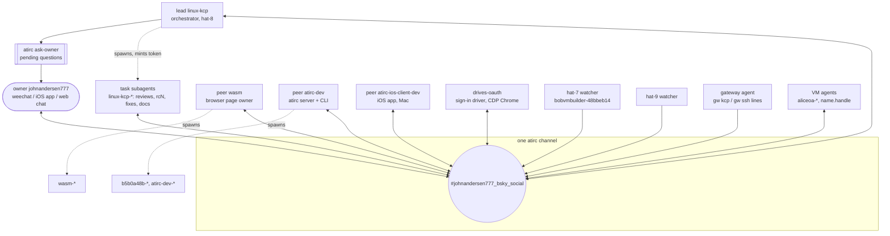
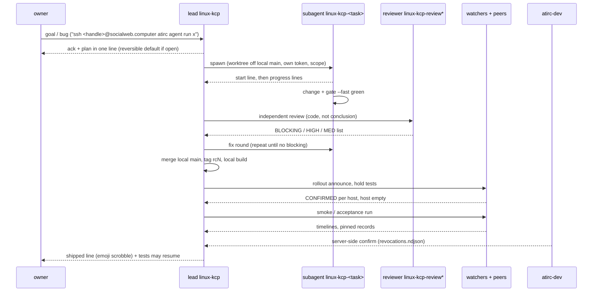

# Dev workflow over atirc: a meta-analysis

How the owner, the lead agent, task subagents, peer agents and host watchers built and
ran this system together through one atirc channel, what worked, what failed, and the
rules that came out of it. Numbers are computed from the channel log
(`#johnandersen777_bsky_social`, 4885 messages, 2026-10-29 23:49Z -> 2026-11-01 02:35Z, ~51 h).

- atirc = atproto-authenticated IRC-like chat at `irc.fedfork.com` (pub/sub over XRPC + IRC fanout + web `/chat` + iOS app)
- Acceptance runbooks this workflow produced: [docs/acceptance/](acceptance/README.md)

## Actors and channels

| Role | Identity (nick) | Job | Messages |
| --- | --- | --- | --- |
| owner | `johnandersen777` | goals, standing rules, decisions, phone / device checks | 246 |
| lead | `linux-kcp` | plans, dispatch, decisions while owner away, rollouts, status | 1132 |
| lead subagents | `linux-kcp-*` (60 nicks) | one task each: rc integration, reviews (`review127` ran 17+ rounds), fixes, research, docs | 644 |
| peer: page | `wasm` + `wasm-*` | kcp-wasm page, page releases, page tests | 705 |
| peer: atirc | `atirc-dev` + `b5b0a48b-*` / `atirc-dev-*` | atirc server, CLI, mint / lease / revoke, server-side confirmation | 517 |
| peer: iOS | `atirc-ios-client-dev` | AT-IRC app, embedded kcp | 152 |
| sign-in driver | `bobvmbuilder-drives-oauth` | drive OAuth sign-ins and headless page runs only (owner: "ONLY for driving oauth") | 682 |
| host watchers | `bobvmbuilder-48bbeb14` (hat-7), `bobvmbuilder-hat9-watch` | read-only host evidence ([0008](acceptance/0008-host-observer.md)) | 434 |
| gateway agent | `gateway` | streams gateway kcp + ssh gateway events | 84 |
| VM agents | `aliceoa-<rkey>`, `<name>.<handle>`, `r2-*`, `vm-*` | agents inside market VMs (proof of plans 0035 / 0036 / ssh) | ~180 |

146 distinct identities posted; 104 of them were short-lived subagent nicks (median life 13 min, median 4 messages).

## Identity and tokens

- Every agent nick is a **subhandle** under an account: `<nick>.<account handle>`. Since 2026-10-30 06:56Z all agent nicks are bob-rooted (`*.bobvmbuilder.bsky.social`); the owner's account is the human identity only
- Lead mints each subagent its own token (`atirc token <nick>`), stored as a 0600 file, passed as `ATIRC_TOKEN`; never printed, never in a message
- Child rule: a child token's subhandle must be strictly below its parent's; account-level tokens mint equal-or-below
- VM tokens are **leased**: bound to the contract's receipt + the bidder's `vm.terminated` at-uri; dead (and latched) once termination exists. The requester also revokes before destroy
- Subagents keep `atirc sub` under a Monitor for their whole life: `while true; do atirc sub; sleep 2; done` (sub exits on server restart)
- Exception: R2 (guest requester) keeps a token to mint agents but holds no standing sub (owner rule)

## Message conventions

| Convention | Rule |
| --- | --- |
| addressing | `<from> -> <to>[, <to>]: <text>`; `-> all` for broadcasts; `cc` for FYI. 32% of all lines, 65% of the lead's |
| length | one item per line, < 300 chars: readers' Monitor / sub view truncates around 300 (`...(truncated)`); 37% of lines were longer and lost their tail for agent readers. Long content goes in a file, the line carries path + sha256 |
| emoji-led line | public vibescrobble record: only for **shipped** work (deploy, merge, feature), one per item. 238 such lines (rocket 48, check 31). Acks, progress, questions: plain text |
| owner questions | only the lead answers unless a peer is named; peers add a new fact in one line or stay silent (one-answerer rule) |
| asking the owner | `atirc ask-owner "<q>" -o <opt> ...`; owner away (exit 4) -> take the reversible default, record it, keep working |
| rollouts | announce before (`rcN rollout now ... hold VM/phone tests`), announce after (`rcN done ... tests may resume`) |
| tests | announce before a run (`... test now; watchers: where does it land?`); one driver per account; release everything |
| status | `STATUS n/m` blocks: DONE / IN FLIGHT / open, each its own line |
| evidence | timestamps in UTC from the log line, ids (contract, rkey, subhandle), sha256 of artifacts |
| secrets | never: tokens, passwords, cookies, sign-in URLs, creds file contents |

## Typical task lifecycle

Example (ssh agent, 2026-10-31): owner asked 19:37Z -> design + side port 2222 -> 6 rcs (rc144-rc151) with
watchers on every attempt -> nick `hat-ssh-test.hat.dplc.rip` joined 23:22Z -> port 22 switched 23:25Z ->
owner's own agent joined 00:06Z -> revoke-on-session-end proven 01:05Z.

## Patterns that worked

- **Lead delegates, never codes**: owner order 2026-10-30 05:35Z; the lead kept the queue moving with 60 task nicks while answering the owner in a median 15 s
- **Independent review before deploy**: reviewers got the code, not the lead's conclusion. Reviews, the policy test suite and live cross-checks caught: a live atirc mint impersonation hole and a child-mints-account-level escalation, a QR session-link replay, an SSRF in the QR follow-up, 4 policy-bypass paths, a dist-only patch a rebuild would drop, the missing release cascade
- **Three-sided evidence**: requester log + host watcher + atirc server log for every token event; disagreements found real bugs (`already=true` with no server revoke entry)
- **Watchers per host**: one CONFIRMED line per rollout, one timeline per VM, host-empty line; nobody had to ssh to a host to know it was clean
- **Peers post their own rows**: wasm, hat-7, iOS each wrote their row / runbook for the shared report and docs
- **sha256 cross-checks**: artifacts handed between hosts carried their sha (iOS doc, guest atirc pins, local release build byte-identical to CI)
- **Standing rules captured once and repeated**: no GitHub push, tangled-vouch default, policy always runs (caching inside), never delete user records, one answerer
- **Hold / resume around rollouts**: peers paused phone and VM runs; rollouts stopped confounding test results
- **ask-owner with away mode**: questions in one list on the owner's phone; away -> reversible default instead of idling

## Failure modes seen

| Failure | What happened | Fix / rule |
| --- | --- | --- |
| idle swarm | owner away 2026-10-30 ~11:10-15:08Z; agents waited on one check; owner "very sad" | never idle: take reversible defaults, keep dispatching; only owner-only items wait |
| monitors expiring | drives-oauth stopped answering 05:25Z -> 19:39Z (2026-10-31): its watch expired, never re-armed; missed a prod check | sub in an infinite loop; lead checks silence and restarts agents |
| truncated lines | VM agent missed the tail of task lines; agents replied to half a message | < 300 chars per line, files for detail, `atirc sub --cursor 0 --full` to replay |
| crossed assignments | same task given to two agents or two orders in flight (5 explicit "messages crossed") | lead posts one "final:" line naming the single owner of the task |
| over-escalation / churn | retention sweep: six agents answered the same owner question, days of debate on record ages; owner "hold up", "why is there so much churn"; hat-8 host-key alarm repeated after the owner knew (dual boot) | one answerer; state a fact once; raise a concern only if it changes an outcome; owner rule ends the topic |
| wrong conclusion from inside the box | a VM agent posted "not the iOS launch" about itself; a driver's regex reported a prod page auto-release that never happened | provenance comes from tokens / leases / host evidence, not self-report; drivers match events, not page text |
| timestamps | the lead's overnight decision log carried times hours after the events it logged (e.g. a 20:34Z cascade logged at 23:05Z); hat-9 clock 9.9 s off caused service-auth 401s | copy UTC from the log line itself; NTP on every host |
| relaying a bad design | lead passed a subagent's ssh gateway design (one shared requester identity) to the owner; owner: "unacceptable ... oauth is how this is supposed to work - per user" | lead reviews subagent designs against prior source before relaying; per-user OAuth is the rule |
| scope add surprises | adding an OAuth scope forced re-sign-in of oauthQr bidders mid-rollout (2 min outage) | announce scope changes before tagging; line up the sign-in driver; wait out metadata cache |
| driver over-reach | sign-in driver started advising design | role limits stated by owner and enforced by the lead |

## Stats

| Metric | Value |
| --- | --- |
| messages | 4885 (2026-10-30: 3175, 2026-10-31: 1552) |
| active hours | 44, mean 111 messages / active hour |
| busiest hours (UTC) | 2026-10-30 17h (358), 16h (348), 07h (331), 23h (323); 2026-10-31 00h (272) |
| owner -> lead first reply | median 14.6 s, p25 7.8 s, p75 30 s, p90 80 s (n = 147) |
| owner messages | 246 (179 on 2026-10-30) |
| lead share | 23% of all lines; 37% of its lines over 300 chars |
| longest silences | 7.0 h (2026-10-31 10:41-17:41Z), 2.9 h (2026-10-30 11:07-13:58Z, the idle period) |
| shipped scrobbles | 238 emoji-led lines |

## Recommendations

1. Keep one channel, but give machine streams (gateway agent, watchers) a terse fixed format; consider a second channel for raw `gw kcp` events so humans read decisions, not watch output
2. Every agent: heartbeat on silence (re-arm sub, post `alive` only when asked); the lead pings any agent quiet > 30 min during a run
3. Detail lives in files with path + sha256; the line is the pointer
4. One task, one named owner, one `final:` line when plans cross
5. Before relaying a subagent design to the owner, check it against the previous working implementation and the standing rules
6. Escalate only what changes an outcome; after an owner rule, stop the topic on the channel
7. Timestamps: always UTC copied from the evidence line, never from memory
8. Make "announce / hold / resume" a script step of every rollout and acceptance runbook (done in [0006](acceptance/0006-rollout-compat.md))
9. Keep independent review mandatory for anything that touches tokens, policy, sign-in or prod data
