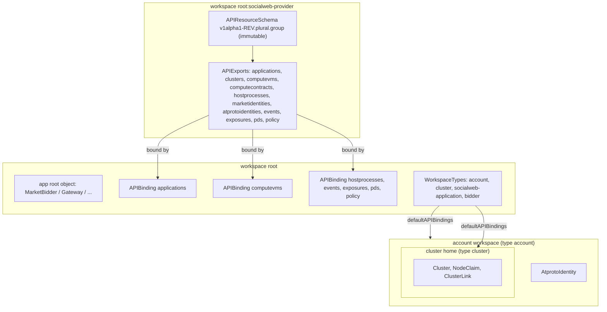
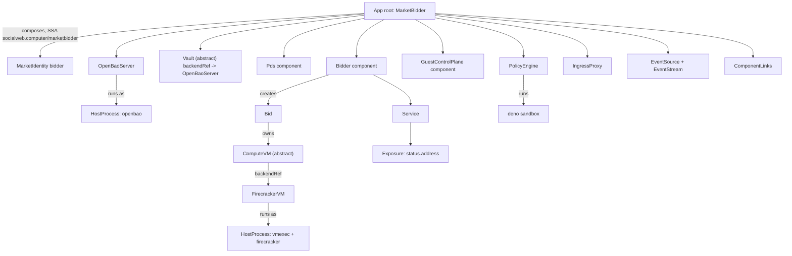
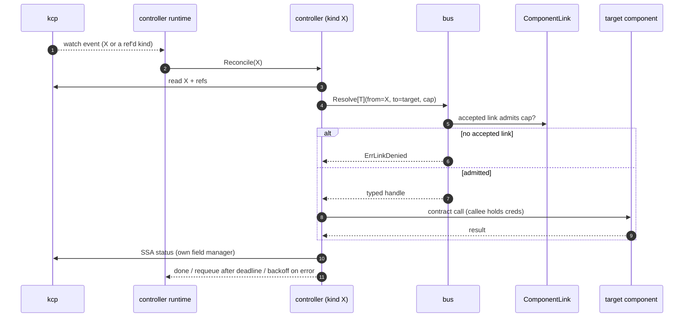
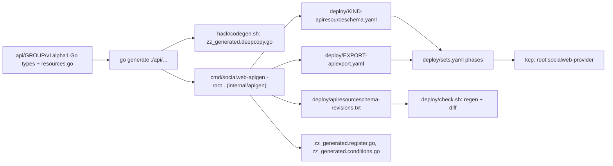

# KCP: how socialweb-computer uses kcp

- kcp = the state store, API server and composition layer of EVERY application, not shared infra
- companion of [SYSTEM.md](SYSTEM.md); decisions + measurements in [ARCHITECTURE.md](ARCHITECTURE.md) sections 0, 6, 12, 13
- source of truth for types: `api/*/v1alpha1`; for schemas and exports: generated files under `deploy/`

## kcp Is Part Of Each App

- application instance = its own kcp + a manifest set + a profile
- application state = kcp objects (ComputeVM, ComputeContract, NodeClaim, OpenBaoServer, HostProcess, component kinds, Service, Exposure, ...)
- components run in process in the core; third-party binaries are HostProcess units; both reconciled from objects
- apps talk to each other ONLY over the atproto market protocol. a shared kcp is composition + isolation, never a data channel
- only exception: tenant Kubernetes clusters of the Gateway use kcp the traditional way (home workspaces, bound exports, tenant k3s behind kcp)

### Which kcp, by profile

| profile | kcp | workspaces |
|---|---|---|
| prod gateway (`install gateway`) | strict kcp per app, blue/green slots | app root in `root`, provider in `root:socialweb-provider`, requester side in `root:app`, cluster homes |
| prod ssh gateway (`run gateway ssh`, standalone) | its own strict kcp on the gateway host | app root in `root` |
| prod bidder (`install bidder`, per handle) | strict kcp per handle, one slot | app root in `root` |
| CLI requester (`run request` without `--network`) | fresh kcp per invocation, state dir persists | app root in `root` |
| market network (`dev up --profile market-network`, CI, soak) | ONE kcp for every app | network in `root`, shared services `root:global` `root:relay` `root:alice` `root:bob`, each app `root:<app>`, its components `root:<app>:app`, child cores in `root:dev:<instance>-<app>` |
| browser page (kcp fork, js/wasm) | in-tab kcp, memory storage | requester root |
| iOS app (`pkg/embedded`) | in-process kcp + vault | requester root; snapshot bytes hold vault secrets in clear: store encrypted, never log |

- one manifest set serves both shapes: in the network the applier rebases every phase workspace under `root:<app>` (`kcpapply.Options.Base`); `root:*-provider` and sets of scope `kcp` stay shared
- service names in manifests: `<name>.default.{{.ServiceSuffix}}`
- a child app in a network has NO kcp or kine of its own; its core is a HostProcess placed by the network's devsup, scoped to `root:<app>`
- children learn the network from values copied onto their root objects and `valueFrom` refs to other workspaces

## The kcp Runtime: Slots, Front, Kine, Postgres

| piece | gateway | bidder | market network / dev |
|---|---|---|---|
| kcp binary | unpatched kcp-dev/kcp main, pinned asset (`versions.json` `assets.kcp`) | same | same |
| slots | blue/green `socialweb-kcp-gw@a`, `@b` | one slot per handle `socialweb-kcp-<hid>@a` | one slot |
| store | kine over postgres unit `socialweb-kcp-gw-pg` (unix socket) | kine over sqlite | kine |
| front | own L4 front `socialweb-kcp-gw-front` on 127.0.0.1:6443 (caddy -> kcp.socialweb.computer) | port-0 front | front under devsup |
| upgrade | roll: new slot beside old on same store, front flips after `/readyz`, old exits, Lease `kube-system/kcp-controllers` deleted so new slot leads at once; pg_dump before every roll | short restart | `dev roll kcp` |

- slots run `--enable-leader-election` and `--shard-base-url` = the front
- kcp release pairs whose storage versions or bootstrap schemas differ: planned short outage instead of a roll
- caddy stays public TLS only, never reconfigured by a swap
- `KcpInstallation` records the selected slot and the front backend
- operator commands: `units roll kcp` (installed host), `dev roll kcp` (dev), `dev restart <instance> core`
- memory caps: kcp slot 3 GiB (`kcpserver.SlotMemoryMax`), front 256 MiB, kine `kcpdatastore.KineMemoryMax`
- packages: `internal/kcpserver` (slots, kubeconfigs, member tokens, roll), `internal/kcpdatastore` (kine), `internal/apiserverfront` (fronts), `internal/lease/local` (slots, ports, rolls)
- tenant clusters reuse the pattern: per-cluster k3s slots a/b over kine over that cluster's postgres, behind a per-cluster front (`controlplane.json` records `activeSlot`)

## Workspaces, APIExports, APIBindings, WorkspaceTypes

- provider workspace `root:socialweb-provider` (type `universal`) holds every APIResourceSchema and APIExport
- apps bind the exports they need with APIBindings (`spec.reference.export.path: root:socialweb-provider`)
- WorkspaceTypes give new workspaces default bindings

### Exports

| export | resources (first ones) | bound by |
|---|---|---|
| `applications` | MarketNetwork, MarketBidder, MarketRequester, Gateway, SshGateway, component kinds, repos, leases, StateSync | `root` (`applications-binding.yaml`), `socialweb-application` type |
| `clusters` | Cluster, Node, NodeClaim, ClusterLink, ClusterClientCertificate | `cluster` type, `socialweb-application` type |
| `atprotoidentities` | AtprotoIdentity | `account` type, `socialweb-application` type |
| `marketidentities` | MarketIdentity, AtprotoRecord, AtprotoRecordWatch | gateway `root:app` (`deploy/apps/gateway`), application type |
| `computevms` | ComputeVM, FirecrackerVM, Bid, GuestIdentityGrant | `bidder` type, `root` (`computevms-binding.yaml`) |
| `computecontracts` | ComputeContract, ContractEvent, Infra, EphemeralInfra, InfraCollection, EphemeralInfraCollection | requester and gateway bindings |
| `hostprocesses` | HostProcess, Postgres, OpenBaoServer, RemoteOpenBao, Vault | `root` (`hostprocesses-binding.yaml`), `bidder` type |
| `events` | EventStream, EventSource, Pds/Relay/JetstreamEventSource | `root` (`events-binding.yaml`) |
| `exposures` | Service, Exposure, ComponentLink | `root` (`exposures-binding.yaml`) |
| `pds` | RemotePDS | `root` (`pds-binding.yaml`) |
| `policy` | PolicyEngine, PolicyWorkflow, PolicyWorkflowRun, PolicyTrigger | `root` (`policy-binding.yaml`) |

### WorkspaceTypes

| type | default bindings | child type | used for |
|---|---|---|---|
| `account` | atprotoidentities | `cluster` | gateway account home (DID to shard map) |
| `cluster` | clusters | | tenant cluster home workspace |
| `socialweb-application` | all eleven exports | | an application workspace |
| `bidder` | computevms, hostprocesses | | bidder workspace |
| `dev-instances` / `dev-instance` | | `dev-instance` only | `root:dev` and `root:dev:<instance>` of a dev host |

- never use kcp's shipped home (`~`): a bare LogicalCluster that can never be deleted

### Manifest sets

- `deploy/sets.yaml`: named sets of ordered phases; each phase = workspace + files + `after` waits (Workspace Ready, APIExport IdentityValid, APIBinding Ready)
- sets: `provider` (scope kcp: provider workspace, schemas, exports, root bindings, WorkspaceTypes), `bidder`, `hostprocesses`, `dev-host`, grants
- per-app sets: `deploy/apps/{gateway,market-bidder,market-requester,ssh-gateway,repo-pds}` (vault, RBAC, extra bindings, iroh dialer, association watch)
- market network: `deploy/market-network/` (workspaces, network vault, peers RBAC)
- applied by `socialweb-computer apply` / `internal/controllers/runtime/kcpapply`
- every app root re-renders its set's HostProcesses and OpenBaoServers each pass; a missing or Lost one voids the applied-set shortcut and the set is applied again

## The Component Runtime

- one core process per instance (`internal/stack/componentcore`) = controller manager + component runtime + HostProcess supervisor
- component kinds (Bidder, Requester, Pds, Plc, Relay, GuestControlPlane, IngressProxy, DispatcherTLS, GatewayAPI, SshServer, PolicyEngine) are objects; `internal/controllers/component` reconciles each into a running instance in `internal/component`
- a component never listens itself: it registers handlers; a Service names component + handler; an Exposure publishes the Service
- local Exposure port comes from the core's port registry (`<state>/ports/ports.json`, 64-port block of 20000-29999 by state dir), survives a core restart, reported in `status.address`
- HostProcess = a systemd user unit (or proc backend) for a third-party binary; followed via D-Bus signals; adopted across core restarts by unit name + InvocationID
- what a HostProcess runs: kcp slots, kine, postgres, OpenBao, fronts, dumbpipe/iroh dialer, firecracker via `socialweb-vmexec`, child cores (market network), deno for policy
- suspend: root `spec.suspend` stops participation, never a process; per component `spec.components[].suspend` stops that process

## Controllers Pattern

- one reconciler per kind: `internal/controllers/<kind>` on `internal/controllers/runtime` (the only home of the dynamic client and unstructured)
- kcp multicluster: every core runs the manager for its own workspaces; a root reconciles only roots of its core's base workspace
- no polling. driven by watches on own kind + every kind it refs
  - deadlines: delayed requeue
  - errors: rate-limited backoff
  - ticker only for an outbound obligation listed in `deploy/obligations.txt` (owner + period)
  - systemd units via D-Bus signals, processes via wait
- writers rule (every write = server-side apply, field manager `socialweb.computer/<controller>`):
  - a spec is written only by its composer
  - a status only by the controller of its kind
  - a field another controller reports = its own status subfield + own field manager (e.g. ComputeVM `status.market.guest` by guestcontrolplane)
  - every child/intent object has an ownerReference to its composer or creator
  - no annotation carries a control signal (release = `spec.release`, restart = `spec.restartedAt`)
  - a child edited by another manager is re-applied with force and a `ChildEditReverted` Warning Event
- cross-workspace children cannot carry ownerReferences: they carry root labels (`apps.socialweb.computer/root`, `root-kind`, `root-cluster`), pruned by label, torn down before the root's finalizer goes
- abstract kinds (AtprotoRepo, Vault, ComputeVM, EventSource): `spec.backendRef` to one concrete kind with label `contracts.socialweb.computer/<abstract>`; abstract status mirrors backend; conditions `Ready` + `BackendBound`
- gate: `scripts/check-architecture.sh` (`hack/archcheck`) enforces layers, obligations, bus callers, no GVR literals outside `api/`, no annotation signals, `apigen:"userEndpoint"` on spec endpoints

### Bus and ComponentLinks

- `bus.Resolve[T](ctx, b, from, to, capability)` -> typed contract handle
- caller = the reconciled object or the component instance, never a controller; System only for `deploy/bus-bootstrap-callers.txt`
- the callee holds credentials; a handle never exposes a token
- a call with no Accepted ComponentLink fails `ErrLinkDenied`
- ComponentLink lives in the target's workspace: `spec.from` (ref or selector), `spec.to`, `spec.capabilities` (name + scope), `spec.suspend`
- capabilities: `xrpc.call`, `stream.dial`, `policy.run`, `vault.*`, `repo.*`, `pds.*`, `pds.serviceauth`, `events.*`
- roots generate links from component refs in their desired specs (`internal/app/compose/links.go`) and wait for Accepted before calling
- bound signals: `NotifyBound` (e.g. vault provider) wakes waiters without polling; binding fingerprint includes readiness

### StateSync and remote access

- StateSync = durable outbox: source, sink, direction, payload, idempotencyKey, conflict + deletion policy (`Retain`, `DeleteRemote`, `AckThenDelete`), ack, retry
- observe is the authority; Acked only when the observation matches the desired hash; status never holds secrets or payload bytes
- examples: bidder `vm.terminated` before teardown (finalizer waits for Acked); market inbox syncs pruned at 10 min
- RemoteOpenBao: vault access separate from a server's lifecycle; probes health/seal, authenticates, checks mounts; never writes the remote vault

## API Resource Catalog

- every kind is cluster-scoped (kcp workspaces are the isolation; apigen writes `scope: Cluster`)
- schema name: `v1alpha1-<rev>.<plural>.<group>`; rev = value in `resources.go` when this doc was written (source of truth: the file)
- "composer" = who writes spec; status is always the kind's own controller unless noted
- "operator-applied" = has a controller but no Go composer: applied from manifests or kubectl

### App roots (group `socialweb.computer`, export `applications`)

| kind | rev | purpose | composer |
|---|---|---|---|
| MarketNetwork | 31 | a whole local market in one kcp: shared services + child roots | `dev up` |
| MarketBidder | 43 | bidder app: profile, identity, comms, ingress, policy, guestNetwork, firecracker, kcp | `install bidder` / `run bidder` / network |
| MarketRequester | 37 | requester app: identity, comms, secretsFallback, atircParentRef, ingress | `run request` / page / iOS / network |
| Gateway | 38 | hosted k8s: webAppFront, clusterProvider, operator, marketNetwork | `install gateway` / network |
| SshGateway | 35 | ssh as yourself: ssh options, owner sessions, per-user requesters | `run gateway ssh` / network |
| ChildApplication | 2 | placement of a child app in a network (networkRef, app, profile) | operator-applied (no Go composer) |

### Components (`socialweb.computer`, export `applications`)

| kind | rev | purpose | composer |
|---|---|---|---|
| Bidder | 24 | market bidder participant | MarketBidder |
| Requester | 29 | contract runner (RFP, accept, secrets, atirc, release) | MarketRequester, Gateway, SshGateway |
| GuestControlPlane | 11 | guest endpoints at 192.0.2.1 (events, downloads, identity proxy) | MarketBidder |
| Pds | 12 | local PDS (localRepo identities, network PDSes) | roots |
| Plc | 11 | local PLC directory | MarketNetwork |
| Relay | 11 | local atproto relay | MarketNetwork |
| IngressProxy | 12 | did:key / iroh / opentunnel ingress to the app's XRPC | roots |
| DispatcherTLS | 11 | TLS front for the network dispatcher | MarketNetwork |
| GatewayAPI | 16 | k8s.socialweb.computer web app + tenant API | Gateway |
| SshServer | 17 | ssh server, web sign-in, keys API | SshGateway |
| MarketPresence | 2 | bidder offering presence with TTL | Bidder; adopted by its root |

### Market and contracts

| kind | group / export | rev | purpose | composer |
|---|---|---|---|---|
| ComputeContract | socialweb.computer / computecontracts | 31 | one rental: spec (vm, tunnels, secretsRef, agent, association, policy), status.contract flow state | CLI, page, Infra, ssh session, NodeClaim |
| ContractEvent | / computecontracts | 5 | one guest/requester event (sealed signals, secrets), owned by its contract | CLI, page (outbound); Requester (inbound) |
| Infra | / computecontracts | 13 | durable set of contracts + nodes + secrets, mirrored to `computer.socialweb.infra` | owner, NodeClaim controller |
| EphemeralInfra | / computecontracts | 13 | Infra with TTL / endWhen | owner |
| InfraCollection | / computecontracts | 1 | one Infra child per `computer.socialweb.infra` record in a repo | owner |
| EphemeralInfraCollection | / computecontracts | 1 | same for `ephemeralInfra` | owner |
| Bid | socialweb.computer / computevms | 9 | one bid per RFP (name = bid rkey); owns its ComputeVM; status by bidder | Bidder |
| ComputeVM | / computevms | 17 | abstract VM: size, owner, requester, userData ref, contract refs, release | Bidder |
| FirecrackerVM | / computevms | 7 | concrete firecracker backend (unit, network, image) | ComputeVM controller |
| GuestIdentityGrant | / computevms | 3 | guest workload identity grant (entity, api, scopes, claims) | Bidder, GuestControlPlane |
| StateSync | socialweb.computer / applications | 1 | durable outbox (vm.terminated, market inbox) | roles, controllers |

### Identity, repos, records

| kind | group / export | rev | purpose | composer |
|---|---|---|---|---|
| MarketIdentity | socialweb.computer / marketidentities | 15 | app identity: mode (localRepo, pdsAccount, oauthQr, oauthBrowser, oauthDelegated, oauthSessionProxy), associations, pendingAction | roots, SshGateway session owners |
| AtprotoRecord | / marketidentities | 7 | one record to keep in a repo (collection, rkey, swapCid, deletionPolicy) | roots, Infra |
| AtprotoRecordWatch | / marketidentities | 7 | watch rkeys of a collection (associations, vouches) | app sets (`repo-pds`) |
| AtprotoIdentity | socialweb.computer / atprotoidentities | 2 | DID to identity mapping in an account home | gateway |
| AtprotoRepo | / applications | 4 | abstract repo: did, head, rev, writable, address | roots |
| LocalRepo | / applications | 2 | repo on a Pds component (signer handle, no token) | roots |
| RemoteRepo | / applications | 2 | repo on a RemotePDS via a MarketIdentity lease | roots |
| AtprotoSession | / applications | 2 | a session of an account on a PDS | roots (`compose/repo.go`) |
| PdsAccount | / applications | 2 | an account on a Pds component | roots |
| PlcIdentity | / applications | 1 | a DID on the local Plc | roots |
| RemotePDS | pds.socialweb.computer / pds | 3 | a remote PDS endpoint + auth + capabilities | roots |

### Vault and host

| kind | group / export | rev | purpose | composer |
|---|---|---|---|---|
| HostProcess | socialweb.computer / hostprocesses | 4 | a host unit for a third-party binary; status.listeners | roots, controllers |
| Postgres | / hostprocesses | 1 | embedded postgres (kcp store, cluster store, vault store) | gateway, cluster provider |
| OpenBaoServer | / hostprocesses | 11 | local OpenBao: mounts, policies, clients; unseal keys in a 0600 file, root token revoked | roots |
| RemoteOpenBao | / hostprocesses | 4 | access to an existing OpenBao (token / AppRole, https) | roots |
| Vault | / hostprocesses | 1 | abstract vault: address, ready, caBundle | roots |
| VaultCredential | / applications | 2 | a credential held in a vault for a repo account | roots (`compose/repo.go`) |
| VaultCertificate | / applications | 2 | a PKI certificate (vault, mount, role, commonName) | operator-applied |
| KcpInstallation | / applications | 1 | selected kcp slot + front backend | operator-applied |
| HostInstall | / applications | 1 | installed account, version, profile | operator-applied |
| HostRelease | / applications | 1 | installed release version + prune | operator-applied |
| PortLease | / applications | 2 | a leased port (cluster, purpose, port) | MarketNetwork |
| SubnetLease | / applications | 2 | a leased subnet (cluster, purpose, prefix) | operator-applied |

### Tenant clusters (export `clusters`)

| kind | rev | purpose | composer |
|---|---|---|---|
| Cluster | 5 | mount object: status.URL, phase, Draining, nodeExpiry | cluster provider (from XRPC) |
| Node | 2 | one node; the bound on leaks | node provider |
| NodeClaim | 16 | one market node for a cluster; status.contract mirrors the ComputeContract | cluster provider (spec), NodeClaim controller (status) |
| ClusterLink | 2 | iroh listener in front of a cluster apiserver or vault | cluster provider |
| ClusterClientCertificate | 2 | client cert record per DID (serial, notAfter, revoked) | gateway |
| ClusterRoll | 2 | control-plane roll of a cluster (strategy, maxUnavailable) | operator-applied |

### Exposure (group `exposure.socialweb.computer`, export `exposures`)

| kind | rev | purpose | composer |
|---|---|---|---|
| Service | 2 | names a component + handler (+ protocol, auth) | roots |
| Exposure | 5 | publishes a Service: local port, hostname/path, ingress; status.address | roots |
| ComponentLink | 3 | admits bus calls from -> to with capabilities | roots (`compose/links.go`) |

### Events (group `events.socialweb.computer`, export `events`)

| kind | rev | purpose | composer |
|---|---|---|---|
| EventSource | 1 | abstract source: cursor, lag, address | roots |
| PdsEventSource | 1 | subscribeRepos of an AtprotoRepo | roots |
| RelayEventSource | 1 | a relay subscribeRepos (Relay ref or URL) | roots |
| JetstreamEventSource | 1 | a Jetstream (v1 or v2) | roots |
| EventStream | 7 | filter (collections, dids) + cursor + sink over one EventSource; `spec.resume` Live / Recent | roots, requester composer |
| RelayStatus | 2 (`socialweb.computer`) | status of a Relay | roots (`compose/repo.go`) |

### Policy (group `policy.socialweb.computer`, export `policy`)

| kind | rev | purpose | composer |
|---|---|---|---|
| PolicyEngine | 3 | the engine component: limits, trust, cache, sandbox, bundled actions | roots |
| PolicyWorkflow | 2 | a workflow (inline or record ref) + defaults | roots |
| PolicyWorkflowRun | 3 | one decision run: perspective, self/subject/counterparty DIDs, rfp/bid/accept, cache | roles |
| PolicyTrigger | 2 | run a workflow on matching source events | roots |

## Schema Revisions

- kcp holds `APIResourceSchema.spec` IMMUTABLE: an update under the same name is Forbidden
- so each schema is named `v1alpha1-<Revision>.<plural>.<group>`; Revision per kind in `api/*/v1alpha1/resources.go`
- `deploy/apiresourceschema-revisions.txt` = revision lock: every name ever generated + sha256 of its spec, append-only, `merge=union`
- change a Go type without bumping Revision -> generation fails -> `deploy/check.sh` fails before any host sees it
- migration = the manifest set applies the new schema, then the re-pointed export; already-bound APIBindings move to the new schema in seconds, identity hash unchanged, stored objects untouched. no binding deleted
- old schemas stay in kcp, harmless

### Burned revisions

- a revision applied to a prod kcp is taken forever, even if the branch that made it is reverted
- reverted branch -> its lock line is gone -> the generator may hand out the same number with a different spec -> prod kcp refuses the apply -> core crash loop
- known burned on prod:
  - Requester `v1alpha1-28` (lock now records 28 and 29 with the same spec)
  - MarketRequester `v1alpha1-38` (NOT in the lock: the next MarketRequester bump must be 39)
- rule: before a bump, check the burned list; after a revert of a shipped schema, keep its lock line
- fix for a crash loop: roll back the binary, bump to a fresh revision, roll forward

## apigen And Codegen

- Go types are the ONLY source of every schema; nothing else writes the outputs
- mapping (no kubebuilder markers: the no-comments rule):
  - struct layout from `encoding/json` tags; `required` = no `omitempty` unless `apigen:"optional"`
  - enums from source: typed string constants in declaration order; a named string type with no constants = error
  - struct tags: `apigen:"enum=a|b"`, `default=`, `minimum=`, `userEndpoint` (required on endpoint fields in spec)
  - `metav1.Condition` items open; unknown fields are an error in `apigen.Model.Validate`
- abstract contracts: `APIResource.Contracts` adds the label `contracts.socialweb.computer/<abstract>` to the concrete schema
- printer columns from `APIResource.PrinterColumns`
- checks: `deploy/check.sh --fast` regenerates into a scratch dir and diffs every file `socialweb-apigen -root . -list` names; `go generate ./...` must leave `api`, `internal/atproto/market`, `deploy` unchanged
- rebase conflicts: `scripts/regen-after-rebase.sh`; never hand-merge generated output; resolve generator inputs by hand first
- lexicons: `internal/lexgen` generates market record Go from `lexicons/`

## See Also

- [SYSTEM.md](SYSTEM.md): the whole system
- [ARCHITECTURE.md](ARCHITECTURE.md): section 0 (kcp per app), 6 (CRDs, generation, revisions), 12 (layout, bus, roots), 13 (invariants)
- [../deploy/market-network/README.md](../deploy/market-network/README.md): the one-kcp network
- `deploy/sets.yaml`, `deploy/workspacetype-*.yaml`, `deploy/*-apiexport.yaml`
