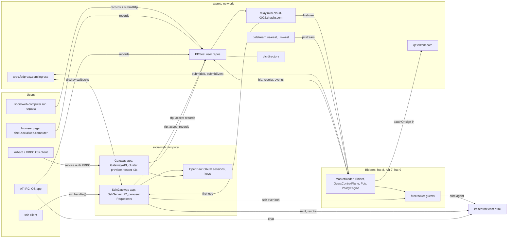
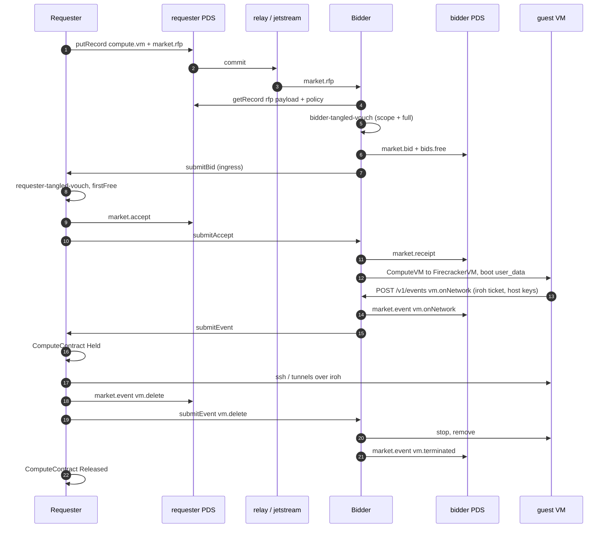
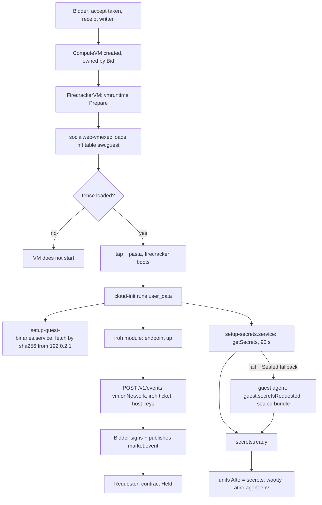
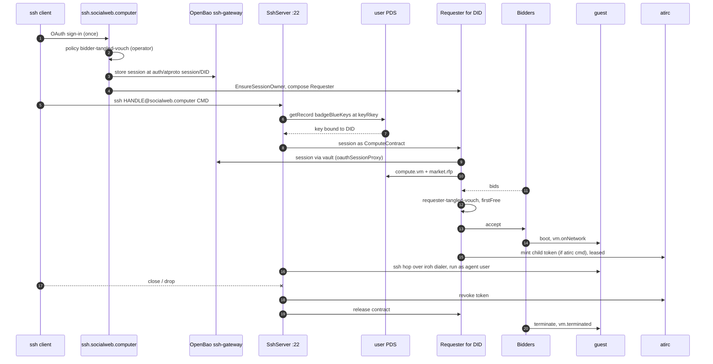
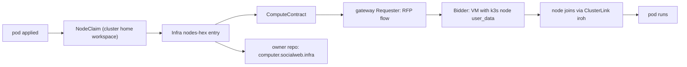

# SYSTEM: socialweb-computer, the whole system

- one page map of every component, repo, host and flow
- deep dives: [KCP.md](KCP.md) (kcp, workspaces, API catalog), [protocol/README.md](protocol/README.md) (every lexicon, its use and its step in the sequence), [ARCHITECTURE.md](ARCHITECTURE.md) (decisions, invariants; open by heading)
- rules for agents: [../AGENTS.md](../AGENTS.md)
- no history here. what was done when: git log, `docs/plans/*.yaml`

## What It Is

socialweb-computer is a compute market on atproto. A requester posts a signed RFP record to its own
atproto repo; bidders (hosts that run firecracker VMs) see it on the firehose, bid with records in their
own repos, the requester accepts one bid, and the winner boots a VM from cloud-init `user_data`. The
requester reaches the guest over iroh (plus opt-in opentunnel https and webrtc). On top of the market sit
products: ssh into a fresh VM as yourself (`ssh <handle>@socialweb.computer`), tenant Kubernetes clusters
that scale nodes from zero by renting market VMs, a browser page and an iPhone app that run a requester
in process, and atirc agents that join a chat channel from inside a VM. Every application is a kcp of its
own (or a workspace of one shared kcp in a market network); state is kcp objects; secrets live only in
the application's own OpenBao.

## Repos

| repo | upstream | role | where it runs |
|---|---|---|---|
| socialweb-computer-kcp | https://github.com/publicdomainrelay/socialweb-computer-kcp | the monorepo: Go core `socialweb-computer`, guest agent, vmexec, apigen, lexicons, manifests, policy actions, socialweb-meshd (rust) | gateway host, every bidder, CLI users, guests (guest tools), wasm page and iOS app (as a library) |
| kcp fork | https://github.com/johnandersen777/kcp | kcp built for js/wasm with memory storage; builds the browser page (`socialweb-wasm/`, `page-rcN` tags) | shell.socialweb.computer (browser) |
| kcp upstream | https://github.com/kcp-dev/kcp | native kcp asset, unpatched, built from main and pinned in `internal/versions/versions.json` | gateway, bidders, CLI requesters, market networks |
| indigo | https://github.com/bluesky-social/indigo | atproto Go libs (repo, MST, xrpc, identity), Go module dependency; local checkout for reading | linked into socialweb-computer |
| atirc | `git@tangled.org:did:plc:vtad4w7ujsvz7t6o6iuvmhjq` | atproto IRC: channels, subhandle tokens (mint, revoke, lease), agents, web chat, send/recv pipe | irc.fedfork.com server; `atirc` CLI in guests and on operator hosts |
| AT-IRC iOS app | local only (`atirc-client-ios`) | iPhone chat client; embeds `pkg/embedded` (in-process kcp + requester) to launch VM agents | iPhone |
| did-key-associator | local only (frozen TS, copy also in monorepo history) | qr.fedfork.com: OAuth QR session-transfer page for headless identities (`oauthQr`) | qr.fedfork.com |
| atproto-reverse-proxy | https://github.com/publicdomainrelay/atproto-reverse-proxy | fedproxy.com ingress: legacy deno relay, ssh relay, caddy; the Go ingress relay from this monorepo runs as a drop-in | fedproxy.com |
| typescript-helpers | https://github.com/publicdomainrelay/typescript-helpers | frozen TS helpers (event streams, abc, cli-args-env); reference only | nowhere live |

## Hosts And Roles

| host | role | runs | public names |
|---|---|---|---|
| socialweb.computer | gateway host | Gateway app (kcp 1): GatewayAPI web app, cluster provider, tenant k3s control planes, k8s requester; SshGateway app (kcp 2): Go ssh server on :22, per-user Requesters; caddy 443; host sshd on 1997 | k8s.socialweb.computer, kcp.socialweb.computer, ssh.socialweb.computer |
| hat-8 | "local" bidder + operator/lead host | MarketBidder (account `swc-bidder`), dev market networks, builds, deploy scripts | none (requestCrawl to relay) |
| hat-7 | bidder | MarketBidder (bob, `oauthQr` identity) | none |
| hat-9 | bidder | MarketBidder | none |
| irc.fedfork.com | atirc | atirc server, `atirc-iroh.service`, `/chat` web client | irc.fedfork.com, `did:web:irc.fedfork.com#atirc` |
| fedproxy.com | did:key xrpc ingress | Go `internal ingress-relay` (caddy drop-in `30-go.conf` of `xrpc-relay-server.service`), ssh relay :2222 | xrpc.fedproxy.com, `*.fedproxy.com` |
| relay.mini-cloud-0002.chadig.com | atproto relay | Go `internal atproto-relay` (127.0.0.1:2584 behind caddy) | firehose source, bidders requestCrawl here |
| qr.fedfork.com | OAuth QR | did-key-associator backend | qr.fedfork.com |
| shell.socialweb.computer | static page | wasm kcp + requester in the browser tab | shell.socialweb.computer |
| iPhone | client | AT-IRC app, embedded requester | none |

- every listener behind the edge binds port 0 and reports its address into kcp status
- only stable public entry points keep fixed ports: caddy 443, gateway kcp front 127.0.0.1:6443, GatewayAPI web-app front 127.0.0.1:8788, ssh 22
- prod installs run from the operator host over ssh. CI never deploys

## System Context

## Applications

- one root object per application, in its own kcp (prod) or its own workspace `root:<app>` (market network)
- the core (`socialweb-computer` process) runs the root's composition controller (`internal/app/<root>`), every controller, the component runtime and the HostProcess supervisor
- components run in process; third-party binaries (kcp, kine, OpenBao, dumbpipe, firecracker via vmexec, deno for policy) are HostProcess units

| root kind | CLI | composes (main children) | role |
|---|---|---|---|
| MarketBidder | `run bidder`, `install bidder` | Bidder, GuestControlPlane, Pds (localRepo mode) or RemotePDS (OAuth), PolicyEngine, OpenBaoServer, IngressProxy, MarketIdentity, EventStreams, ComputeVM/FirecrackerVM (per contract) | sells VMs |
| MarketRequester | `run request` | Requester, PolicyEngine, OpenBaoServer, Pds (localRepo) or OAuth identity, IngressProxy, MarketIdentity, EventStreams, ComputeContract | rents VMs; one fresh kcp per invocation, state dir persists |
| Gateway | `serve gateway kcp`, `install gateway` | GatewayAPI, Requester, PolicyEngine, OpenBaoServer, cluster provider, MarketIdentity (alice requester), Infra per cluster | hosted tenant k8s clusters |
| SshGateway | `run gateway ssh` | SshServer, per-DID Requesters, PolicyEngine, OpenBaoServer `ssh-gateway`, iroh dialer HostProcess, session-owner MarketIdentities, Exposures | ssh as yourself into a fresh VM |
| MarketNetwork | `dev up --profile market-network` | Plc, Relay, Pds alice/bob, IngressProxy dispatcher, DispatcherTLS, PolicyEngine, OpenBaoServer `network` (PKI), child roots (bidders, gateway, requesters, ssh gateways) | dev/CI/soak: a whole local market in one kcp |

### Components (in-process kinds)

| component | package | does |
|---|---|---|
| Bidder | `internal/services/bidder`, `internal/market/bidder` | reads RFPs, runs policy, bids (`bids.free`), takes accepts, writes receipts, creates ComputeVMs, publishes vm events |
| GuestControlPlane | `internal/services/guestcontrolplane` | guest-facing endpoints at `http://192.0.2.1:<port>`: OpenBao allow-list proxy (workload identity), `POST /v1/events`, `GET /v1/downloads/<sha256>/<name>`, `compute.guest.subscribeEvents` |
| Requester | `internal/services/requester`, `internal/market/requester` | runs each ComputeContract: RFP, bid window, accept, receipt, network, secrets, atirc mint/revoke, release |
| Pds | `internal/services/pds`, `internal/pds/local` | a local PDS for an identity without a real account (localRepo) |
| Plc, Relay | `internal/services/plc`, `internal/services/relay` | network-local PLC and relay (market network) |
| IngressProxy | `internal/services/ingressproxy` | did:key ingress to the app's XRPC (`xrpc-subscription`, iroh or opentunnel provider); default host `xrpc.fedproxy.com` |
| DispatcherTLS | `internal/services/dispatchertls` | TLS front of the market network dispatcher |
| GatewayAPI | `internal/services/gatewayapi`, `internal/gatewayhttp` | k8s.socialweb.computer: `/oauth/*`, `/session`, `/api/*`, `/xrpc/computer.socialweb.k8s.*`, `/downloads/*` |
| SshServer | `internal/services/sshserver` | ssh on :22, web sign-in at `/`, `/keys`, session owners, per-session contracts |
| PolicyEngine | `internal/policyengine` | gha-lite workflows in embedded deno; bundled actions `bundled-actions/tangy/` |

## Market Protocol

- lexicons: `lexicons/` (NSID prefix `com.publicdomainrelay.temp.`)
- every lexicon, field by field, with its sequence step: [protocol/README.md](protocol/README.md)
- applications talk ONLY over this protocol. a shared kcp is never a data channel

### Records

| record | written by | in repo of | purpose |
|---|---|---|---|
| `compute.vm` | requester | requester | the VM asked for (size, role) |
| `market.rfp` | requester | requester | signed request for proposals; strongRefs vm payload + policy; callbacks submitBid/submitEvent |
| `market.offering`, `market.heartbeat` | bidder | bidder | what the bidder sells; liveness. offering at rkey `self` |
| `market.bid` + `market.bids.free` / `bids.x402` | bidder | bidder | bid envelope + payload. rkey `market.BidRKey` (one bid per RFP) |
| `market.accept` | requester | requester | the chosen bid (no payload record) |
| `market.receipt` | bidder | bidder | bidder took the accept; payload = the RFP compute.vm ref |
| `market.event` + `compute.events.vm.*`, `compute.events.guest.*` | both | sender | lifecycle: vm.hostKeys, vm.onNetwork, vm.delete, vm.terminated, guest.* |
| `market.association`, `market.associationRequest` | requester | requester / guest requester | contract-scoped association (guest requester R2) |
| `badgeBlueKeys` | operator / user | operator / user | key claims: bidder association (`bidder_associate`), requester association, ssh key claims |
| `sh.tangled.graph.vouch` | operators, users | voucher | trust edge read by tangled-vouch policies |
| `computer.socialweb.infra`, `computer.socialweb.ephemeralInfra` | the owner's kcp (infra controller: CLI, gateway, page, iOS) | owner | the record of an Infra / EphemeralInfra object (two-way sync); per-account index at rkey `self`; never deleted ([protocol/infra.md](protocol/infra.md)) |

### XRPC

| method | served by | caller |
|---|---|---|
| `market.submitRfp` | bidder ingress | requester (push path); 409 `RFPClosed` after the window |
| `market.submitBid` | requester ingress | bidder |
| `market.submitAccept` | bidder ingress | requester |
| `market.submitEvent` | both ingresses | either side |
| `compute.secrets.getSecrets/<contract>` | requester ingress | guest `setup-secrets.service` (workload identity token) |
| `compute.guest.subscribeEvents` | GuestControlPlane | guest agent (WebSocket, cursor, 25 s keepalive) |
| `computer.socialweb.k8s.*` | GatewayAPI | cluster owners (service auth, aud `did:web:k8s.socialweb.computer`) |

### Comms modes

- `spec.comms.mode`: `XRPC` (ingress only), `Firehose` (no inbound endpoint), `Both` (requester default)
- event sources (Firehose/Both): network relay or `relay.mini-cloud-0002.chadig.com`, Jetstream v2 us-east/us-west
- server-side filter: `wantedCollections`, `wantedDids`; client filter always runs too
- requester stream carries `market.bid`, `market.receipt`, `market.event`; bidder stream `market.rfp`, `market.accept`, `market.event`
- payload records are read through the strongRef (getRecord), never taken as stream input
- dedup: one sink per role drops a `uri|cid` seen in the last 15 s
- addressee index: requester keeps only records about its own ComputeContracts; bidder only RFPs, accepts of its bids, events of its receipts. rest counted as `market_foreign_dropped`

### Selection

- bid window: 10 min from RFP `createdAt` (`market.RFPBidWindow`)
- bidder bids once per RFP (Bid object name = rkey)
- requester picks, recorded in `status.chosen.reason`:
  - `firstFree`: first policy-allowed free bid ends the window (the normal case; fastest bidder wins)
  - `bestWithinWindow`: lowest cost after the window
  - `policy`: best within window, confirmed by the RFP's attached policy
  - `resumed`: restarted runner picked up a prior choice
- `status.bids` keeps at most 20 `{did, uri, offer, cost, verdict, arrivedAt}`

### Policies

- a market policy ALWAYS runs, both sides, both lanes (scope + full), every decision. no skip paths
- defaults: `bidder-tangled-vouch` (bidder), `requester-tangled-vouch` (requester). `open` only when named, never prod
- tangled-vouch: counterparty must be vouched (`sh.tangled.graph.vouch`) by the operator; both directions needed for a deal
- bidder full lane = own workflow + every policy the RFP attaches; allow only if all allow
- caching lives inside the engine run (`cache-key` over workflow, mode, perspective, DIDs, records, args). never across parties, never a skip
- missing engine, evaluator or non-boolean `allow` = deny

### Market sequence

### ComputeContract phases

- `Pending` -> `Requesting` -> `Held` -> `Releasing` -> `Released`; or `Failed`
- `status.contract`: strongRefs rfp/bid/accept/receipt, winner, vmAddress (iroh), hostKeys, networks, release, termination, timestamps
- every write lands before the flow moves on; a restarted runner resumes from the recorded stage
- release: `spec.releaseRequestedAt` (SSA, release manager), outcome in `status.release.requestedAt`; retried 6x, 1 s doubling to 30 s
- a release whose vm.delete keeps failing settles Released once the bidder's vm.terminated appears

## Guests

### Boot

- the RFP flow is the ONLY way a guest comes up. no hand-started VM, no agent install outside cloud-init
- `user_data` built by `BuildUserData` + module registry (`internal/atproto/cloudinit`)
- requester modules carry config only; bidder adds `setup-guest-binaries.service` (`internal/guestseed`)
- binaries come from the bidder's GuestControlPlane `GET /v1/downloads/<sha256>/<name>`, sha256 checked, installed to `/usr/local/bin`. never GitHub/GHCR from a guest
- downloads = release asset `socialweb-guest-downloads`: opentunnel, wootty, atirc, socialweb-guest-agent
- opt-in `spec.guestTools: [socialweb-computer]`: bidder serves its own binary (linux/amd64 only)
- guest image: `firecracker-x86_64`, pinned by sha256 in `internal/versions/versions.json`, from `guest-images/<target>/<sha256>` in the public bucket

### Transports (three, never add one)

| transport | default | how |
|---|---|---|
| iroh | required, every guest | requester ssh + `status.contract.vmAddress`; contract Held on iroh address + host keys |
| opentunnel | opt-in per `spec.tunnels[]` | https URL per tag to guest `127.0.0.1:<port>`; `vm.onNetwork` kind `https`; optional wootty shell |
| webrtc | opt-in per `spec.tunnels[]` | guest agent bridges datachannel tag to `127.0.0.1:<port>`; STUN `stun.cloudflare.com:3478`, no TURN; `run request proxy`, `ssh --transport webrtc` |

- signaling sealed: age-x25519 `guest.publicKey` per tag, offer/answer sealed. no key, SDP, ICE or IP in any record, object or log
- browser shell: ssh over webrtc first, wootty fallback

### Fence

- nf_tables bridge table `swcguest` loaded before the tap exists (`internal/guestnet`)
- allowed from guest: TCP to `192.0.2.1` only on ComputeVM `spec.hostPorts`; DNS to pasta gateway; ICMPv6 RD/ND
- dropped: host's own addresses, guest link, RFC1918, CGNAT, loopback, link-local, multicast, ULA; every ethertype but IPv4/IPv6/ARP
- `lanUDP` (default on): UDP 1024+ to LAN (not 1900/5353/5355) for same-LAN webrtc
- `hostUDP` (default only with policy `bidder-only-me`): UDP to host's own addresses
- forwarded webrtc UDP port per ComputeVM from `webrtcUDPPorts` (default 31000-31999)
- TCP to LAN or to host addresses: never

### Secrets

- `spec.secretsRef`: bundle `[{path, value, mode}]` in the requester's OpenBao
- primary: getSecrets on requester ingress, auth = guest workload identity token (bidder OpenBao identity engine via GuestControlPlane proxy, GuestIdentityGrant)
- fallback `secretsFallback: Sealed` (browser page): only on demand, after `guest.secretsRequested`; sealed to the guest's key as ContractEvent `secrets-<contract>`
- never send a sealed bundle unasked
- condition `SecretsApplied` reason `GetSecrets` or `SealedFallback`
- guest events: guest POSTs to GuestControlPlane, bidder signs + publishes; bidder never opens a sealed body

## Identity And Auth

### Where identity lives

- OAuth sessions, repo keys, relay keypairs, OIDC signing key, requester key: ONLY in the app's own OpenBao
- kcp objects hold references (SecretRef), never values
- the callee holds credentials; a bus handle never exposes a token
- atproto OAuth sessions held by the OpenBao atproto auth plugin (`auth/atproto session/<did>`); refresh in the plugin
- plugin keeps a session on transient refresh errors (`invalid_client*`, `use_dpop_nonce`, 429, 5xx, unreachable); expires on `invalid_grant` etc.

### MarketIdentity modes

| mode | repo lives in | sign-in | used by |
|---|---|---|---|
| `localRepo` | app's own Pds component | none (account created at install) | default bidder, dev requester |
| `pdsAccount` | a PDS account (password in vault) | app password | market network accounts |
| `oauthQr` | user's PDS | QR session-transfer at qr.fedfork.com (`status.pendingAction.url`, 5 min) | headless bidder with a real account (hat-7) |
| `oauthBrowser` | user's PDS | authorize URL in `status.pendingAction` | CLI requester, browser page |
| `oauthDelegated` | user's PDS | session handed in by another app | delegated flows |
| `oauthSessionProxy` | user's PDS | reads a session another component stored in the vault | ssh gateway session owners, gateway cluster owners |

- scope upgrade: optional new scope (e.g. `rpc:chat.atirc.revoke`) -> `pendingAction {kind: signInAgain, reason: ScopeUpgrade}`, identity stays Ready
- a required new scope = SessionExpired for OAuth identities on rollout: plan the re-sign-in first
- granted scopes are read from the token response, never the access token's `scope` claim
- sign-ins are scripted (`scripts/oauth-signin.ts`, headless Chrome). no sign-in link handed to a person

### Associations

- bidder/requester DID tied to operator: one `badgeBlueKeys` record in the operator repo (`challenge` = operator DID, `keyId` = app DID, service `bidder_associate` / requester)
- `AtprotoRecordWatch/association` verifies; MarketIdentity `status.associations` reports. no manual patch
- written by `scripts/associate-bidder.ts`
- contract-scoped association (R2): `market.association` at rkey `requester_associate-<sha256(subject)[:32]>-<accept rkey>`

### Service auth

- atproto service auth JWT (`getServiceAuth`, `lxm` + `aud`) for every cross-service call:
  - k8s API: aud `did:web:k8s.socialweb.computer`, lxm `computer.socialweb.k8s.*`
  - atirc: aud `did:web:irc.fedfork.com#atirc`, lxm `chat.atirc.mint` / `chat.atirc.revoke`
- did:key ingress (IngressProxy) carries submitBid/submitEvent callbacks for apps without a public host

### ssh key claims

- `badgeBlueKeys` at a stable `keyRkey` in the user's own repo, written via ssh.socialweb.computer `/keys`
- ssh authorizer: one getRecord per offered key. no listing

## SSH Gateway

- `ssh <handle>@socialweb.computer <cmd>` -> a VM rented AS that user, from that user's repo
- sign in once at https://ssh.socialweb.computer (OAuth, session in OpenBao `ssh-gateway`)
- admission: policy `bidder-tangled-vouch` scope lane, self = `spec.ssh.operatorDid`. refused = signed out, "this account was not admitted"
- admitted -> session owner MarketIdentity `owner-<stamp(did)>` (oauthSessionProxy) -> Requester `requester-<stamp(did)>`
- cap `spec.ssh.maxAccounts` (default 64)
- per-DID requester has `spec.contractOwnerDid`: runs only that DID's ComputeContracts
- every session = a ComputeContract: transient `ssh-run-<hash>` (TTL 1 h, released at command end unless `LC_KEEP_VM`) or held `LC_SESSION` `ssh-<hash>` (idle 5 min)
- disconnect (client close, 3 missed 15 s keepalives) -> cancel command -> revoke atirc token -> release contract
- restart: first sync releases stale `ssh-run-` contracts, adopts held sessions still alive

## atirc Integration

- atirc = atproto IRC at irc.fedfork.com; identities are subhandles `.<handle>`
- tokens: `chat.atirc.mint` with explicit exp (max 24 h), `chat.atirc.revoke`; revoking a subhandle revokes everything below it
- lease: a token minted for a contract is leased on the receipt + the bidder's `vm.terminated` at-uri. dies at vm.terminated even if revoke missed

### In a contract (`spec.agent`)

- requester mints after the receipt is verified, writes `ATIRC_TOKEN` into the bundle at `/etc/atirc/atirc.env`
- user_data installs `atirc-agent.service`, never starts it; `atirc-agent-env.path` try-restarts on env change
- `guest.agentStart` (requester event) -> guest agent starts the unit
- `run request --agent`, `run request agent <name>`

### In an ssh session

- command starting `atirc` (or `LC_ATIRC=1`) -> agent module in user_data; requester mints child `ssh-<rfp rkey>.<handle>`
- token reaches the command only via ssh env `LC_ATIRC_TOKEN` -> process env. never argv, never a file
- `atirc agent run ` -> agent joins as `.<handle>`; mint failure fails the command
- runs as the agent user (named by `atirc nick`, wheel, NOPASSWD), not root (claude refuses root)

### Revoke before release

- order: revoke leased token BEFORE vm.delete, while the lease is alive; 401 "lease not alive" counts as revoked
- every mint recorded under `atircMinted` in the bundle secret; background revoke with backoff (cap 5 min) until revoked or exp
- `status.atircRevokes`: Done / Pending / Abandoned (24 h)
- `run request release` waits up to 15 min (`RequestRevokeWait`) for revokes, exits non-zero on timeout and keeps state

### Guest requester (R2)

- `spec.association {fromGuest}`: guest runs its own requester (`run request --guest-requester`) as the agent user
- requester mints the R2 child token `r2-<accept rkey>.<handle>` into `/etc/socialweb-computer/r2-atirc.env`
- R2 mints its own agents below that subhandle (`spec.atircParentRef`)
- release cascades: `guest.r2Release` -> guest requester releases its contracts -> `guest.r2Released`

### Clients

- `atirc sub` / `atirc pub` (agents, operators), `atirc send` / `recv` pipe (`chat.atirc.pipe`)
- web chat `/chat`, AT-IRC iOS app (also launches VM agents through its embedded requester)

## Tenant Kubernetes Clusters (Gateway)

- the one traditional kcp use: tenant k3s `--disable-agent` control planes behind kcp
- per cluster: k3s over kine over its own postgres, cluster OpenBao (identity bundle), External Secrets pair, two ClusterLinks (dumbpipe iroh in front of apiserver and vault)
- blue/green control-plane slots a/b behind a per-cluster front (`controlplane.json`)
- scale from zero: a pod -> NodeClaim -> one entry of the cluster's Infra `nodes-<hex>` -> ComputeContract `infra-nodes-<hex>-node-<hex>` -> RFP flow -> VM boots as k3s node, joins over iroh
- delete the pod -> claim deleted -> contract released -> VM gone
- node network: `--flannel-backend=none`, bridge CNI, `socialweb-meshd` (rust) cross-node, CoreDNS per node
- nodes published to the owner's repo: `computer.socialweb.infra/nodes-<hex>` (no secrets, no user data)
- API: `computer.socialweb.k8s.kubectlApplyServerSide`, `getJob`, `subscribeClusters` with service auth

## Records Policy

- never delete user records. no sweep, retention or GC of people's repo records
- release deletes only the app's own contract-scoped records it wrote (e.g. its association)
- record growth pain = fix the read, never the data
- no `listRecords` on a collection that grows without bound; one `getRecord` at a deterministic rkey
- stable rkeys:
  - bid: `market.BidRKey` per RFP
  - offering: `self`
  - infra index: `computer.socialweb.infra/self`
  - association: `requester_associate-<sha256>-<accept rkey>`
  - ssh key claim: `keyRkey`
- `listRecords` remains only as a legacy fallback (e.g. a ComputeVM accepted before stable rkeys)
- progress fields write at most once a minute (no churn commits)

## Deploy And Release

| artifact | how built | where installed |
|---|---|---|
| release binary | `scripts/build-socialweb-computer.sh` (clean checkout, every pinned asset, `-tags "release embed_deno"`, `CGO_ENABLED=0`) -> `~/.tmp/socialweb-computer-build/release/<commit>/` + `SHA256SUMS` | gateway, bidders |
| dev binary | `--dev --publish /var/tmp/<work>` | own market network only |
| guest image | CI or `scripts/build-guest-image.sh`, content-addressed in the bucket | bidders fetch + verify |
| guest downloads | `scripts/build-guest-downloads.sh` | embedded, served by GuestControlPlane |
| browser page | kcp fork `scripts/browser-dev/build-page.sh`, tag `page-rcN` | shell.socialweb.computer |

- release candidates: `vX-rcN` git tags on main (local tags); one short worktree per change
- gateway: `scripts/deploy.sh` (ship, `upgrade --binary --sha256`, `install gateway` again, caddy sites). host `socialweb.computer`, ssh port 1997, account `socialweb`
- bidder: stage binary, `upgrade --binary <path> --sha256 <sha>` as `swc-bidder`, then `install bidder` again
- upgrade: switches `bin/current`, keeps `bin/previous`, core restarts and adopts every unit by name + InvocationID. VMs, state, OpenBao, DID, association survive
- rollback: `socialweb-computer rollback` swaps the two binary slots
- fresh install keeps nothing: new DID, new association
- ingress relay: `scripts/deploy-xrpc-relay.sh`; atproto relay: `scripts/deploy-atproto-relay.sh` (both health-check + auto rollback). never run `atproto-reverse-proxy/scripts/deploy.sh` (prints a token)
- before a rollout restarts bidders: tell testers, wait for a gap
- a new required OAuth scope forces re-sign-in of OAuth identities: line it up first

### Burned schema revisions

- APIResourceSchema spec is immutable in kcp; a type change needs a Revision bump in `api/*/v1alpha1/resources.go`
- `deploy/apiresourceschema-revisions.txt` locks name -> sha256 forever
- a revision once applied to prod with one spec is burned: reusing its number with another spec (e.g. a reverted branch's build) makes kcp refuse the schema -> core crash loop
- fix: roll back, bump to a fresh revision, roll forward. details: [KCP.md](KCP.md#schema-revisions)

## Code Map

| path | holds |
|---|---|
| `cmd/socialweb-computer` | the one binary: `run`, `install`, `upgrade`, `rollback`, `dev`, `units`, `serve`, `internal ...` |
| `cmd/socialweb-guest-agent`, `cmd/socialweb-vmexec`, `cmd/socialweb-node` | guest agent, VM exec + fence, node tools |
| `cmd/socialweb-apigen` | schema/export generator |
| `api/` | kcp API types (see [KCP.md](KCP.md#api-resource-catalog)) |
| `internal/app/<root>` | five composition roots + `compose` |
| `internal/controllers/<kind>` | one reconciler per kind |
| `internal/services/<svc>` | component XRPC/HTTP adapters |
| `internal/market/{bidder,requester,participant}` | market logic |
| `internal/atproto/{cloudinit,ingress,relay,market}` | user_data, ingress relay, relay, market records |
| `internal/bus`, `internal/component` | contract handles + ComponentLinks; component runtime |
| `internal/stack/{componentcore,gatewaykcp,gatewayssh,bidder,request}` | core wiring per profile |
| `internal/kcpserver`, `internal/kcpdatastore`, `internal/apiserverfront` | kcp slots, kine, fronts |
| `internal/policyengine` | policy engine + bundled actions |
| `internal/guestnet`, `internal/guestseed`, `internal/guestagent` | fence, guest binaries, guest agent |
| `pkg/embedded` | in-process requester for other modules (iOS) |
| `deploy/` | generated schemas/exports, sets, app manifest sets, market network |
| `lexicons/` | atproto lexicons |
| `rust/` | socialweb-meshd |

## See Also

- [KCP.md](KCP.md), [protocol/README.md](protocol/README.md), [ARCHITECTURE.md](ARCHITECTURE.md), [bidder.md](bidder.md), [deploy.md](deploy.md), [gateway.md](gateway.md)
- [../deploy/market-network/README.md](../deploy/market-network/README.md)
- [acceptance/](acceptance/), [ATIRC-WORKFLOW.md](ATIRC-WORKFLOW.md)
