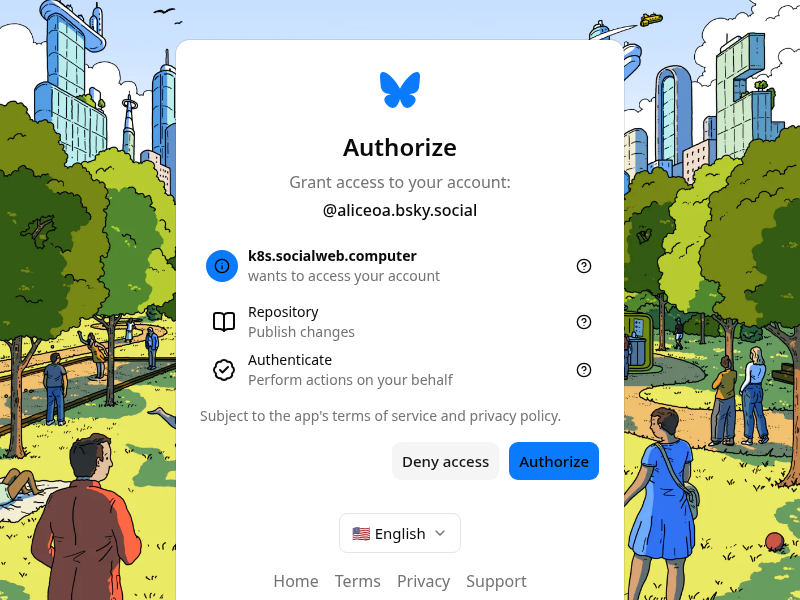
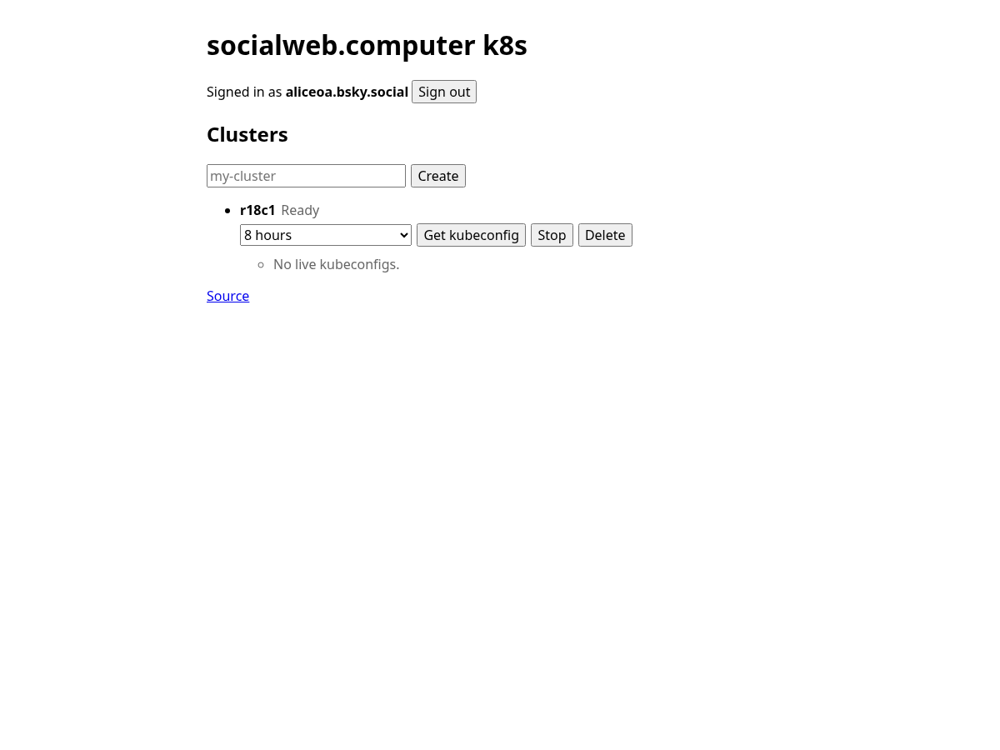
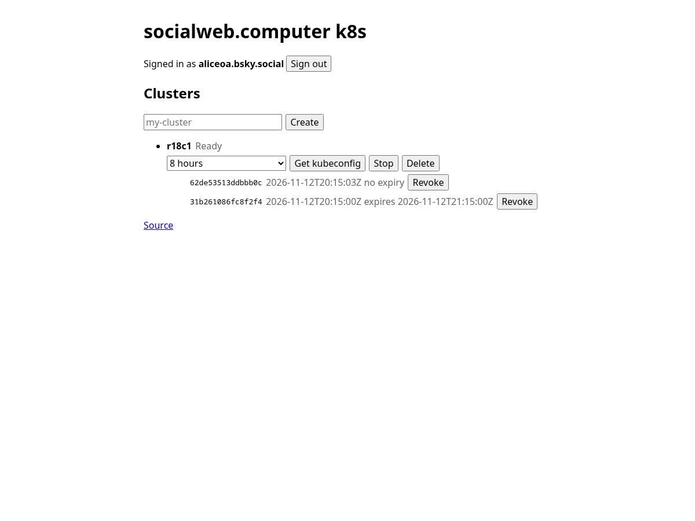
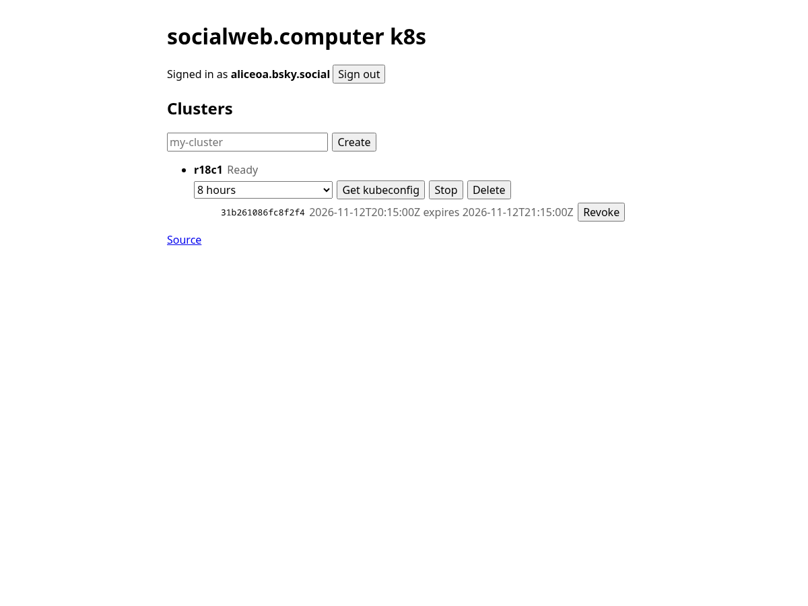

# Acceptance 0001: account modes, per-component pause, and one VM per host

This is the runnable acceptance used for plans 0023 and 0024. It exercises:

- a localRepo bidder;
- an oauthQr bidder that receives the market over the prod PDS firehose;
- a localRepo gateway requester;
- per-component suspend without stopping the GuestControlPlane or the shared IngressProxy;
- typed Bidder settings and fail-closed overrides;
- a tenant k3s cluster that scales from zero to three market VMs and back to zero,
  placing one VM on each bidder host;
- ssh over WebRTC from the CLI requester to a guest on each bidder host (section 9, plan 0034
  ACC34-CLI-SSH).

Run it from a host with `goat`, `kubectl`, `ssh` to `socialweb.computer`, `hat-7`
and `hat-9`, `dumbpipe` on PATH, and the credential files named below. The
requester tries iroh first when `dumbpipe` is on PATH; hat-9 offers no https, so
a requester host without `dumbpipe` cannot reach it. It changes the prod gateway
and the bidders. Do not run it without that authority.

## Hosts for this pass (2026-11-10)

- hat-7 is john's prod bidder (`did:plc:7q5lnitxv4meizdon5fmhzrq`). Its offering
  endpoints are iroh and webrtc (its `market-https=true` transition ended 2026-11-10). Do not re-identity hat-7 and do not end
  its session.
- hat-9 is bob's bidder (`did:plc:4vcig7s43z3nyqrnepmcfzqt`). Its offering
  endpoints are iroh and webrtc.
- Both serve the compute kinds `vm` and `deno`.
- local is hat-8's `swc-bidder` (`did:plc:2l2wdry77c7jtucbslstagkj`, localRepo,
  associated to bob). It runs the same release as hat-7 and hat-9; a bidder on an
  older release with an `endpointUrl`-only offering must not take part (upgrade
  it, or keep its root `spec.suspend=true`).
- The oauthQr bidder parts (sections 2, 4, 7 and the section 9 sign-in) run on
  hat-8 as a temporary prod-qr bidder for bob under a fresh account (2026-11-10:
  `swc-qr0001`), so no existing install is touched. Read it and its kubeconfig
  where the steps say `hat-7`; hat-7 is then paused with the others in sections
  1 and 4 and is one more host in sections 5, 6 and 9. The oauthQr mode is a
  drop-in written before the first start, so no localRepo DID is ever created:

```bash
A=swc-qr0001; S=/var/lib/socialweb-computer/$A; H=bobvmbuilder.bsky.social
BIN=/var/tmp/swc-release/socialweb-computer-<sha12>
D=$S/.config/systemd/user/socialweb-computer-bidder@$H.service.d
sudo useradd --system --user-group --no-create-home --home-dir $S --shell /usr/sbin/nologin --comment socialweb-computer $A
sudo install -d -m 0700 -o $A -g $A $S
sudo install -d -m 0755 -o $A -g $A $S/.config $S/.config/systemd $S/.config/systemd/user "$D"
printf '[Service]\nExecStart=\nExecStart=%s/bin/current/socialweb-computer run bidder --handle %%i --fg -- --atproto-oauth-qr\n' "$S" |
  sudo install -m 0644 -o $A -g $A /dev/stdin "$D/10-oauth-qr.conf"
sudo "$BIN" install bidder --account $A --adopt-account --handle $H --compute-kinds vm,deno --vm-slots 8 \
  --guest-image-source file:///var/lib/socialweb-computer/guest-image
```

  It comes up `oauthQr AwaitingScan` with no local Pds; section 2 signs bob in.
  After the pass: pause it, `sudo $S/bin/current/socialweb-computer uninstall
  bidder --account $A --purge`, `sudo userdel $A`, then delete its records in
  bob's repo with `deleteRecord`: `market.offering/self`,
  `market.heartbeat/self` and its `computer.socialweb.ingress.listen/market` record. A
  getRecord of each then answers RecordNotFound. Never delete `badgeBlueKeys`,
  `market.association`, `link.ident.endorsement` or vouch records. A step that only reads may run on the existing
  hat-9 bob bidder instead.
- The runner host is hat-8 (it has `kubectl`, `dumbpipe`, `deno` and Chrome for
  `scripts/oauth-signin.ts`, and both credential files). Without `goat` there,
  the gateway XRPC calls take a service-auth token from alice's PDS
  (`com.atproto.server.getServiceAuth?aud=$AUD&lxm=$N.<method>`) and call
  `$GW/xrpc/$N.<method>` with curl; the session token stays in a mode-0600 file
  of the scratch dir, deleted afterwards.
- Gateway steps are lead-approved. Take a backup first and verify after.
  Coordinate them with whoever redeploys the gateway.
- Market service auth uses a hostname-free audience: `<bidder DID>#pdr_temp_market`
  and `<bidder DID>#pdr_temp_compute_event`. The gateway cluster XRPC audience
  (`AUD` below) is unchanged.
- Every market read is one getRecord at a computable key; no step lists records.

Last pass: 2026-11-11 11:54-12:45Z, every bidder and the gateway on kcp e496cbff
(release d9438c15, ident.link associations), CLI d9438c15 on hat-8, alice requester,
bob oauthQr bidder `swc-qr0001` on hat-8 (installed for the pass, removed after),
no bidders list anywhere (the gateway env names only a deny list). Association: requester
`did:plc:jjcsg5fg3ujd22ywuxg4lr72` `Associated=True`, phase Ready, `alsoKnownAs`
[`at://root-app.gateway.local`, `https://ident.link/agent-of/<alice>`], endorsement + grant at rkey =
requester DID, walk roots [alice], `approvedAssociations` empty; the three bidder pairs (hat-7 -> john,
hat-9 and hat-8 -> bob): agent-of only, endorsement `{agent}`, grant without `expiresAt`, roots
[operator]. Section 1: hat-9, local and hat-7 `Suspended` `{"desired":6,"notReady":0,"ready":5,"suspended":1}`,
Bidder `true Ready`. Section 2: bob signed in by QR (page "Session transferred"; the `--done` text
waits 60 s for "close this window", the page says "close this page": harmless), root Ready 4/4,
EventStream `gateway-pds` Running, offering `["iroh","webrtc"]`. Section 3: Cluster Ready 34 s after
createCluster (`get --raw /readyz` answers NotFound through the kcp front; namespaces list fine).
Section 4: first VM on the oauthQr bidder, pod Ready 76 s after the apply; zero nodes 139 s after the
scale. Section 5: oauthQr (73 s), local (52 s), hat-9 (80 s), hat-7 (77 s): four pods on four distinct
nodes. Section 6 (A2, all four winners paused): 4 -> 3 -> 2 -> 1 -> 0 released hat-9, oauthQr, hat-7,
local (155, 160, 155, 145 s), each step one `requester_released`, `requester_contract_records_deleted`
6/6, the released host at 0 ComputeVM / FirecrackerVM / firecracker, `vm.terminated` `deleted_on_request`
with a `vm.delete` request ref; cluster deleted. Section 7: heartbeat frozen at 12:27:04Z for 180 s,
root Ready `{"desired":4,"notReady":0,"ready":3,"suspended":1}`, GuestControlPlane and `ingress-iroh`
Ready, healthz 200; advanced 4 s after resume. Section 8 (hat-7): `applied:true`, heartbeat every 5 s,
offering cid unchanged for 60 s, four offerings `["iroh","webrtc"]` without `endpointUrl`, drift
reverted (`a direct edit of a composed child is reverted`), typo `Failed` / `InvalidKey`, child
generation unchanged. Section 9 (ACC34, fresh / restarted): oauthQr 2.0 / 3.8 s, local 3.1 / 4.8 s,
hat-9 2.4 / 5.0 s, hat-7 2.3 / 3.6 s; every run `Released`, `requester_contract_records_deleted` 12/12,
every logged record URI RecordNotFound three times, 0 plaintext signaling lines, hosts empty. Bidder
ERROR 0 on all three; gateway ERROR only `Reconciler error` of the `root:app` AtprotoRecord
`testaccount-alice-atirc-operator` (`com.fedfork.irc.agentOperator`, ScopeMissing; Failed since
02:43Z, pre-existing). Cleanup: `swc-qr0001` uninstalled with `--purge`, `userdel`; bob's
`market.offering/self`, `market.heartbeat/self` and `computer.socialweb.ingress.listen/market`
RecordNotFound.

Earlier pass: 2026-11-10 18:06-18:41Z, every bidder and the gateway on c770a887
(alice requester, bob oauthQr bidder `swc-qr0001` on hat-8). Section 1: hat-9,
hat-7 and local `Suspended`, Bidder `true Ready`. Section 2: bob signed in by QR,
root Ready 4/4, EventStream `gateway-pds` Running, offering `["iroh","webrtc"]`.
Section 4: the first VM landed on the oauthQr bidder 49 s after the apply; back
to zero nodes in 2 min 34 s. Section 5: four pods on four distinct nodes, one
market VM on each bidder (oauthQr, local, hat-7, hat-9). Section 6 (A2): all
four winners paused, deployment deleted, every VM released (0 ComputeVMs, 0
firecracker on every host), cluster deleted. Section 7: heartbeat frozen at
18:21:54Z for 180 s, root Ready `{"desired":4,"notReady":0,"ready":3,"suspended":1}`,
GuestControlPlane and `ingress-iroh` Ready, GCP healthz 200; advanced 15 s after
resume. Section 8: override `applied:true` (generation 8), heartbeat every 5 s,
offering cid unchanged for 60 s, all four offerings `["iroh","webrtc"]` without
`endpointUrl`, drift reverted (`a direct edit of a composed child is reverted`),
typo `Failed` / `InvalidKey` with no child generation change. Section 9 (ACC34,
fresh / restarted invocation): hat-9 5.2 / 5.2 s, hat-7 21.6 / 4.8 s, local
3.7 / 6.9 s, oauthQr 9.1 / 3.8 s; every run `Released`,
`requester_contract_records_deleted` 12 of 12, every logged record URI
RecordNotFound three times, 0 plaintext signaling lines, hosts empty.

Gateway re-check (5e6c4e3d), 2026-11-11 01:32-01:58Z: the gateway on 5e6c4e3d
(redeployed 2026-11-10 19:23Z), every bidder on 253031e2 (rollout 10), alice
signed in at `k8s.socialweb.computer` by `scripts/oauth-signin.ts --start-api`;
sections 3, 1, 4, 5 and 6 only. No oauthQr bidder is installed (`swc-qr0001` is
gone and hat-7 is localRepo, receiving over the relay and Jetstream), so section
2 does not apply and hat-7 is the receiving host of section 4. Section 3:
Cluster Ready 36 s after createCluster; the kubeconfig of `getKubeconfig` and of
the web `POST /api/clusters/kubeconfig` both name
`https://kcp.socialweb.computer/clusters/root:2wjeqtgx:<cluster>:clusters`, a
client certificate and no CA data; `get --raw /readyz` ok, k3s v1.36.4+k3s1,
namespaces `default kube-node-lease kube-public kube-system users`
(`/api/config` reports `kcpPublicHost: null`: the GatewayAPI does not pass it
to the cluster API; the kubeconfig takes it from `SOCIALWEB_GATEWAY_KCP_PUBLIC_HOST`).
Section 4: hat-9 and local `Suspended`, first VM on hat-7, pod Ready 54 s after
the scale, back to zero nodes in 149 s. Section 5: 1 -> hat-7 (53 s), pause, 2 ->
hat-8 (49 s), pause, 3 -> hat-9 (49 s): three pods on three distinct nodes, one
market VM on each bidder. Section 6, one step at a time after the resume: 3 -> 2
released the hat-9 VM (156 s), 2 -> 1 the hat-8 VM (155 s), 1 -> 0 the hat-7 VM
(133 s). Each step: one node gone, the other pods on their nodes, one
`requester_released`, one `requester_contract_records_deleted` (6 records), the
released host at 0 ComputeVM / 0 FirecrackerVM / 0 firecracker / 0 vm dirs, the
`vm.terminated` pinned `deleted_on_request` with a `vm.delete` request ref; 0
bidder ERROR. A pre-run VM (hat-8, before section 1) released while hat-8 was
paused (A2). Gateway 0 ERROR through the scale steps. After deleteCluster the
session owner of alice is pruned, and the declared-state `testaccounts`
AtprotoRecords of alice log `Reconciler error` LinkDenied every 5 s (also after
the 2026-11-10 pass, until the 19:20Z restart): the AtprotoRepo controller kept
the binding of the deleted AtprotoRepo (no `Gone` hook); fixed on main, a
record then waits for its repo binding (INFO).

This runbook was validated end to end on `v0.0.0-rc81`: three pods on three
distinct tenant nodes, one market VM on each bidder host, paused winners forcing
the next placement, and every VM released when the cluster returned to zero.
It passed again, all nine sections, on `v0.0.0-rc142` (2026-10-31) with every
bidder on rc142, and on `v0.0.0-rc154` (2026-11-01, gateway, ssh gateway and
every bidder on rc154): first VM on hat-7 in 43 s, one VM per host (hat-7,
local, hat-9), back to zero, heartbeat freeze and advance, offering unchanged,
drift reverted, typo fails closed InvalidKey, ACC34 exit 0 on every host
(fresh / restarted kcp: local 2.2 / 3.2 s, hat-9 3.1 / 2.2 s, hat-7 4.9 / 4.5 s),
no plaintext signaling in any log.
Plan 0026 (abstract kinds, the bus with default-deny ComponentLinks) changed
the object names and fields it reads; the commands below use the plan 0026
names. Every kind is read by its full resource name (for example
`marketbidders.socialweb.computer`), because a market kcp binds several
exports that share short names.

The authoritative OAuth role sets are in
`internal/atproto/oauth/scope.go`, ported from
`typescript-helpers/lib/oauth-scope/mod.ts` (the generator behind
`did-key-associator/generated/oauth-scope.js`). Do not substitute
`transition:generic`.

## Variables

```bash
GW=https://k8s.socialweb.computer
AUD=did:web:k8s.socialweb.computer
N=com.publicdomainrelay.temp.cluster
CL=scale-auth-$(date +%s)
W=~/.tmp/auth-modes-0001
mkdir -p "$W"
chmod 700 "$W"

PROD_K=/var/lib/socialweb-computer/socialweb/kcp/admin.kubeconfig
PROD_ACCOUNT=2wjeqtgx
H7_K=$(ssh hat-7 'sudo -n -u swc-bidder sh -c "ls -t /var/lib/socialweb-computer/swc-bidder/handles/*/kcp/front.json | head -1 | sed s,front.json,admin.kubeconfig,"')
H9_K=$(ssh hat-9 'sudo -n -u swc-bidder sh -c "ls -t /var/lib/socialweb-computer/swc-bidder/handles/*/kcp/front.json | head -1 | sed s,front.json,admin.kubeconfig,"')
LOCAL_K=$(sudo -n -u swc-bidder sh -c "ls -t /var/lib/socialweb-computer/swc-bidder/handles/*/kcp/front.json | head -1 | sed s,front.json,admin.kubeconfig,")
```

The gateway account workspace name (`PROD_ACCOUNT`) appears in the cluster
provider log line `home":"root:<account>:<cluster>"`. It is stable for a state
dir.

## Requester association

The gateway requester must be associated before it accepts any bid. Check it
before creating a cluster.

The requester MarketIdentity lives in `root:app`; the gateway's components
(`Pds/pds`, `Requester/requester`, `GatewayAPI/gateway-api`) live in `root`.
The association is the ident.link pair + grant
([../design/ident-link-associations.md](../design/ident-link-associations.md)):
the gateway adds `https://ident.link/agent-of/<alice DID>` to the requester
DID's `alsoKnownAs` (its local PDS `plc-rotation.key`; a failure logs
`gateway_requester_agent_of`), and alice's repo holds
`com.publicdomainrelay.temp.market.association/<requester DID>` {agent,
createdAt} and `link.ident.endorsement/<requester DID>` {agent}: declared in
`deploy/testaccounts/alice/identity.yaml`, or written by
`scripts/associate-bidder.ts` from the Alice account. The identity controller
walks the requester DID and reports the roots in `status.associations` and the
`Associated` condition. `SOCIALWEB_GATEWAY_APPROVED_ASSOCIATIONS`
(comma-separated DIDs in the gateway env) pre-approves operators in
`spec.approvedAssociations`; it is not needed when the walk reaches alice. Do
not patch the MarketIdentity spec: the Gateway root owns it and server-side
apply reverts the edit.

```bash
ID_ARGS="--kubeconfig $PROD_K --server https://127.0.0.1:6443/clusters/root:app"
MI=marketidentities.socialweb.computer
ALICE=did:plc:lpfuqerea3deuoyrn7ojser4; APDS=https://jellybaby.us-east.host.bsky.network
ASSOC=$(ssh socialweb.computer "sudo -n -u socialweb env HOME=/var/lib/socialweb-computer/socialweb kubectl $ID_ARGS get $MI requester -o jsonpath='{.status.conditions[?(@.type==\"Associated\")].status}'")
RI_DID=$(ssh socialweb.computer "sudo -n -u socialweb env HOME=/var/lib/socialweb-computer/socialweb kubectl $ID_ARGS get $MI requester -o jsonpath='{.status.did}'")
printf 'requester=%s associated=%s\n' "$RI_DID" "$ASSOC"
curl -s "https://plc.directory/$RI_DID" | jq -c .alsoKnownAs   # holds https://ident.link/agent-of/$ALICE
for c in link.ident.endorsement com.publicdomainrelay.temp.market.association; do
  curl -s "$APDS/xrpc/com.atproto.repo.getRecord?repo=$ALICE&collection=$c&rkey=$RI_DID" | jq -c '.value // .error'
done                                                           # {agent: RI_DID}, {agent: RI_DID, createdAt}
if [ "$ASSOC" != True ]; then
  deno run -A --no-lock scripts/associate-bidder.ts --creds ~/.aliceoa_bsky_social_source \
    --account ALICE --agent-did "$RI_DID" | jq -c .
fi
socialweb-computer internal association "$RI_DID" | jq -c '{roots, errors}'   # roots [ALICE]
ssh socialweb.computer "sudo -n -u socialweb env HOME=/var/lib/socialweb-computer/socialweb kubectl $ID_ARGS get $MI requester -o jsonpath='{.spec.approvedAssociations}{\"\n\"}{.status.associations}{\"\n\"}{.status.phase}{\"\n\"}'"
```

A missing agent-of entry is a PLC op on the gateway host (lead go first):
`socialweb-computer identity agent-of add <alice DID> --did <requester DID>
--pds-state-dir "$(kubectl $ID_ARGS get pds pds -o jsonpath='{.spec.stateDir}')" --drop-borrowed-handle`
(the Pds stateDir is `<instance state>/components/Pds-pds` unless the root overrides it).

Wait until the identity phase is `Ready`, `status.associations` names alice's
DID and the `Requester` child reports `spec.operatorDID` with it.
Without that, every bid is denied by `requester-tangled-vouch` even though
bidder policy runs succeed.

## Bidder policy: bidder-tangled-vouch on every prod bidder

Every prod bidder runs `bidder-tangled-vouch`. It is the MarketBidder default
when `spec.policy` is unset, and `install bidder` writes it to `config.json` as
`bidder-policy`. `open` runs only when an operator sets it explicitly
(`--bidder-policy open` or `spec.policy: open`); it is never acceptable on a
prod bidder. The bidder bids only for a requester in its operator's vouch
graph, so the acceptance requester alice (`did:plc:lpfuqerea3deuoyrn7ojser4`)
must be vouched by the bidder operator: bob (`did:plc:ocnuqjlzgohypj3zoznermms`)
and john (`did:plc:5svqtrhheairglgiiyvutzik`) each hold an
`sh.tangled.graph.vouch` record with rkey alice's DID. The CLI requester's
default `requester-tangled-vouch` needs the other direction: alice vouches bob
and john.

```bash
ssh hat-7 "sudo -n -u swc-bidder env HOME=/var/lib/socialweb-computer/swc-bidder KUBECONFIG=$H7_K kubectl get bidders.socialweb.computer bidder -o jsonpath='{.spec.policy}{\"\n\"}'"
ssh hat-9 "sudo -n -u swc-bidder env HOME=/var/lib/socialweb-computer/swc-bidder KUBECONFIG=$H9_K kubectl get bidders.socialweb.computer bidder -o jsonpath='{.spec.policy}{\"\n\"}'"
sudo -n -u swc-bidder env HOME=/var/lib/socialweb-computer/swc-bidder KUBECONFIG=$LOCAL_K \
  kubectl get bidders.socialweb.computer bidder -o jsonpath='{.spec.policy}{"\n"}'
for OP in did:plc:ocnuqjlzgohypj3zoznermms did:plc:5svqtrhheairglgiiyvutzik; do
  goat get "at://$OP/sh.tangled.graph.vouch/did:plc:lpfuqerea3deuoyrn7ojser4" | jq -r .kind
done
```

Each Bidder prints `bidder-tangled-vouch`, and each vouch prints `vouch`.

Each localRepo bidder is its operator's agent by the ident.link pair + grant
(the bidder writes agent-of with its local PDS `plc-rotation.key`; the
operator's records are declared in `deploy/testaccounts/{john,bob}/identity.yaml`
or written by `scripts/associate-bidder.ts --agent-did <bidder DID>`):

```bash
pair() {  # <bidder DID> <operator DID>
  curl -s "https://plc.directory/$1" | jq -c .alsoKnownAs
  P=$(curl -s "https://plc.directory/$2" | jq -r '.service[] | select(.id=="#atproto_pds") | .serviceEndpoint')
  for c in link.ident.endorsement com.publicdomainrelay.temp.market.association; do
    curl -s "$P/xrpc/com.atproto.repo.getRecord?repo=$2&collection=$c&rkey=$1" | jq -c '.value // .error'
  done
  socialweb-computer internal association "$1" | jq -c '{roots, errors}'
}
pair did:plc:7q5lnitxv4meizdon5fmhzrq did:plc:5svqtrhheairglgiiyvutzik   # hat-7 -> john
pair did:plc:4vcig7s43z3nyqrnepmcfzqt did:plc:ocnuqjlzgohypj3zoznermms   # hat-9 -> bob
pair did:plc:2l2wdry77c7jtucbslstagkj did:plc:ocnuqjlzgohypj3zoznermms   # hat-8 swc-bidder -> bob
```

Each `alsoKnownAs` holds `https://ident.link/agent-of/<operator DID>` and no
`at://<operator handle>`, each endorsement is `{agent: <bidder DID>}`, each
grant `{agent, createdAt}` with no `expiresAt`, and each walk's roots are
[operator DID].

## Service auth for the gateway

The gateway XRPC calls are authenticated as the Alice operator account.

```bash
if ! goat account check-auth >/dev/null 2>&1; then
  set -a
  . ~/.aliceoa_bsky_social_source
  set +a
  GOAT_USERNAME=$ALICE_ATPROTO_HANDLE GOAT_PASSWORD=$ALICE_ATPROTO_PASSWORD goat account login
fi
tok() { goat account service-auth --aud "$AUD" --lxm "$N.$1"; }
xrpc() {
  verb=$1
  method=$2
  shift 2
  goat xrpc "$verb" "$GW" "$N.$method" "$@" "Authorization:Bearer $(tok "$method")"
}
```

## 1. Pause hat-9 and local, leave hat-7 receiving

Pause a bidder with the root's `spec.suspend`. The Bidder process keeps
running with `spec.suspendParticipation=true`: it withdraws its offering,
declines new RFPs, still fulfils an accept of a bid it published before the
pause, and still reads the market inbox, so it still releases the VMs it runs
(acceptance row A2). The root reports `Suspended`; the
GuestControlPlane, Pds, IngressProxy, Services and Exposures stay Ready.

```bash
ssh hat-9 "sudo -n -u swc-bidder env HOME=/var/lib/socialweb-computer/swc-bidder KUBECONFIG=$H9_K kubectl patch marketbidders.socialweb.computer app --type merge -p '{\"spec\":{\"suspend\":true}}'"
sudo -n -u swc-bidder env HOME=/var/lib/socialweb-computer/swc-bidder KUBECONFIG=$LOCAL_K \
  kubectl patch marketbidders.socialweb.computer app --type merge -p '{"spec":{"suspend":true}}'
```

Check both roots and the Bidder spec:

```bash
ssh hat-9 "sudo -n -u swc-bidder env HOME=/var/lib/socialweb-computer/swc-bidder KUBECONFIG=$H9_K kubectl get marketbidders.socialweb.computer app -o jsonpath='{.status.phase}{\"\n\"}{.status.componentSummary}{\"\n\"}'"
sudo -n -u swc-bidder env HOME=/var/lib/socialweb-computer/swc-bidder KUBECONFIG=$LOCAL_K \
  kubectl get marketbidders.socialweb.computer app -o jsonpath='{.status.phase}{"\n"}{.status.componentSummary}{"\n"}'
sudo -n -u swc-bidder env HOME=/var/lib/socialweb-computer/swc-bidder KUBECONFIG=$LOCAL_K \
  kubectl get bidders.socialweb.computer bidder -o jsonpath='{.spec.suspendParticipation} {.status.phase}{"\n"}'
```

Both roots must be `Suspended`; the Bidder reports `true Ready`.

A component override (`{"spec":{"components":{"Bidder":{"suspend":true}}}}`)
pauses only the Bidder's participation: it sets the Bidder's
`spec.suspendParticipation=true`, not `spec.suspend` (suspend stops
participation, never obligations). The Bidder process keeps running: it
withdraws its offering, stops its heartbeat, declines new RFPs and accepts, and
still releases the VMs it runs on `vm.delete`, over XRPC or the firehose. The
root stays `Ready` with `componentSummary`
`{"desired":5,"notReady":0,"ready":4,"suspended":1}` on a localRepo bidder
(Bidder, GuestControlPlane, Pds, PolicyEngine and one more since rc81) and the Bidder reports
`true Ready`. A Requester override works the same way. Other component kinds
keep `spec.suspend`, which stops the component. Section 7 uses it.

## 2. Resume hat-7 and point it at the gateway PDS firehose

Read the gateway PDS ingress URL from its Exposure. Then apply it on hat-7 as a
RelayEventSource and name it in the root's `spec.comms.eventSourceRefs`. It
receives `market.rfp` and `market.accept` from this stream. The offering lists
the bidder's endpoints as `endpoints: [{kind, address}]` with kind `iroh`,
`webrtc` or `https`. A prod-qr bidder lists `https` only with the bidder option
`market-https=true` (config.json `"bidder-options": "--market-https=true"`).
hat-7 and hat-9 list iroh and webrtc (no prod bidder lists https since 2026-11-10). The requester
reads the winner's offering to reach it.

```bash
PDS_URL=$(ssh socialweb.computer "sudo -n -u socialweb env HOME=/var/lib/socialweb-computer/socialweb kubectl --kubeconfig $PROD_K get exposures.exposure.socialweb.computer svc-pds-pds-ingress -o jsonpath='{.status.address}'")
ssh hat-7 "sudo -n -u swc-bidder env HOME=/var/lib/socialweb-computer/swc-bidder KUBECONFIG=$H7_K kubectl apply -f -" <<YAML
apiVersion: events.socialweb.computer/v1alpha1
kind: RelayEventSource
metadata: {name: gateway-pds}
spec: {url: "$PDS_URL"}
---
apiVersion: events.socialweb.computer/v1alpha1
kind: EventSource
metadata: {name: gateway-pds}
spec: {backendRef: {group: events.socialweb.computer, kind: RelayEventSource, name: gateway-pds}}
YAML
ssh hat-7 "sudo -n -u swc-bidder env HOME=/var/lib/socialweb-computer/swc-bidder KUBECONFIG=$H7_K kubectl patch marketbidders.socialweb.computer app --type merge -p '{\"spec\":{\"suspend\":false,\"comms\":{\"eventSourceRefs\":[{\"kind\":\"EventSource\",\"name\":\"gateway-pds\"}]}}}'"
```

Both objects and `spec.comms.eventSourceRefs` survive a bidder restart: the run
command applies the root without that field, so its server-side apply keeps the
operator's value (D03).

The root must become Ready and one EventStream must be running:

```bash
ssh hat-7 "sudo -n -u swc-bidder env HOME=/var/lib/socialweb-computer/swc-bidder KUBECONFIG=$H7_K kubectl get marketbidders.socialweb.computer app -o jsonpath='{.status.phase}{\"\n\"}{.status.message}{\"\n\"}'"
ssh hat-7 "sudo -n -u swc-bidder env HOME=/var/lib/socialweb-computer/swc-bidder KUBECONFIG=$H7_K kubectl get eventstreams.events.socialweb.computer,eventsources.events.socialweb.computer"
```

If the MarketIdentity is `AwaitingScan`, run the headless sign-in with Bob's
credential file. Read the current QR url immediately before the command; it
expires after 5 minutes.

```bash
U=$(ssh hat-7 "sudo -n -u swc-bidder env HOME=/var/lib/socialweb-computer/swc-bidder KUBECONFIG=$H7_K kubectl get marketidentities.socialweb.computer bidder -o jsonpath='{.status.pendingAction.url}'")
deno run -A --no-lock scripts/oauth-signin.ts --creds ~/.bobvmbuilder_bsky_social_source \
  --account BOB --url "$U" --done "You can close this window"
```

A timeout waiting for the final page text is harmless when the identity is
`Ready` afterwards. The stored scope must be the authoritative bidder set:

```bash
ssh hat-7 "sudo -n -u swc-bidder env HOME=/var/lib/socialweb-computer/swc-bidder KUBECONFIG=$H7_K kubectl get marketidentities.socialweb.computer bidder -o jsonpath='{.status.phase}{\"\n\"}'"
```

## 3. Create the tenant cluster

```bash
xrpc procedure createCluster name="$CL"
for i in $(seq 1 60); do
  phase=$(xrpc query listClusters | jq -r --arg n "$CL" '.clusters[] | select(.name==$n) | .phase')
  [ "$phase" = Ready ] && break
  sleep 5
done
[ "$phase" = Ready ] || { echo "cluster $CL is $phase"; exit 1; }
xrpc procedure getKubeconfig name="$CL" ttlSeconds:=28800 | jq -r .kubeconfig > "$W/kubeconfig"
chmod 600 "$W/kubeconfig"
KC=$W/kubeconfig
```

### 3a. The page, a no-expiry kubeconfig, revoke

Last pass: 2026-11-12 20:13-20:17Z, kcp ac51b91e (rollout 18), alice, headless Chrome (`scripts/oauth-signin.ts
--start-api --cookie-file`, then the page's own `/api/*` calls in the page context, puppeteer-core): consent page
`k8s.socialweb.computer` for `@aliceoa.bsky.social`; cluster `r18c1` Ready 36 s after create; a 1 h and a no-expiry
kubeconfig (`notAfter` 9999-12-31, `noExpiry: true`) both list namespaces (5) (`get --raw /readyz` answers NotFound
through the kcp front for either: use `get ns`); `kubeconfigs` lists both; revoking the no-expiry one: `kubectl`
refused at once (`You must be logged in to the server`), listed `revoked: true`, the 1 h one still works; deleting the
cluster: the 1 h one refused within 1 s, the cluster list empty 16 s later. Do not press Sign out on the
page as alice: it revokes every kubeconfig (`$KC` too) and ends the gateway's alice session (`DELETE /session` did
that on this pass; alice signed in again at once with `oauth-signin.ts --start-api`).

 
 

The page signs in (its own `#handle` form), mints with `ttlSeconds` 0, lists and revokes:

```bash
curl -fsS "$GW/" | grep -q '<title>socialweb.computer k8s</title>'
curl -fsS "$GW/api/config" | jq -e .noExpiry
deno run -A --no-lock scripts/oauth-signin.ts --creds ~/.aliceoa_bsky_social_source --account ALICE \
  --url "$GW/" --done "Signed in as" --cookie-file "$W/jar.json"
api() {
  curl -fsS -H 'Content-Type: application/json' -d "$2" "$GW/api/clusters/$1" \
    -H "Cookie: swc_session=$(jq -r '.[] | select(.name=="swc_session") | .value' "$W/jar.json")"
}
api kubeconfig "{\"name\":\"$CL\",\"ttlSeconds\":0}" | jq -r .kubeconfig > "$W/noexpiry.kubeconfig"
chmod 600 "$W/noexpiry.kubeconfig"
kubectl --kubeconfig "$W/noexpiry.kubeconfig" get ns
S=$(api kubeconfigs "{\"name\":\"$CL\"}" | jq -r '[.kubeconfigs[] | select(.noExpiry and (.revoked|not))] | sort_by(.createdAt) | last | .serial')
api kubeconfigs/revoke "{\"name\":\"$CL\",\"serial\":\"$S\"}" | jq -e .revoked
sleep 2
! kubectl --kubeconfig "$W/noexpiry.kubeconfig" get ns
kubectl --kubeconfig "$KC" get ns
```

The same over xrpc:

```bash
xrpc procedure getKubeconfig name="$CL" ttlSeconds:=0 | jq -r .kubeconfig > "$W/noexpiry-xrpc.kubeconfig"
chmod 600 "$W/noexpiry-xrpc.kubeconfig"
kubectl --kubeconfig "$W/noexpiry-xrpc.kubeconfig" get ns
S=$(xrpc query listKubeconfigs name=="$CL" | jq -r '[.kubeconfigs[] | select(.noExpiry and (.revoked|not))] | sort_by(.createdAt) | last | .serial')
xrpc procedure revokeKubeconfig name="$CL" serial="$S" | jq -e .revoked
sleep 2
! kubectl --kubeconfig "$W/noexpiry-xrpc.kubeconfig" get ns
```

Pass: the page answers, `noExpiry` is true, each no-expiry kubeconfig lists namespaces, its serial lists
with `noExpiry`, and after its revoke `kubectl` is refused (`Unauthorized`) while `$KC` still works.

## 4. First scale: one oauthQr VM on hat-7, then zero

With hat-9 and local paused, only hat-7 can bid. The deployment uses required
pod anti-affinity on `kubernetes.io/hostname`, so each replica needs a different
node, and each node is one market VM.

```bash
kubectl --kubeconfig "$KC" apply -f - <<'YAML'
apiVersion: apps/v1
kind: Deployment
metadata:
  name: scale-check
  namespace: default
spec:
  replicas: 1
  selector:
    matchLabels:
      app: scale-check
  template:
    metadata:
      labels:
        app: scale-check
    spec:
      affinity:
        podAntiAffinity:
          requiredDuringSchedulingIgnoredDuringExecution:
            - labelSelector:
                matchLabels:
                  app: scale-check
              topologyKey: kubernetes.io/hostname
      containers:
        - name: run
          image: docker.io/library/busybox:1.36.1
          command: ["sh", "-c", "sleep 3600"]
YAML
kubectl --kubeconfig "$KC" wait --for=condition=Ready pod -l app=scale-check --timeout=15m
kubectl --kubeconfig "$KC" get pods -o wide
```

Read the winner and the VM:

```bash
NC="https://127.0.0.1:6443/clusters/root:$PROD_ACCOUNT:$CL"
ssh socialweb.computer "sudo -n -u socialweb env HOME=/var/lib/socialweb-computer/socialweb kubectl --kubeconfig $PROD_K --context root --server $NC get nodeclaims.socialweb.computer -o wide"
```

`get nodeclaims -o wide` prints only the name and age; the winner is
`status.contract.winner.did`, the phase `status.phase` (`Bidding`,
`Provisioning`, `Joining`, `Running`, `Released`) and the node's workload
grant `status.grant`. Read the three bidder DIDs once:

```bash
D7=$(ssh hat-7 "sudo -n -u swc-bidder env HOME=/var/lib/socialweb-computer/swc-bidder KUBECONFIG=$H7_K kubectl get marketbidders.socialweb.computer app -o jsonpath='{.status.did}'")
D9=$(ssh hat-9 "sudo -n -u swc-bidder env HOME=/var/lib/socialweb-computer/swc-bidder KUBECONFIG=$H9_K kubectl get marketbidders.socialweb.computer app -o jsonpath='{.status.did}'")
DL=$(sudo -n -u swc-bidder env HOME=/var/lib/socialweb-computer/swc-bidder KUBECONFIG=$LOCAL_K kubectl get marketbidders.socialweb.computer app -o jsonpath='{.status.did}')
printf 'hat-7=%s\nhat-9=%s\nlocal=%s\n' "$D7" "$D9" "$DL"
```

Only hat-7 is unpaused, so the first winner must be `$D7`:

```bash
WINNER=$(ssh socialweb.computer "sudo -n -u socialweb env HOME=/var/lib/socialweb-computer/socialweb kubectl --kubeconfig $PROD_K --context root --server $NC get nodeclaims.socialweb.computer -o jsonpath='{.items[0].status.contract.winner.did}'")
[ "$WINNER" = "$D7" ] || { echo "first VM landed on $WINNER, not hat-7 ($D7)"; exit 1; }
kubectl --kubeconfig "$KC" scale deployment scale-check --replicas=0
for i in $(seq 1 120); do
  nodes=$(kubectl --kubeconfig "$KC" get nodes --no-headers 2>/dev/null | wc -l)
  [ "$nodes" = 0 ] && break
  sleep 5
done
[ "$nodes" = 0 ] || { echo "cluster still has $nodes nodes"; exit 1; }
```

The provider holds an idle node for two minutes before it requests release, so
this loop can take several minutes after the last pod goes away. That hold is
normal, not a hung scale-down.

That proves the oauthQr bidder on hat-7 alone takes the cluster from zero to one
node and back to zero. The NodeClaim list is empty or every claim is `Released`.
The release is not complete until the bidder has destroyed the VM. Check that
hat-7 holds no Running ComputeVM for this cluster:

```bash
ssh hat-7 "sudo -n -u swc-bidder env HOME=/var/lib/socialweb-computer/swc-bidder KUBECONFIG=$H7_K kubectl get computevms.socialweb.computer -o wide"
```

## 5. One VM per host: resume hat-9 and local

Resume the two paused bidders, then run the same deployment one VM at a time.
After each VM is Ready, pause the bidder that won it; the next scale-up must use
the next host.

```bash
ssh hat-9 "sudo -n -u swc-bidder env HOME=/var/lib/socialweb-computer/swc-bidder KUBECONFIG=$H9_K kubectl patch marketbidders.socialweb.computer app --type merge -p '{\"spec\":{\"suspend\":false}}'"
sudo -n -u swc-bidder env HOME=/var/lib/socialweb-computer/swc-bidder KUBECONFIG=$LOCAL_K \
  kubectl patch marketbidders.socialweb.computer app --type merge -p '{"spec":{"suspend":false}}'
ssh hat-9 "sudo -n -u swc-bidder env HOME=/var/lib/socialweb-computer/swc-bidder KUBECONFIG=$H9_K kubectl wait --for=condition=Ready bidders.socialweb.computer/bidder --timeout=120s"
sudo -n -u swc-bidder env HOME=/var/lib/socialweb-computer/swc-bidder KUBECONFIG=$LOCAL_K \
  kubectl wait --for=condition=Ready bidders.socialweb.computer/bidder --timeout=120s

kubectl --kubeconfig "$KC" scale deployment scale-check --replicas=1
kubectl --kubeconfig "$KC" wait --for=condition=Ready pod -l app=scale-check --timeout=15m
WINNER=$(ssh socialweb.computer "sudo -n -u socialweb env HOME=/var/lib/socialweb-computer/socialweb kubectl --kubeconfig $PROD_K --context root --server $NC get nodeclaims.socialweb.computer -o jsonpath='{.items[0].status.contract.winner.did}'")
case "$WINNER" in
  "$D7") HOST=hat-7 ;;
  "$D9") HOST=hat-9 ;;
  "$DL") HOST=local ;;
  *) echo "winner $WINNER is not one of the three market bidders"; exit 1 ;;
esac
printf 'first winner=%s host=%s\n' "$WINNER" "$HOST"
```

Pause that winner:

```bash
case "$HOST" in
  hat-7)
    ssh hat-7 "sudo -n -u swc-bidder env HOME=/var/lib/socialweb-computer/swc-bidder KUBECONFIG=$H7_K kubectl patch marketbidders.socialweb.computer app --type merge -p '{\"spec\":{\"suspend\":true}}'"
    ;;
  hat-9)
    ssh hat-9 "sudo -n -u swc-bidder env HOME=/var/lib/socialweb-computer/swc-bidder KUBECONFIG=$H9_K kubectl patch marketbidders.socialweb.computer app --type merge -p '{\"spec\":{\"suspend\":true}}'"
    ;;
  local)
    sudo -n -u swc-bidder env HOME=/var/lib/socialweb-computer/swc-bidder KUBECONFIG=$LOCAL_K \
      kubectl patch marketbidders.socialweb.computer app --type merge -p '{"spec":{"suspend":true}}'
    ;;
esac
```

Wait until that root reports `Suspended` before the next scale-up. The pause is
asynchronous: the root reports `Suspended` only once its Bidder runs the new
generation with `suspendParticipation`; scaling up earlier lets the paused
bidder still bid on the next RFP, and an accept of a bid it already published
is honoured.

```bash
case "$HOST" in
  hat-7) ssh hat-7 "sudo -n -u swc-bidder env HOME=/var/lib/socialweb-computer/swc-bidder KUBECONFIG=$H7_K kubectl wait --for=jsonpath='{.status.phase}'=Suspended marketbidders.socialweb.computer/app --timeout=300s" ;;
  hat-9) ssh hat-9 "sudo -n -u swc-bidder env HOME=/var/lib/socialweb-computer/swc-bidder KUBECONFIG=$H9_K kubectl wait --for=jsonpath='{.status.phase}'=Suspended marketbidders.socialweb.computer/app --timeout=300s" ;;
  local) sudo -n -u swc-bidder env HOME=/var/lib/socialweb-computer/swc-bidder KUBECONFIG=$LOCAL_K \
           kubectl wait --for=jsonpath='{.status.phase}'=Suspended marketbidders.socialweb.computer/app --timeout=300s ;;
esac
```

Scale to two; wait, read the second winner, and pause it too:

```bash
kubectl --kubeconfig "$KC" scale deployment scale-check --replicas=2
kubectl --kubeconfig "$KC" wait --for=condition=Ready pod -l app=scale-check --timeout=15m
ssh socialweb.computer "sudo -n -u socialweb env HOME=/var/lib/socialweb-computer/socialweb kubectl --kubeconfig $PROD_K --context root --server $NC get nodeclaims.socialweb.computer -o wide"
```

Repeat the host map/pause block for the new winner. Scale to three; the final
winner must be the one host still unpaused:

```bash
kubectl --kubeconfig "$KC" scale deployment scale-check --replicas=3
kubectl --kubeconfig "$KC" wait --for=condition=Ready pod -l app=scale-check --timeout=15m
kubectl --kubeconfig "$KC" get pods -o wide
ssh socialweb.computer "sudo -n -u socialweb env HOME=/var/lib/socialweb-computer/socialweb kubectl --kubeconfig $PROD_K --context root --server $NC get nodeclaims.socialweb.computer -o wide"
```

Pass condition: three pods are Ready, the NodeClaims name three distinct
winners, and the three `NODE` names in `get pods -o wide` are distinct.

## 6. Resume paused winners, scale to zero, delete the cluster

A paused winner (root `spec.suspend`) still reads the market inbox and
releases its VM on the requester's `vm.delete` (A2). To prove A2, run the
scale to zero below before the resume block and check `computevms` on every
paused host; otherwise resume first. A winner paused with the component
override releases its VM the same way.

```bash
ssh hat-7 "sudo -n -u swc-bidder env HOME=/var/lib/socialweb-computer/swc-bidder KUBECONFIG=$H7_K kubectl patch marketbidders.socialweb.computer app --type merge -p '{\"spec\":{\"suspend\":false}}'"
ssh hat-9 "sudo -n -u swc-bidder env HOME=/var/lib/socialweb-computer/swc-bidder KUBECONFIG=$H9_K kubectl patch marketbidders.socialweb.computer app --type merge -p '{\"spec\":{\"suspend\":false}}'"
sudo -n -u swc-bidder env HOME=/var/lib/socialweb-computer/swc-bidder KUBECONFIG=$LOCAL_K \
  kubectl patch marketbidders.socialweb.computer app --type merge -p '{"spec":{"suspend":false}}'
ssh hat-7 "sudo -n -u swc-bidder env HOME=/var/lib/socialweb-computer/swc-bidder KUBECONFIG=$H7_K kubectl wait --for=condition=Ready bidders.socialweb.computer/bidder --timeout=120s"
ssh hat-9 "sudo -n -u swc-bidder env HOME=/var/lib/socialweb-computer/swc-bidder KUBECONFIG=$H9_K kubectl wait --for=condition=Ready bidders.socialweb.computer/bidder --timeout=120s"
sudo -n -u swc-bidder env HOME=/var/lib/socialweb-computer/swc-bidder KUBECONFIG=$LOCAL_K \
  kubectl wait --for=condition=Ready bidders.socialweb.computer/bidder --timeout=120s

Scale down one replica at a time, 3 -> 2 -> 1 -> 0. Each step must remove
exactly one node and release exactly one VM before the next step starts:

```bash
for n in 2 1 0; do
  kubectl --kubeconfig "$KC" scale deployment scale-check --replicas=$n
  for i in $(seq 1 120); do
    nodes=$(kubectl --kubeconfig "$KC" get nodes --no-headers 2>/dev/null | wc -l)
    [ "$nodes" = $n ] && break
    sleep 5
  done
  [ "$nodes" = $n ] || { echo "cluster has $nodes nodes, want $n"; exit 1; }
  kubectl --kubeconfig "$KC" get nodes -o wide
  kubectl --kubeconfig "$KC" get pods -o wide
  ssh socialweb.computer "sudo -n -u socialweb env HOME=/var/lib/socialweb-computer/socialweb kubectl --kubeconfig $PROD_K --context root --server $NC get nodeclaims.socialweb.computer -o jsonpath='{range .items[*]}{.metadata.name} {.status.phase} {.status.contract.winner.did}{\"\\n\"}{end}'"
  # the orphan check of every bidder host below, then pin the released VM's vm.terminated
done
```

At each step: the pods still run on distinct nodes, the claim of the node that
left is gone, its bidder host has one firecracker fewer, and the gateway logs
one `requester_released` and one `requester_contract_records_deleted`. Each
step takes about 2.5 min: the provider holds an idle node for two minutes.
Check every bidder host (the orphan check of
[0008](0008-host-observer.md)): the ComputeVM and FirecrackerVM of the released
VM are gone, and `pgrep -c -x firecracker` counts only the VMs still Running.

```bash
ssh hat-7 "sudo -n -u swc-bidder env HOME=/var/lib/socialweb-computer/swc-bidder KUBECONFIG=$H7_K kubectl get computevms.socialweb.computer,firecrackervms.socialweb.computer; pgrep -c -x firecracker"
ssh hat-9 "sudo -n -u swc-bidder env HOME=/var/lib/socialweb-computer/swc-bidder KUBECONFIG=$H9_K kubectl get computevms.socialweb.computer,firecrackervms.socialweb.computer; pgrep -c -x firecracker"
sudo -n -u swc-bidder env HOME=/var/lib/socialweb-computer/swc-bidder KUBECONFIG=$LOCAL_K \
  kubectl get computevms.socialweb.computer,firecrackervms.socialweb.computer; pgrep -c -x firecracker
```

Pin the released VM's `vm.terminated` with one getRecord (0008 "Pinning the
vm.terminated record", step 2). The gateway journal names the receipt URI
(`at://<bidder DID>/com.publicdomainrelay.temp.market.receipt/receipt-<hex>`);
the record is `deleted_on_request` with a `vm.delete` request ref:

```bash
RK=termination-payload-$(printf 'terminated:%s' "$RECEIPT_URI" | sha256sum | cut -c1-32)
goat get "at://<bidder DID>/com.publicdomainrelay.temp.compute.events.vm.terminated/$RK" | jq -c '{reason, request: .request.uri}'
```

After the last step the claim list is empty and no host runs a firecracker.
Delete the deployment:

```bash
kubectl --kubeconfig "$KC" delete deployment scale-check
```

Delete the cluster and the scratch directory:

```bash
xrpc procedure deleteCluster name="$CL"
rm -rf "$W"
```

## 7. Per-component pause checks (A1-A4)

On the oauthQr bidder, define the heartbeat reader:

```bash
BOB=$(ssh hat-7 "sudo -n -u swc-bidder env HOME=/var/lib/socialweb-computer/swc-bidder KUBECONFIG=$H7_K kubectl get marketidentities.socialweb.computer bidder -o jsonpath='{.status.did}'")
PDS=$(ssh hat-7 "sudo -n -u swc-bidder env HOME=/var/lib/socialweb-computer/swc-bidder KUBECONFIG=$H7_K kubectl get marketidentities.socialweb.computer bidder -o jsonpath='{.status.pdsUrl}'")
hb() { curl -sS "$PDS/xrpc/com.atproto.repo.getRecord?repo=$BOB&collection=com.publicdomainrelay.temp.market.heartbeat&rkey=self" | jq -r .value.createdAt; }
```

Pause only Bidder and wait until the Bidder runs the paused generation
(`spec.suspendParticipation` is `true` and `status.observedGeneration` equals
`metadata.generation`); a heartbeat sent between the patch and that point is
the old generation's last one:

```bash
ssh hat-7 "sudo -n -u swc-bidder env HOME=/var/lib/socialweb-computer/swc-bidder KUBECONFIG=$H7_K kubectl patch marketbidders.socialweb.computer app --type merge -p '{\"spec\":{\"components\":{\"Bidder\":{\"suspend\":true}}}}'"
ssh hat-7 "sudo -n -u swc-bidder env HOME=/var/lib/socialweb-computer/swc-bidder KUBECONFIG=$H7_K kubectl get bidders.socialweb.computer bidder -o jsonpath='{.spec.suspendParticipation} {.metadata.generation} {.status.observedGeneration}{\"\n\"}'"
```

Then record the heartbeat, wait 180 s, and compare:

```bash
hb
sleep 180
hb
```

`createdAt` must be identical. On the oauthQr bidder the root must be Ready with
`{"desired":4,"notReady":0,"ready":3,"suspended":1}` (it runs no Pds), the Bidder reports
`spec.suspendParticipation=true` and phase `Ready`; GuestControlPlane stays
Ready; the IngressProxy stays Ready; the GuestControlPlane ingress URL answers:

```bash
ssh hat-7 "sudo -n -u swc-bidder env HOME=/var/lib/socialweb-computer/swc-bidder KUBECONFIG=$H7_K kubectl get marketbidders.socialweb.computer app -o jsonpath='{.status.phase}{\"\n\"}{.status.componentSummary}{\"\n\"}'"
ssh hat-7 "sudo -n -u swc-bidder env HOME=/var/lib/socialweb-computer/swc-bidder KUBECONFIG=$H7_K kubectl get guestcontrolplanes.socialweb.computer,ingressproxies.socialweb.computer"
curl -sS "https://$(ssh hat-7 "sudo -n -u swc-bidder env HOME=/var/lib/socialweb-computer/swc-bidder KUBECONFIG=$H7_K kubectl get exposures.exposure.socialweb.computer svc-guestcontrolplane-guest-kcp-ingress -o jsonpath='{.status.address}'" | sed 's#https://##')/healthz"
```

Resume, wait for Ready, and prove the heartbeat advances:

```bash
ssh hat-7 "sudo -n -u swc-bidder env HOME=/var/lib/socialweb-computer/swc-bidder KUBECONFIG=$H7_K kubectl patch marketbidders.socialweb.computer app --type merge -p '{\"spec\":{\"components\":{\"Bidder\":null}}}'"
ssh hat-7 "sudo -n -u swc-bidder env HOME=/var/lib/socialweb-computer/swc-bidder KUBECONFIG=$H7_K kubectl wait --for=condition=Ready bidders.socialweb.computer/bidder --timeout=120s"
hb
```

## 8. Typed settings, drift and fail-closed overrides

On any Ready bidder, set a 5 s heartbeat and a 15 s offering refresh:

```bash
K=$H7_K
HOST=hat-7
ssh "$HOST" "sudo -n -u swc-bidder env HOME=/var/lib/socialweb-computer/swc-bidder KUBECONFIG=$K kubectl patch marketbidders.socialweb.computer app --type merge -p '{\"spec\":{\"components\":{\"Bidder\":{\"suspend\":false,\"settings\":{\"bidder\":{\"heartbeatIntervalSeconds\":5,\"offeringRefreshSeconds\":15}}}}}}'"
ssh "$HOST" "sudo -n -u swc-bidder env HOME=/var/lib/socialweb-computer/swc-bidder KUBECONFIG=$K kubectl wait --for=condition=Ready bidders.socialweb.computer/bidder --timeout=120s"
ssh "$HOST" "sudo -n -u swc-bidder env HOME=/var/lib/socialweb-computer/swc-bidder KUBECONFIG=$K kubectl get marketbidders.socialweb.computer app -o jsonpath='{.status.componentOverrides}'"
```

The override entry must show `"applied":true` and the child generation. Sample
the heartbeat twice, 10 s apart; `createdAt` advances about every 5 s. Read the
offering record `cid` twice, 60 s apart: it must not change. A refresh re-reads
the offering, corrects it only when it drifted and checks relay visibility; four
refreshes of a correct offering write nothing to the PDS.

Read the offering endpoints with one getRecord (`D7` and `D9` from section 4):

```bash
for D in "$D7" "$D9"; do
  goat get "at://$D/com.publicdomainrelay.temp.market.offering/self" | jq -c '[.endpoints[].kind], has("endpointUrl")'
done
```

hat-7 and hat-9 each print `["iroh","webrtc"]` (any
order); each prints `false`: no offering carries `endpointUrl`.

A direct child edit is reverted and reported:

```bash
ssh "$HOST" "sudo -n -u swc-bidder env HOME=/var/lib/socialweb-computer/swc-bidder KUBECONFIG=$K kubectl patch bidders.socialweb.computer bidder --type merge -p '{\"spec\":{\"suspend\":true}}'"
sleep 5
ssh "$HOST" "sudo -n -u swc-bidder env HOME=/var/lib/socialweb-computer/swc-bidder KUBECONFIG=$K kubectl get bidders.socialweb.computer bidder -o jsonpath='{.spec.suspend}{\"\n\"}'"
ssh "$HOST" "sudo -n -u swc-bidder env HOME=/var/lib/socialweb-computer/swc-bidder KUBECONFIG=$K kubectl get marketbidders.socialweb.computer app -o jsonpath='{.status.conditions}' | jq -c '.[]|select(.type==\"ComponentDrift\")'"
```

The child `suspend` is empty/false within seconds. `ComponentDrift=True` names
`Bidder/bidder` only until the next pass sees the child match again; then it is
`False NoDrift`, so read it right after the edit or in the core log. A typo key fails closed:

```bash
ssh "$HOST" "sudo -n -u swc-bidder env HOME=/var/lib/socialweb-computer/swc-bidder KUBECONFIG=$K kubectl patch marketbidders.socialweb.computer app --type merge -p '{\"spec\":{\"components\":{\"Bldier\":{\"suspend\":true}}}}'"
ssh "$HOST" "sudo -n -u swc-bidder env HOME=/var/lib/socialweb-computer/swc-bidder KUBECONFIG=$K kubectl get marketbidders.socialweb.computer app -o jsonpath='{.status.phase}{\"\n\"}{.status.conditions}' | jq -c '.[]|select(.type==\"ComponentOverridesValid\")'"
```

The phase is `Failed` and the condition is `False/InvalidKey`; no child
generation changed. Remove the typo and the test settings when done:

```bash
ssh "$HOST" "sudo -n -u swc-bidder env HOME=/var/lib/socialweb-computer/swc-bidder KUBECONFIG=$K kubectl patch marketbidders.socialweb.computer app --type merge -p '{\"spec\":{\"components\":null}}'"
```

## 9. ACC34: ssh over WebRTC from the CLI on each bidder

Plan 0034 ACC34-CLI-SSH. Each bidder runs a release with plan 0034: its
`socialweb-guest-downloads` asset serves `socialweb-guest-agent` to its guests
at `http://192.0.2.1:<port>/v1/downloads`, and its guest event queue and
`compute.guest.subscribeEvents` are up. The requester is the CLI of the same
release, on this host, against the prod market. The guest reaches
`stun:stun.cloudflare.com:3478` and nothing else is used for ICE.

### hat-7 signs in again after a scope change

An oauthQr session keeps the scope it was granted at sign-in. Plan 0034 added
`com.publicdomainrelay.temp.compute.events.guest.publicKey` and
`com.publicdomainrelay.temp.compute.events.guest.signalWebRTC` to the bidder
and requester role scopes (`internal/atproto/oauth/scope.go`). hat-7's identity
stays `Ready` on its old session after the upgrade, and nothing asks for a new
QR on its own; its PDS then refuses the bidder's writes of those records, so
the guest's publicKey and answer never reach the requester and ACC34 times out
waiting for the guest's publicKey on hat-7. After any release that changes a
role scope, before this section:

1. Check that the qr.fedfork.com client metadata scope covers every bidder and
   requester scope token of the release.
2. End hat-7's old session so the identity reports `AwaitingScan` or
   `SessionExpired` with a `pendingAction.url`.
3. Sign bob in again with the commands of section 2 (read the current QR url
   right before `scripts/oauth-signin.ts`; it expires after 5 minutes), and
   wait for `Ready`.

On the 2026-11-10 pass these three steps run on the hat-8 prod-qr bidder, not on
hat-7: hat-7's session is not ended (Hosts for this pass).

hat-9 and local are localRepo bidders; their records go to their own PDS and
need no sign-in.

### Per bidder

Run the block once per host, with the other two bidders paused as in section 1
so that only `$HOST` bids. Wait until both paused roots report `Suspended`
before the request.

```bash
SWC=socialweb-computer
R=~/.tmp/acc34
mkdir -p "$R"
chmod 700 "$R"
HOST=hat-7
NAME=acc34-$HOST-$(date +%s)
$SWC run request --state-dir "$R" --name "$NAME" --hold \
  --tunnel ssh:22:webrtc --transport webrtc --exec "uname -a; id" \
  -- --atproto-oauth-qr 2>&1 | tee "$R/$NAME-request.log"
$SWC run request ssh "$NAME" --state-dir "$R" --transport webrtc \
  --exec "uname -a; id" 2>&1 | tee "$R/$NAME-ssh.log"
```

The requester is alice, signed in by QR: the CLI requester's identity on the prod market is
`-- --atproto-oauth-qr` (README, Rent a VM from the CLI). The default `localRepo` makes a new DID
per invocation that waits in `AwaitingApproval` for alice's endorsement + grant, and with
`-- --skip-qr` it has no operator, so no prod bidder is vouched. While `run request` waits, it
prints `identity requester pendingAction scanQr url <url> expiresAt <RFC 3339>` on stderr, and
again for each new URL. From a second shell, sign alice in with the newest one:

```bash
URL=$(command grep -oE 'pendingAction (scanQr|signInAgain) url [^ ]*' "$R/$NAME-request.log" | tail -1 | cut -d' ' -f4)
deno run -A --no-lock scripts/oauth-signin.ts --creds ~/.aliceoa_bsky_social_source --account ALICE --url "$URL"
```

The wait has no deadline while the identity waits on the scan; `run request` goes on once it
prints `signed in as`.

Pass conditions for each host:

- `run request` reaches `Held` and the command's output shows `Linux` and
  `uid=`; ssh ran with `StrictHostKeyChecking=yes` against the host keys the
  guest reported (a host key error fails the run).
- The second `run request ssh` (the invocation's kcp started again from its
  state dir) also prints `uid=`.
- Record the Held to shell time: the `seconds` of the `ssh returned` line with
  `"transport":"webrtc"`. On the local bidder in a market network it was 2.16 s
  on a fresh invocation and about 7 s after the invocation's kcp restarted
  (2026-10-24).
- The winner is `$HOST`: while the contract is held, `$HOST` lists a Running
  ComputeVM for the requester DID (`run request list --json` carries no winner).
- No log line holds signaling plaintext or a private key:

```bash
command grep -c -E 'a=candidate|AGE-SECRET-KEY' "$R/$NAME-request.log" "$R/$NAME-ssh.log"
```

  Both counts are 0.

Release, then check the host holds no ComputeVM for it:

```bash
$SWC run request release "$NAME" --state-dir "$R"
```

`run request release` ends `Released`. The requester log has
`requester_contract_records_deleted`: its accept, rfp, compute.vm and
com.fedproxy.rbac records are gone (with an R2, also the grant and endorsement
at rkey = R2 DID). A
getRecord of each at its key in alice's repo answers RecordNotFound; read it 3
times. A second `run request release` of a Released invocation only removes it.
Read `computevms.socialweb.computer -o
wide` on `$HOST` as in section 6; no ComputeVM of this contract is left. Resume
the two paused bidders as in section 6 and repeat for the next host. ACC34
passes when every bidder host passes (2026-11-10: local, hat-9, hat-7 and the oauthQr bidder).

When the requester waits for the guest's publicKey or answer and times out, read
the winning bidder's core journal for "the requester refused the market event"
and "submitting the market event to the requester failed" before retrying, and
on hat-7 recheck the scope note above. A bidder HTTP 400 on `market.event`
means an unsigned event: the requester is an old build. Guest events are signed
and stored at computed keys.
