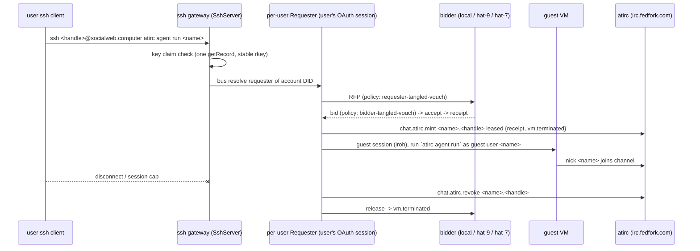

# Acceptance 0002: ssh gateway, per-user OAuth, atirc agent over ssh

Proves `ssh <handle>@socialweb.computer atirc agent run <name>` rents a market VM
**as that user**, starts an atirc agent in it as `<name>.<handle>`, and on session
end revokes the token before the contract is released.

- Gateway: Go `SshServer` + one per-user `Requester` per signed-in DID (`requester-<stamp(did)>`)
- Port 22 on `socialweb.computer` = Go ssh gateway (legacy deno gateway disabled, kept for rollback)
- Web half: `https://ssh.socialweb.computer` (sign-in + `/keys`)
- Last pass: 2026-11-12 23:38-23:56Z, gateway + ssh gateway + bidders on kcp e190a3b1 (release 66f3bd4d, rollout 19), alice,
  no bidders list (discovery: candidates=17 bidders=3). Web sign-in on ssh.socialweb.computer (headless oauth-signin.ts
  `--start-api`; consent page: client ssh.socialweb.computer for @aliceoa.bsky.social), a temp key via `POST /keys`
  (record at its stable rkey; `GET /keys` did not list it, only the `requester_associate` key), `ssh -F /dev/null -p 22`.
  Transient `atirc agent run a2bot < <agent config>`: session_started 23:43:02.37Z, discovery +13 s, hat-7 won, guest ssh
  ready 23:44:00, `requester_session_atirc_minted a2bot.aliceoa.bsky.social` 23:44:01.69Z, JOIN 23:44:33Z (91 s after the
  session start; the guest installs Claude Code first), `a2bot: uname -m; id -un` answered `x86_64 / a2bot` in 3.5 s (guest
  user, not root); disconnect 23:45:42.55Z, `requester_session_atirc_revoked` 23:45:42.576Z, release 23:45:42.62Z,
  Released 23:45:43.87Z (revoke 1.3 s before), records 6/6 deleted. Held `LC_SESSION=a2held`: JOIN 23:50:25Z, answered
  `hostname=fc-lpfuqerea3de-c0268b10 user=a2held` in 3.2 s; disconnect 23:50:45.79Z, revoked 23:50:45.805Z, then
  (known open issue: the guest's agent keeps running) `requester_held_session_released reason=idle` 23:55:45.83Z, hat-8
  Released 23:55:47.65Z, 6/6 deleted. A key with no claim: `Permission denied (publickey)`. Hosts 0 firecracker; no record
  of alice's created in the window remains (full listRecords scan); temp key deleted (RecordNotFound), observer token
  revoked. One WARN `requester_inbox_delete_failed` per contract (StateSync inbox). Not run: the side port (no staged
  build), an unvouched DID; the atirc-side `revocations.ndjson` (no ssh to irc.fedfork.com from the kit: the gateway
  log is the revoke evidence)
- Previous pass: final code, gateway + ssh gateway + bidders on rollout 8 (5e6c4e3d), 2026-11-10 19:42Z: alice signed in again on the web page (headless oauth-signin.ts, `--start-api`), a temp key on `/keys`, transient `ssh aliceoa.bsky.social@socialweb.computer 'uname -a; id; hostname'` -> exit 0 in 63 s, key removed; before: gateway kcp 438ca0fa, bidders rollout 6 (2d367fe8), 2026-11-10 16:45Z: alice signed in again on the web page (headless oauth-signin.ts, `--start-api`), a temp key on `/keys`, transient `ssh aliceoa.bsky.social@socialweb.computer 'uname -a; id; hostname'` -> exit 0 in 61 s, key removed; before: kcp 69aa8b0f (bin 5b8682fd, p2p rollout 2), 2026-11-10 13:33Z: alice, web sign-in + a temp key on `/keys`, transient `ssh aliceoa.bsky.social@socialweb.computer 'uname -a; id; hostname'` -> exit 0 in 62 s (the bidder reached over its offering endpoints); earlier: rc152 2026-11-01 (owner account, atirc agent), rc154 restart check
- The port-22 gateway is its own unit, `swc-ssh-gateway.service` (`run gateway ssh --instance sg`, state `/var/lib/socialweb-computer/socialweb/sg`): `infra/hosts/socialweb-computer.sh --apply` upgrades `bin/current` but does not restart it; restart it after (it runs `bin/current`)



## Preconditions

| Item | Need |
| --- | --- |
| Account | atproto handle, signed in once at `https://ssh.socialweb.computer` (session lives in gateway OpenBao; a deno-era session does not carry over) |
| ssh key | `com.publicdomainrelay.temp.badgeBlueKeys` key claim in the user's own repo at the **stable rkey** (`keyRkey(did, key)`); `/keys` lists it |
| Vouch, bidder side | `bidder-tangled-vouch`: a bidder operator vouches the requester: `sh.tangled.graph.vouch` record, rkey = requester DID, in the operator repo |
| Vouch, requester side | `requester-tangled-vouch`: the requester vouches the bidder operator (other direction) |
| Vouch cache | bidder and requester cache verdicts up to 5 min: after writing a vouch wait 5 min before retry |
| Versions | gateway + ssh gateway >= rc152 (revoke on disconnect), >= rc153 (held sessions survive restart), >= rc154 (vault wait, 0 restarts) |
| Watchers | gateway agent (gw kcp + gw ssh lines), host watcher per bidder (see [0008](0008-host-observer.md)) |

Vouch pairs used on prod (public test accounts): bob -> john, john -> bob.

Check a vouch (`goat` or any getRecord client):

```bash
OP=<bidder operator DID>; REQ=<requester DID>
goat get "at://$OP/sh.tangled.graph.vouch/$REQ" | jq -r .kind     # vouch
goat get "at://$REQ/sh.tangled.graph.vouch/$OP" | jq -r .kind     # vouch
```

## Steps

1. Announce on atirc: `linux-kcp -> all: ssh gateway test as <handle> now; watchers: where does it land?`
2. New host key once after the deno -> Go switch: `ssh-keygen -R socialweb.computer`
3. Transient run (VM lives for the command); the agent config (harness, model; the format `atirc config agent` writes) on
   stdin, else the guest's `atirc agent run` exits `no harness configured`:

   ```bash
   ssh <handle>@socialweb.computer atirc agent run <name> < ~/.config/atirc/config.toml
   ```

4. Held run (session name pinned, survives a gateway restart until expiry):

   ```bash
   ssh -o SetEnv=LC_SESSION=<session-name> <handle>@socialweb.computer atirc agent run <name>
   ```

   Other session env: `LC_VM_NAME` (DNS label), `LC_POLICY` / `LC_POLICY_ARGS` (`none`/`off` refused: a policy always runs), `LC_KEEP_VM`.
5. Side port (staging a new gateway build before it owns 22): `ssh -p 2222 <handle>@socialweb.computer ...`
6. Wait for the nick `<name>` to join the owner channel; address it once (`<name>: say hi`), see one reply.
7. Disconnect (Ctrl-C / close) or let the session cap end it.

## Expected observations

Gateway core log (`gw ssh:` lines on atirc from the gateway agent), in order:

| msg | fields | owner run 2026-11-01 |
| --- | --- | --- |
| `session_started` | did, sessionId | 00:05:34 |
| `requester_bidder_discovery` | candidates=17 bidders=3 | 00:05:47 (+13 s) |
| contract `Held` (gw kcp line, ComputeContract `ssh-run-<hash>`) | winner DID | ~00:06:30 |
| `requester_session_atirc_minted` | subhandle=`<name>.<handle>` | 00:06:33 |
| `guest_session_started` | target | 00:06:34 |
| nick joins channel | | ~00:06:40 |
| `guest_session_terminated` | phase=session | 01:05:33.88 (1 h cap) |
| `requester_session_atirc_revoked` | subhandle | 01:05:33-35 |
| ComputeContract `Releasing` -> `Released`, then DELETED | | 01:05:35 -> 01:05:37 |

- Session start -> agent nick on channel: ~60-70 s (hat run rc151: mint 23:21:34 -> JOIN 23:22:02)
- Disconnect -> Released: ~2-4 s
- atirc side (`revocations.ndjson`): revoke entry **before** contract Released
- Bidder side: `vm.terminated` pinned; ssh-path records may carry **no `request` field** (see 0008)

Gateway restart check (rollout):

- `SshServer ssh-server phase=Ready`, `SshGateway app phase=Ready comps=4/4`
- per-user MarketIdentity `owner-<hash>` `phase=Ready ready=SignedIn` for every signed-in user
- SshServer + requester restarts = 0 (rc154: `requester_signer_key_waits_for_vault`, `sshserver_waits_for_vault` -> `sshserver_vault_ready` -> `signer_key_bound`)

## Pass criteria

- VM rented as the ssh user (ComputeContract owner DID = user DID), not a shared requester
- `<name>.<handle>` minted leased, agent runs as guest user `<name>` (not root), joins and replies
- On disconnect / cap: revoke strictly before Released; zero live tokens for the user afterwards
- Winning host empty after release (watcher line)
- Unvouched DID or missing key claim: refused, no RFP

## Cleanup

- Nothing if the session ended. A held `LC_SESSION` session: reconnect with the same name and exit, or wait for expiry
- Leftover VM: bidder-side termination ([0007](0007-bidder-termination.md))
- Plain (unleased) test token left: revoke it (`atirc revoke` with the parent token) or ask atirc-dev for the manual revocation path

## Known pitfalls

| Symptom | Cause / fix |
| --- | --- |
| stderr `sign in at https://ssh.socialweb.computer first`, exit 1 | per-user requester missing / not Ready: sign in on the web page |
| `OAuthSessionExpiredError: refresh token already consumed` | stale session: sign in again on `ssh.socialweb.computer` |
| all bids denied, bidders' policy runs Succeeded | requester side: user does not vouch the bidder operator |
| no bid at all | bidder side: no operator vouches the user; or 5-min verdict cache still holds the old deny |
| `atirc agent run x` -> `Forbidden` | child subhandle not below the session token; fixed rc150 (gateway mints `<name>.<handle>` directly) |
| harness refuses `--dangerously-skip-permissions` as root | fixed rc151: agent runs as guest user `<name>` |
| key accepted on old TID rkey, refused by new check | copy the key claim to its stable rkey (nothing deleted) |
| `run gateway ssh: ... the SshGateway was not Ready within 10m0s`, the unit restarts every ~10 min | one per-user Requester never gets Ready (2026-11-10: an account whose repo was deleted, RemoteRepo RepoNotFound); remove that account's per-user objects |
| per-user requesters `vault: the Vault is not bound to a ready backend` after a restart | HostProcess `bao-ssh-gateway` stayed Lost (the OpenBaoServer missed the update at startup); restarting the unit once more re-placed it (2026-11-10) |
| `requester_record_delete_skipped` / records left in the user's repo after release | the user's session predates the optional delete scopes (kcp 3e1796d5): sign in again at ssh.socialweb.computer to grant them |
| token alive after session end | rc151 gap (no end-of-command revoke); fixed rc152; lease kills it anyway once `vm.terminated` exists |
| host key warning on 22 | expected once after the deno -> Go switch: `ssh-keygen -R socialweb.computer` |
| Go gateway rented every VM as one identity | design regression caught 2026-10-31; per-user OAuth is the rule, never a shared requester |
