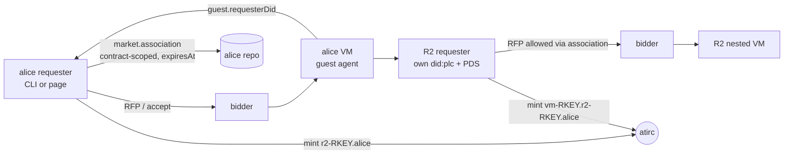

# Acceptance 0005: record association, guest requester R2, cascade release (plan 0036)

Proves an agent that cannot do OAuth can still be a market requester the owner vouches
for: alice's VM starts a second requester R2 (own did:plc + PDS in the VM), alice
writes a contract-scoped `market.association` naming R2, bidders allow R2's RFP via
that record, R2 rents a nested VM, and releasing alice's contract cascades: R2 releases
first, every token in the chain is revoked, the association record is deleted.

- Plan [0036](../plans/0036-record-association.yaml) item V1 (A4-A8)
- Last pass: rc128 cascade 2026-10-30 20:34Z (atirc-dev confirmed server-side); rc127 V1 all 3 tokens revoked



## Preconditions

| Item | Need |
| --- | --- |
| Accounts | alice (authority) signed in by QR; R2 is created inside the VM, nothing to prepare |
| Vouches | bob + john vouch alice; alice vouches bob + john (R2 inherits trust only through the association) |
| Versions | **all** bidders on the same rc (>= rc128): a bidder that ignores `guestTools` can win and the guest has no `socialweb-computer` |
| Scopes | requester `guest.secretsUpdated` c/u, `market.associationRequest` c/u/d; bidder `guest.requesterDid` c (re-sign-in after these were added) |
| atirc | child mint below the r2 token (any depth), lease server |
| Watchers | host watchers (both VMs may land on different hosts), atirc-dev for revocations |

## Steps

```bash
SWC=socialweb-computer; R=~/.tmp/acc36; mkdir -p "$R"; chmod 700 "$R"
NAME=cli-v1-$(date +%s)
# 1. outer VM: agent + socialweb-computer in the guest + guest association slot
$SWC run request --state-dir "$R" --name "$NAME" --hold --guest-tools socialweb-computer \
  --associate guest --agent -- --atproto-oauth-qr > "$R/$NAME-request.log" 2>&1 &
# sign alice in (pendingAction url), wait Held + requester_atirc_minted
# 2. zero-command R2: guest.r2Start -> socialweb-r2.service in the guest
$SWC run request r2 "$NAME" --state-dir "$R" --r2-name r2-v1 --agent --hold
# 3. optional: VM agent for the outer VM
$SWC run request agent "$NAME" --state-dir "$R"
# 4. wait: R2 Held on its nested VM, grandchild nick vm-<rkey>.r2-<rkey>.aliceoa joins
# 5. release ONLY the outer contract: cascade must release R2 first
$SWC run request release "$NAME" --state-dir "$R"
```

Page: Request VM with Associate DID / R2 box (`guestTools`, `fromGuest`, `secretsRef`), then **Start R2**.
Manual fallback in the guest (debug only): `socialweb-computer run request --guest-requester ...` as the agent user (never root).

## Expected observations

Outer requester (alice) log:

| msg | meaning |
| --- | --- |
| `requester_guest_requester_reported` / `requester_guest_requester` | R2 DID arrived via `guest.requesterDid` |
| proof `at://<R2>/...market.associationRequest/request` verified | possession proof of the R2 repo |
| `requester_association_written` | `at://<alice>/com.publicdomainrelay.temp.market.association/requester_associate-<hash>-<rkey>` |
| `requester_atirc_minted` subhandle `r2-<accept rkey>.aliceoa.bsky.social` | child token into `/etc/socialweb-computer/r2-atirc.env` |
| `requester_secrets_updated_sent` | `guest.secretsUpdated` delivered |
| `requester_guest_requester_release` ... `r2Released` | cascade on outer release |
| `requester_atirc_revoked` x2 (r2 + VM agent), `release_revoke left=0` | grandchild covered by suffix |

Guest / R2: `socialweb-r2.service: active` (started by `guest.r2Start`), `association ref arrived`, identity Ready, R2 RFP, Held, in-guest `socialweb-r2-release ok`.

Timings (V1 rc125): R2 DID reported 17:15:48 -> Verified 17:15:52 -> hat-7 bid on R2 RFP 17:16:09 -> R2 joined channel 17:16:38. Cascade revoke ~32 s after outer release.

## Part B: co-located accounts, peer records, retire, out-of-band loss

1. Start R2 with a co-located account: as root in the outer guest (`run request ssh "$NAME" --exec ...`) write
   `/run/socialweb-r2/r2-start.env` (`R2_NAME=r2`, `R2_HOLD=1`, `R2_COLOCATED=mesh1`, root:socialweb-r2 0640), then
   `systemctl start --no-block socialweb-r2.service`. R2 stays in the foreground while Held.
2. R2's core log: AtprotoRecords `peer`, `colocated-mesh1-association`, `colocated-mesh1-mirror`,
   `colocated-mesh1-peer` written; `ingressproxy_iroh_dumbpipe_listening` exposure `svc-pds-pds-iroh`;
   `participant_request_crawl` relay `https://relay.mini-cloud-0002.chadig.com` ok true.
3. From any host: `getRecord(<R2 DID>, computer.socialweb.peer, r2-<accept rkey>.<owner handle>)` and
   `getRecord(<mesh1 DID>, computer.socialweb.peer, mesh1.r2-<accept rkey>.<owner handle>)` carry `iroh` and `lease`;
   `socialweb-computer internal association <mesh1 DID>` exits 0 with `operator` the owner's DID (chain mesh1 -> R2 -> owner).
4. Release the outer contract: plc.directory `/<did>/log/last` is `plc_tombstone` for R2 and mesh1, the owner's
   association record is RecordNotFound (3 reads).
5. Out-of-band loss (a second round): delete the outer ComputeVM on its bidder (0007) without a release;
   `internal association <mesh1 DID>` exits 1, its log says `the contract was terminated`. With the bidder down
   instead, the verdict holds only until the chain's earliest `expiresAt` (accept + 24 h). No cleanup runs in either case.

Last pass: 2026-11-10. Steps 1, 2 (records) and 4 on kcp cef6a0ca (hat-9): both DIDs `plc_tombstone`, association
RecordNotFound x3. Steps 1-3 and 5 on kcp 69aa8b0f (hat-7): crawl ok, both peer records by getRecord over https and over
`dumbpipe connect <ticket>`, mesh1 and R2 resolve to bob; after the out-of-band delete (vm.terminated
`deleted_on_request`) both are unassociated within 7 s, and R2's nested ComputeVM carries `spec.associationExpiresAt`
from the chain (the bidder backstop). That run found the requester kept its contract records after a bidder termination
(fixed: the termination path deletes them before Released).

## Pass criteria

- Bidder policy allows R2's RFP **only** via the association (forged self-claim by R2 denied; a DID not named by alice denied)
- R2 rents a nested VM, grandchild agent joins (3 levels: alice -> r2 -> vm)
- Outer-only release: R2 contract Released first, outer Released, exit 0
- `revocations.ndjson` holds r2, VM agent (grandchild by suffix) before / at termination
- Association record gone after release (`getRecord` -> RecordNotFound, checked 3 times)
- Both hosts empty (watchers)

## Cleanup

- If the cascade failed: release R2 contract first (from the guest or bidder-side delete), then outer
- Orphan R2 VM: [0007](0007-bidder-termination.md) on its host; token dies by lease
- Unrevoked token: atirc-dev server-side revoke by subhandle (suffix covers children)
- R2 runs **no** `atirc sub` (owner rule); kill any test sub

## Known pitfalls

| Symptom | Cause / fix |
| --- | --- |
| guest has no `socialweb-computer` | `-- --guest-tools` went to `spec.options` (bare `--agent` swallowed the next arg, pre rc126); or a pre-rc125 bidder won |
| R2 `run request` refuses root, bundle root-only | rc126 mirrors into `/run/socialweb-r2`, runs as the agent user |
| `run request r2` rejected by CLI | missing from the capabilities registry (rc127); fixed rc128 |
| outer release leaves R2 VM running | no cascade before A8 (rc127) |
| R2 token alive after release | revoke ran in a goroutine after Released and the CLI stopped kcp (rc126); fixed rc127 |
| cross-contract clobber / impersonation via authority vouch | review HIGHs fixed: contract-scoped rkey, nonce proof record in the R2 repo |
| denied accept, no receipt, guest stays | bounded denied-accept release (A8) |
