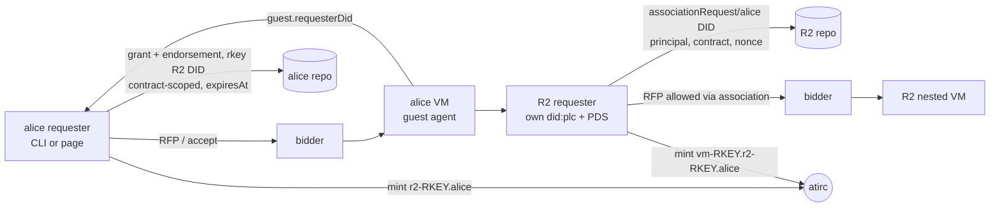

# Acceptance 0005: record association, guest requester R2, cascade release (plan 0036)

Proves an agent that cannot do OAuth can still be a market requester the owner vouches
for: alice's VM starts a second requester R2 (own did:plc + PDS in the VM, DID doc
`https://ident.link/agent-of/<alice DID>`), R2 writes `market.associationRequest/<alice DID>`
{principal, contract, nonce} in its repo, alice checks it and writes the contract-scoped grant
`market.association/<R2 DID>` then `link.ident.endorsement/<R2 DID>`, bidders allow R2's RFP via
the walk R2 -> alice, R2 rents a nested VM, and releasing alice's contract cascades: R2 releases
first, every token in the chain is revoked, alice deletes the endorsement then the grant, R2's DID
is tombstoned.

- Design: [../design/ident-link-associations.md](../design/ident-link-associations.md)

- Plan [0036](../plans/0036-record-association.yaml) item V1 (A4-A8)
- Last pass: 2026-11-11 16:22-16:46Z, kcp f482083c (release 4656466c, rollout 14), alice by QR, no bidders list
  (winner hat-8 for every VM), no workaround. A (`cli-v1-1794414131`): outer Held 16:23:52Z; `run request r2 --r2-name r2-v1
  --agent --hold` 16:24:09Z; R2 reported 16:24:39Z, `requester_association_written` 16:24:40Z, R2 Ready 16:24:46Z, its
  `--agent` contract Held on the nested VM 16:25:52Z (no handle refusal); chain alice -> R2 -> nested R3 (identity-only) ->
  nested agent, roots [alice]; the owner node lists the nested agent. Outer-only release: R2 released first
  (`requester_guest_requester_released` ok after 5m24s: the nested identity-only R3 never answered its r2Release, see
  pitfalls), `requester_guest_dids_tombstoned by=the guest`, records 14/14, grant + endorsement RecordNotFound x3, R2, R3
  and the agent `plc_tombstone`, hosts empty. B (`cli-v1-1794415120`): R2 with `R2_COLOCATED=mesh1` Held 16:42:08Z; iroh
  dumbpipe listening, crawl, R2 and mesh1 peer records (`iroh`, no `lease`), R2's grant + endorsement of mesh1, mesh1
  `alsoKnownAs` [at://mesh1.<R2 handle>, agent-of/R2], walk roots [alice]; release: `r2Released` in 24 s, records 12/12,
  both DIDs `plc_tombstone`. Step 5 (out-of-band loss) not re-run. Before: 2026-11-11 13:32-13:38Z, kcp e496cbff, **FAIL**
  (ref never mirrored, R2's agent check wanted a resolving handle; fixed in 982ba545, e9f1de4a)
- Earlier pass: part A rc128 cascade 2026-10-30 20:34Z (atirc-dev confirmed server-side); part B 2026-11-10 (see its end).
  Both predate the ident.link cut-over (old-shape association, mirror, peer `lease`): not yet re-run on the records below



## Preconditions

| Item | Need |
| --- | --- |
| Accounts | alice (authority) signed in by QR; R2 is created inside the VM, nothing to prepare |
| Vouches | bob + john vouch alice; alice vouches bob + john (R2 inherits trust only through the association) |
| Versions | **all** bidders on the same main (>= kcp 8601013d): a bidder that ignores `guestTools` can win and the guest has no `socialweb-computer`; the guest runs the winner's binary, so part B needs it on every bidder |
| Requester host | `dumbpipe` on PATH: an iroh-only bidder (hat-9: offering `endpoints` [iroh, webrtc]) is reached over iroh first |
| Owner | part A as alice (QR); part B ran as bob (pdsAccount, `--atproto-pds-url https://bsky.social`); any requester whose bidders allow it works |
| Scopes | requester `guest.secretsUpdated` c/u, `market.association` and `market.associationRequest` c/u/d, optional `repo:link.ident.endorsement?action=create&action=delete` (without it `requester_endorsement_skipped`, R2 stays unassociated); bidder `guest.requesterDid` c (re-sign-in after these were added) |
| atirc | child mint below the r2 token (any depth), lease server |
| Watchers | host watchers (both VMs may land on different hosts), atirc-dev for revocations |

## Steps

```bash
SWC=socialweb-computer; R=~/.tmp/acc36; mkdir -p "$R"; chmod 700 "$R"
NAME=cli-v1-$(date +%s)
# 1. outer VM: agent + socialweb-computer in the guest + guest association slot
$SWC run request --state-dir "$R" --name "$NAME" --hold --guest-tools socialweb-computer \
  --associate guest --agent -- --atproto-oauth-qr > "$R/$NAME-request.log" 2>&1 &
# sign alice in (pendingAction url), wait Held + requester_atirc_minted
# 2. zero-command R2: guest.r2Start -> socialweb-r2.service in the guest
$SWC run request r2 "$NAME" --state-dir "$R" --r2-name r2-v1 --agent --hold
# 3. optional: VM agent for the outer VM
$SWC run request agent "$NAME" --state-dir "$R"
# 4. wait: R2 Held on its nested VM, grandchild nick vm-<rkey>.r2-<rkey>.aliceoa joins
# 5. release ONLY the outer contract: cascade must release R2 first
$SWC run request release "$NAME" --state-dir "$R"
```

Page: Request VM with Associate DID / R2 box (`guestTools`, `fromGuest`, `secretsRef`), then **Start R2**.
Manual fallback in the guest (debug only): `socialweb-computer run request --guest-requester ...` as the agent user (never root).

## Expected observations

Outer requester (alice) log:

| msg | meaning |
| --- | --- |
| `requester_guest_requester_reported` / `requester_guest_requester` | R2 DID arrived via `guest.requesterDid` |
| `requester_association_request_entry` | bundle entry `/etc/socialweb-computer/association-request.json` {principal, contract, nonce, rotationKey} |
| `at://<R2>/com.publicdomainrelay.temp.market.associationRequest/<alice DID>` verified | principal == alice, contract == the accept, nonce (constant time) |
| `requester_association_written subject=<R2 DID>` | grant `at://<alice>/com.publicdomainrelay.temp.market.association/<R2 DID>` {agent, contract, expiresAt, createdAt}, then `link.ident.endorsement/<R2 DID>` {agent}; its strongRef in the refFile (R2's `--association-ref`) |
| `requester_atirc_minted` subhandle `r2-<accept rkey>.aliceoa.bsky.social` | child token into `/etc/socialweb-computer/r2-atirc.env` |
| `requester_secrets_updated_sent` | `guest.secretsUpdated` delivered |
| `requester_guest_requester_release` ... `r2Released` | cascade on outer release |
| `requester_atirc_revoked` x2 (r2 + VM agent), `release_revoke left=0` | grandchild covered by suffix |
| `requester_association_deleted rkey=<R2 DID>` | endorsement, then grant deleted |

Guest / R2: `socialweb-r2.service: active` (started by `guest.r2Start`), `association ref arrived`, identity Ready, R2 RFP, Held, in-guest `socialweb-r2-release ok`, `local_account_retired did=<R2 DID> plc=tombstoned`.

Check the pair + grant while R2 is Held (read only):

```bash
ALICE=did:plc:lpfuqerea3deuoyrn7ojser4; R2=<R2 DID>   # `subject` of requester_association_written
pds() { curl -s "https://plc.directory/$1" | jq -r '.service[] | select(.id=="#atproto_pds") | .serviceEndpoint'; }
rec() { curl -s "$(pds "$1")/xrpc/com.atproto.repo.getRecord?repo=$1&collection=$2&rkey=$3" | jq -c '.value // .error'; }
rec "$ALICE" com.publicdomainrelay.temp.market.association "$R2"        # {agent, contract, expiresAt, createdAt}
rec "$ALICE" link.ident.endorsement "$R2"                               # {agent}
rec "$R2" com.publicdomainrelay.temp.market.associationRequest "$ALICE" # {principal, contract, nonce, createdAt}
curl -s "https://plc.directory/$R2" | jq -c .alsoKnownAs                # at://<R2 handle>, https://ident.link/agent-of/$ALICE
curl -s "https://plc.directory/$R2/data" | jq -c .rotationKeys          # [renter key, VM localPDS key]; an OAuth renter: [VM localPDS key]
socialweb-computer internal association "$R2" | jq -c '{roots, expiresAt, errors}'   # roots [ALICE]
# the renter's core log: $R/requests/$NAME/dev/$NAME/logs/core.log while it runs, $R/requests/$NAME/logs/core.log after
```

Timings (V1 rc125): R2 DID reported 17:15:48 -> Verified 17:15:52 -> hat-7 bid on R2 RFP 17:16:09 -> R2 joined channel 17:16:38. Cascade revoke ~32 s after outer release.

## Part B: co-located accounts, peer records, retire, out-of-band loss

1. Start R2 with a co-located account: as root in the outer guest (`run request ssh "$NAME" --exec ...`) write
   `/run/socialweb-r2/r2-start.env` (`R2_NAME=r2`, `R2_HOLD=1`, `R2_COLOCATED=mesh1`, root:socialweb-r2 0640), then
   `systemctl start --no-block socialweb-r2.service`. R2 stays in the foreground while Held.
2. R2's core log: AtprotoRecords `peer`, `colocated-mesh1-grant`, `colocated-mesh1-endorsement`,
   `colocated-mesh1-peer` written; `ingressproxy_iroh_dumbpipe_listening` exposure `svc-pds-pds-iroh`;
   `participant_request_crawl` relay `https://relay.mini-cloud-0002.chadig.com` ok true.
3. From any host (helpers above, `M=<mesh1 DID>`): `rec "$R2" computer.socialweb.peer <R2 handle>` (`<label>-<rfp rkey>.<renter handle>`) and
   `rec "$M" computer.socialweb.peer mesh1.<R2 handle>` carry `iroh`, no `lease`;
   `rec "$R2" com.publicdomainrelay.temp.market.association "$M"` (same contract + expiresAt as R2's grant) and
   `rec "$R2" link.ident.endorsement "$M"`; `curl -s https://plc.directory/$M | jq -c .alsoKnownAs` is
   [`at://mesh1.<R2 handle>`, `https://ident.link/agent-of/<R2 DID>`], `/data` rotationKeys as R2's;
   `socialweb-computer internal association "$M"` exits 0, roots [owner DID], ancestors R2 (depth 1) and owner (depth 2).
4. Release the outer contract: for R2 and mesh1 `curl -s -o /dev/null -w '%{http_code}' https://plc.directory/<did>` is
   404 and `/<did>/log/last` is `plc_tombstone`; the owner's endorsement and grant at rkey = R2 DID are RecordNotFound (3 reads).
5. Out-of-band loss (a second round): delete the outer ComputeVM on its bidder (0007) without a release;
   `internal association <mesh1 DID>` exits 1, its log says `the contract was terminated`. With the bidder down
   instead, the verdict holds only until the chain's earliest `expiresAt` (accept + 24 h). R2 never retires (its VM is
   gone), so on the bidder's vm.terminated the owner's requester tombstones both DIDs with its own rotation key (first in
   their rotationKeys): `requester_tombstoned did=<R2 DID>` and `did=<mesh1 DID>` with `key=<renter did:key>` (none
   while R2 still runs: `requester_guest_dids_tombstoned by=the guest`), then for both `curl -s -o /dev/null -w '%{http_code}'
   https://plc.directory/<did>` is 404 and `/<did>/log/last` is `plc_tombstone`; `requester_tombstone_skipped` names the
   reason when it does not (no agent-of, or the renter key is not a rotation key). The owner's requester logs
   `requester_contract_records_deleted`: its accept, rfp, compute.vm, contract-scoped grant + endorsement and
   rbac record are RecordNotFound within seconds. A policy with `association.maxDepth: 1` denies mesh1 (one link only).

Last pass: 2026-11-10. Steps 1, 2 (records) and 4 on kcp cef6a0ca (hat-9): both DIDs `plc_tombstone`, association
RecordNotFound x3. Steps 1-3 and 5 on kcp 69aa8b0f (hat-7): crawl ok, both peer records by getRecord over https and over
`dumbpipe connect <ticket>`, mesh1 and R2 resolve to bob; after the out-of-band delete (vm.terminated
`deleted_on_request`) both are unassociated within 7 s, and R2's nested ComputeVM carries `spec.associationExpiresAt`
from the chain (the bidder backstop). That run found the requester kept its contract records after a bidder termination
(fixed: the termination path deletes them before Released).
2026-11-10 14:41-14:46Z, bidders on kcp 4ccc3bd6, owner bob: parts A and B pass in one round (outer and R2's nested VM on
hat-9): the R2 association and `r2-<accept rkey>.bobvmbuilder.bsky.social` token, the agents mesh-keyed
(`requester_agent_mesh_key_written`, no agent token), R2 Held and up, part B records, crawl and chain as above; the
outer-only release cascades (R2 Released first, `atircRevokes` Done), both DIDs `plc_tombstone`, and none of bob's
contract records since the round remain. 15:47-15:50Z, bidders on kcp 2d367fe8: `run request r2 <name> --r2-name r2
--agent --hold` with no manual `run request agent`: the guest requester logs `agentStart is out` when Held, the hat-9
bidder queues the guest event for R2's nested VM, and the release again leaves no records.

## Pass criteria

- Bidder policy allows R2's RFP **only** via the association (forged self-claim by R2 denied; a DID not named by alice denied)
- R2 rents a nested VM, grandchild agent joins (3 levels: alice -> r2 -> vm)
- Outer-only release: R2 contract Released first, outer Released, exit 0
- `revocations.ndjson` holds r2, VM agent (grandchild by suffix) before / at termination
- The owner's grant + endorsement at rkey = R2 DID and the requester's other contract records (accept, rfp, compute.vm, rbac) gone after release or
  a bidder termination (`getRecord` at their keys -> RecordNotFound, checked 3 times); R2 and co-located DIDs `plc_tombstone`
  after a release
- Both hosts empty (watchers)

## Cleanup

- If the cascade failed: release R2 contract first (from the guest or bidder-side delete), then outer
- Orphan R2 VM: [0007](0007-bidder-termination.md) on its host; token dies by lease
- Unrevoked token: atirc-dev server-side revoke by subhandle (suffix covers children)
- R2 runs **no** `atirc sub` (owner rule); kill any test sub
- `run request release <name>` of an invocation that is Released, or Failed before a VM was held, only removes it

## Known pitfalls

| Symptom | Cause / fix |
| --- | --- |
| guest has no `socialweb-computer` | `-- --guest-tools` went to `spec.options` (bare `--agent` swallowed the next arg, pre rc126); or a pre-rc125 bidder won |
| R2 `run request` refuses root, bundle root-only | rc126 mirrors into `/run/socialweb-r2`, runs as the agent user |
| `run request r2` rejected by CLI | missing from the capabilities registry (rc127); fixed rc128 |
| outer release leaves R2 VM running | no cascade before A8 (rc127) |
| R2 token alive after release | revoke ran in a goroutine after Released and the CLI stopped kcp (rc126); fixed rc127 |
| cross-contract clobber / impersonation via authority vouch | review HIGHs fixed: nonce proof record in the R2 repo; a grant at rkey = R2 DID bound to another contract is refused (`is bound to another contract`) |
| R2 Ready but its RFPs denied, `internal association <R2>` no roots | the renter's endorsement is missing: `requester_endorsement_skipped` (the optional scope); sign the renter in again |
| R2 waits for the association ref forever (`/run/socialweb-r2/association-ref` empty) | kcp e496cbff mirrored the ref only with a non-empty `r2-atirc.env`; fixed in 982ba545, passed 2026-11-11 |
| R2's `--agent` contract `refused: the atirc agent needs a requester handle that resolves to <R2 DID>` | kcp e496cbff; fixed in e9f1de4a (identlink.HandleOK), passed 2026-11-11 |
| the cascade takes minutes; R2's log has the nested contract waiting on its own guest requester | a nested identity-only R2 (the `--agent` of R2's contract) answers `r2Release`, but the bidder refuses the message (`printableASCII` rejects spaces), so its renter waits its timeout ([0004](0004-vm-atirc-agent.md) pitfalls); fix pending |
| denied accept, no receipt, guest stays | bounded denied-accept release (A8) |
