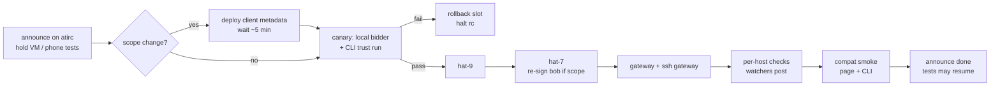

# Acceptance 0006: rc rollout checks and compat smoke

Proves a release candidate is live and healthy on every prod component and that the
**unchanged** clients (prod page, iOS app, CLI of the previous rc) still work against it.
Run after every rollout; it is the gate before "tests may resume".

- Components: gateway (`socialweb.computer`), ssh gateway, bidders local (hat-8) / hat-9 / hat-7, page (`shell.socialweb.computer`)
- Build: the CI build of a main commit: `main/<commit>/binaries/socialweb-computer-linux-amd64` in the public bucket once the run's
  `publish` job succeeded, else the run's `binaries` artifact (`gh run download <run> -n binaries`); check it against that run's
  `SHA256SUMS`. A local tag build is the fallback. Installs run from the lead host over ssh (no CI deploy key)
- Rollout 10 (bidders only): 2026-11-11, 253031e2 (CI 42927796096, published sha256 233343a9cc0b = `main/latest`).
  hat-9 00:57Z, hat-7 01:01Z, hat-8 `swc-bidder` 01:02Z, each after `pgrep -x firecracker` = 0 and a config backup
  (`config.json.bak-rollout10-*`): version, readyz ok, MarketBidder Ready, offering `["iroh","webrtc"]`, 0 ERROR from
  start, three `ingress.offer` stream dials, mesh UDP listener, hosts empty. Rollback: `bin/previous` = d1f19736 (rollout 9).
  Proof round: [0007](0007-bidder-termination.md) last expiry pass
- Last pass: 2026-11-13 01:05-01:36Z, rollout 20 (release/rc165 038bd32e = e190a3b1 + the startup-wait fix 5b75ac08 + the
  release-records fix; `v0.0.0-rc165-pre1`, `bin/current` sha256 24a8b5307d19, `bin/previous` 66f3bd4d) on every
  component. Bidders hat-7 (unit start 00:55:55Z), hat-9 (00:56:09Z), hat-8 `swc-bidder` (00:56:25Z): version, `bidder.json`
  ready=true, MarketIdentity Ready (hat-7 SignedIn=True; hat-8, hat-9 localRepo, Associated=True), no `pendingAction`,
  `bidder-tangled-vouch`, MarketBidder `app` Ready 6/6, offering `self` `["iroh","webrtc"]` with no `endpointUrl`, NRestarts
  0, 0 ERROR / 0 unsupported from start, 0 `starts before its virtual workspace serves discovery` (the rollout 19 start
  logged 11 per bidder; same grep), `ingress.offer` lines hat-8 5, hat-9 3, hat-7 3, hosts 0 ComputeVM / FirecrackerVM /
  firecracker / `vms/`. Gateway (unit start 01:04:31Z) and `swc-ssh-gateway.service` (01:04:57Z), `bin/current`
  24a8b5307d19, NRestarts 0 after 21 min, 0 ERROR and 0 startup-wait timeouts from start on both (the
  `testaccount-alice-atirc-operator` retries no longer show), no failed system units: Gateway Ready ("every component is
  ready"), SshGateway `app` Ready, SshServer Ready, `owner-3b4d61ac074e291a` and `owner-748258c72ce18fe0` Ready
  SignedIn=True, HostProcesses `bao-ssh-gateway`, `iroh-dial`, `bootstrap-*` Running; k8s, root, ssh /healthz, atlibs,
  shell 200, kcp 403. Compat smoke, alice, no bidders list: CLI of rollout 19 (e190a3b1, binary 66f3bd4dc927, hat-8) `run
  request --hold --exec id -- --atproto-oauth-qr` 01:12:21Z: consent page qr.fedfork.com for @aliceoa.bsky.social, 3 bids,
  winner hat-8, Held, `uid=0(root)`, release exit 0 01:16:13Z, phase `released`, rfp / accept gone; the old CLI's release
  still left its release `market.event` and `compute.events.vm.delete` (the fix is in the requester, so an old client keeps
  the bug; both deleted by hand, RecordNotFound x3). The new CLI's six releases in 0001 section 9 and 0003 (same day) left
  0. Page compat: 0009
- Previous pass: 2026-11-12 21:35-21:56Z, rollout 19 (kcp e190a3b1, release sha256 66f3bd4dc927) on every component (rolled
  21:10-21:20Z by the lead). Bidders hat-7 (unit start 21:10:30Z), hat-9 (21:10:44Z), hat-8 `swc-bidder` (21:10:57Z):
  version `v0.0.0-rc99.0.20261112201800-e190a3b1c7ee`, `bin/current` sha256 66f3bd4dc927, `bidder.json` ready=true,
  MarketIdentity Ready (hat-7 SignedIn=True; hat-8, hat-9 localRepo), no `pendingAction`, `bidder-tangled-vouch`,
  MarketBidder `app` Ready, offering `self` `["iroh","webrtc"]` with no `endpointUrl`, 0 ERROR / 0 unsupported from start,
  `ingress.offer` dial lines (hat-8 11, hat-9 3, hat-7 3), mesh UDP 31001 / 31002, hosts empty. Gateway (unit start
  21:18:44Z) and `swc-ssh-gateway.service` (21:20:15Z), both `bin/current` 66f3bd4dc927, NRestarts 0 after 30 min: Gateway
  Ready ("every component is ready"), SshGateway `app` Ready, SshServer Ready, `owner-3b4d61ac074e291a` and
  `owner-748258c72ce18fe0` Ready SignedIn, `bao-ssh-gateway` and `iroh-dial` Running; ssh gateway 0 ERROR from start;
  gateway 7 ERROR from start (21:29:59-21:30:33Z), all `Reconciler error` of the pre-existing `root:app` AtprotoRecord
  `testaccount-alice-atirc-operator` (Failed since 2026-10-31, ScopeMissing `com.fedfork.irc.agentOperator`, see 0001);
  k8s, root, ssh /healthz, atlibs, shell 200, kcp 403. The gateway host also lists a failed
  `socialweb-hp-gw-pg-2wjeqtgx-r19c1.service` (a tenant cluster's pg HostProcess left from an earlier run; not touched)
- Compat smoke on rollout 19, alice, no bidders list, 2026-11-12: CLI of rollout 18 (ac51b91e, binary 3421208fa716, hat-8)
  `run request --hold --exec id -- --atproto-oauth-qr` 21:45:27Z: QR sign-in (consent page: qr.fedfork.com for
  @aliceoa.bsky.social), 3 bids, winner hat-8, Held 21:48:25Z, `uid=0(root)`; `run request release` -> Released 21:50:16Z,
  `requester_contract_records_deleted` 4/4 (rfp, accept RecordNotFound), but the release `market.event` and its
  `compute.events.vm.delete` stayed in alice's repo (deleted by hand; pitfalls). The prod page files
  (https://shell.socialweb.computer/, last-modified 2026-11-11 10:35Z, `modules/requester.wasm` sha256 305329f484b5) in the
  requester repo's `scripts/page-round.mjs` (`PAGE_ROOT`, no bidder: discovery) 21:55:12Z: 3 ingress offers (one per bidder),
  https `submit*` 0, winner hat-8, receipt, shell `Linux fc-lpfuqerea3de-1d26077f ... uid=0(root)` over the guest
  datachannel, release, 7 records getRecord 400, 0 offers left, 48 s, hosts empty. The harness needed `identlink` passed to
  the WebrtcCubit as the page's `main.js` does (pitfalls). No atirc token on either contract (atirc check n/a)
- Previous pass: 2026-11-10, rollout 8 (5e6c4e3d, published sha256 b7b286df94b4) on every component. Bidders hat-9 19:19Z,
  hat-7 19:20Z, hat-8 `swc-bidder` 19:21Z (`main/<commit>/binaries` checked against SHA256SUMS, `infra/hosts/hat-N.sh
  --apply`, hat-8 `SSH_TARGET=hat-8 infra/bidder/deploy.sh --apply`): version, MarketBidder Ready 6/6, no `pendingAction`,
  `bidder-tangled-vouch`, offering `["iroh","webrtc"]` with no `endpointUrl`, 0 ERROR / 0 unsupported from start, three
  `computer.socialweb.ingress.offer` stream dials (two jetstream, one relay), mesh UDP in 31000-31999, hosts empty.
  Gateway `scripts/deploy.sh` (no env or spec file) 19:23Z, then `systemctl restart swc-ssh-gateway.service`: Gateway Ready
  5/5, SshGateway Ready, `owner-<hash>` Ready SignedIn, `bao-ssh-gateway` and `iroh-dial` Running, 12 min with 0 restarts,
  0 ERROR from start on both units (rollout 7, c770a887, had 3 `provider not found` at the gateway start and one `Failed
  to watch ... context canceled` at a createCluster; 6745dd6f and e4cff4ae fix them), k8s, root, ssh, ssh /healthz,
  atlibs and shell 200, kcp 403; caddy sites unchanged. Rollout 7 (c770a887, 18:00Z) brought hat-8 `swc-bidder` from rc159
  (an `endpointUrl`-only offering) to the same release as the hats.
- Compat smoke on rollout 8 (5e6c4e3d), alice, 2026-11-10: CLI of the previous build (41319a3a, hat-8) `run request
  --hold --exec id` 19:45Z: Held in 65 s, `uid=0(root)`, Released. Prod page https://shell.socialweb.computer (unchanged,
  OAuth through its form, `contract` via webrtc to hat-9) 19:50Z: signed in, receipt, shell `Linux ... uid=0` over the
  guest datachannel, release, 7 records deleted, 0 errors, 46 s, hat-9 empty. The run before it (19:46Z) got the
  receipt, released and deleted its 5 records but ended `the guest did not report what via "webrtc" needs` after 176 s
  (no guest webrtc fingerprint seen in its watch): one flake in two
- Previous pass: 2026-11-10. Bidders hat-7 + hat-9 on rollout 6 (2d367fe8) 15:47Z: version, bidder.json ready, MarketIdentity
  Ready, `bidder-tangled-vouch`, 0 ERROR / 0 unsupported since restart, hosts empty. Gateway + ssh gateway on rollout 5
  (438ca0fa) 15:31Z: SshGateway Ready, 12 min with 0 restarts, 0 ERROR from start, endpoints 200. Compat smoke (bob, rollout 5
  bidders): CLI `run request --exec id` Held -> Released (hat-9); atlibs requester page at shell.socialweb.computer, fresh
  profile: bind_key, Run a contract -> receipt, guest hostKeys + webrtc fingerprint, release terminated, its 5 records deleted
- Previous pass: rc154, 2026-11-01 02:22-02:25Z (all components, 0 restarts); page compat vs rc153 01:17Z



## Preconditions

- Release built from a local tag; `sha256sum` of the binary recorded; independent review verdict "no blocking" for every change in it
- Peers told: `linux-kcp -> all, wasm: rcN rollout now (gateway, ssh gateway, then bidders); hold VM/phone tests until done.` Wait for any in-flight phone / VM run to release first
- Owner-held VMs listed (never restarted under, never released)
- Role-scope change? then qr / client metadata deployed first, metadata cache waited out (~5 min), drives-oauth lined up to re-sign oauthQr identities (hat-7 bob, gateway alice)
- Floor rule: never roll a bidder below rc139 (offering/self writer)

## Steps

1. Canary: upgrade the local bidder only (others stay on the old rc), CLI trust run (alice, `bidder-tangled-vouch`): Held, Released rc=0. Pause the other bidders if the canary must land locally (see 0003)
2. Upgrade hat-9, then hat-7 (`upgrade --binary <staged> --sha256 <sha>`, then `install bidder --handle <handle>`; [bidder.md](../bidder.md#installed))
3. Gateway + ssh gateway ([deploy.md](../deploy.md))
4. Per-host checks below (host watchers post one CONFIRMED line + one host line each)
5. Compat smoke (below)
6. Announce: `rcN done: <components>. tests may resume.`

Per-bidder check (run as root on the host, or read the watcher post):

```bash
STATE=/var/lib/socialweb-computer/swc-bidder
K=$(sudo -n -u swc-bidder sh -c "ls -t $STATE/handles/*/kcp/front.json | head -1 | sed s,front.json,admin.kubeconfig,")
kb() { sudo -n -u swc-bidder env HOME=$STATE KUBECONFIG="$K" kubectl "$@"; }
sudo "$STATE/bin/current/socialweb-computer" version --json | jq -r '.version,.commit'
kb get marketidentities.socialweb.computer bidder -o jsonpath='{.status.phase} {.status.conditions[?(@.type=="SignedIn")].status} {.status.pendingAction}{"\n"}'
kb get bidders.socialweb.computer bidder -o jsonpath='{.spec.policy}{"\n"}'
U='socialweb-computer-bidder@<handle>.service'
sudo journalctl _SYSTEMD_USER_UNIT="$U" --since "<restart time>" | command grep -c '"level":"ERROR"'
sudo journalctl _SYSTEMD_USER_UNIT="$U" --since "<restart time>" | command grep -c 'unsupported type'
kb get computevms.socialweb.computer,firecrackervms.socialweb.computer --no-headers; pgrep -c -x firecracker
```

Compat smoke (unchanged clients vs new servers):

- Page: the deployed page files (`index.html`, `*.js`, `stage.json`, `modules/` of https://shell.socialweb.computer/) in the requester repo's `scripts/page-round.mjs` with `PAGE_ROOT` set to them and no bidder (discovery), as alice ([0009](0009-browser-page.md) A3 / A6): offers > 0, https `submit*` 0, receipt, shell, release, every record 400. Announce "no parallel alice runs"
- CLI: `run request --hold --exec "id"` (previous rc CLI if the RFP / bid shape changed), Held, Released
- atirc-dev confirms revoke via=account before release in `revocations.ndjson`

## Expected observations

| Check | Pass value |
| --- | --- |
| version | `v0.0.0-rcN <commit>` on every host |
| `bidder.json` | `ready=true` |
| MarketIdentity | `Ready`, `SignedIn=True`, `pendingAction` absent |
| policy | `bidder-tangled-vouch` (never `open`) |
| startup | 0 `"level":"ERROR"`, 0 `unsupported type: source.TypedFunc` since restart |
| guest image | `bidder_guest_image_ready` in the bidder's log since its start (it verified its pinned guest image against versions.json; until then it withdraws its offering, sends no heartbeat and refuses VM RFPs, logging `bidder_guest_image_unready`); reading `guestImageUnready`, the count of failed checks before it |
| host | 0 computevms / 0 firecrackervms / 0 firecracker procs / `vms/` empty (sudo), or only owner-held VMs |
| gateway | `Gateway gateway phase=Ready comps=5/5`, `SshGateway app phase=Ready comps=4/4`, `SshServer ssh-server phase=Ready`; the SshGateway Ready message carries no `signed-in account requesters are not ready` (per-user requesters do not gate it, 554bb104) |
| ssh gateway users | every `owner-<hash>` MarketIdentity `Ready ready=SignedIn`; an owner who must sign in again is `SessionExpired` with one WARN `a MarketIdentity needs its owner to sign in again`, never a Reconciler ERROR (3b65b44e); a new optional scope never expires a session (07c5d797) |
| restarts | SshServer + per-user requesters 0 (rc154+); `swc-ssh-gateway.service` NRestarts unchanged for 12 min after its restart (its startup gate is 10 min) |
| ssh gateway HostProcesses | `bao-ssh-gateway`, `iroh-dial` Running after the restart (a Lost one is placed again, 77f52875) |
| page compat | Held 50-55 s, `tokens: revoked` + `released`, revoke ~8-9 s before release |

Timings: one bidder restart ~2 min (VMs survive the upgrade); rc154 whole rollout 02:22:05 -> 02:24:37 (no scope change). Watcher CONFIRMED lines land within ~30 s of the restart.

## Pass criteria

- Every row above passes on every component
- Compat smoke passes on the unchanged prod page (no page rebuild needed) and the CLI
- No in-flight peer run was broken by the rollout

## Cleanup / rollback

- Bidder: `rollback` swaps `bin/current` / `bin/previous` and restarts ([bidder.md](../bidder.md#installed))
- Page: redeploy the previous `page-rcN` tag
- ssh gateway on 22: re-enable the legacy unit only as last resort (kept for rollback)
- Release compat smoke VMs; hosts empty

## Known pitfalls

| Symptom | Cause / fix |
| --- | --- |
| oauthQr bidder `Failed/SessionExpired` right after rollout (rc121, ~2 min outage) | scope added to Bidder/RequesterOAuthScope; re-sign from pendingAction url; announce before tagging |
| sign-in gets old scope set | client metadata cached; wait ~5 min after deploy |
| canary "not vouched" while scope lane allows (rc123) | policy regression; roll the canary back, halt the rc |
| page stuck "waiting for kcp" (`/policy_sandbox.js` 404) | asset missing from prod bundle list; fix or roll back within 10 min |
| page `field not declared in schema` | page manifests not re-applied (ETag read from `kcp.wasm`, prod serves `.gz`); roll page back, fix ETag |
| 7 min gateway outage, schema rev burned (rc146) | record burned revs; root-cause restart churn before next rc |
| peer phone run confounded | rollout restarted bidders mid-contract; wait for a gap |
| `version` prints the old rc | upgrade staged but `install bidder` not re-run, or wrong handle instance |
| `run gateway ssh: the SshGateway was not Ready within 10m0s`, restart every 10 min (2026-11-10) | a per-user requester could not start (its account deleted at its PDS: RemoteRepo RepoNotFound); fixed in 554bb104. Mitigation: back up `sg/`, delete that account's `owner-<hash>` MarketIdentity and `requester-<hash>` (and its Service/Exposure) on the ssh gateway kcp |
| every ssh gateway user `SessionExpired` right after a redeploy (2026-11-10, 3e1796d5) | a new optional OAuth scope was counted as required for oauthSessionProxy identities; fixed in 07c5d797. Users sign in again |
| ERROR `get informer failed: no matches for kind "AtircNode"` for ~20 s after the restart that adds a kind | the export served before the set apply added the kind; fixed in 8c613c21 (the provider waits for its kinds) |
| bidder ERROR `vault: the Vault is not bound to a ready backend` at start; ssh gateway the same from the marketidentity controller | the reconcile ran before the provider bind; fixed in 1c01bcbb (MarketBidder) and 07c5d797 (MarketIdentity) |
| bidder ERROR `bus: no accepted ComponentLink allows root:RemoteRepo...` every 5 min | an account RemoteRepo left behind by a pdsAccount -> localRepo switch; fixed in 1c01bcbb (pruned) |
| prod page run fails after the receipt, ~176 s in: `the guest did not report what via "webrtc" needs` (1 in 2, 2026-11-10 19:46Z) | the guest reports vm.onNetwork for ssh and shell a few ms apart; the bidder's guest recorder (`internal/guestidentity/guestrecord.go` OnNetwork, read-modify-write on a cached ComputeVM) dropped one tag, so only one onNetwork record was published (bidder journal: one `a market report StateSync is created` for vm.onNetwork per VM). Page side: requester 84ffaf9 takes any tag's fingerprint; the page's webrtc watch reads ssh and shell. Bidder side: fixed in rollout 9 |
| kubectl `connection refused` on a bidder host | the snippet picked a stale handle's kubeconfig; pick the handle with the newest `front.json` (381a186f) |
| `page-round.mjs`: every bid `denied by policy (scope): scope denied by requester-tangled-vouch` (2026-11-12) | the harness builds the WebrtcCubit without `identlink`; the page's `main.js` passes it (`import * as identlink from '@publicdomainrelay/identlink'`). Without it the policy's identlink walk (`com.fedfork.exec.sync.getRecord`) is not available. Pass `identlink` as `main.js` does |
| CLI release leaves the release `market.event` and its `compute.events.vm.delete` in the requester repo (rollout 19, 2026-11-12) | `finishRelease` calls `deleteContractRecords` before `writeStatus`; `deleteMarketRecords` reads `r.stateCopy()`, which does not carry `state.Release` yet (`releaseEnvelope` sets it on the release path's copy). Open; delete both by hand after a CLI round |
