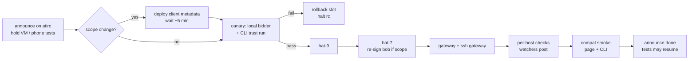

# Acceptance 0006: rc rollout checks and compat smoke

Proves a release candidate is live and healthy on every prod component and that the
**unchanged** clients (prod page, iOS app, CLI of the previous rc) still work against it.
Run after every rollout; it is the gate before "tests may resume".

- Components: gateway (`socialweb.computer`), ssh gateway, bidders local (hat-8) / hat-9 / hat-7, page (`shell.socialweb.computer`)
- Build: local tag `v0.0.0-rcN` off local main, local build with pin check (no GitHub push, no CI deploy key; installs run from the lead host over ssh)
- Last pass: rc154, 2026-11-01 02:22-02:25Z (all components, 0 restarts); page compat vs rc153 01:17Z



## Preconditions

- Release built from a local tag; `sha256sum` of the binary recorded; independent review verdict "no blocking" for every change in it
- Peers told: `linux-kcp -> all, wasm: rcN rollout now (gateway, ssh gateway, then bidders); hold VM/phone tests until done.` Wait for any in-flight phone / VM run to release first
- Owner-held VMs listed (never restarted under, never released)
- Role-scope change? then qr / client metadata deployed first, metadata cache waited out (~5 min), drives-oauth lined up to re-sign oauthQr identities (hat-7 bob, gateway alice)
- Floor rule: never roll a bidder below rc139 (offering/self writer)

## Steps

1. Canary: upgrade the local bidder only (others stay on the old rc), CLI trust run (alice, `bidder-tangled-vouch`): Held, Released rc=0. Pause the other bidders if the canary must land locally (see 0003)
2. Upgrade hat-9, then hat-7 (`upgrade --binary <staged> --sha256 <sha>`, then `install bidder --handle <handle>`; [bidder.md](../bidder.md#upgrade-and-uninstall))
3. Gateway + ssh gateway ([deploy.md](../deploy.md))
4. Per-host checks below (host watchers post one CONFIRMED line + one host line each)
5. Compat smoke (below)
6. Announce: `rcN done: <components>. tests may resume.`

Per-bidder check (run as root on the host, or read the watcher post):

```bash
STATE=/var/lib/socialweb-computer/swc-bidder
K=$(sudo -n -u swc-bidder sh -c "ls $STATE/handles/*/kcp/admin.kubeconfig | head -1")
kb() { sudo -n -u swc-bidder env HOME=$STATE KUBECONFIG="$K" kubectl "$@"; }
sudo "$STATE/bin/current/socialweb-computer" version --json | jq -r '.version,.commit'
kb get marketidentities.socialweb.computer bidder -o jsonpath='{.status.phase} {.status.conditions[?(@.type=="SignedIn")].status} {.status.pendingAction}{"\n"}'
kb get bidders.socialweb.computer bidder -o jsonpath='{.spec.policy}{"\n"}'
U='socialweb-computer-bidder@<handle>.service'
sudo journalctl _SYSTEMD_USER_UNIT="$U" --since "<restart time>" | command grep -c '"level":"ERROR"'
sudo journalctl _SYSTEMD_USER_UNIT="$U" --since "<restart time>" | command grep -c 'unsupported type'
kb get computevms.socialweb.computer,firecrackervms.socialweb.computer --no-headers; pgrep -c -x firecracker
```

Compat smoke (unchanged clients vs new servers):

- Page: one short prod run as hat on a fresh profile (`page-check.ts`, see [0009](0009-browser-page.md) A6): Request VM -> Held -> 60 s -> reload -> Release. Announce "no parallel hat runs"
- CLI: `run request --hold --exec "id"` (previous rc CLI if the RFP / bid shape changed), Held, Released
- atirc-dev confirms revoke via=account before release in `revocations.ndjson`

## Expected observations

| Check | Pass value |
| --- | --- |
| version | `v0.0.0-rcN <commit>` on every host |
| `bidder.json` | `ready=true` |
| MarketIdentity | `Ready`, `SignedIn=True`, `pendingAction` absent |
| policy | `bidder-tangled-vouch` (never `open`) |
| startup | 0 `"level":"ERROR"`, 0 `unsupported type: source.TypedFunc` since restart |
| host | 0 computevms / 0 firecrackervms / 0 firecracker procs / `vms/` empty (sudo), or only owner-held VMs |
| gateway | `Gateway gateway phase=Ready comps=5/5`, `SshGateway app phase=Ready comps=4/4`, `SshServer ssh-server phase=Ready` |
| ssh gateway users | every `owner-<hash>` MarketIdentity `Ready ready=SignedIn` |
| restarts | SshServer + per-user requesters 0 (rc154+) |
| page compat | Held 50-55 s, `tokens: revoked` + `released`, revoke ~8-9 s before release |

Timings: one bidder restart ~2 min (VMs survive the upgrade); rc154 whole rollout 02:22:05 -> 02:24:37 (no scope change). Watcher CONFIRMED lines land within ~30 s of the restart.

## Pass criteria

- Every row above passes on every component
- Compat smoke passes on the unchanged prod page (no page rebuild needed) and the CLI
- No in-flight peer run was broken by the rollout

## Cleanup / rollback

- Bidder: `rollback` swaps `bin/current` / `bin/previous` and restarts ([bidder.md](../bidder.md#upgrade-and-uninstall))
- Page: redeploy the previous `page-rcN` tag
- ssh gateway on 22: re-enable the legacy unit only as last resort (kept for rollback)
- Release compat smoke VMs; hosts empty

## Known pitfalls

| Symptom | Cause / fix |
| --- | --- |
| oauthQr bidder `Failed/SessionExpired` right after rollout (rc121, ~2 min outage) | scope added to Bidder/RequesterOAuthScope; re-sign from pendingAction url; announce before tagging |
| sign-in gets old scope set | client metadata cached; wait ~5 min after deploy |
| canary "not vouched" while scope lane allows (rc123) | policy regression; roll the canary back, halt the rc |
| page stuck "waiting for kcp" (`/policy_sandbox.js` 404) | asset missing from prod bundle list; fix or roll back within 10 min |
| page `field not declared in schema` | page manifests not re-applied (ETag read from `kcp.wasm`, prod serves `.gz`); roll page back, fix ETag |
| 7 min gateway outage, schema rev burned (rc146) | record burned revs; root-cause restart churn before next rc |
| peer phone run confounded | rollout restarted bidders mid-contract; wait for a gap |
| `version` prints the old rc | upgrade staged but `install bidder` not re-run, or wrong handle instance |
