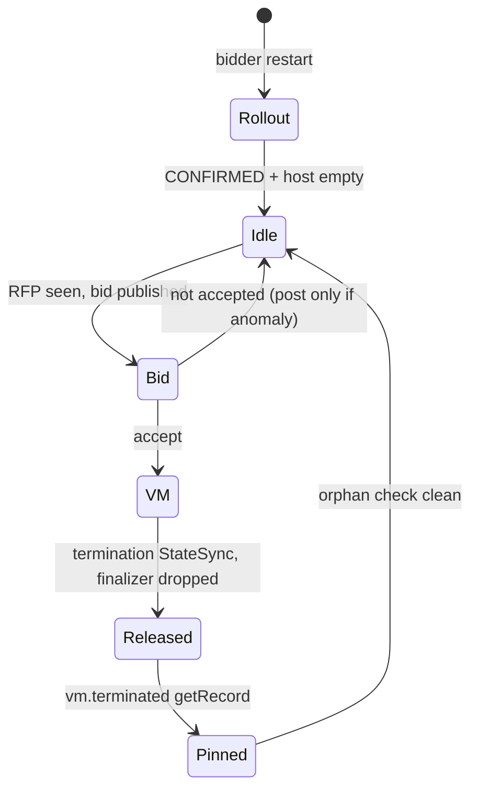

# Acceptance 0008: host observer verification (per bidder host)

Read-only verification a host watcher agent runs on a bidder host for every rollout
and every VM: the bidder is healthy, each VM's lifetime is captured, the
`vm.terminated` record is pinned, and the host is empty afterwards. Every other
acceptance (0001-0006, 0009, 0010) uses these posts as its host-side evidence.

- Bidders (2026-11-10): hat-7 `johnandersen777.bsky.social`, bidder `did:plc:7q5lnitxv4meizdon5fmhzrq` (localRepo, handle dir
  `855d5a9904`); hat-9 `bobvmbuilder.bsky.social`, bidder `did:plc:4vcig7s43z3nyqrnepmcfzqt` (localRepo, handle dir `53eff7074d`).
  hat-7's old bob handle `53eff7074d` is archived in `/var/lib/socialweb-computer/handle-53eff7074d-*.tgz`
- Watchers: the host watcher agent per host, lead (local), gateway agent (gateway kcps)
- Adapted from the hat-7 watcher's observer protocol
- Last pass: 2026-11-10 15:14Z, rollout 5 438ca0fa: hat-7 and hat-9 CONFIRMED + host empty; hat-9 VM timeline + pin, orphan check 0/0/0



## Rules

- Watch only: never release, delete or restart anything without explicit owner (or lead, on owner authority) direction
- One CONFIRMED line per rollout, one timeline per VM, one host line after release
- Post only VMs that land here and anomalies (bid failures, bidder errors); lost bids are noise (owner/lead rule)
- Each atirc line < 300 chars; split timeline, pinned record, cid line, host line
- No tokens, cookies, URLs with secrets, file contents of creds

## Preconditions (after any bidder rollout)

| Check | Pass value |
| --- | --- |
| `socialweb-computer version` | expected `v0.0.0-rcN <commit>` |
| `bidder.json` under the handle dir | `ready: true` |
| MarketIdentity | `phase: Ready`, `SignedIn: True`, `pendingAction` absent |
| startup since restart (`--since` = local restart time) | 0 `unsupported type: source.TypedFunc`, 0 `"level":"ERROR"` |
| host (unless a VM is expected) | 0 computevms, 0 firecrackervms, 0 `firecracker` procs, `vms/` empty |

`vms/` is mode 0700: always count it with sudo; a non-sudo count reads 0 while a VM runs.

A localRepo MarketIdentity (both prod bidders now) has no `SignedIn` condition: `Ready=True` and no `pendingAction` pass.
Expected WARN at start: one `no ComputeVM PolicyTrigger action handler is registered`. Not anomalies: a Bid `Failed
InvalidPayload` (an RFP whose compute.vm does not parse is refused before any bid, fc56b5fb), WARN `the provision of an
accept failed` ending `Obsolete` when the requester deleted its accept, WARN `an inbound vm delete event is refused`.

Post: `hat-7 rcN CONFIRMED: v0.0.0-rcN <commit> live; bidder.json ready=true; MarketIdentity Ready, SignedIn=True, pendingAction absent; startup clean (0 unsupported-type, 0 ERROR since restart).` then `hat-7 host empty: 0 computevms / 0 firecrackervms / 0 firecracker procs, vms dir empty.`

## During a VM lifetime (per ComputeVM)

Sources: bidder journal (`journalctl -f -o cat _SYSTEMD_USER_UNIT=socialweb-computer-bidder@<handle>.service`)
and/or the kcp watch (`kubectl get computevms.socialweb.computer -w -o json`). Capture:

- bid published (RFP uri, bid uri), accept uri, provision StateSync name
- phases `Pending -> Preparing -> Booting -> Running` with timestamps, `prepared` seconds, pid, slot
- `a guest ComputeVM is applied`, backend creation, hostKeys report (payload rkey), onNetwork report(s) (payload rkey, tag)
- release: termination StateSync name/time, `Running -> Releasing`, `released`, `released: the backend is gone and the finalizer is dropped`, `a released bid is marked terminated` (bid id)

Typical (hat-7, ssh gateway VM, 2026-10-31): bid 22:50:56.18 -> accept 22:51:16.49 -> prepared 1.32 s -> Running 22:51:21.38 -> hostKeys 22:51:30.79 -> onNetwork 22:51:33.43; term 22:51:38.49 -> released 22:51:39.75 -> finalizer 22:51:39.81.
Tenant node (acceptance 0001, rc154): accept -> Running 3 s, Running -> onNetwork ~10 s.
hat-9, bob CLI VM, rollout 5 (2026-11-10): accept 15:14:10.38 -> prepared 1.27 s -> Running 15:14:13.58 -> hostKeys 15:14:23.51 -> onNetwork 15:14:26.19; term 15:14:33.33 -> released 15:14:34.34 -> finalizer 15:14:34.41; pinned `termination-payload-812eba60d84956819e88b4d0639f5fcf` (cid `bafyreicqol5x2sfqpv76cshnd4xhlgksbdzikglkncqm5uko3llhamso6q`, `deleted_on_request`, with a `vm.delete` request ref).

## Pinning the vm.terminated record

The record URI is what matters; the cid is what a counterparty must cite.

1. Take the rkey from the journal (`termination-payload-<hash>`) and `com.atproto.repo.getRecord` it on the bidder PDS
   (repo = bidder DID, collection `com.publicdomainrelay.temp.compute.events.vm.terminated`). One getRecord, no scan
2. If the journal line is gone, compute the rkey. It is `market.EventRKeys(market.TerminationKey(<receipt uri>))`:
   `termination-payload-` and the first 32 hex chars of sha256 of `terminated:<receipt uri>`. Take the receipt uri
   from the bidder journal line of the termination StateSync. Then do the one getRecord of step 1. Never list records
3. Pin: uri, cid, `createdAt`, `reason`, `request.uri` or its absence

```bash
RK=termination-payload-$(printf 'terminated:%s' "$RECEIPT_URI" | sha256sum | cut -c1-32)
```

Caveat: releases over the ssh-gateway session path produced records with **no `request` field**
(keys `$type`, `createdAt`, `observedAt`, `reason`, `signatures`); page-path releases carry a `vm.delete`
strong ref. Report an absent request ref explicitly.

## Orphan check after every release

```bash
kb get computevms.socialweb.computer,firecrackervms.socialweb.computer   # No resources found
pgrep -c -x firecracker                                                  # 0
sudo ls -A /var/lib/socialweb-computer/swc-bidder/handles/<hash>/vms | wc -l   # 0
```

## Pass criteria

- Rollout: CONFIRMED line with every precondition true, then host empty
- Per VM: timeline complete (bid to finalizer), vm.terminated pinned with uri + cid + reason
- After release: orphan check 0 / 0 / 0
- Anything else (bidder ERROR, VM left, record missing) posted as an anomaly to the lead

## Known pitfalls

| Symptom | Cause / fix |
| --- | --- |
| watcher silent for hours | its atirc sub / Monitor expired and was never re-armed; restart loop `while true; do atirc sub; sleep 2; done` |
| "all bids denied by policy" blamed on the bidder | check the bidder policy runs (Succeeded + bid published): the deny may be requester-side |
| stale pendingAction after rollout | session predates a scope change; lead / drives-oauth re-signs |
| bidder clock off (hat-9 -9.94 s) | service-auth 401 at the counterparty; enable NTP (chronyd) |
| CONFIRMED with the old version | `install bidder` not re-run after `upgrade` |
