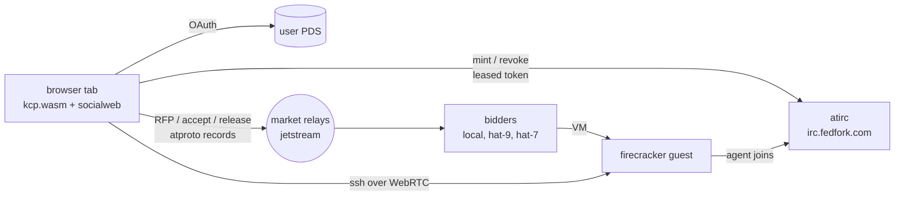

# Acceptance 0009: wasm browser page (shell.socialweb.computer)

Real kcp + socialweb control plane compiled to js/wasm, running in a browser tab. The
tab is a requester: it rents a VM on the market, holds it, opens a shell on it,
releases it.

- Author: the `wasm` peer agent (page owner); folded here by the docs agent
- Last pass: page-rc141 prod compat vs rc153 bidders, 2026-11-01 01:17Z (A3/A6)

## Scope

- **Page** = `johnandersen777/kcp` fork, branch `kcp-wasm-memory-storage-1`, host hat-8, path `~/src/kcp/kcp-wasm-mac`
- **Prod** = `https://shell.socialweb.computer` (static files, `.gz` only, no `/debug/*`)
- **Dev** = `scripts/kubectl_wasm_web.ts` on :8090, behind the fedproxy tunnel, with `/debug/*` (log stream + control)
- **Release** = tag `page-rcNNN`; log of every release in `docs/plans/0037-fenced-browser-sandbox.md` (page repo)

## Accounts

- `hat.dplc.rip` (PDS pds.rip): default test requester; creds file local, mode 0600, never printed
- `aliceoa.bsky.social`: second requester, use when hat is busy; own creds file
- Bidders deny unvouched requesters (`bidder-tangled-vouch`); requesters deny bidders whose operator they do not vouch (`requester-tangled-vouch`)
- One driver per account at a time; announce runs on atirc first

## Tools

- `scripts/browser-demo.ts`: full VM run recorded to `demos/` (needs dev server)
- `page-hold.ts` (lead host scratch): headless Chrome, signs in, holds the tab (dev page + `phone.sh` control)
- `page-check.ts <creds> <PREFIX> <url> [holdSeconds]` (wasm scratch): prod check on a fresh profile; reads the `#log` panel (prod has no debug stream). `SIGNIN_ONLY=1` stops before Request VM
- `webchat-check.ts` (wasm scratch): signed-in atirc `/chat` check, no VMs
- Unit + policy: `cd scripts/browser && deno test --allow-read --allow-net`; `scripts/browser-dev/policy-suite.sh`

## Tests

### A1 - Unit + policy suite (every build)

- Deno browser tests all pass (278/0 at page-rc141)
- Policy suite: page half of `always-run/page/...`, headless fence check, js/wasm browsersandbox Go tests
- **Pass** = 0 failures

### A2 - Boot + sign-in

1. Load page (dev or prod), fresh profile
2. Wait `kcp ready in` / `kcp cold boot (Ns)`
3. Sign in (two taps: prepare, then "Continue sign-in" opens PDS popup)
4. **Pass** = identity shows `Signed in as <handle>`, MarketIdentity Ready

### A3 - VM lifecycle (core)

1. Tap Request VM (`#compute-request`)
2. Wait ComputeContract `Held: held: the guest is on the network`
3. `ssh <vm>` in the page terminal (WebRTC datachannel), run `uname -a`, exit
4. Release
5. **Pass**
   - Held in ~40-60 s
   - row shows `agent token: leased` while Held
   - after release: row shows `tokens: revoked` and `released`
   - atirc: revoke via=account BEFORE bidder's `vm.terminated`
   - bidder host empty after (watcher confirms, [0008](0008-host-observer.md))

### A4 - Held-reload snapshot restore

1. Signed-in profile (handle already in boot config), Request VM, Held
2. Stay idle >= 5 min (past the 5-min watch verify)
3. Reload
4. **Pass** = `kcp snapshot: restored (snapshot Ns old ...)`, restore ~2-3 s (cold boot ~15-19 s)
5. Capture-wait reasons in the log explain any miss (`persisted state is still changing`, `within Ns of the last capture`)
6. Known: first reload after a FIRST sign-in on a fresh profile cold-boots (`changed since the capture: boot configuration (handle)`), expected

### A5 - Upgrade load (schema change releases)

1. Profile last run on the previous prod release
2. Load the new release
3. **Pass** = page re-applies manifests (kcp.wasm ETag changed), no `field not declared in schema`, VM lifecycle A3 passes on that profile

### A6 - Compat smoke vs new bidders/gateway (after server-side rollouts)

- Run when bidders change bid/market code or bump a shared schema (ComputeContract, Requester ...)
- `page-check.ts` as hat on prod, hold 60 s
- **Pass** = A3 pass criteria on the unchanged prod page
- Done: rc148 (22:24Z 2026-10-31), rc153 (01:17Z 2026-11-01); see also [0006](0006-rollout-compat.md)

### A7 - Signed-in atirc /chat (web chat client)

- `webchat-check.ts` as hat, optional second identity (bob) in a separate browser context
- **Pass**
  - `/chat` injects `__ATIRC_SESSION__` (handle, channel)
  - ws `?format=json`, text frames only
  - member list with "you" marker
  - second identity open/close renders `-- nick joined` / `-- nick left`
  - post lands with nick = handle-shaped nick

## Rules

- Release every test VM; never touch other people's VMs
- Gate any skip/stop mode in a driver BEFORE the Request VM code; never close a tab holding a VM
- Never print creds, tokens, cookies, sign-in URLs
- Prod deploy only with lead OK; build release candidates from `refs/tags/page-rc<deployed>`
- Workarounds are stopgaps: report as such, root-cause, fix
