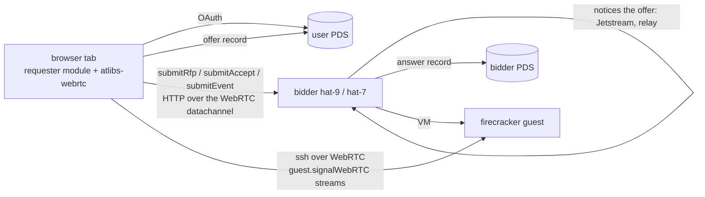

# Acceptance 0009: browser requester page (shell.socialweb.computer)

The requester page in a browser tab: it signs in with OAuth, rents a VM on the market through the requester
wasm module, opens a shell on it over a WebRTC datachannel, releases it and deletes what it wrote. Every
market call reaches the bidder over the bidder's offering `webrtc` endpoint (offer and answer as
`computer.socialweb.ingress.offer` / `.answer` records); a browser cannot dial iroh, and bidders advertise https
only with `market-https=true` (the hat-7 transition, removed 2026-11-10 after this runbook passed against
iroh/webrtc-only bidders).

- Since 2026-11-10 the page is the atlibs requester page (repo atlibs-socialweb-computer-requester, `web/webrtc`),
  deployed by its `scripts/deploy-page.sh`. It replaced the kcp-wasm page (kcp compiled to js/wasm, branch
  `kcp-wasm-memory-storage-1`), whose Go requester dials only https endpoints; that page's snapshot-restore (old
  A4) and schema-upgrade (old A5) checks retired with it (cut-over, no backcompat)
- Last pass: 2026-11-13 02:39-02:53Z, rollout 20 (kcp v0.0.0-rc165-pre1 038bd32e, binary 24a8b530) on every bidder,
  prod page files as deployed 2026-11-11 (requester repo 35c405b, atlibs 0.6.0, atlibs-webrtc 0.4.0, identlink 0.2.0),
  alice, no bidders list (each bidder targeted by pausing the other two, as 0001 section 9 does), headless Chrome on
  hat-8. A1: 57/57 (`node --test web/webrtc/*.test.mjs modules/requester/test.mjs`) from fresh clones at the README's
  sibling pins. A2: the page's own form, consent page `shell.socialweb.computer/oauth/requester/client-metadata.json`
  for @aliceoa.bsky.social, page shows `aliceoa.bsky.social (did:plc:lpfuqerea3deuoyrn7ojser4)`. A3 + A6
  (`scripts/page-round.mjs`, a temp copy that passes `identlink` like `main.js` and drops `bidders`): hat-7 47 s,
  hat-9 47 s, local 45 s; each: 1 ingress offer, https `submit*` 0, receipt from the unpaused bidder, shell `Linux ...
  uid=0(root)`, release, 7 records getRecord 400, 0 offers left, 0 market.event / vm.delete / rfp / accept left (fix 13),
  host empty. The first hat-9 round (02:41:23Z) failed `submitRfp: ICE disconnected` (pitfalls: mDNS on hat-9, and the
  answerer off its leased port); it passed at 02:45:45Z once hat-9 allowed mdns. A7 (`webchat-check.ts`, alice + bob,
  consent `irc.fedfork.com` for each): session injected (`#aliceoa_bsky_social`), ws `?format=json` text frames only,
  member list, post shown; no join/leave lines (the second tab is the same session; bob lands in his own per-handle
  channel)
- Last pass vs hat-7 after market-https came off (offering iroh + webrtc, rollout 6): 2026-11-10 16:49Z A3 headless
  (`scripts/page-round.mjs`, the deployed page files) in 45 s, alice: 1 ingress offer, https `submit*` 0, shell `Linux ...
  uid=0(root)` over the guest datachannel, release, 7 records answer getRecord 400, 0 offers left, hat-7 empty
- Last pass vs hat-9: 2026-11-10 15:10-15:12Z, prod https://shell.socialweb.computer/ (requester repo 5a49bd6, requester record bafyreiee4x, atlibs 0.2.3, atlibs-webrtc 0.2.1) vs hat-9 on kcp 438ca0fa: A2 OAuth sign-in through the page's form (bsky.social, consent) and A3 in 50 s, alice

## Accounts

- `aliceoa.bsky.social`: test requester; creds file local, mode 0600, never printed
- Bidders deny unvouched requesters (`bidder-tangled-vouch`); the page's bid policy (`policy-requester-tangled-vouch`)
  denies bidders whose operator the requester does not vouch
- One driver per account at a time

## Tools

- `scripts/deploy-page.sh [--build-only] [<handle>/requester[@pin]]` (requester repo): `atlibs add` the published
  requester and its hook defaults, `atlibs stage --target spa --origin https://shell.socialweb.computer/`, the
  page files, then tar to `/var/www/shell.socialweb.computer` (the old tree and Caddy site saved in `/var/backups`)
- Unit: `node --test web/webrtc/*.test.mjs modules/requester/test.mjs` (requester repo, after `cargo build --release
  --target wasm32-unknown-unknown`)
- Headless round (the page's `WebrtcCubit` in headless Chrome, an app-password session in place of the OAuth
  popup, real RTCPeerConnection): `scripts/page-round.mjs <bidder DID> [command]` (requester repo) with `ALICE_ATPROTO_HANDLE` /
  `ALICE_ATPROTO_PASSWORD` in its environment; prints the contract result, the ingress offers written, whether any
  `submit*` went over https, and a getRecord of every record the run deleted

## Tests

### A1 - Unit (every build)

- **Pass** = 0 failures (requester module 35, web/webrtc 8, 2026-11-10)

### A2 - Boot + sign-in

1. Load https://shell.socialweb.computer/ on a fresh profile
2. Sign in with the handle; the PDS authorization page lists the requester scopes (the `ingress` group, WebRTC
   offers, is optional for a session signed in before it existed)
3. **Pass** = the page shows `<handle> (<did>)`

### A3 - VM lifecycle over WebRTC (core)

1. `contract {bidders: [<bidder DID>], webrtc_ssh: true, via: webrtc, tag: ssh, command: "uname -a; id"}` (the
   page's actions, or `scripts/page-round.mjs`)
2. **Pass**
   - offers written > 0, https `submit*` calls 0 (the bidder was reached over its webrtc endpoint)
   - receipt, then the shell output (`Linux`, `uid=0`) over the guest's datachannel
   - release with the bidder's `vm.terminated`; every record the run wrote answers getRecord 400 afterwards
   - no `computer.socialweb.ingress.offer` left in the requester's repo
   - bidder host empty after ([0008](0008-host-observer.md))

Evidence, 2026-11-10 (headless Chrome on the bidder's LAN; `scripts/page-round.mjs` at 15:08Z and the prod URL with
OAuth at 15:11Z): offer `computer.socialweb.ingress.offer/<hat-9>.<tid>` written, hat-9 answered from its offer
stream, ICE connected on 192.168.0.106:31001 (host), RFP / bid / accept / receipt over the datachannel (https
`submit*` 0), offer deleted after the answer; shell `Linux fc-lpfuqerea3de-91f1fd3f ... uid=0(root)`; release; 7
records deleted (rfp, vm, accept, two market.event, vm.delete, guest.signalWebRTC), none left; hat-9 empty.

The test hosts share the bidder's NAT, so this proves the host-candidate path only. A browser elsewhere pairs
srflx with srflx: the bidder's answerer keeps one UDP port (31001, the bidder's `bidder-mesh` lease in
`spec.guestNetwork.webrtcUDPPorts`) and gathers its srflx from stun.cloudflare.com on it, so a NAT with
endpoint-independent mapping lets the browser's checks in once the bidder has sent its own; a symmetric NAT on
either side fails (no TURN, by design).

### A6 - Compat smoke vs new bidders/gateway (after server-side rollouts)

- Run A3 against each prod bidder after a bidder rollout or a shared schema bump
- 2026-11-10 13:57Z: the retired kcp-wasm page (unchanged prod) passed against hat-7 over https (Held, tokens
  revoked, Released) before the cut-over; it left a market.event and a vm.delete in the requester's repo

### A7 - Signed-in atirc /chat (web chat client)

- `webchat-check.ts` as hat, optional second identity (bob) in a separate browser context
- **Pass**: `/chat` injects `__ATIRC_SESSION__`; ws `?format=json`; member list; join/leave lines; posts land

## Known gaps

- None open for this page. (The kcp iOS app reaches webrtc-only bidders since eb018e0e; 0010 passed 2026-11-10.)

## Pitfalls

| Symptom | Cause / fix |
| --- | --- |
| `submitRfp: ICE disconnected: a symmetric NAT on either side defeats STUN-only WebRTC` against one bidder from a browser on its LAN (hat-9, 2026-11-13 02:41:23Z; hat-9 answered at 02:41:40Z, the page's only pairs were srflx) | hat hosts must allow mdns (the FedoraServer firewalld zone doesn't by default): headless/real Chrome on the bidder's LAN hides host candidates behind `.local` names, and pion's default QueryOnly mDNS needs the reply on udp 5353, else only srflx pairs and ICE disconnects without hairpin NAT. hat-9 now allows `mdns`; the 02:45:45Z round paired host to host |
| the bidder's answer offers an ephemeral UDP port, outside 31000-31999 (hat-9 53721), journal `webrtc_mesh_udp_port_unbound ... address already in use` | every bidder service restart (a pause / resume) builds a new mesh that cannot bind its leased port: the old mesh's UDP listener is never closed (`Service.mesh`, `webrtc.NewMesh`, since 4ccc3bd6), so the answerer falls back to an ephemeral port and one socket leaks per cycle. A firewall that opens only the webrtc range then drops the page's checks unless the bidder sends first (mDNS above). Fix pending |
| every bid refused by the page's bidder-trust policy in a `page-round.mjs` round | the repo's `scripts/page-round.mjs` does not pass `identlink` to `WebrtcCubit` as `main.js` does; use a copy that does (requester repo fix pending) |

## Rules

- Release every test VM; never touch other people's VMs
- Never print creds, tokens, cookies, sign-in URLs
- Prod deploy only with lead OK
