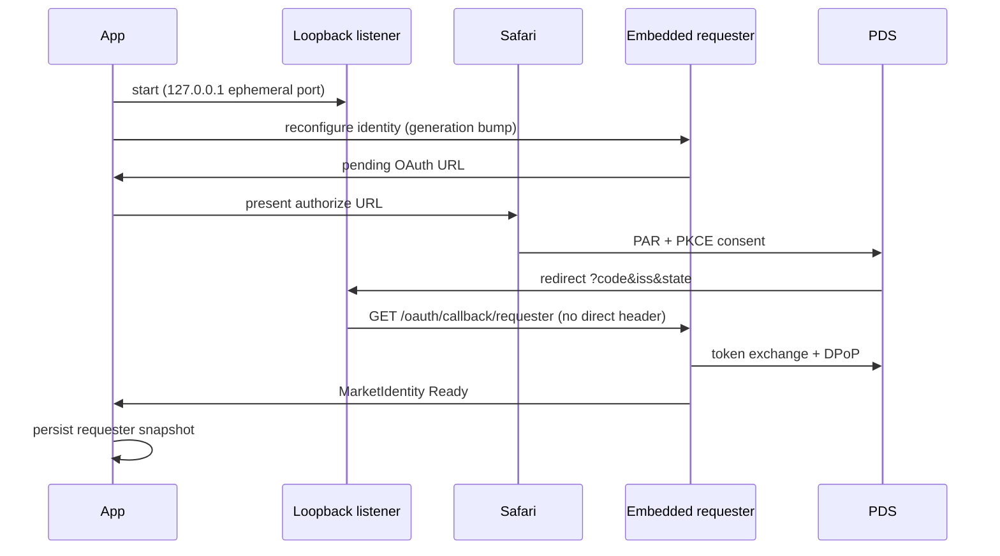
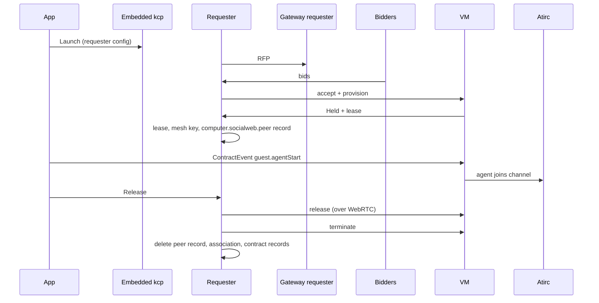

# Acceptance 0010: iOS app, embedded kcp requester (AT-IRC)

Acceptance procedures for the AT-IRC iOS app: the in-process kcp + socialweb
requester, the market (Agents) flow, presence, and device performance. This is
the iOS counterpart to the k8s, ssh, and browser-page acceptance docs.

- Author: the `atirc-ios-client-dev` peer agent; folded here by the docs agent (device ids replaced by placeholders)
- Plan: [0038](../plans/0038-ios-embedded-kcp.yaml)
- Final pass: simulator 2026-11-10, alice, final code (kcp 5e6c4e3d, app a8d1678, rollout 8 bidders + gateway): A1
  19:52Z (13 scopes, Ready after relaunch); A2/A3 forced to webrtc 20:01-20:06Z (3 bidders connected in 1.5-1.8 s,
  won by did:plc:2l2wdr..., peer record published, released, peer and association deleted, 14 of 14 records deleted).
  One launch before it sat after `requester_started` with no discovery for 6 min; a relaunch went through
- Last pass: simulator 2026-11-10, alice, bidders reached over WebRTC only (kcp aaab79d0, app 37c9b0f, rollout 6
  bidders): A1 16:24Z (41 scopes granted), A2 hat-9 Held 16:27Z, A3 Released 16:31:34Z (14 of 14 records deleted),
  A4 cross-restart release 16:37:37Z. A5/A6 not re-run (no change since 2026-10-31)
- Related: [0004](0004-vm-atirc-agent.md) (agent path), [0008](0008-host-observer.md) (host evidence)
- Bidders advertise iroh and webrtc endpoints (hat-7's `market-https=true` transition ended 2026-11-10; no prod bidder advertises https). The embedded
  requester has no dumbpipe, so it takes webrtc (`internal/ingress/webrtc` MeshDialer: sealed
  `computer.socialweb.ingress.offer` record, answer by getRecord, HTTP over datachannels); the simulator runs force
  it with `SIMCTL_CHILD_SOCIALWEB_REQUESTER_BIDDER_ENDPOINTS=webrtc`

## Artifacts

| Item | Value |
| --- | --- |
| App repo | `~/src/atirc-client-ios/AT-IRC` (local only; no remote) |
| Framework | `GoLib/AtircGo.xcframework`, built by `GoLib/build.sh` from `SOCIALWEB_COMMIT` of `SOCIALWEB_SRC` (a socialweb-computer-kcp clone); it seeds the patched apiserver module under /tmp itself |
| Framework target | socialweb-computer-kcp `5e6c4e3d` (`a8d1678`, final); A1-A4 accepted on `aaab79d0` (`37c9b0f`), A1-A3 again on `c770a887` and `5e6c4e3d` |
| App build | `a8d1678` (client_id scope = `RequesterOAuthScope`, 13 tokens; presence `2c23c1f`, perf `a43e389`) |
| Simulator | iPhone 17e (`<simulator udid>`) |
| Device | owner iPhone (`<device udid>`) |
| Bundle id | `com.fedfork.irc.AT-IRC` |

Never add a second gomobile framework: one Go runtime per app.

## Preconditions

- Build succeeds:
  `xcodebuild -project AT-IRC.xcodeproj -scheme AT-IRC -configuration Debug -destination 'platform=iOS Simulator,id=<simulator udid>' -derivedDataPath .build build`
- Tests pass: `xcodebuild ... test` (17 unit + 2 UI at `f8e4841`).
- IRC account signed in (the app's own atproto OAuth account): `Scripts/sim-signin.sh <simulator udid>` (alice).
- `OAuthClient.scope` (the loopback client_id's scope) equals the pinned kcp's `oauth.RequesterOAuthScope`
  (`OAuthScopeTests`): the market sign-in reuses that client_id.
- Market identity may be `SessionExpired`; A1 re-signs it.
- Gateway/socialweb services reachable; bidders Ready.

## A1 - Market sign-in and persistence

Purpose: the requester's OAuth callback must reach the requester and survive a
restart.

Steps:
1. Open Agents (`ATIRC_OPEN_AGENTS=1` automates this in the simulator).
2. If identity is `SessionExpired`, tap **Sign in to market**.
3. Complete the PDS OAuth flow in the Safari sheet.
4. Confirm the return page says signed in and the Agents screen turns Ready.
5. Kill the app, relaunch, open Agents.

Pass criteria:
- App log `market-oauth: callback received keys=code,iss,state` followed by
  `callback forwarded status=200`.
- `market identity ready`, then `marketidentity phase=Ready`.
- After kill/relaunch: `marketidentity phase=Ready` (not `SessionExpired`).

Failure signatures:
- `callback forward failed: kcp HTTP 404` -> OAuth callback was routed at the
  apiserver instead of the requester (`X-Atirc-Direct` must be absent on
  `/oauth/callback/requester`).
- `SessionExpired` after restart -> requester snapshot was not persisted on
  Ready.
- No sign-in URL -> loopback bind failed or config empty; check
  `market-oauth` logs and the visible error text.
- `callback received keys=error,error_description,iss,state` and the browser shows `Sign-in failed:
  invalid_scope` -> the requester asks for a scope the app's client_id does not declare; regenerate
  `OAuthClient.scope` from the pinned kcp's `RequesterOAuthScope`.
- The PDS password step says `The data you submitted is invalid` -> the loopback client_id (it carries the whole
  scope) is too long: 44-46 single-collection tokens (client_id about 3.6-3.8 KB) failed, through PAR too. Since
  c770a887 the requester asks multi-collection repo permissions (`repo?collection=..&collection=..&action=..`,
  13 tokens) and signs in with PAR.

## A2 - Launch, agentStart, join

Purpose: the app launches a market VM and the agent speaks on the channel.

Steps:
1. Agents -> **Launch** (or `ATIRC_TEST_AGENT_LAUNCH=1`).
2. Wait for a new contract to reach `Held`.
3. Persist the snapshot (`KCPHost.persistSnapshot()`, automatic in the test
   hook after the mint).
4. Tap **Start agent** (ContractEvent `guest.agentStart`). Test hook does this
   after 40 s.
5. Watch the channel for the agent's join and first message.

Pass criteria:
- Contract shows `Held` with a VM name.
- Console (`simctl launch --console-pty`): `webrtc_mesh_connected` per bidder (about 1.4 s), no iroh or https
  bidder endpoint.
- `ContractEvent` outbound `guest.agentStart` settles: `agentStart ... Submitted: submitted to webrtc://...`.
- Token-less agent: `requester_agent_lease_written`, `requester_agent_mesh_key_written`,
  `requester_agent_peer_published` (no `requester_agent_peer_failed`; a ScopeMissingError there means the
  session lacks `repo:computer.socialweb.peer`; sign in again).
- Agent process runs on a bidder host; request host-side logs confirm the VM.
- Guest join on the channel: 0004 / 0011 own the mesh agent; not re-checked from the app on 2026-11-10.

## A3 - Release before termination

Purpose: Release ends the VM and removes the agent's lease, its mesh peer record and the contract's records.
Token-less agents hold no atirc token, so there is no revoke step (the lease latch and the association expiry make
a missed cleanup harmless).

Steps:
1. With a Held/running contract, tap **Release** (the test hook releases 240 s after agentStart).
2. Observe the release over WebRTC and the record cleanup.

Pass criteria:
- `requester_released`, then `requester_agent_peer_deleted` and `requester_association_deleted`.
- `requester_contract_records_deleted deleted=N of=N` and no `requester_record_delete_skipped`.
- No `computer.socialweb.ingress.offer` record left in the account.
- Host reports the VM gone (no firecracker for it).

Observed accepted run (2026-11-10, hat-9): released 16:31:34Z, peer and association deleted the same second,
14 of 14 records deleted (`einfra-atirc-ios-z2g1t8`).

## A4 - Cross-restart release from sealed snapshot

Purpose: a Release must complete from persisted state after the app process
died.

Steps:
1. Launch a contract and wait for the mint.
2. Persist the snapshot (release build does this automatically at launch and
   after contract changes).
3. Terminate the app.
4. Relaunch and open Agents; the contract row must still be present.
5. Release it.

Pass criteria:
- Chat shows the restored contract row before any network refresh.
- The fresh requester signals a new WebRTC session to the winner and releases: `requester_released`,
  `requester_agent_peer_deleted`, `requester_association_deleted`, `requester_contract_records_deleted`.
- Evidence: `infra restore visible=true`, then `released contracts=<id>`.
- The requester compose must not stall on `Workspace <app|socialweb-provider> phase Initializing initializers
  [system:apibindings]` (see Known pitfalls; fixed in the kcp fork, kcp-ios 120706ba2).

If restore says the snapshot was discarded as stale, the app cold-boots; the
release must still work from a fresh requester once identity is Ready.

## A5 - Presence: member list and join/leave lines

Purpose: the chat view shows who is connected and streams join/leave.

Steps:
1. Open a busy channel (e.g. the owner channel) with several agents online.
2. Tap the people badge.
3. Let peers join and leave.

Pass criteria:
- Badge count matches the `presence_snapshot` identities and updates live.
- Member sheet lists nicks (colored) and hosts, with the local account marked
  **you**.
- Inline dim lines appear: `-- nick joined` / `-- nick left`.
- A second tab of the **same** DID produces no extra join/leave (presence is
  per identity); use two different DIDs to test.

Notes:
- Presence snapshot arrives on every subscribe; members are cleared on
  reconnect and repopulated from the next snapshot.
- Joins/leaves are coalesced to one state update per 250 ms.

## A6 - Performance baseline

Purpose: presence churn and chat scrolling must not degrade the app.

Pass criteria:
- Idle CPU ~0 % with kcp/requester running and presence churn on the channel.
- No `glassEffect() tried to update multiple times per frame` warnings.
- Chat scroll stays put when the reader is scrolled up (owner bug 3981);
  a "N new messages" pill appears instead.
- Launch: kcp ready ~4 s, requester ready ~5-6 s on simulator.

## Known pitfalls

| Symptom | Cause / fix |
| --- | --- |
| requester compose stuck on `Workspace app` (or `socialweb-provider`) `phase Initializing initializers [system:apibindings]`, every default APIBinding `Bound`, about 1 launch in 13-20 (2026-11-10) | the kcp workspace scheduling reconciler retried after a conflicting Workspace patch and set the already initialized LogicalCluster back to `Initializing`; admission re-armed `status.initializers` and the APIBinder had no event left to react to. Fixed in the kcp fork (github.com/johnandersen777/kcp branch kcp-ios 120706ba2: only Scheduling -> Initializing; the app pins f233e4f2c); 25 of 25 relaunches compose after it. Same code is in upstream kcp; servers run unpatched upstream kcp |
| a launch "sits after `requester_started`" with no `infra_contract_requested` and no bidder discovery (1 launch in ~8) | the app's launch PATCHes the session EphemeralInfra at the resourceVersion it read, and the infra controller writes the object's status right after the requester starts: `launch failed: kcp HTTP 409 ... the object has been modified` (logged since the fix; before, only errorText). Fixed in the app (atirc-ios-client adab576): read-modify-apply retries on 409 (launch, release, release all); 10 of 10 launches request a contract (2026-11-10, bob) |
| VMs keep running after the app was killed during launch loops (8 bob VMs on hat-9, 2026-11-10) | the app persisted the infra snapshot at launch, before the receipt; a killed app restored a receipt-less contract, requested a new one and orphaned the VM. Fixed in the app (adab576): the snapshot is persisted every 5 s while the requester runs (unchanged state not rewritten); each relaunch then releases the previous VM. Bidders end any VM with no association proof at accept + 24 h (kcp 97b635a6); before that, operator delete (0007) |
| a watch silently misses events after a burst (any controller) | the kcp fork's memory store dropped a watch replay beyond 100 events with the watch still open; fixed in the fork (kcp-ios f233e4f2c, replay buffered whole) |

Stall diagnosis: the console (`simctl launch --console-pty`) carries the kcpapply wait error with the Workspace
phase, initializers and every False LogicalCluster condition; a stall with no `APIBindingsInitialized=False`
condition and all APIBindings Bound is the re-armed initializer above.

## Automation hooks (DEBUG)

| Variable | Effect |
| --- | --- |
| `ATIRC_OPEN_AGENTS=1` | open the Agents sheet at launch |
| `ATIRC_OPEN_CHANNEL=#name` | open a specific channel |
| `ATIRC_MARKET_SIGNIN=1` | trigger requester identity generation bump |
| `ATIRC_MARKET_SIGNIN_EXPORT=1` | write the sign-in URL to a 0600 file for headless tests |
| `ATIRC_TEST_LAUNCH=1` | launch a contract, wait, persist, log policy runs |
| `ATIRC_TEST_AGENT_LAUNCH=1` | launch -> persist -> agentStart -> hold -> release all |
| `ATIRC_RELEASE_ALL=1` | release every held contract |
| `ATIRC_DUMP_WORKSPACE=1` | log workspace/policy state every 5 s |
| `ATIRC_SIGNIN_HANDLE=<handle>` | app-level atproto sign-in helper |

## Sequence: market sign-in

## Sequence: launch and release

## Security constraints

- The credential source file is read only inside the one signing command;
  never print, log, or post its values or any sign-in URL.
- Snapshots (kcp, requester, infra, provider identities) are sealed with a
  Keychain key, Data Protection Complete, excluded from backups.
- The agent is token-less: the requester writes a contract-scoped lease (association) and a mesh peer record;
  release deletes both, and their expiry makes a missed cleanup harmless.
- Local commits only; never push the app repo.
