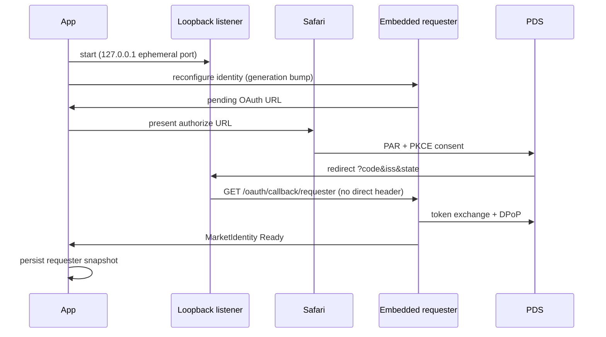
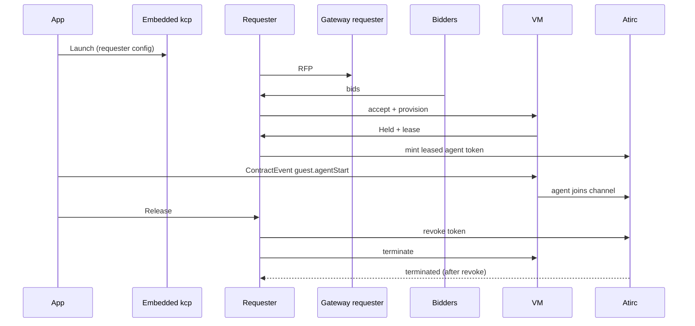

# Acceptance 0010: iOS app, embedded kcp requester (AT-IRC)

Acceptance procedures for the AT-IRC iOS app: the in-process kcp + socialweb
requester, the market (Agents) flow, presence, and device performance. This is
the iOS counterpart to the k8s, ssh, and browser-page acceptance docs.

- Author: the `atirc-ios-client-dev` peer agent; folded here by the docs agent (device ids replaced by placeholders)
- Plan: [0038](../plans/0038-ios-embedded-kcp.yaml)
- Last pass: simulator 2026-10-31 (A2 agent joined 02:36Z, A3 revoke 02:39:36Z before Released, A4 cross-restart 02:33Z)
- Related: [0004](0004-vm-atirc-agent.md) (agent path), [0008](0008-host-observer.md) (host evidence)

## Artifacts

| Item | Value |
| --- | --- |
| App repo | `~/src/atirc-client-ios/AT-IRC` (local only; no remote) |
| Framework | `GoLib/AtircGo.xcframework`, built by `GoLib/build.sh` from the socialweb mount |
| Framework target | socialweb `973f7821` in the accepted build (`a43e389`+) |
| App build | `a43e389`+ (presence `2c23c1f`, perf `a43e389`; tests `f8e4841`) |
| Simulator | iPhone 17e (`<simulator udid>`) |
| Device | owner iPhone (`<device udid>`) |
| Bundle id | `com.fedfork.irc.AT-IRC` |

Never add a second gomobile framework: one Go runtime per app.

## Preconditions

- Build succeeds:
  `xcodebuild -project AT-IRC.xcodeproj -scheme AT-IRC -configuration Debug -destination 'platform=iOS Simulator,id=<simulator udid>' -derivedDataPath .build build`
- Tests pass: `xcodebuild ... test` (17 unit + 2 UI at `f8e4841`).
- IRC account signed in (the app's own atproto OAuth account).
- Market identity may be `SessionExpired`; A1 re-signs it.
- Gateway/socialweb services reachable; bidders Ready.

## A1 - Market sign-in and persistence

Purpose: the requester's OAuth callback must reach the requester and survive a
restart.

Steps:
1. Open Agents (`ATIRC_OPEN_AGENTS=1` automates this in the simulator).
2. If identity is `SessionExpired`, tap **Sign in to market**.
3. Complete the PDS OAuth flow in the Safari sheet.
4. Confirm the return page says signed in and the Agents screen turns Ready.
5. Kill the app, relaunch, open Agents.

Pass criteria:
- App log `market-oauth: callback received keys=code,iss,state` followed by
  `callback forwarded status=200`.
- `market identity ready`, then `marketidentity phase=Ready`.
- After kill/relaunch: `marketidentity phase=Ready` (not `SessionExpired`).

Failure signatures:
- `callback forward failed: kcp HTTP 404` -> OAuth callback was routed at the
  apiserver instead of the requester (`X-Atirc-Direct` must be absent on
  `/oauth/callback/requester`).
- `SessionExpired` after restart -> requester snapshot was not persisted on
  Ready.
- No sign-in URL -> loopback bind failed or config empty; check
  `market-oauth` logs and the visible error text.

## A2 - Launch, agentStart, join

Purpose: the app launches a market VM and the agent speaks on the channel.

Steps:
1. Agents -> **Launch** (or `ATIRC_TEST_AGENT_LAUNCH=1`).
2. Wait for a new contract to reach `Held`.
3. Persist the snapshot (`KCPHost.persistSnapshot()`, automatic in the test
   hook after the mint).
4. Tap **Start agent** (ContractEvent `guest.agentStart`). Test hook does this
   after 40 s.
5. Watch the channel for the agent's join and first message.

Pass criteria:
- Contract shows `Held` with a VM name.
- `ContractEvent` outbound `guest.agentStart` settles.
- atirc mints a **leased** child token for the contract.
- Guest joins the channel and posts at least one line.
- Agent process runs on a bidder host; request host-side logs confirm the VM.

## A3 - Release before termination

Purpose: Release must revoke the agent's atirc token before the VM dies.

Steps:
1. With a Held/running contract, tap **Release**.
2. Observe the atirc token revocation and the VM termination.

Pass criteria:
- `revoke` timestamp is **strictly before** `vm.terminated`.
- Contract reaches `Released`.
- Host reports the VM gone.

Observed accepted run: revoke 0.6 s before termination (iOS agent
`einfra-atirc-ios-p1z6dz`).

## A4 - Cross-restart release from sealed snapshot

Purpose: a Release must complete from persisted state after the app process
died.

Steps:
1. Launch a contract and wait for the mint.
2. Persist the snapshot (release build does this automatically at launch and
   after contract changes).
3. Terminate the app.
4. Relaunch and open Agents; the contract row must still be present.
5. Release it.

Pass criteria:
- Chat shows the restored contract row before any network refresh.
- Release revokes the token before `vm.terminated`.
- Evidence: `infra restore visible=true`, then `released contracts=<id>`.

If restore says the snapshot was discarded as stale, the app cold-boots; the
release must still work from a fresh requester once identity is Ready.

## A5 - Presence: member list and join/leave lines

Purpose: the chat view shows who is connected and streams join/leave.

Steps:
1. Open a busy channel (e.g. the owner channel) with several agents online.
2. Tap the people badge.
3. Let peers join and leave.

Pass criteria:
- Badge count matches the `presence_snapshot` identities and updates live.
- Member sheet lists nicks (colored) and hosts, with the local account marked
  **you**.
- Inline dim lines appear: `-- nick joined` / `-- nick left`.
- A second tab of the **same** DID produces no extra join/leave (presence is
  per identity); use two different DIDs to test.

Notes:
- Presence snapshot arrives on every subscribe; members are cleared on
  reconnect and repopulated from the next snapshot.
- Joins/leaves are coalesced to one state update per 250 ms.

## A6 - Performance baseline

Purpose: presence churn and chat scrolling must not degrade the app.

Pass criteria:
- Idle CPU ~0 % with kcp/requester running and presence churn on the channel.
- No `glassEffect() tried to update multiple times per frame` warnings.
- Chat scroll stays put when the reader is scrolled up (owner bug 3981);
  a "N new messages" pill appears instead.
- Launch: kcp ready ~4 s, requester ready ~5-6 s on simulator.

## Automation hooks (DEBUG)

| Variable | Effect |
| --- | --- |
| `ATIRC_OPEN_AGENTS=1` | open the Agents sheet at launch |
| `ATIRC_OPEN_CHANNEL=#name` | open a specific channel |
| `ATIRC_MARKET_SIGNIN=1` | trigger requester identity generation bump |
| `ATIRC_MARKET_SIGNIN_EXPORT=1` | write the sign-in URL to a 0600 file for headless tests |
| `ATIRC_TEST_LAUNCH=1` | launch a contract, wait, persist, log policy runs |
| `ATIRC_TEST_AGENT_LAUNCH=1` | launch -> persist -> agentStart -> hold -> release all |
| `ATIRC_RELEASE_ALL=1` | release every held contract |
| `ATIRC_DUMP_WORKSPACE=1` | log workspace/policy state every 5 s |
| `ATIRC_SIGNIN_HANDLE=<handle>` | app-level atproto sign-in helper |

## Sequence: market sign-in

## Sequence: launch and release

## Security constraints

- The credential source file is read only inside the one signing command;
  never print, log, or post its values or any sign-in URL.
- Snapshots (kcp, requester, infra, provider identities) are sealed with a
  Keychain key, Data Protection Complete, excluded from backups.
- The app never holds a long-lived agent token; the requester mints a leased
  child after the contract receipt and it dies by revoke or lease latch.
- Local commits only; never push the app repo.
