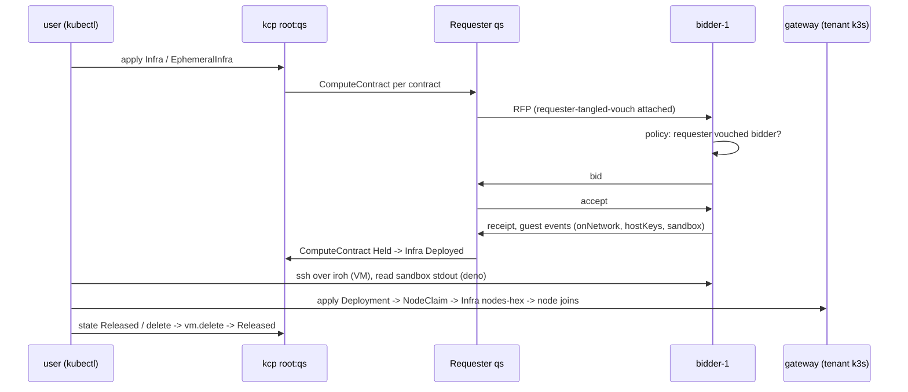

# Acceptance 0012: Infra quickstart (VM, k8s, Deno sandbox, agent VM)

Proves the path of [../QUICKSTART.md](../QUICKSTART.md) end to end: a local kcp with a market in it, a
requester app, kubectl apply of each example in [../../examples/infra/](../../examples/infra/), await, use each
resource, release, dev down. The atirc join of the agent VM is the one prod step.

- Paths: kubectl against a market network (`dev up --profile market-network`); the browser page applies the same
  `mixed.yaml` from its terminal ([0009](0009-browser-page.md))
- Last pass: local market network `qs1` on hat-8, main 12ff7b53 dev build, 2026-11-01 03:24-03:50Z: VM, k8s, Deno pass with
  the default policy; agent VM passes up to the mint (join is the prod step below)



## Preconditions

| Item | Need |
| --- | --- |
| Host | Linux, `/dev/kvm`, the VM account `test-0001` (subuid range, linger on), `kubectl`, `jq`, `ssh` |
| Binary | `scripts/build-socialweb-computer.sh --dev --publish /var/tmp/<work>` of the branch under test |
| Guest image | `file:///var/lib/socialweb-computer/guest-image` (or let `dev up` fetch the pinned one) |
| Live slot | `deno run -A ~/.tmp/swc-lead/live-slot.ts acquire <name>` before `dev up` |
| Names | instance and bidder handle unique to the run (`--app-values` `{app}.<inst>.bob.test`) |
| atirc (prod step) | an OAuth requester identity with `rpc:chat.atirc.mint` (see 0004) |

## Steps

Run every command as `test-0001` (`sudo -n -u test-0001 env HOME=/home/test-0001 XDG_RUNTIME_DIR=/run/user/$(id -u test-0001) ...`).
`k <ws> ...` is the helper of QUICKSTART section 3.

1. `dev up --instance qs1 --profile market-network --host-backend proc --bidders 1 --with-gateway ...` (QUICKSTART section 2);
   `dev status` phase Ready.
2. Add the requester app `qs` to `MarketNetwork.spec.apps`; wait `.status.apps[qs]` Ready with a did.
3. Vouches (QUICKSTART section 4): [vouch.yaml](../../examples/infra/vouch.yaml) in `root:qs` (requester -> bidder) and
   [vouch-bidder-operator.yaml](../../examples/infra/vouch-bidder-operator.yaml) in `root:bidder-1` (bidder operator -> requester);
   both AtprotoRecords Applied. Wait 5 minutes if any contract was denied before.
4. VM: apply `vm.yaml` (your key in), `kubectl wait ... phase=Deployed`, ssh over iroh, read `/root/quickstart`.
5. k8s: apply `k8s-cluster.yaml` to the tenant kubeconfig; read the gateway Infra `nodes-<hex>`, node Ready, pod logs.
6. Deno: set `MarketBidder app` `spec.computeKinds: [vm, deno]` in `root:bidder-1`; apply `deno-sandbox.yaml`; read
   `status.contract.sandbox`.
7. Agent: write `agent-bundle.json` into the requester OpenBao (QUICKSTART section 4); apply `agent-vm.yaml`; read the
   requester log for `requester_atirc_*`; on prod apply `agent-start.yaml` and watch the channel for the nick JOIN.
8. Release: patch each contract `state: Released` (or delete the object); delete the Deployment; `dev down`; release
   the live slot.

## Expected Observations

| Event | Where | Typical |
| --- | --- | --- |
| network Ready | `dev status` | 34 s (`dev up` exit 1 on a transient, `dev status` Ready right after) |
| requester app `qs` Ready, did | `MarketNetwork.status.apps` | < 75 s after the `spec.apps` apply |
| `vouch-bidder` Applied, `at://<qs did>/sh.tangled.graph.vouch/<bidder did>`; `operator-vouch-requester` Applied, `at://<bidder operator did>/sh.tangled.graph.vouch/<qs did>` | AtprotoRecord status | 1-4 s |
| Infra `quickstart-vm` Deploying -> Deployed | `status.phase`, `status.contracts[vm1]` | 19 s (03:46:01 -> 03:46:20) |
| ssh prints `quickstart-vm-ok`, `x86_64` | ssh over dumbpipe | 0.7 s |
| gateway Infra `nodes-<hex>` Deployed, node `<acct>-tenant-node1` Ready, pod Running, log `quickstart-k8s-ok` | `root:gateway`, tenant k3s | pod applied 03:27:30, Infra Deployed 20 s, node Ready 37 s, pod Running 46 s |
| ComputeVM backend `DenoSandbox`; `sandbox.stdout` `quickstart-deno-ok sum=10 on linux/x86_64`, exit 0 | `root:bidder-1`, contract status | 6 s to Held (03:46:01 -> 03:46:07) |
| agent contract: mint attempted after receipt | requester core log | Held 19 s; `requester_atirc_mint_failed ... the requester identity signs no service auth` every retry; `agent-start.yaml` Submitted < 1 s, bidder: `a requester guest event is queued for the guest` |
| tenant scale to zero: Deployment deleted 03:47:03, pod gone 03:47:35, Infra entry Releasing 03:49:35 (2 min idle), Infra and node gone 03:49:39 | `root:gateway`, tenant k3s | ~2.5 min |
| state Released -> contract Released | Infra status | VM and Deno Released 1 s after the patch; agent EphemeralInfra delete: `requester_atirc_release_revoke left=0`, `infra_released` 0.1 s |

## Pass Criteria

- every example passes `kubectl apply --dry-run=server` in `root:qs` (k8s-cluster.yaml: applied to the tenant cluster)
- examples carry no `policy`: the default `requester-tangled-vouch` admits the bidder only after the vouch record
- VM, k8s, Deno reach Deployed / Running and are used as documented; no secret printed on any terminal
- agent: locally everything up to the mint; on prod the nick joins after `agent-start.yaml`, and release revokes the
  token before `vm.terminated` (0004 pass criteria)
- after release and `dev down`: no VM unit of the instance left (`dev down` `vmsLeft` 0)

## Vouch Readings (2026-11-01, qs1)

| time (Z) | records present | fresh policy run at the bidder |
| --- | --- | --- |
| 03:27 | none | `not vouched` |
| 03:30:37 | requester -> bidder operator | `not vouched` (03:31, 03:35) |
| 03:36:00 | + requester -> bidder | `not vouched` (03:40:34, `fromCache` false) |
| 03:42:17 | + bidder operator -> requester | allowed (03:46:01): VM, Deno, agent all Held |

An earlier pass of the VM and Deno scenarios (03:28-03:32) used a local-test-only contract override instead of the
vouches; its readings (VM 19 s, Deno 5 s) match the default-policy pass. That override is not part of the examples.

## Prod Step For The Agent Join

The mint needs a requester identity irc.fedfork.com resolves. Run on prod by the lead (0004 preconditions):

```bash
SWC=socialweb-computer; R=~/.tmp/acc12; mkdir -p "$R"; chmod 700 "$R"
NAME=qs-agent-$(date +%s)
$SWC run request --state-dir "$R" --name "$NAME" --hold --agent -- --atproto-oauth-qr > "$R/$NAME.log" 2>&1 &
# sign in from the pendingAction url, wait for Held + requester_atirc_minted
$SWC run request agent "$NAME" --state-dir "$R"
# watch the channel for the JOIN of aliceoa-<rkey>; prompt once: "aliceoa-<rkey>: uname -m"
$SWC run request release "$NAME" --state-dir "$R"
```

or, from the browser page terminal, `kubectl apply -f agent-vm.yaml`, then the agentStart, once the page writes the bundle
for kubectl-applied agent contracts (page-rc141: the contract fails at once, `reading the secrets bundle ...: not found`;
the page team's fix is page-rc142).

## Cleanup

- `k root:qs delete infras.socialweb.computer,ephemeralinfras.socialweb.computer --all`
- `kubectl --kubeconfig $TK delete -f examples/infra/k8s-cluster.yaml`
- `dev down --instance qs1`, then `live-slot.ts release <name>`

## Known Pitfalls

| Symptom | Cause / fix |
| --- | --- |
| `dev up` exit 1: gateway `Requester ... names no identity DID or handle` | a component Failed for a moment at start; `dev status` shows Ready seconds later |
| `no bids received within 30s`; bidder Bid `policy rejected ... not vouched` (requester-tangled-vouch) | the bidder runs the RFP's attached policy as itself (`self-did` = bidder, `counterparty-did` = requester, PolicyWorkflowRun in `root:bidder-1`): the bidder operator has not vouched the requester; apply vouch-bidder-operator.yaml; denials are cached 5 min |
| requester -> bidder vouch alone, still `not vouched` | expected: that is the requester's own direction; the bidder-side run needs the operator -> requester record |
| deno contract `no bids` | the bidder does not serve `deno`: `MarketBidder.spec.computeKinds` |
| agent contract fails before the RFP: `an agent needs its token in spec.secretsRef` | add `spec.secrets` for the contract |
| agent mint error | the bundle path is not in the vault (write it first), or the local requester DID is unknown to irc.fedfork.com (prod step) |
| `Using secret key ...` on the terminal | dumbpipe's own ephemeral key on stderr: `2>/dev/null` in the ProxyCommand |
| EphemeralInfra `endWhen: Complete` stays `Released` | it ends only at the next reconcile, today the ttl requeue: Released 03:32:06, gone 03:39:10 (`expiresAt` 03:39:08); open defect for the lead |
| released DenoSandbox ComputeVM stays `Running` with `spec.release` set | bidder side: the sandbox ComputeVM is never finished; open defect for the lead; `dev down` removes it |
