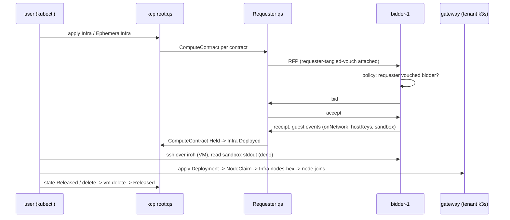

# Acceptance 0012: Infra quickstart (VM, k8s, Deno sandbox, agent VM)

Proves the path of [../quickstart-local.md](../quickstart-local.md) end to end (the prod step: [../quickstart-prod.md](../quickstart-prod.md)): a local kcp with a market in it, a
requester app, kubectl apply of each example in [../../examples/infra/](../../examples/infra/), await, use each
resource, release, dev down. The atirc join of the agent VM is a prod step ([0013](0013-mixed-prod.md)).

- Paths: kubectl against a market network (`dev up --profile market-network`); the browser page applies the same
  `mixed.yaml` from its terminal ([0009](0009-browser-page.md))
- Last pass: 2026-11-13 02:56-03:10Z, own network `a12r` on hat-8 as `test-0001`, rollout 20 release binary
  (v0.0.0-rc165-pre1 038bd32e, 24a8b530; it embeds every asset and has `dev up`, so no `--dev` build), examples from
  038bd32e, live slot held; requester by `run requester --name qs --network a12r`. 1 `dev up` exit 0 in 45 s, Ready,
  `spec.computeKinds` `["vm","deno"]`; 2 ready 11.7 s, `root-qs.requester.local`, `localRepo`; 3
  `operator-vouch-requester-<stamp>` and `network-vouch-bidder-1` Applied, bidder `bidder-tangled-vouch`, every example
  (10 files, k8s-cluster.yaml to the tenant) passes the server dry run; 4 Deployed 19.8 s, ssh over iroh
  `quickstart-vm-ok` `x86_64` 0.76 s; 5 node `*-tenant-node1` Ready and `quickstart-k8s-ok`, but pod Ready 4 m 40 s after
  the apply (02:58:18 -> 03:02:58; was 46-79 s): the cluster OpenBao logged 22 x `write auth/jwt-<hash>/config -> HTTP 400
  error checking oidc discovery URL` (the bidder's guest OIDC issuer `https://did-key-<..>.relay.localhost/v1/identity/oidc`
  did not answer yet; the bidder logs `the guest OIDC keys are published after a token exchange`), then `nodemarket: the
  node can log in to the cluster OpenBao with its workload token` 03:02:39; 6 Held 4 s, `spec.backendRef.kind`
  `DenoSandbox`, `quickstart-deno-ok sum=10 on linux/x86_64` exit 0; 7 `requester_agent_bundle_placeholder` (0600),
  `requester_contract_refused`, Failed with the `--atproto-handle` message, no RFP; 8 Ctrl-C removes the ready file,
  `a12r-qs` NotFound 8 s later, restart `restarted: true` ready 2.7 s, VM and Deno Held, ssh again 0.95 s; 9 VM Released
  1.5 s after the patch, Deno 3 s (both `requester_contract_records_deleted` 6/6), agent `infra_released`, node, Infra and
  ComputeVMs gone 03:06:49; the requester repo holds only `sh.tangled.graph.vouch` (0 market.event / vm.delete / rfp /
  accept / compute.vm, fix 13); `dev down` exit 0 in 123 s, `remaining` `[]`, no `vmsLeft`, no process or unit of the
  instance left
- Previous pass: local market network `qs1` on hat-8, main 12ff7b53 dev build, 2026-11-01 03:24-03:50Z: VM, k8s, Deno pass with
  the default policy; agent VM passes up to the mint (join is the prod step below). Since main 2ea66d62 (plan 0039 D) the
  local agent contract is refused before its RFP (step 7); read 2026-11-01 08:38Z on own network `mxp`, main 6497fe61.
  2026-11-01 09:22-09:42Z, own network `acc12`, main ec97f78e (rc158 + docs) dev build, requester by `run requester
  --network`: every step passes (readings below); Held contracts stay Held across a `run requester` restart, but a
  restart within about 5 s of the Ctrl-C fails (Known Pitfalls)
  2026-11-10 15:10-15:20Z, own network `acc12r` on hat-8, main eb018e0e dev build, requester by `spec.apps`: steps 1-7
  and 9 pass (network Ready, vouches Applied, `quickstart-vm-ok` over iroh, node `*-tenant-node1` Ready and
  `quickstart-k8s-ok`, deno `quickstart-deno-ok sum=10`, the agent refused for its `.local` handle); release logs
  `requester_contract_records_deleted` for the VM and the deno contract; `dev down` 108 s, no VM left. Step 8, 15:22-15:24Z on
  a second `acc12r` network with `run requester --name qs --network acc12r`: VM and deno Held, Ctrl-C removes the ready
  file, `root:dev` workspace `acc12r-qs` NotFound within seconds, the restart writes the ready file again, both
  contracts stay Held and ssh over iroh prints `quickstart-vm-ok` again. The prod step waits for alice.



## Preconditions

| Item | Need |
| --- | --- |
| Host | Linux, `/dev/kvm`, the VM account `test-0001` (subuid range, linger on), `kubectl`, `jq`, `ssh` |
| Binary | `scripts/build-socialweb-computer.sh --dev --publish /var/tmp/<work>` of the branch under test |
| Guest image | `file:///var/lib/socialweb-computer/guest-image` (or let `dev up` fetch the pinned one) |
| Live slot | `deno run -A ~/.tmp/swc-lead/live-slot.ts acquire <name>` before `dev up` |
| Names | instance and bidder handle unique to the run (`--app-values` `{app}.<inst>.bob.test`) |
| atirc (prod step) | an OAuth requester identity with `rpc:chat.atirc.mint` (see 0004) |

## Steps

Run every command as `test-0001` (`sudo -n -u test-0001 env HOME=/home/test-0001 XDG_RUNTIME_DIR=/run/user/$(id -u test-0001) ...`).
`k <ws> ...` is the helper of quickstart-local section 3.

1. `dev up --instance qs1 --profile market-network --host-backend proc --bidders 1 --with-gateway --compute-kinds vm,deno ...`
   (quickstart-local section 2); `dev status` phase Ready; `MarketBidder app` `spec.computeKinds` in `root:bidder-1` is
   `["vm","deno"]`.
2. Add the requester app `qs` to `MarketNetwork.spec.apps` (or run `run requester --name qs --network <instance>` in its
   own terminal, quickstart-local section 4); wait `.status.apps[qs]` Ready with a did.
3. Vouches (quickstart-local section 4): the network composes `network-vouch-bidder-1` in `root:qs` (requester -> bidder)
   and `operator-vouch-requester-<stamp>` in `root:bidder-1` (bidder operator -> requester); read both Applied. The
   bidder runs `bidder-tangled-vouch` (no `open` anywhere). Wait 5 minutes if any contract was denied before.
4. VM: apply `vm.yaml` (your key in), `kubectl wait ... phase=Deployed`, ssh over iroh, read `/root/quickstart`.
5. k8s: apply `k8s-cluster.yaml` to the tenant kubeconfig; read the gateway Infra `nodes-<hex>`, node Ready, pod logs.
6. Deno: apply `deno-sandbox.yaml`; read `status.contract.sandbox`.
7. Agent: apply `agent-vm.yaml` (no bao step: the requester writes the placeholder bundle, log
   `requester_agent_bundle_placeholder`). On a dev network the requester handle is `.local`
   (`root-<name>.requester.local`: the workspace `root:qs` with `-` for `:`), so the contract is Failed before its RFP with `refused: the atirc agent needs a
   requester handle that resolves to <did>: ... start the requester with --atproto-handle ...`, no record written; a
   plain VM contract of the same requester still runs. The agent join is a prod step ([0013](0013-mixed-prod.md)).
8. Restart (the `run requester` form of step 2): Ctrl-C it while the VM and Deno contracts are Held, wait until
   `k root:dev get workspaces <instance>-qs` is NotFound (a few seconds), run the same command again; the ready file
   comes back, both contracts stay Held, ssh to the VM works again.
9. Release: patch each contract `state: Released` (or delete the object); delete the Deployment; `dev down`; release
   the live slot.

## Expected Observations

| Event | Where | Typical |
| --- | --- | --- |
| network Ready | `dev status` | 34 s (`dev up` exit 1 on a transient, `dev status` Ready right after) |
| requester app `qs` Ready, did | `MarketNetwork.status.apps` | < 75 s after the `spec.apps` apply |
| `network-vouch-bidder-1` Applied, `at://<qs did>/sh.tangled.graph.vouch/<bidder did>`; `operator-vouch-requester-<stamp>` Applied, `at://<bidder operator did>/sh.tangled.graph.vouch/<qs did>` | AtprotoRecord status | 1-4 s |
| Infra `quickstart-vm` Deploying -> Deployed | `status.phase`, `status.contracts[vm1]` | 19 s (03:46:01 -> 03:46:20) |
| ssh prints `quickstart-vm-ok`, `x86_64` | ssh over dumbpipe | 0.7 s |
| gateway Infra `nodes-<hex>` Deployed, node `<acct>-tenant-node1` Ready, pod Running, log `quickstart-k8s-ok` | `root:gateway`, tenant k3s | pod applied 03:27:30, Infra Deployed 20 s, node Ready 37 s, pod Running 46 s |
| ComputeVM backend `DenoSandbox`; `sandbox.stdout` `quickstart-deno-ok sum=10 on linux/x86_64`, exit 0 | `root:bidder-1`, contract status | 6 s to Held (03:46:01 -> 03:46:07) |
| agent contract: placeholder bundle, then refused before the RFP | requester core log, contract status | at once: `requester_agent_bundle_placeholder` (`/etc/atirc/atirc.env`, 0600), `requester_contract_refused`, Failed `refused: ... root-qs.requester.local is a .local handle that nobody resolves; start the requester with --atproto-handle ...`; no RFP, no record (before main 2ea66d62: Held 19 s, `requester_atirc_mint_failed` every retry) |
| tenant scale to zero: Deployment deleted 03:47:03, pod gone 03:47:35, Infra entry Releasing 03:49:35 (2 min idle), Infra and node gone 03:49:39 | `root:gateway`, tenant k3s | ~2.5 min |
| state Released -> contract Released | Infra status, requester core log | VM and Deno Released 1 s after the patch; `requester_contract_records_deleted` (accept, rfp, compute.vm, association, rbac records RecordNotFound by getRecord at their keys); agent EphemeralInfra delete: `requester_atirc_release_revoke left=0`, `infra_released` 0.1 s |

## Pass Criteria

- every example passes `kubectl apply --dry-run=server` in `root:qs` (k8s-cluster.yaml: applied to the tenant cluster)
- examples carry no `policy`: the default `requester-tangled-vouch` admits the bidder only after the vouch record
- VM, k8s, Deno reach Deployed / Running and are used as documented; no secret printed on any terminal
- agent: locally the placeholder bundle is written and the contract is refused before its RFP with the
  `--atproto-handle` message; on prod ([0013](0013-mixed-prod.md)) the nick joins after `agent-start.yaml`, and release
  revokes the token before `vm.terminated` (0004 pass criteria)
- `run requester` restart: every Held contract stays Held and ssh works again
- after release and `dev down`: no VM unit of the instance left (the `dev down` report has no `vmsLeft` key, it is
  omitted when empty, and `remaining` is `[]`)

## Readings (2026-11-01, acc12, main ec97f78e, `run requester --network`)

| step | time (Z) | result |
| --- | --- | --- |
| 1 dev up | 09:22:36 -> 09:23:18 | exit 0, 42 s; Ready, bidder-1 and gateway Ready; `spec.computeKinds` `["vm","deno"]` |
| 2 run requester qs | 09:26:04 -> 09:26:15 | ready file, did, handle `root-qs.requester.local`, `localRepo`, 11 s |
| 3 vouches | 09:26:28 | `operator-vouch-requester-<stamp>` and `network-vouch-bidder-1` Applied |
| dry-run of every example in `root:qs` | 09:26:53 | all 9 files created (server dry run) |
| 4 VM | 09:26:54 -> 09:27:13 | Deployed 19 s; ssh `quickstart-vm-ok`, `x86_64` |
| 5 k8s | 09:27:29 -> 09:28:48 | Infra `nodes-<hex>` Deployed, node `<acct>-tenant-node1` Ready, pod Running 79 s, log `quickstart-k8s-ok` |
| 6 Deno | 09:27:36 -> 09:27:39 | Held 3 s, backend `DenoSandbox`, `quickstart-deno-ok sum=10 on linux/x86_64`, exit 0 |
| 7 agent | 09:28:56 | `requester_agent_bundle_placeholder` (0600), `requester_contract_refused`, Failed with the `--atproto-handle` message, no RFP |
| 8 restart at once (5 s after Ctrl-C) | 09:29:35 -> 09:32:35 | FAIL: exit 1 `waiting for the market network to place qs within 3m0s` (Known Pitfalls); again 09:33:39 -> 09:36:39 |
| 8 restart after the workspace is gone | 09:32:48 -> 09:32:49; 09:37:04 | ready 1.6 s, VM and Deno Held, ssh 0.5 s |
| 9 release | 09:37:36 -> 09:40:16 | Deno ended by its ttl (Deadline, 600 s) at 09:37:36; VM Released 1 s after the patch; agent delete `requester_atirc_release_revoke left=0`; Deployment deleted 09:37:40, pod gone 09:38:12, Infra and node gone 09:40:13, ComputeVM 09:40:16 |
| dev down | 09:40:24 -> 09:42:27 | exit 0, 123 s, `remaining` `[]`, no VM unit left; WARN `the MarketNetwork was not gone within 2m0s` (devsup stopped the rest) |

## Vouch Readings (2026-11-01, qs1)

| time (Z) | records present | fresh policy run at the bidder |
| --- | --- | --- |
| 03:27 | none | `not vouched` |
| 03:30:37 | requester -> bidder operator | `not vouched` (03:31, 03:35) |
| 03:36:00 | + requester -> bidder | `not vouched` (03:40:34, `fromCache` false) |
| 03:42:17 | + bidder operator -> requester | allowed (03:46:01): VM, Deno, agent all Held |

An earlier pass of the VM and Deno scenarios (03:28-03:32) used a local-test-only contract override instead of the
vouches; its readings (VM 19 s, Deno 5 s) match the default-policy pass. That override is not part of the examples.

## Prod Step For The Agent Join

The agent needs a requester account whose handle resolves to its DID (a real OAuth account, or pdsAccount on
bsky.social); since the token-less mesh agents (0004) no atirc token is minted. Run on prod by the lead (0004
preconditions); the owner mesh node checks of 0004 are not repeated here. The winner
may be hat-9, which offers iroh and webrtc but no https: `dumbpipe` must be on PATH on the requester host.

```bash
SWC=socialweb-computer; R=~/.tmp/acc12; mkdir -p "$R"; chmod 700 "$R"
NAME=qs-agent-$(date +%s)
$SWC run request --state-dir "$R" --name "$NAME" --hold --agent -- --atproto-oauth-qr > "$R/$NAME.log" 2>&1 &
# sign in from the pendingAction url, wait for Held + requester_agent_peer_published
$SWC run request agent "$NAME" --state-dir "$R"
# in the guest: atirc-agent.service active, `atirc mesh run --no-publish` as the nick user <handle-label>-<rfp rkey>
$SWC run request release "$NAME" --state-dir "$R"
# getRecord computer.socialweb.peer/<nick>.<handle> and its lease market.association: RecordNotFound
```

or, from the browser page terminal (page-rc142 and later), `kubectl apply -f agent-vm.yaml`, then the Agent button,
then `kubectl patch ... state Released`. The page writes the ssh key and the agent secrets bundle for a kubectl-applied
contract.

## Prod Readings (2026-11-01, rc154 bidders, page-rc142)

| Path | Account | Held | Agent | Release |
| --- | --- | --- | --- | --- |
| CLI `run request --hold --agent` | alice | 04:05Z, local bidder | `aliceoa-3mz7vzp2j2v2b` joined; answered `x86_64 fc-lpfuqerea3de-1a35a0de` over atirc | token revoked 04:09:57 before vm.delete; the `--hold` process stopped the invocation kcp 130 ms into the release, so the first `release` failed while Releasing and a second `release` finished it (fixed after rc156: one owner per invocation kcp; on today's main a second `release` of a Released invocation only removes it) |
| page terminal, kubectl EphemeralInfra `qsprod` | hat | created 04:10:19, Held 04:11:00, local bidder | `hat-3mz7wtwqt2c2r` joined; ssh `uname -a` from the page terminal | revoked, then Released 04:12:55 |

No token or key material in any log (plaintext check 0 on every log file).

2026-11-10 15:53-15:56Z, bob (pdsAccount, `--agent=/etc/atirc/atirc.env`), bidders on kcp 2d367fe8, CLI on the same
commit: Held 15:53:36; `requester_agent_mesh_key_written`, `requester_agent_lease_written` (a contract-scoped
market.association), `requester_agent_peer_published` `computer.socialweb.peer/bobvmbuilder-<rfp rkey>.bobvmbuilder.bsky.social`
(iroh ticket and lease); `run request agent`: the bidder took agentStart, `atirc-agent.service` active running `atirc
mesh run --no-publish` as `bobvmbuilder-<rfp rkey>`; release: the peer record, its lease and the accept are
RecordNotFound; hosts empty.

## Cleanup

- `k root:qs delete infras.socialweb.computer,ephemeralinfras.socialweb.computer --all`
- `kubectl --kubeconfig $TK delete -f examples/infra/k8s-cluster.yaml`
- `dev down --instance qs1`, then `live-slot.ts release <name>`

## Known Pitfalls

| Symptom | Cause / fix |
| --- | --- |
| `dev up` exit 1: gateway `Requester ... names no identity DID or handle` | before rc156: a component Failed for a moment at start; rc156 `dev up` waits 1 min on a Failed component |
| `no bids received within 30s`; bidder Bid `policy rejected ... not vouched` (requester-tangled-vouch) | the bidder runs the RFP's attached policy as itself (`self-did` = bidder, `counterparty-did` = requester, PolicyWorkflowRun in `root:bidder-1`): the bidder operator has not vouched the requester: read `operator-vouch-requester-<stamp>` in `root:bidder-1` (the network composes it once the requester has a DID); denials are cached 5 min |
| requester -> bidder vouch alone, still `not vouched` | expected: that is the requester's own direction; the bidder-side run needs the operator -> requester record |
| deno contract `no bids` | the bidder does not serve `deno`: `dev up` without `--compute-kinds vm,deno` (`MarketBidder.spec.computeKinds`) |
| agent contract fails before the RFP: `an agent needs its token in spec.secretsRef` | add `spec.secrets` for the contract |
| agent contract Failed `refused: the atirc agent needs a requester handle that resolves to <did> ... --atproto-handle ...` | expected on a dev network: the requester handle is `.local`; the join is the prod step ([0013](0013-mixed-prod.md)) |
| agent mint error on prod | the requester identity signs no atirc service auth (`requester_service_auth` `atircSigning` `none`, reason in `atircReason`): use an OAuth or pdsAccount identity, or a local PDS on plc.directory with a public ingress and handle ([../quickstart-prod.md](../quickstart-prod.md) section 5) |
| `run requester --network` restart right after Ctrl-C: `network child` Provisioning `workspace root:dev:<instance>-<name> ... is being deleted in the parent`, then exit 1 `waiting for the market network to place <name> within 3m0s` | defect on main ec97f78e: the stop deletes the child's dev workspace, the restart reaches it while it is Deleting (`internal/devinstance/parent.go` EnsureChildWorkspace fails at once on a deletionTimestamp), and the MarketNetwork pass only logs `a child application is not ready yet` and returns no error or requeue (`internal/app/marketnetwork/children.go` ensureApp), so nothing retries once the workspace is gone; wait until `k root:dev get workspaces <instance>-<name>` is NotFound, then start it again |
| Deno EphemeralInfra gone before its release patch (`NotFound`) | `deno-sandbox.yaml` has `ttlSeconds: 600`: after 10 min it ends by Deadline (`infra_ephemeral_ended` reason Deadline) and releases its contract itself |
| `Using secret key ...` on the terminal | dumbpipe's own ephemeral key on stderr: `2>/dev/null` in the ProxyCommand |
| EphemeralInfra `endWhen: Complete` stays `Released` until its ttl | fixed in rc156: it ends in the pass that sees every contract Released or Failed (released 04:02:28, gone 04:02:30) |
| released DenoSandbox ComputeVM stays `Running` with `spec.release` set | fixed in rc156: the bidder terminates and deletes it like a VM (released 04:01:45, gone 04:01:47) |
| `run request release` beside a running `--hold` fails while `Releasing`, the VM keeps running | rc156 and earlier: the `--hold` process stopped the shared kcp when the contract left Held; fixed after rc156 (`requests/<name>/owner.lock`); on an older build run `run request release` again. On today's main a `release` of an invocation that is Released, or Failed before a VM was held, only removes it |
