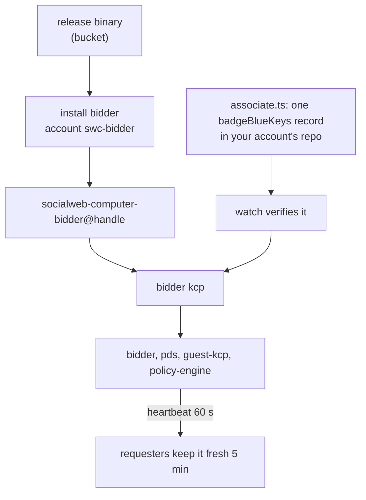

# The bidder: install, identity and upgrades

The long form of the bidder sections of the README: the guest image the binary resolves, the bucket layout it uses, every flag and every fact about the installed unit. For the short copy-paste path see [the README](../README.md#run-and-install-a-bidder).

Every tagged release publishes Linux binaries and the guest image to a public bucket. The bucket needs no credentials.

| Path | Holds |
| --- | --- |
| `releases/<version>/binaries/socialweb-computer-linux-amd64` | The host binary for Linux amd64. |
| `releases/<version>/binaries/socialweb-computer-linux-arm64` | The host binary for Linux arm64. |
| `releases/<version>/binaries/SHA256SUMS` | The sha256 of both binaries. |
| `releases/<version>/binaries/release.json` | The commit, the build mode and one entry per platform. |
| `releases/<version>/binaries/version-linux-<arch>.txt` | The pinned version and sha256 of every asset in that binary. |
| `releases/<version>/guest-image/firecracker-x86_64/` | `vmlinux`, `rootfs.ext4` and `image.json`: the guest image a bidder's VMs boot. |
| `releases/<version>/manifest.json` | Every file under the version, with its size and sha256. |

`<version>` is a git tag, for example `v0.0.0-rc3`. Everything in the bucket is readable without credentials: `releases/<version>/` holds one tag's build, `main/<commit>/` holds the build of each commit on `main`, and `main/latest/` is a copy of the newest one.

Take the newest release, verify it, and put it on your PATH:

```bash
BUCKET=https://socialweb-computer-kcp.sfo3.digitaloceanspaces.com
V=$(curl -s "$BUCKET/?list-type=2&prefix=releases/&delimiter=/" \
  | grep -o 'releases/v[^<]*' | sed 's|releases/||; s|/$||' | sort -V | tail -1)
ARCH=linux-$(uname -m | sed 's/x86_64/amd64/; s/aarch64/arm64/')
mkdir -p ~/.tmp/swc-release && cd ~/.tmp/swc-release
curl -fLO --progress-bar "$BUCKET/releases/$V/binaries/socialweb-computer-$ARCH"
curl -fLO --progress-bar "$BUCKET/releases/$V/binaries/SHA256SUMS"
grep " socialweb-computer-$ARCH\$" SHA256SUMS | sha256sum -c -
mkdir -p ~/.local/bin && install -m 0755 "socialweb-computer-$ARCH" ~/.local/bin/socialweb-computer
export PATH="$HOME/.local/bin:$PATH"
socialweb-computer version
```

Run it as the account that runs the binary; for the market network below that is the VM account (`test-0001`). Ubuntu's `~/.profile` puts `~/.local/bin` on PATH only when it exists at login, so the `export` covers the shell that created it; a later login has it. On another distribution, add it to PATH yourself, or install to `/usr/local/bin` instead.

`socialweb-computer version` prints the build, the commit and the sha256 of every asset in the binary. The release tag is in `binaries/release.json` and `manifest.json`.

To pin a version instead of taking the newest, set `V` yourself: `V=v0.0.0-rc3`.

`socialweb-computer install gateway`, `install bidder` and `upgrade --binary --sha256` take this same file and its sha256: `SHA=$(grep " socialweb-computer-$ARCH\$" SHA256SUMS | cut -d' ' -f1)`.

On a bidder host, `--guest-image-source` takes the guest image you name. It accepts a `file://` or `https://` base, fetches `image.json`, `vmlinux` and `rootfs.ext4` from `<base>/<file>`, and verifies each against the sha256 pinned in the bidder's build, so a guest image that does not match those pins is refused:

`BUCKET` and `V` are the variables set in the block above; set them again in a new shell.

```bash
HANDLE=bobvmbuilder.bsky.social
sudo ~/.local/bin/socialweb-computer install bidder --handle "$HANDLE" \
  --guest-image-source "$BUCKET/releases/$V/guest-image/firecracker-x86_64"
```

`install bidder` fetches and verifies it there and then, so an unreachable or mismatched image is an install failure rather than a surprise at the first RFP. It also prints the download's progress.

To place the files yourself instead, download them and pass a `file://` base:

```bash
for f in vmlinux rootfs.ext4 image.json; do
  curl -fLO --progress-bar "$BUCKET/releases/$V/guest-image/firecracker-x86_64/$f"
done
sudo install -d -m 0755 /var/lib/socialweb-computer/guest-image
sudo install -m 0644 vmlinux rootfs.ext4 image.json /var/lib/socialweb-computer/guest-image/
```

Only `firecracker-x86_64` is published. An arm64 host builds its own with `scripts/build-guest-image.sh`. See [Run and install a bidder](#run-and-install-a-bidder) for the rest of the install.

A binary installed from this bucket needs no image flag at all: it looks for the image pinned into its own build under `releases/<its version>` first and under `main/<its commit>` second, then falls back to `main/latest` and to the newest `releases/<v>` in the bucket, which is what a locally built binary with a dev stamp relies on. `--guest-image-source` takes precedence when given, and `--guest-image-release-base` searches another base. Every candidate is verified against the sha256 pinned in the binary, so a candidate whose bytes are not this build's is skipped for the next one, and only when every published candidate differs is the image refused rather than trusted.

---

Run a bidder inside a market network as a child application. Without `--guest-image-source`, `run bidder` downloads the guest image of its own build from the published artifacts, so a binary from the bucket needs no image flag.

- An installed bidder with the pinned image in its store boots it without asking the published artifacts. Without it, it asks them, and a miss is a refusal.
- A `run bidder` with `--host-backend proc` (the market-network mode above) always asks the published artifacts.
- A fetch prints its progress: a bar on a terminal, a line every few seconds otherwise, lines for a `file://` source. A file under 8 MiB prints nothing. In a market network, the progress goes to the network's log.

```bash
socialweb-computer run bidder --host-backend proc --profile market-network --network mn1 --handle b2.mn1.bob.test \
  --guest-image-source file:///var/lib/socialweb-computer/guest-image --vm-host-backend systemd-user
```

Install a bidder on a host (one explicit root step), then it runs as its own account, `swc-bidder`. Copy-paste, from the bucket:

```bash
HANDLE=<your atproto handle>
V=$(curl -fsSL https://api.github.com/repos/publicdomainrelay/socialweb-computer-kcp/tags | jq -r ".[].name" | grep "^v" | sort -V | tail -1)
B=https://socialweb-computer-kcp.sfo3.digitaloceanspaces.com/releases/$V/binaries
curl -fsSLO "$B/socialweb-computer-linux-amd64" && curl -fsSLO "$B/SHA256SUMS"
grep " socialweb-computer-linux-amd64$" SHA256SUMS | sha256sum -c -
sudo install -m 0755 socialweb-computer-linux-amd64 /usr/local/bin/socialweb-computer
sudo socialweb-computer install bidder --handle "$HANDLE"
```

Then associate the bidder's own DID with that account once; the link comes from the bidder's identity status:

```bash
K=$(sudo ls /var/lib/socialweb-computer/swc-bidder/handles/*/kcp/admin.kubeconfig | head -1)
U=$(sudo kubectl --kubeconfig "$K" get marketidentity bidder -o jsonpath='{.status.pendingAction.url}')
deno run -A --no-lock scripts/associate.ts --creds ~/.bobvmbuilder_bsky_social_source --account BOB --url "$U"
```

A binary built from a working tree needs `--allow-dev-binary` on the install; a release binary does not.



`--allow-dev-binary` accepts a binary built from a working tree. A release binary needs no such flag.

The install writes and enables one unit, `socialweb-computer-bidder@<handle>.service`, in the account's own systemd manager, and returns only once the stack is up. It fetches the guest image with progress and prints how long `enable --now` and the `/readyz` wait took. The first kcp start is a cold bootstrap, inside the install. `--ready-timeout` (default `1m`) bounds its `/readyz` wait; raise it before the first install on a slow host. On a failure, the line above it names what the install waited for, and the step table ends at the failed step. To inspect the unit afterwards:

```bash
sudo runuser -u swc-bidder -- env XDG_RUNTIME_DIR=/run/user/$(id -u swc-bidder) \
  systemctl --user status 'socialweb-computer-bidder@<handle>.service'
sudo journalctl _SYSTEMD_USER_UNIT='socialweb-computer-bidder@<handle>.service' --since -10min
sudo journalctl -t kcp --since -10min
```

`swc-bidder` is a system account (uid below 1000), so systemd writes its user units' log lines to the system journal, not to a per-user journal. `journalctl --user` as that account finds nothing and reports "insufficient permissions"; read the system journal as root with the `_SYSTEMD_USER_UNIT` filter above.

- The unit is `Type=notify` with a watchdog. Its start timeout is `--ready-timeout` plus six minutes; a core that never becomes ready is killed and restarted.
- Every run writes `ready-timeout` and `network-timeout` to the account's `config.json`, passed or not; the installed core reads its budgets there. The file changes only when a value changes.
- The kcp is at `/var/lib/socialweb-computer/swc-bidder/handles/<hash>/kcp`, one slot under `slot-a`. See [Inspect the kcp of an application](#inspect-the-kcp-of-an-application).
- A re-run is safe: every step is idempotent and a completed step is skipped. A stored guest image is re-verified; one that no longer matches its pin is fetched again when a source resolves.
- A re-run that changes `config.json` or a unit file restarts the core units that read it. A re-run that changes nothing restarts nothing.
- Install refuses when `bin/current` is not the binary you invoked. Run `upgrade --binary <path> --sha256 <digest>` as the account, then the same `install` again; the refusal prints that command.

Upgrade an installed bidder as its account, staging the new binary from a release or a local build:

```bash
sudo runuser -u swc-bidder -- env XDG_RUNTIME_DIR=/run/user/$(id -u swc-bidder) \
  CONFIG_PATH_SOCIALWEB_COMPUTER=/var/lib/socialweb-computer/swc-bidder/config.json \
  /var/lib/socialweb-computer/swc-bidder/bin/current/socialweb-computer \
  upgrade --binary <new binary> --sha256 <its sha256>
```

- A production bidder gates which RFPs it answers with `bidder-policy` in its `config.json`, which the unit passes through `CONFIG_PATH_SOCIALWEB_COMPUTER`. Unset, the policy is this repository's default, `open` (`internal/appctl/bidder.go`), so a production bidder must name `tangled-vouch` there; `install bidder` does not write that key.
- Other hono-bidder options go in `bidder-options` of the same `config.json`, written as they would be after `--`: `"bidder-options": "--bid-ttl-sec 1800 --offering-refresh-sec 60"`. Each must be an `options` entry of `market-bidder` in [`deploy/apps/option-map.yaml`](deploy/apps/option-map.yaml); the core puts them in MarketBidder `spec.options`, so they reach the bidder DenoPod's argv, and a changed value replaces the running bidder pod. An option after `--` on the unit's command line wins. Values are split on spaces; `bidder-policy-args` takes a value with spaces. Restart the unit (`systemctl --user restart 'socialweb-computer-bidder@<handle>.service'` as the account) after an edit.
- The guest image is pinned by sha256 in [`internal/versions/versions.json`](internal/versions/versions.json); the bidder verifies every file against that pin.
- A production bidder runs profile `prod-qr`: it has its own PDS, the DenoPod `pds` in its own kcp, and writes every market record there, never to the handle's own repo. The handle's account is written exactly once, by the association record above; `associate.ts --delete` revokes it. A bidder publishes a heartbeat every 60 s and requesters keep only bidders fresh within 5 min, so a stopped bidder stops receiving RFPs.

`install bidder` options:

| Option | Meaning | Default |
|---|---|---|
| `--handle` | The atproto handle(s) of the bidder instances, comma-separated. A re-run with another handle adds that instance. | |
| `--account` | The system account the bidder runs as. | `swc-bidder` |
| `--adopt-account` | Take over an existing account that no install record names. | |
| `--allow-dev-binary` | Accept a binary built from a working tree. A release binary needs no such flag. | |
| `--guest-image-source` | The guest image source, written to `config.json`. Unset, the bidder downloads the image of this build from the published artifacts, which this install also does. | |
| `--guest-image-release-base` | The base the published artifacts are searched under. An image already in the store is re-verified and used without touching the network, unless its bytes no longer match its pin, which sends it back to the base. Clearing this option (an empty flag or env value) is a refusal when no `--guest-image-source` and no stored source names an image. | the public bucket |
| `--ready-timeout D` | How long the install waits for the kcp slot to answer `/readyz`, and the budget the installed core is given. It also sizes the installed unit's start timeout and watchdog, at this plus six minutes, so a large value means a long start timeout. Refused above `10m`, because past that a wedged core waits longer to be restarted, not a cold start for more room. | `1m` |
| `--network-timeout D` | How long the guest image fetch may take, and a third of it, at least 30s, is the budget for searching the release base when no source names an image. Refused under `30s` and above `30m`. | `3m` |
| `--vm-slots N` | One range of `N * 65536` subordinate ids reserved in `/etc/subuid` and `/etc/subgid`; each running VM holds one slot of 65536 ids. | 256 |
| `--dry-run` | Print the computed step list and change nothing. | |
| `--root DIR` | Install into a staged host under `DIR` as the invoking user, without root. | |

## See also

- [The README](../README.md)
- [ARCHITECTURE section 15](ARCHITECTURE.md) for the readings behind these rules
