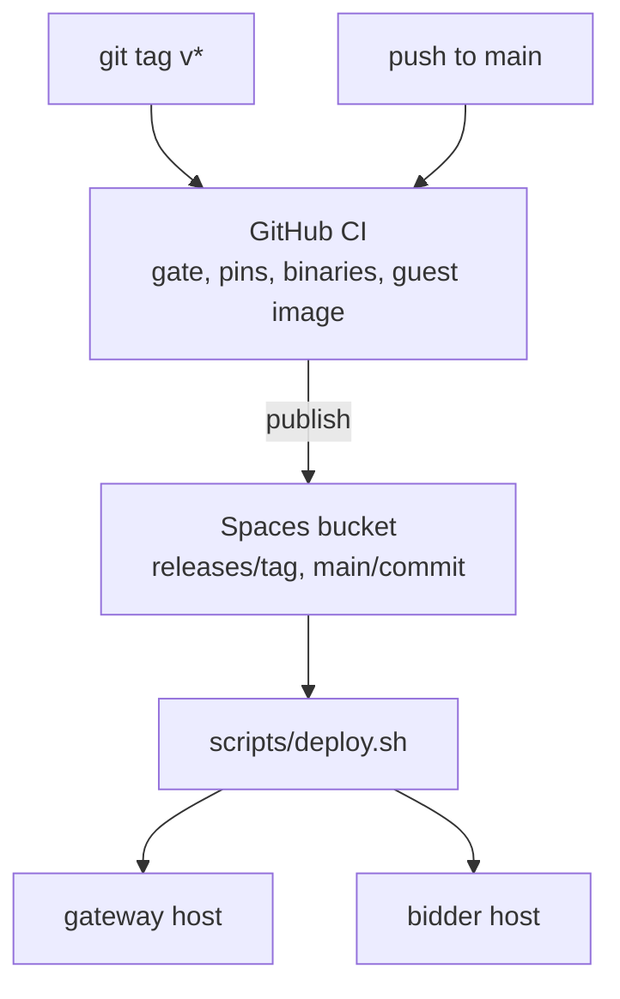

# Deploying a release to production

The long form of the gateway deploy: the build, the acceptance step, rollback, the canary and the
one-time host items. Short path in [CONTRIBUTING](../CONTRIBUTING.md#deploy-the-gateway).



Three deploy shapes, and they differ:

| Shape | What happens | What survives |
| --- | --- | --- |
| Routine gateway deploy (`scripts/deploy.sh` on an installed gateway) | `upgrade --binary --sha256`, then `install gateway` again; the core adopts every installed and transient unit and rolls the kcp slot only when kcp's argv or binary changed | State dir and its kcp objects, the root OpenBao (requester repo key, sessions), the gateway requester's DID and its association record, gateway sessions, running components. Read on prod: web session across rc8 to rc9, requester DID and association across rc11 to rc21 with no new claim |
| Routine bidder upgrade (as the account: `upgrade --binary <path> --sha256 <digest>`, then the same `install bidder` again) | The bidder's core restarts on the new binary; components are replaced only when the spec or the component set changed | The bidder's state dir, its OpenBao (repo key), the bidder DID and handle, its association record, its PDS repo. Read on prod: Bob's bidder DID and association across rc11 to rc21 with no new claim |
| Fresh install (`install gateway` or `install bidder` on an empty host, or a lost or purged state dir) | First install; new keys generated | Nothing. The identity gets a new DID and needs one association claim again (`scripts/associate-bidder.ts` with `--bidder-did` or `--requester-did`; the application's association watch approves it, with no manual `approvedAssociations` patch) |

The policy is still "nothing is guaranteed": a change may deliberately wipe state, and there is no migration or backward compatibility to plan for. Losing sessions, VMs, clusters, claims or receipts is acceptable; what exists, this table says.

```bash
# 1. confirm the commit's run is green on GitHub (.github/workflows/ci.yml)
# 2. build the release
C=$(git rev-parse HEAD)
scripts/build-socialweb-computer.sh --platform linux/amd64 --commit $C
B=~/.tmp/socialweb-computer-build/release/$C/socialweb-computer-linux-amd64; SHA=$(sha256sum $B | cut -d' ' -f1)
# 3. gateway (socialweb.computer): ship, install the first time or upgrade and install again after, write the caddy sites
BINARY=$B SHA256=$SHA SSH_KEY=~/.ssh/id_ed25519_no_password \
  GATEWAY_ENV_FILE=~/.tmp/deploy/gateway.env GATEWAY_SPEC_FILE=~/.tmp/deploy/gateway-spec.yaml scripts/deploy.sh
# 4. bidder: stage the binary, then upgrade it as the account
R=/var/tmp/swc-release/socialweb-computer-${C:0:8}; sudo install -m 0755 $B $R
sudo runuser -u swc-bidder -- env XDG_RUNTIME_DIR=/run/user/$(id -u swc-bidder) \
  CONFIG_PATH_SOCIALWEB_COMPUTER=/var/lib/socialweb-computer/swc-bidder/config.json $R upgrade --binary $R --sha256 $SHA
```

Every prod bidder runs the policy `bidder-tangled-vouch`: it is the MarketBidder default when `spec.policy` is unset, and `install bidder` writes `bidder-policy` to config.json (`bidder-tangled-vouch` unless `--bidder-policy` names another), which `upgrade` and restarts keep. `open` is insecure and runs only when set explicitly (`--bidder-policy open` or `spec.policy: open`); never on a prod bidder. A requester gets bids only when the bidder operator vouches it (`sh.tangled.graph.vouch`, rkey the requester's DID): bob and john vouch alice, the acceptance requester (docs/acceptance/0001-auth-modes.md, Bidder policy).

Verify the deployment by scaling a tenant cluster from zero and back:

```bash
GW=https://k8s.socialweb.computer AUD=did:web:k8s.socialweb.computer K=computer.socialweb.k8s
# apply the Job below to the canary cluster, then poll it (README: Apply objects and read Jobs without a kubeconfig)
jq -n '{cluster: "canary", manifest: {apiVersion: "batch/v1", kind: "Job",
  metadata: {name: "scale-check", namespace: "default"},
  spec: {backoffLimit: 0, template: {spec: {restartPolicy: "Never",
    containers: [{name: "run", image: "docker.io/library/busybox:1.36.1", command: ["sh", "-c", "echo up"]}]}}}}}' |
  curl -sS -X POST "$GW/xrpc/$K.kubectlApplyServerSide" -H "Content-Type: application/json" \
    -H "Authorization: Bearer $(goat account service-auth --aud $AUD --lxm $K.kubectlApplyServerSide)" -d @- | jq -c '{kind, name}'
curl -sS "$GW/xrpc/$K.getJob?cluster=canary&namespace=default&name=scale-check&tailLines=50" \
  -H "Authorization: Bearer $(goat account service-auth --aud $AUD --lxm $K.getJob)" | jq -c '{phase, succeeded}'
```

A tenant cluster scales from zero when you apply a pod to it: the pod raises a `NodeClaim`, the cluster runs the RFP flow for a market VM, the node joins, and the pod runs. Deleting the pod returns the cluster to zero nodes and deletes the VM. Applying a Job on a cluster at zero nodes works the same way; poll `getJob` or watch `#nodeClaim` on `subscribeClusters`.

Roll back as the account with `socialweb-computer rollback --state-dir <state>` (or with
`CONFIG_PATH_SOCIALWEB_COMPUTER=<state>/config.json` set).

Once per host, or when the item changes:

```bash
# guest image on a bidder host (pinned sha256 in internal/versions/versions.json)
scripts/build-guest-image.sh --target firecracker-x86_64 --out /var/tmp/guest-image
sudo install -d -m 0755 /var/lib/socialweb-computer/guest-image && sudo install -m 0644 /var/tmp/guest-image/firecracker-x86_64/{vmlinux,rootfs.ext4,image.json} /var/lib/socialweb-computer/guest-image/
# OAuth client scope on qr.fedfork.com (the did-key-associator frontend, a separate host); needed when a bidder writes a new record type
cd ../did-key-associator && SSH_KEY=~/.ssh/id_ed25519_no_password scripts/deploy.sh --static-only
```

The deploy inputs (gateway.env, gateway-spec.yaml) live on the orphan branch `swc-deploy`, in the worktree `~/.tmp/deploy`. The credential files `~/.aliceoa_bsky_social_source` and `~/.bobvmbuilder_bsky_social_source` are mode 0600; never print, log, or commit their values.

## See also

- [The gateway and its API front](gateway.md)
- [CONTRIBUTING](../CONTRIBUTING.md#deploy-the-gateway)
