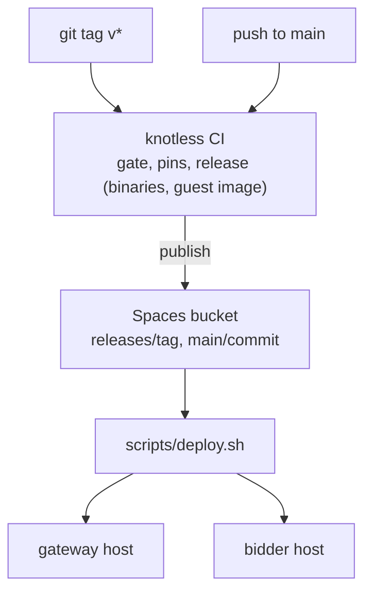

# Deploying a release to production

The long form of the gateway deploy: the build, the acceptance step, rollback, the canary and the
one-time host items. Short path in [CONTRIBUTING](../CONTRIBUTING.md#deploy-the-gateway).



Three deploy shapes, and they differ:

| Shape | What happens | What survives |
| --- | --- | --- |
| Routine gateway deploy (`scripts/deploy.sh` on an installed gateway) | `upgrade --binary --sha256`, then `install gateway` again; the core adopts every installed and transient unit and rolls the kcp slot only when kcp's argv or binary changed | State dir and its kcp objects, the root OpenBao (requester repo key, sessions), the gateway requester's DID and its association record, gateway sessions, running components. Read on prod: web session across rc8 to rc9, requester DID and association across rc11 to rc21 with no new claim |
| Routine bidder upgrade (as the account: `upgrade --binary <path> --sha256 <digest>`, then the same `install bidder` again) | The bidder's core restarts on the new binary; components are replaced only when the spec or the component set changed | The bidder's state dir, its OpenBao (repo key), the bidder DID and handle, its association record, its PDS repo. Read on prod: Bob's bidder DID and association across rc11 to rc21 with no new claim |
| Fresh install (`install gateway` or `install bidder` on an empty host, or a lost or purged state dir) | First install; new keys generated | Nothing. The identity gets a new DID and needs the operator's endorsement + grant again (`scripts/associate-bidder.ts --agent-did <new DID>`; the app writes the new DID's agent-of entry, the identlink walk approves it, with no manual `approvedAssociations` patch; `--remove` with the old DID deletes the old pair) |

The policy is still "nothing is guaranteed": a change may deliberately wipe state, and there is no migration or backward compatibility to plan for. Losing sessions, VMs, clusters, claims or receipts is acceptable; what exists, this table says.

```bash
# 1. confirm the commit's knotless checks are green (gate, pins, release: .knotless/workflows/)
# 2. build the release
C=$(git rev-parse HEAD)
scripts/build-socialweb-computer.sh --platform linux/amd64 --commit $C
B=~/.tmp/socialweb-computer-build/release/$C/socialweb-computer-linux-amd64; SHA=$(sha256sum $B | cut -d' ' -f1)
# 3. gateway (socialweb.computer): ship, install the first time or upgrade and install again after, write the caddy sites
BINARY=$B SHA256=$SHA SSH_KEY=~/.ssh/id_ed25519_no_password \
  GATEWAY_ENV_FILE=~/.tmp/deploy/gateway.env GATEWAY_SPEC_FILE=~/.tmp/deploy/gateway-spec.yaml scripts/deploy.sh
# 4. bidder: stage the binary, then upgrade it as the account
R=/var/tmp/swc-release/socialweb-computer-${C:0:8}; sudo install -m 0755 $B $R
sudo runuser -u swc-bidder -- env XDG_RUNTIME_DIR=/run/user/$(id -u swc-bidder) \
  CONFIG_PATH_SOCIALWEB_COMPUTER=/var/lib/socialweb-computer/swc-bidder/config.json $R upgrade --binary $R --sha256 $SHA
```

Every prod bidder runs the policy `bidder-tangled-vouch`: it is the MarketBidder default when `spec.policy` is unset, and `install bidder` writes `bidder-policy` to config.json (`bidder-tangled-vouch` unless `--bidder-policy` names another), which `upgrade` and restarts keep. `open` is insecure and runs only when set explicitly (`--bidder-policy open` or `spec.policy: open`); never on a prod bidder. A requester gets bids only when the bidder operator vouches it (`sh.tangled.graph.vouch`, rkey the requester's DID): bob and john vouch alice, the acceptance requester (docs/acceptance/0001-auth-modes.md, Bidder policy).

Verify the deployment with acceptance 0001, which is the canary: it scales a tenant k8s cluster through the gateway
(nodes 0 -> 1 -> 2 -> 3 -> 2 -> 1 -> 0, each node a market VM rented through the gateway's NodeClaim path, the gateway's
account modes and one VM per host) and releases everything. It takes about 12 minutes, runs alone (an exclusive entry), and
needs the prod target's requester (`release` = the newest rc tag) and the bob account on the deploy host:

```bash
cd tests && SWC_COMPAT_REQUESTER=release:<previous rc tag> ./gate.sh $PWD/targets/prod.json --account bob 0001:run
```

The RESULT line is `0001:run PASS <seconds>`; a failure freezes the run (`GATE_FREEZE_TTL`, 900 s; attach with
`swc-test-host attach <run dir>`, the path is in the log) and the gateway rolls back with the command below. Run the whole
release gate (`./gate.sh $PWD/targets/prod.json --account bob,alice`, see AGENTS.md "Release pipeline") when a release is cut.
Besides it, read `https://k8s.socialweb.computer/` (200), the web app's `/api/config` on the host, `docker ps` of the
host's other tenants (the knotless runner and its siblings are never restarted by a gateway deploy) and
`systemctl restart swc-ssh-gateway.service` (it runs `bin/current` and keeps the old binary until restarted).

Roll back as the account with `socialweb-computer rollback --state-dir <state>` (or with
`CONFIG_PATH_SOCIALWEB_COMPUTER=<state>/config.json` set).

Once per host, or when the item changes:

```bash
# guest image on a bidder host (pinned sha256 in internal/versions/versions.json)
scripts/build-guest-image.sh --target firecracker-x86_64 --out /var/tmp/guest-image
sudo install -d -m 0755 /var/lib/socialweb-computer/guest-image && sudo install -m 0644 /var/tmp/guest-image/firecracker-x86_64/{vmlinux,rootfs.ext4,image.json} /var/lib/socialweb-computer/guest-image/
# OAuth client scope on qr.fedfork.com (the did-key-associator frontend, a separate host); needed when a bidder writes a new record type
cd ../did-key-associator && SSH_KEY=~/.ssh/id_ed25519_no_password scripts/deploy.sh --static-only
```

The deploy inputs (gateway.env, gateway-spec.yaml) live on the orphan branch `swc-deploy`, in the worktree `~/.tmp/deploy`. The credential files `~/.aliceoa_bsky_social_source` and `~/.bobvmbuilder_bsky_social_source` are mode 0600; never print, log, or commit their values.

## See also

- [The gateway and its API front](gateway.md)
- [CONTRIBUTING](../CONTRIBUTING.md#deploy-the-gateway)
