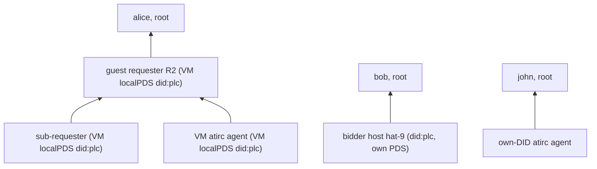

# design: associations on ident.link, level N

- status: decided 2026-11-10 (owner + lead, see [Decisions](#decisions)); implementing
- spec: https://ident.link (draft, 2026-10-22); lexicon `link.ident.endorsement` (github.com/bluesky-social/ident.link `74d22dc`; not ours: read only)
- replaces: kcp operator claim, association mirror, `parent` chains ([../protocol/identity.md](../protocol/identity.md#associations-plan-0036)); atirc `agentOperator`/`agents` owner graph and peer `lease`; atlibs `associate`, mesh-agent lease
- rule: no backcompat. one cut-over, old records deleted, old code removed

## The Pair (ident.link, as specified)

| side | where | what |
|---|---|---|
| agent declares | agent DID doc `alsoKnownAs` | `https://ident.link/agent-of/<principal-did>`, one per principal |
| principal confirms | principal repo `link.ident.endorsement`, rkey = agent DID | `{"$type":"link.ident.endorsement","agent":"<agent-did>"}` |
| revoke | either side alone | principal deletes the endorsement, or agent drops the entry |

```json
{"id":"did:plc:4vcig7s43z3nyqrnepmcfzqt","alsoKnownAs":["https://ident.link/agent-of/did:plc:ocnuqjlzgohypj3zoznermms"]}
```

```sh
goat get at://did:plc:ocnuqjlzgohypj3zoznermms/link.ident.endorsement/did:plc:4vcig7s43z3nyqrnepmcfzqt
# {"$type":"link.ident.endorsement","agent":"did:plc:4vcig7s43z3nyqrnepmcfzqt"}
```

- the pair says who is responsible (spec: informational, SHOULD NOT authorize)
- our authorization is a second record, the grant, beside the endorsement

## Grant (ours)

- NSID `com.publicdomainrelay.temp.market.association` (same name, new shape), principal repo, rkey = agent DID
- pair without grant: attribution only, never trusted. grant without pair: nothing
- no role: an agent of P is P's agent as requester, bidder, atirc peer, sub-agent
- no `parent`: chains come from DID docs

| field | req | meaning |
|---|---|---|
| `agent` | yes | agent DID, == rkey |
| `expiresAt` | with `contract` | dead after it |
| `contract` | no | strongRef of the principal's `market.accept`; dead once the contract is not Held |
| `createdAt` | yes | |

```json
{"$type":"com.publicdomainrelay.temp.market.association","agent":"did:plc:4vcig7s43z3nyqrnepmcfzqt","createdAt":"2026-11-11T00:00:00Z"}
```

```json
{"$type":"com.publicdomainrelay.temp.market.association","agent":"did:plc:r2guestaaaaaaaaaaaaaaaaa","contract":{"uri":"at://did:plc:lpfuqerea3deuoyrn7ojser4/com.publicdomainrelay.temp.market.accept/3m5abc","cid":"bafyrei..."},"expiresAt":"2026-11-11T01:00:00Z","createdAt":"2026-11-11T00:00:00Z"}
```

| kind | `contract` | `expiresAt` | ends at |
|---|---|---|---|
| standing (bidder hosts, owner agents) | - | - | delete |
| timed | - | yes | expiresAt or delete |
| contract-scoped (R2, VM accounts) | yes | yes, contract deadline | expiresAt, contract not Held, delete, agent DID tombstone |

- write: grant, then endorsement. delete: endorsement, then grant. a crash in between leaves something untrusted, never something wider
- absent grant = untrusted (not standing): deleting the grant never widens trust

## Level N

- edge `A -> P` holds iff: P in A's agent-of entries, `P/link.ident.endorsement/A` has `agent == A`, `P/market.association/A` live
- ancestors(A): DIDs reachable by held edges. roots(A): ancestors with no held edge up (A itself if none)
- lifetime(A): min `expiresAt` along the path. contract Held per edge, every principal above it an authority (`scopeHeld` today)



### Walk (same in Go and Rust)

```
walk(A): queue=[(A, d=0, path=[A], exp=inf)]; seen={A}; lookups=0
  pop (X, d, path, exp)
    doc = resolveDid(X)                       # 404, tombstoned: no principals
    for P in dedupe(agentOf(doc)):
      P in path                -> skip        # cycle
      d+1 > maxDepth           -> truncated
      (lookups += 2) > budget  -> truncated
      E, G = getRecord(P, link.ident.endorsement, X), getRecord(P, market.association, X)   # parallel, sync.getRecord, CAR verified
      E.agent == X && G.agent == X && live(G) -> edge X->P, exp' = min(exp, G.expiresAt)
      P not in seen -> push (P, d+1, path+[P], exp')
```

| limit | value | note |
|---|---|---|
| maxDepth | 100 (`trust.MaxChainDepth`, kept) | round-5 decision; atirc server's 8 raised to it |
| lookup budget | 256 getRecords per walk | caps multi-principal fan-out |
| truncated branch | not a root, not trusted | fail closed |
| cycle | edge skipped; an all-cycle group has no root: untrusted | atirc refuses today; same result |
| DID unresolvable, PDS down | edge unconfirmed (spec) | fail closed, logged |

### Cache, re-verify

| item | ok TTL | error TTL |
|---|---|---|
| DID doc | 5 min | 5 s |
| edge verdict (kcp `defaultTrustCacheTTL`) | 5 min, capped at grant `expiresAt` | 5 s |
| atirc owner graph, mesh | 10 s (bounded), mesh re-check every 3 s | 2 s |
| firehose delete of endorsement/grant, `#identity` event | drops that DID's cached edges (`ApplyEvent`, atirc invalidate) | |

### Trusted for X

| check | rule | today |
|---|---|---|
| `OperatorOf(X)` (policy snapshot) | roots(X) | `parent` chain root |
| tangled-vouch | some V in {self}+ancestors(self) vouches some S in {cp}+ancestors(cp), or the sets meet | depth 1 |
| same owner (networked deno to own bidder; app "mine") | roots(requester) meets roots(bidder) | operator equal |
| atirc owner graph, mesh admission of owner O | O == X or O in ancestors(X) | `agentOperator` + `agents` |
| bidder guest lifetime cap | lifetime(requester) | `proofExpiry` (second walker, removed) |
| atirc mint exp | min(24 h, lifetime(subject)) | clamp to association `expiresAt` |
| requireContract verifiers | every edge to the root contract-scoped | same |

- vouch pairs come out of the same budget, nearest first (BFS order)
- no delegation flag: any agent may have agents; theirs is bounded by its lifetime and contracts

## Q1: Agents Without A DID

- decided: every agent gets a did:plc on the VM's localPDS (atirc VM agents, sub-requesters, co-located accounts). no DID-less agents, no did:web
- the VM runs the guest requester R2 (own did:plc + localPDS, plan 0036). an agent is a co-located account on that PDS; a VM with `--agent` starts R2 identity-only (no RFP) when nothing else asked for one
- genesis op (one per account): `rotationKeys` = [renter rotation key, VM localPDS key], `alsoKnownAs` = [`at://<handle>`, `https://ident.link/agent-of/<principal>`]
- principal: R2 for its co-located accounts and VM agents (R2 writes the endorsement + grant in its own repo); the renter for R2 (after the nonce check)
- the renter's rotation key reaches the VM as a public did:key in the secrets bundle (`identity.rotationKey`); its private half never leaves the renter (Go: the requester component's `<state>/components/Requester-requester/plc-rotation.key`, k256, 0600, made on first use, a copy of the local PDS's `plc-rotation.key` when there is one; pkg/embedded: the same path under `Config.StateDir`; atlibs: the host's sealed did:key)
- release: principal deletes endorsement + grant, tombstone (localPDS key; the renter's key when the VM is gone: after deleting its grant the renter waits up to 2 m, none after vm.terminated, then tombstones R2 and the DIDs R2 listed in `associationRequest.accounts` whose head op says the right agent-of and holds its key; best effort). nothing ran: grant expiry + contract Held + bidder cap end trust
- cost per agent: 2 PLC ops (genesis, tombstone; permanent public log), 4 record ops, localPDS share; VM RAM/boot: [measured](#vm-cost)

Genesis (agent co-located with R2):

```json
{"type":"plc_operation","rotationKeys":["did:key:zQ3sh...renter","did:key:zQ3sh...vmLocalPds"],"verificationMethods":{"atproto":"did:key:zQ3sh...agentSigning"},"alsoKnownAs":["at://agent-3m5abc.r2-3m5abc.<pds host>","https://ident.link/agent-of/did:plc:r2guestaaaaaaaaaaaaaaaaa"],"services":{"atproto_pds":{"type":"AtprotoPersonalDataServer","endpoint":"https://did-key-<vm key>.xrpc.fedproxy.com"}},"prev":null,"sig":"..."}
```

Peer record, in the agent's own repo (rkey = subhandle), no `lease`: the repo DID is walked.

```json
{"$type":"computer.socialweb.peer","iroh":"<endpoint id>","channels":["#johnandersen777_bsky_social"],"createdAt":"2026-11-11T00:00:00Z"}
```

- mesh accept: owner O == repo DID or O in ancestors(repo DID); peer lifetime = lifetime(repo DID)
- own-DID atirc agents (`/agent/login`, `com.fedfork.irc.agents`): bsky.social ones retired, not migrated (none named in atirc config or docs; the atirc server state is checked at its step). new ones live on a PDS we run, principal rotation key first: no email token

### VM Cost

| item | reading | command (`R` = renter state dir, `NAME` = invocation) |
|---|---|---|
| R2 + localPDS RSS | (measured at 0004/0005) | `socialweb-computer run request ssh "$NAME" --state-dir "$R" --exec 'ps -u r2 -o rss= \| awk "{s+=\$1} END {print s/1024}"'` (MiB, every process of user `r2`: R2's socialweb-computer, its kcp, PDS, user systemd) |
| R2 unit cgroup | (measured at 0004/0005) | `socialweb-computer run request ssh "$NAME" --state-dir "$R" --exec 'systemctl show socialweb-r2.service -p MemoryCurrent'` |
| per-agent share | (measured at 0004/0005) | both rows above once on a `run request --guest-requester` VM without `--colocated` and once on a `run request --agent` VM; the difference |
| boot: renter start | (measured at 0004) | `head -1 run.log` of `socialweb-computer run request --agent ... 2>&1 \| tee run.log` |
| boot: Held + R2 verified | (measured at 0004) | `grep -m1 -e '"phase":"Held"' -e requester_guest_requester "$R/requests/$NAME/logs/core.log"` |
| boot: agentStart | (measured at 0004) | `grep -m1 'run request agent' run.log` (`socialweb-computer run request agent "$NAME"` posts guest.agentStart) |
| boot: guest unit start | (measured at 0004) | `socialweb-computer run request ssh "$NAME" --state-dir "$R" --exec 'journalctl -u atirc-agent.service -o short-iso \| head -1'` |
| boot: agent online | (measured at 0004) | on the owner node: `atirc mesh sub --others 2>&1 \| grep -m1 "<nick> online"` (time from the line's timestamp, or `ts` from moreutils) |

## Q2: Identities

| identity | DID | agent-of | endorses + grants | rotation key | PLC op |
|---|---|---|---|---|---|
| john (owner) | did:plc:5svqtrhheairglgiiyvutzik, bsky.social | - (root) | hat-7 bidder, john's atirc agents | bsky PDS | none |
| bob | did:plc:ocnuqjlzgohypj3zoznermms, bsky.social | - (root) | hat-9, hat-8 swc-bidder, bob's R2s | bsky PDS | none |
| alice | did:plc:lpfuqerea3deuoyrn7ojser4, bsky.social | - (root) | alice's R2s | bsky PDS | none |
| hat | did:plc:j4yw65srpdumubaadp7ijmy5, pds.rip | - | - | - | none: 404 on plc.directory (dead); drop from testaccounts |
| hat-7 bidder | did:plc:7q5lnitxv4meizdon5fmhzrq | john | - | hat-7 `<pds stateDir>/plc-rotation.key`, sole key | 1, run on hat-7 |
| hat-9 bidder | did:plc:4vcig7s43z3nyqrnepmcfzqt | bob | - | hat-9 `plc-rotation.key` | 1, on hat-9 |
| hat-8 swc-bidder | did:plc:2l2wdry77c7jtucbslstagkj | bob | - | hat-8 `plc-rotation.key` | 1, on hat-8 |
| R2, VM agents, co-located accounts | new did:plc per contract | R2 (agents), renter (R2) | R2: its agents | renter key, then VM localPDS key | genesis + tombstone |
| own-DID atirc agents | existing accounts | owner | - | their PDS | 1 each (email token on bsky.social) |

- roots only write records: no `requestPlcOperationSignature` for john, bob, alice
- bidder DIDs carry `at://<operator handle>` today (borrowed, never verifies); the op sets `alsoKnownAs` to `["https://ident.link/agent-of/<operator>"]`
- `plcsubmit.UpdateHandle` resets `alsoKnownAs` to `[at://handle]` and would drop agent-of: keep non-`at://` entries
- no PLC op tool exists for alsoKnownAs: add `socialweb-computer identity agent-of add|remove <did>` (local rotation key, `plc.SignOperation`)

## Q3: Extra Data

- spec-clean: the endorsement holds only `agent`. role, contract, expiry live in the grant (our namespace, same repo, same rkey)
- role dropped (no verifier needs it once the pair names the principal)
- one getRecord more per edge, in parallel with the endorsement

## Q4: Leases, Expiry

| end | who | what |
|---|---|---|
| release | principal | delete endorsement, delete grant, delete peer record, tombstone the agent DID |
| VM gone, nothing ran | nobody | grant/peer `expiresAt` passes; contract not Held after `vm.terminated`; verifiers drop it |
| bidder backstop | bidder | ends the VM at lifetime(requester) + grace (as rollout 9) |
| atirc tokens | atirc | exp clamped to lifetime; leased token dies at `vm.terminated` (as today) |

## Q5: Shared Library

| lang | home | used by |
|---|---|---|
| Go | kcp `internal/identlink`; `internal/policyengine/trust` on it | policy snapshot, bidder cap, requester discovery, gateway |
| Rust | own repo `atlibs-identlink` (knotless, Unlicense): crate `identlink`, native + wasm, JS wrapper for browsers | atirc (`ownership.rs`, `mesh/verify.rs`), atlibs `crates/policy`, market-status, mesh-agent, atlibs-atirc, atlibs-webrtc |

- writers (endorse, grant, unendorse) stay with each writer
- getRecord = `com.atproto.sync.getRecord`, CAR verified (commit signature against the DID doc `#atproto` key, MST proof of the record) in every IO implementation. never listRecords
- wasm modules: new atlibs host calls `identity.resolveDid` and a verified `get_record`; `describeRepo` (the PDS's view) is never trusted for agent-of

API (both languages, same names):

| item | shape |
|---|---|
| `IO` | `resolveDid(did) -> doc or none` (none: 404, tombstoned, deactivated); `getRecord(repo, collection, rkey) -> value or none` (verified); `contractHeld(contract strongRef, authorities []did) -> bool`; `now()` |
| `walk(io, agent, {maxDepth=100, budget=256})` | `{agent, ancestors [{did, depth, expiresAt?}], roots [did], expiresAt?, truncated, errors [string]}` |
| `agentOf(alsoKnownAs) -> [did]` | entries `https://ident.link/agent-of/<did>`, deduped, invalid DIDs dropped |
| ancestor `expiresAt` | min grant `expiresAt` along the BFS path that first reached it |
| walk `expiresAt` | min over roots (conservative); none = standing |
| errors | an IO error leaves that edge unconfirmed and is listed; callers cache with the error TTL when `errors` is not empty |

Vectors `vectors.json` (atlibs-identlink root; kcp `internal/identlink/vectors.json` byte-identical, checked by `deploy/check.sh --fast`):

```json
{"now":"2026-11-11T00:00:00Z",
 "dids":{"did:plc:a":{"alsoKnownAs":["https://ident.link/agent-of/did:plc:p"]},"did:plc:p":{"alsoKnownAs":[]},"did:plc:gone":null},
 "records":{"at://did:plc:p/link.ident.endorsement/did:plc:a":{"$type":"link.ident.endorsement","agent":"did:plc:a"},
            "at://did:plc:p/com.publicdomainrelay.temp.market.association/did:plc:a":{"$type":"com.publicdomainrelay.temp.market.association","agent":"did:plc:a","createdAt":"2026-11-10T00:00:00Z"}},
 "held":{"at://did:plc:p/com.publicdomainrelay.temp.market.accept/1":true},
 "cases":[{"name":"one edge standing","agent":"did:plc:a","options":{},"want":{"ancestors":[{"did":"did:plc:p","depth":1}],"roots":["did:plc:p"],"truncated":false}}]}
```

- cases at least: standing, contract-scoped, expired, contract not held, pair without grant, grant without pair, endorsement `agent` mismatch, grant `agent` mismatch, two principals, cycle, depth limit, budget limit, unresolvable principal, depth 3 chain, agent-of entry with an invalid DID, duplicate entries

## Removed

| record | repo | rkey | replaced by |
|---|---|---|---|
| `badgeBlueKeys` operator claim | operator | `<service>-<did with : as ->` | endorsement + standing grant |
| `badgeBlueKeys/association` mirror, `badgeBlueKeys.proof` | subject | `association` | agent-of in the subject DID doc |
| `market.association` old shape (`subject`, `service`, `parent`, `note`) | authority | `<service>-<did>`, `<service>-<sha256(subject)[:32]>-<accept rkey>` | grant at rkey = agent DID |
| mesh-agent / kcp `agentpeer.go` self-association lease, renter-repo VM peer record | renter | `requester_associate-<sha>-<accept rkey>`, `<nick>.<handle>` | VM agent account (localPDS) + its own peer record |
| `computer.socialweb.peer.lease`, `computer.socialweb.agents` `lease` | | | the walk of the peer record repo |
| `com.fedfork.irc.agentOperator` | agent | `self` | agent-of in the agent DID doc |
| `com.fedfork.irc.agents` | owner | agent DID | endorsement + grant |
| association kinds `bskyPost`, `delvePost` (kcp, atirc `assoc_posts`) | | | none |
| atlibs requester `associate` (TID rkey, never found) + `associateConfirm` rpc | | | endorse + grant |
| scopes `market.bidderAssociation`, `requester.associateConfirm` (no code) | | | removed |

- kept: `badgeBlueKeys` signer key binding, ssh key claim (key bindings, not associations)
- kept, trimmed: `market.associationRequest` `{principal, contract, nonce}`, guest repo, rkey = principal DID. anyone can declare agent-of alice; alice endorses only the DID that answered this contract's nonce

## Q6: Rollout (one cut-over)

| # | step | repo / host |
|---|---|---|
| 1 | lexicons: vendor `link.ident.endorsement` (`74d22dc`); new `market.association`; trimmed `associationRequest`; peer without `lease`; drop `badgeBlueKeys.proof`, `com.fedfork.irc.agentOperator`/`agents`; OAuth `repo:link.ident.endorsement?action=create&action=delete` as an optional scope | kcp, atirc, atlibs-mesh-agents |
| 2 | Go `identlink`, trust rework, bidder `proofExpiry` out, `agent-of add/remove`, genesis with agent-of + renter rotation key, `agentpeer.go` peer shape | kcp |
| 3 | Rust `identlink` + wasm/JS + vectors; atlibs host calls `identity.resolveDid`, verified `get_record` | atlibs-identlink, atlibs |
| 4 | atirc on `identlink`; `/agent/login` writes the pair (+ PLC op flow) | atirc |
| 5 | policy crate, market-status, mesh-agent, requester endorse, app, atlibs-atirc, atlibs-webrtc | atlibs-split |
| 6 | bidders hat-7, hat-9, hat-8: binaries, PLC op, then john/bob endorse + grant | hosts |
| 7 | gateway | kcp deploy |
| 8 | irc.fedfork.com, bidders' atirc pin | atirc deploy |
| 9 | npm atlibs*, app republish, alice binding | npm |
| 10 | delete old records at known rkeys (testaccounts `declared`: getRecord, deleteRecord) | john, bob, alice |
| 11 | runbooks below | |

| runbook | proves |
|---|---|
| 0001 auth modes | bidder <-> operator via the pair |
| 0004 vm atirc agent | VM agent did:plc on the localPDS, pair + grant, mesh admission, expiry, tombstone; VM cost |
| 0005 guest requester association | R2 pair + grant, nested accounts, release, tombstone |
| 0007 bidder termination | lifetime cap from the walk |
| 0011 atirc | owner graph |
| 0013 mixed prod | all at once |
| atirc 0001 | ship gates, VM agents |

## Owner Actions

- none expected. sign-ins and re-signs (optional scope `repo:link.ident.endorsement`) are done from `~/.atproto_source` (john), `~/.aliceoa_bsky_social_source`, `~/.bobvmbuilder_bsky_social_source`; one driver per account, announced before each window
- a PLC email token only if unavoidable: the design needs none (roots never change their DID doc; bsky.social agent accounts are retired)

## Decisions

| # | question | decided |
|---|---|---|
| 1 | VM agents | did:plc on the VM localPDS for every agent (owner); renter rotation key first; tombstone at release |
| 2 | pair without grant | untrusted |
| 3 | role in grant | none |
| 4 | every chained link contract-scoped | dropped; contract Held per edge when the grant names one |
| 5 | bidder DIDs' borrowed `at://` handle | dropped; `plcsubmit.UpdateHandle` keeps other `alsoKnownAs` entries |
| 6 | new own-DID agents | on a PDS we run, principal rotation key first |
| 7 | owner rotation key on bidder DIDs | no |
| 8 | record auth | `sync.getRecord` + CAR verify everywhere |
| 9 | Rust crate home | own repo `atlibs-identlink` (knotless, Unlicense), Rust + wasm/JS, shared vectors |
| - | hat | dead (owner): removed from testaccounts, skipped |
| - | bsky.social own-DID atirc agents | retired, not migrated |
| - | found bugs | fixed in this work: atlibs `associate` TID rkey, mesh-agent self-lease, no lease check in atlibs-atirc/webrtc, atirc `lease_root` skips contract Held, bidder `proofExpiry` second walker |
