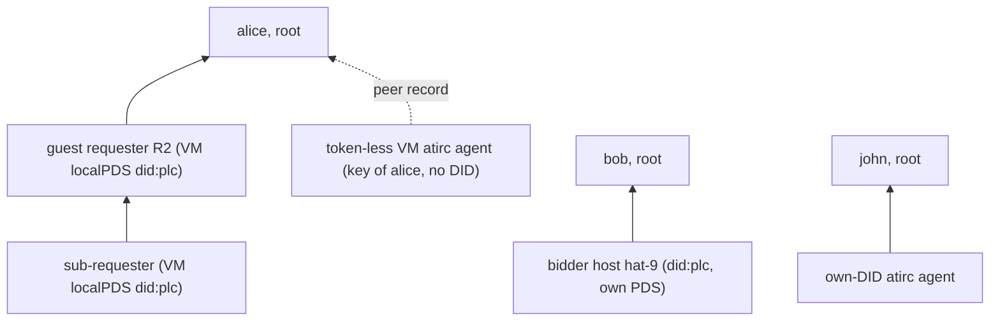

# design: associations on ident.link, level N

- status: design checkpoint 2026-11-10, not implemented
- spec: https://ident.link (draft, 2026-10-22); lexicon `link.ident.endorsement` (github.com/bluesky-social/ident.link `74d22dc`; not ours: read only)
- replaces: kcp operator claim, association mirror, `parent` chains ([../protocol/identity.md](../protocol/identity.md#associations-plan-0036)); atirc `agentOperator`/`agents` owner graph and peer `lease`; atlibs `associate`, mesh-agent lease
- rule: no backcompat. one cut-over, old records deleted, old code removed

## The Pair (ident.link, as specified)

| side | where | what |
|---|---|---|
| agent declares | agent DID doc `alsoKnownAs` | `https://ident.link/agent-of/<principal-did>`, one per principal |
| principal confirms | principal repo `link.ident.endorsement`, rkey = agent DID | `{"$type":"link.ident.endorsement","agent":"<agent-did>"}` |
| revoke | either side alone | principal deletes the endorsement, or agent drops the entry |

```json
{"id":"did:plc:4vcig7s43z3nyqrnepmcfzqt","alsoKnownAs":["https://ident.link/agent-of/did:plc:ocnuqjlzgohypj3zoznermms"]}
```

```sh
goat get at://did:plc:ocnuqjlzgohypj3zoznermms/link.ident.endorsement/did:plc:4vcig7s43z3nyqrnepmcfzqt
# {"$type":"link.ident.endorsement","agent":"did:plc:4vcig7s43z3nyqrnepmcfzqt"}
```

- the pair says who is responsible (spec: informational, SHOULD NOT authorize)
- our authorization is a second record, the grant, beside the endorsement

## Grant (ours)

- NSID `com.publicdomainrelay.temp.market.association` (same name, new shape), principal repo, rkey = agent DID
- pair without grant: attribution only, never trusted. grant without pair: nothing
- no role: an agent of P is P's agent as requester, bidder, atirc peer, sub-agent
- no `parent`: chains come from DID docs

| field | req | meaning |
|---|---|---|
| `agent` | yes | agent DID, == rkey |
| `expiresAt` | with `contract` | dead after it |
| `contract` | no | strongRef of the principal's `market.accept`; dead once the contract is not Held |
| `createdAt` | yes | |

```json
{"$type":"com.publicdomainrelay.temp.market.association","agent":"did:plc:4vcig7s43z3nyqrnepmcfzqt","createdAt":"2026-11-11T00:00:00Z"}
```

```json
{"$type":"com.publicdomainrelay.temp.market.association","agent":"did:plc:r2guestaaaaaaaaaaaaaaaaa","contract":{"uri":"at://did:plc:lpfuqerea3deuoyrn7ojser4/com.publicdomainrelay.temp.market.accept/3m5abc","cid":"bafyrei..."},"expiresAt":"2026-11-11T01:00:00Z","createdAt":"2026-11-11T00:00:00Z"}
```

| kind | `contract` | `expiresAt` | ends at |
|---|---|---|---|
| standing (bidder hosts, owner agents) | - | - | delete |
| timed | - | yes | expiresAt or delete |
| contract-scoped (R2, VM accounts) | yes | yes, contract deadline | expiresAt, contract not Held, delete, agent DID tombstone |

- write: grant, then endorsement. delete: endorsement, then grant. a crash in between leaves something untrusted, never something wider
- absent grant = untrusted (not standing): deleting the grant never widens trust

## Level N

- edge `A -> P` holds iff: P in A's agent-of entries, `P/link.ident.endorsement/A` has `agent == A`, `P/market.association/A` live
- ancestors(A): DIDs reachable by held edges. roots(A): ancestors with no held edge up (A itself if none)
- lifetime(A): min `expiresAt` along the path. contract Held per edge, every principal above it an authority (`scopeHeld` today)



### Walk (same in Go and Rust)

```
walk(A): queue=[(A, d=0, path=[A], exp=inf)]; seen={A}; lookups=0
  pop (X, d, path, exp)
    doc = resolveDid(X)                       # 404, tombstoned: no principals
    for P in dedupe(agentOf(doc)):
      P in path                -> skip        # cycle
      d+1 > maxDepth           -> truncated
      (lookups += 2) > budget  -> truncated
      E, G = getRecord(P, link.ident.endorsement, X), getRecord(P, market.association, X)   # parallel, sync.getRecord, CAR verified
      E.agent == X && G.agent == X && live(G) -> edge X->P, exp' = min(exp, G.expiresAt)
      P not in seen -> push (P, d+1, path+[P], exp')
```

| limit | value | note |
|---|---|---|
| maxDepth | 100 (`trust.MaxChainDepth`, kept) | round-5 decision; atirc server's 8 raised to it |
| lookup budget | 256 getRecords per walk | caps multi-principal fan-out |
| truncated branch | not a root, not trusted | fail closed |
| cycle | edge skipped; an all-cycle group has no root: untrusted | atirc refuses today; same result |
| DID unresolvable, PDS down | edge unconfirmed (spec) | fail closed, logged |

### Cache, re-verify

| item | ok TTL | error TTL |
|---|---|---|
| DID doc | 5 min | 5 s |
| edge verdict (kcp `defaultTrustCacheTTL`) | 5 min, capped at grant `expiresAt` | 5 s |
| atirc owner graph, mesh | 10 s (bounded), mesh re-check every 3 s | 2 s |
| firehose delete of endorsement/grant, `#identity` event | drops that DID's cached edges (`ApplyEvent`, atirc invalidate) | |

### Trusted for X

| check | rule | today |
|---|---|---|
| `OperatorOf(X)` (policy snapshot) | roots(X) | `parent` chain root |
| tangled-vouch | some V in {self}+ancestors(self) vouches some S in {cp}+ancestors(cp), or the sets meet | depth 1 |
| same owner (networked deno to own bidder; app "mine") | roots(requester) meets roots(bidder) | operator equal |
| atirc owner graph, mesh admission of owner O | O == X or O in ancestors(X) | `agentOperator` + `agents` |
| bidder guest lifetime cap | lifetime(requester) | `proofExpiry` (second walker, removed) |
| atirc mint exp | min(24 h, lifetime(subject)) | clamp to association `expiresAt` |
| requireContract verifiers | every edge to the root contract-scoped | same |

- vouch pairs come out of the same budget, nearest first (BFS order)
- no delegation flag: any agent may have agents; theirs is bounded by its lifetime and contracts

## Q1: Agents Without A DID

| option | DID | rotation key | cost per agent | VM dies uncleaned |
|---|---|---|---|---|
| A. key of the renter (rec, leaf token-less VM agents) | none: subhandle + mesh key, peer record in renter repo | - | 1 put + 1 delete | peer `expiresAt` / contract |
| B. renter-minted did:plc, no PDS | did:plc, DID doc only | renter | +2 PLC ops (genesis, tombstone; permanent public log) + 4 record ops | renter tombstones; grant expiry |
| C. VM localPDS account (rec when it needs a repo) | did:plc on VM localPDS (R2 flow) | renter key first, localPDS key second | localPDS in the VM + 2 PLC ops + 4 record ops | grant expiry, contract Held, bidder cap |
| D. did:web | needs one TLS host per agent (atproto did:web is host-only), no audit log | - | DNS + cert per agent | stop serving |

- A: a token-less agent is not a principal of anything with a DID; it is a key the renter binds. ident.link is DID to DID, so it does not apply. the peer record carries the lifetime inline (the old self-association `lease` never verified: atlibs policy rejects operator == subject)
- C: R2, sub-requesters, co-located accounts, any agent that endorses agents of its own. genesis carries agent-of (0 extra ops); tombstone at release exists (`run request` retire)
- rule for every new agent DID: its principal's rotation key is first in `rotationKeys` (spec "Protecting from alterations"); the agent gets repo access only. the renter can tombstone from outside a dead VM
- own-DID atirc agents (`/agent/login`, claude.ai connector accounts): the pair. on bsky.social the agent-of op needs the account's email token: see Owner Actions

Peer record (A), renter repo, rkey = subhandle:

```json
{"$type":"computer.socialweb.peer","iroh":"<endpoint id>","channels":["#alice"],"contract":{"uri":"at://did:plc:lpfuqerea3deuoyrn7ojser4/com.publicdomainrelay.temp.market.accept/3m5abc","cid":"bafyrei..."},"expiresAt":"2026-11-11T01:00:00Z","createdAt":"2026-11-11T00:00:00Z"}
```

- `lease` removed from `computer.socialweb.peer` (kcp, atirc, atlibs-mesh-agents copies stay byte-identical); `contract` + `expiresAt` added, both or neither
- mesh accept: peer record live (expiry, contract Held, which atirc skips today) and the record's repo passes the owner-graph rule

## Q2: Identities

| identity | DID | agent-of | endorses + grants | rotation key | PLC op |
|---|---|---|---|---|---|
| john (owner) | did:plc:5svqtrhheairglgiiyvutzik, bsky.social | - (root) | hat-7 bidder, john's atirc agents | bsky PDS | none |
| bob | did:plc:ocnuqjlzgohypj3zoznermms, bsky.social | - (root) | hat-9, hat-8 swc-bidder, bob's R2s | bsky PDS | none |
| alice | did:plc:lpfuqerea3deuoyrn7ojser4, bsky.social | - (root) | alice's R2s | bsky PDS | none |
| hat | did:plc:j4yw65srpdumubaadp7ijmy5, pds.rip | - | - | - | none: 404 on plc.directory (dead); drop from testaccounts |
| hat-7 bidder | did:plc:7q5lnitxv4meizdon5fmhzrq | john | - | hat-7 `<pds stateDir>/plc-rotation.key`, sole key | 1, run on hat-7 |
| hat-9 bidder | did:plc:4vcig7s43z3nyqrnepmcfzqt | bob | - | hat-9 `plc-rotation.key` | 1, on hat-9 |
| hat-8 swc-bidder | did:plc:2l2wdry77c7jtucbslstagkj | bob | - | hat-8 `plc-rotation.key` | 1, on hat-8 |
| R2 / VM accounts (C) | new did:plc per contract | spawner | their own agents | renter key, then VM localPDS key | in genesis |
| own-DID atirc agents | existing accounts | owner | - | their PDS | 1 each (email token on bsky.social) |

- roots only write records: no `requestPlcOperationSignature` for john, bob, alice
- bidder DIDs carry `at://<operator handle>` today (borrowed, never verifies); the op sets `alsoKnownAs` to `["https://ident.link/agent-of/<operator>"]`
- `plcsubmit.UpdateHandle` resets `alsoKnownAs` to `[at://handle]` and would drop agent-of: keep non-`at://` entries
- no PLC op tool exists for alsoKnownAs: add `socialweb-computer identity agent-of add|remove <did>` (local rotation key, `plc.SignOperation`)

## Q3: Extra Data

- spec-clean: the endorsement holds only `agent`. role, contract, expiry live in the grant (our namespace, same repo, same rkey)
- role dropped (no verifier needs it once the pair names the principal)
- one getRecord more per edge, in parallel with the endorsement

## Q4: Leases, Expiry

| end | who | what |
|---|---|---|
| release | principal | delete endorsement, delete grant, tombstone agent DID (C), delete peer record (A) |
| VM gone, nothing ran | nobody | grant/peer `expiresAt` passes; contract not Held after `vm.terminated`; verifiers drop it |
| bidder backstop | bidder | ends the VM at lifetime(requester) + grace (as rollout 9) |
| atirc tokens | atirc | exp clamped to lifetime; leased token dies at `vm.terminated` (as today) |

## Q5: Shared Library

| lang | home | used by |
|---|---|---|
| Go | kcp `internal/identlink` (walk, edge, cache); `internal/policyengine/trust` on it | policy snapshot, bidder cap, requester discovery, gateway |
| Rust | crate `identlink` in atlibs `rust/src/identlink` (beside `abi`), IO trait `{resolve_did, get_record}`; native and wasm | atirc (replaces `ownership.rs` checks, `mesh/verify.rs` `lease_root`), atlibs `crates/policy`, market-status, mesh-agent |
| JS | none of its own: the browser calls the wasm module `identlink` through atlibs | atlibs-atirc `dialable`, atlibs-webrtc `peerReceipt` (both ignore `lease` today) |

- one vectors file `identlink/vectors.json` (DID docs, records, expected walk); kcp keeps a byte-identical copy, pre-commit checked like `peer.json`
- getRecord = `com.atproto.sync.getRecord`, CAR verified against the DID doc signing key (Go: `internal/atproto/repo.VerifyCommitCAR`). never listRecords
- wasm modules have no DID doc call (only `describeRepo`, the PDS's view): add host call `identity.resolveDid` and a verified `get_record` to atlibs `abi`
- writers (endorse, grant, unendorse) stay with each writer

## Removed

| record | repo | rkey | replaced by |
|---|---|---|---|
| `badgeBlueKeys` operator claim | operator | `<service>-<did with : as ->` | endorsement + standing grant |
| `badgeBlueKeys/association` mirror, `badgeBlueKeys.proof` | subject | `association` | agent-of in the subject DID doc |
| `market.association` old shape (`subject`, `service`, `parent`, `note`) | authority | `<service>-<did>`, `<service>-<sha256(subject)[:32]>-<accept rkey>` | grant at rkey = agent DID |
| mesh-agent / kcp `agentpeer.go` self-association lease | renter | `requester_associate-<sha>-<accept rkey>` | peer `contract` + `expiresAt` |
| `computer.socialweb.peer.lease`, `computer.socialweb.agents` `lease` | renter | | peer `contract` + `expiresAt` |
| `com.fedfork.irc.agentOperator` | agent | `self` | agent-of in the agent DID doc |
| `com.fedfork.irc.agents` | owner | agent DID | endorsement + grant |
| association kinds `bskyPost`, `delvePost` (kcp, atirc `assoc_posts`) | | | none |
| atlibs requester `associate` (TID rkey, never found) + `associateConfirm` rpc | | | endorse + grant |
| scopes `market.bidderAssociation`, `requester.associateConfirm` (no code) | | | removed |

- kept: `badgeBlueKeys` signer key binding, ssh key claim (key bindings, not associations)
- kept, trimmed: `market.associationRequest` `{principal, contract, nonce}`, guest repo, rkey = principal DID. anyone can declare agent-of alice; alice endorses only the DID that answered this contract's nonce

## Q6: Rollout (one cut-over)

| # | step | repo / host |
|---|---|---|
| 1 | lexicons: vendor `link.ident.endorsement` (`74d22dc`); new `market.association`; trimmed `associationRequest`; peer `contract`/`expiresAt`; drop `badgeBlueKeys.proof`, `com.fedfork.irc.agentOperator`/`agents`; OAuth `repo:link.ident.endorsement?action=create&action=delete` as an optional scope | kcp, atirc, atlibs-mesh-agents |
| 2 | Go `identlink`, trust rework, bidder `proofExpiry` out, `agent-of add/remove`, genesis with agent-of + renter rotation key, `agentpeer.go` peer shape | kcp |
| 3 | Rust `identlink`, abi `resolveDid` + verified get_record | atlibs |
| 4 | atirc on `identlink`; `/agent/login` writes the pair (+ PLC op flow) | atirc |
| 5 | policy crate, market-status, mesh-agent, requester endorse, app, atlibs-atirc, atlibs-webrtc | atlibs-split |
| 6 | bidders hat-7, hat-9, hat-8: binaries, PLC op, then john/bob endorse + grant | hosts |
| 7 | gateway | kcp deploy |
| 8 | irc.fedfork.com, bidders' atirc pin | atirc deploy |
| 9 | npm atlibs*, app republish, alice binding | npm |
| 10 | delete old records at known rkeys (testaccounts `declared`: getRecord, deleteRecord) | john, bob, alice |
| 11 | runbooks below | |

| runbook | proves |
|---|---|
| 0001 auth modes | bidder <-> operator via the pair |
| 0004 vm atirc agent | peer record (A), mesh admission, expiry |
| 0005 guest requester association | R2 pair + grant, nested accounts, release, tombstone |
| 0007 bidder termination | lifetime cap from the walk |
| 0011 atirc | owner graph |
| 0013 mixed prod | all at once |
| atirc 0001 | ship gates, VM agents |

## Owner Actions

| # | action | when |
|---|---|---|
| 1 | "go" on this design, answers to Open Decisions | now |
| 2 | approve using john and bob sessions to write endorse + grant for hat-7 (john), hat-9 and hat-8 (bob), and delete their old claims; re-sign-in with the optional endorsement scope if the session lacks it | step 6 |
| 3 | same for alice (R2 runs in 0005/0013; old record deletes) | step 10 |
| 4 | list own-DID atirc agent accounts (we never listRecords `com.fedfork.irc.agents`); per bsky.social account an email token for its agent-of PLC op, or retire it | step 4 |
| 5 | confirm hat (pds.rip, DID 404) is dead and leaves testaccounts | step 10 |

## Open Decisions (recommendation first)

| # | question | rec | alternative |
|---|---|---|---|
| 1 | leaf token-less VM agents | A: key of the renter, no DID | B: every agent a renter-minted did:plc (2 PLC ops each) |
| 2 | pair without grant | untrusted | trusted as standing (fewer records, deletes widen) |
| 3 | role in grant | dropped | `roles[]` |
| 4 | chained links must be contract-scoped (kcp rule today) | drop: each standing edge is explicit | keep |
| 5 | bidder DIDs' borrowed `at://` handle | drop | keep |
| 6 | new own-DID agents | on a PDS we run, principal rotation key first, no email token | bsky.social + email token each |
| 7 | owner rotation key on bidder DIDs (spec MAY) | no | add a john key above the host key |
| 8 | record auth | `sync.getRecord` + CAR verify everywhere | `repo.getRecord` over TLS |
| 9 | Rust crate home | atlibs `rust/src/identlink` | own repo `atlibs-identlink` |
