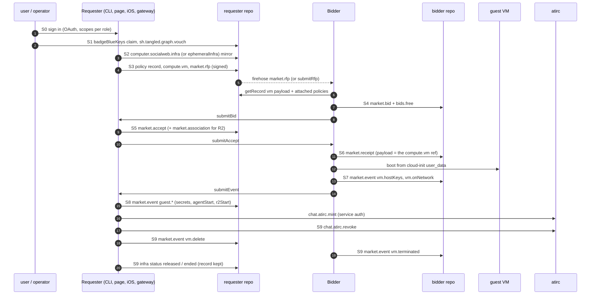

# protocol: the atproto protocol of socialweb-computer

- every record, XRPC method and stream that socialweb-computer applications speak
- applications talk ONLY over this protocol. a shared kcp is composition and isolation, never a data channel
- lexicon files: `lexicons/` (embedded by `lexicons/embed.go`, Go types generated by `internal/lexgen`)
- companion of [../SYSTEM.md](../SYSTEM.md) (the whole system) and [../KCP.md](../KCP.md) (kcp objects)
- no history here. what changed when: git log, `docs/plans/*.yaml`

## Files In This Tree

| doc | what |
|---|---|
| [README.md](README.md) | this index: NSID families, where each is documented, the end-to-end sequence |
| [market.md](market.md) | the RFP flow: rfp, bid, accept, receipt, event, offering, heartbeat, relays, submit* XRPC, streams, selection |
| [guest-events.md](guest-events.md) | `compute.events.vm.*`, `compute.events.guest.*`, `compute.guest.subscribeEvents`, secrets, agent start, guest requester (R2) |
| [lexicons-market.md](lexicons-market.md) | reference rows for every lexicon under `com/publicdomainrelay/temp/` except `cluster.*` and `badgeBlueKeys` |
| [infra.md](infra.md) | `computer.socialweb.infra`, `ephemeralInfra`, `k8s.*`, `cluster.*`: the deployment records and the gateway cluster API |
| [identity.md](identity.md) | `network.attested.*`, `badgeBlueKeys`, associations (plan 0036), did:key ingress, sign-in |
| [policy.md](policy.md) | policy records (gha-lite workflows), the strongRefs an RFP attaches, tangled-vouch |
| [outside.md](outside.md) | lexicons we use but do not own: `sh.tangled.graph.vouch`, `chat.atirc.*`, `com.atproto.*`, `app.bsky.*`, `com.fedproxy.*`, OAuth scopes per role |

## How To Read A Lexicon Row

Every lexicon section in this tree carries the same fields.

| field | meaning |
|---|---|
| NSID | the full id, as in the `id` of the lexicon file |
| type | `record`, `query`, `procedure`, `subscription` or `object` |
| key fields | the fields a reader acts on; the lexicon file has the rest |
| rkey | `self`, a deterministic key (named), `tid`, or `any` with the scheme the writer uses |
| written by / read by | the application role and the Go package |
| step | the step of the [end-to-end sequence](#end-to-end-sequence) where it appears |

## NSID Families

| family | owner | lexicon files | kind | doc |
|---|---|---|---|---|
| `com.publicdomainrelay.temp.market.*` | us | `lexicons/com/publicdomainrelay/temp/market/` | records + XRPC | [market.md](market.md), [lexicons-market.md](lexicons-market.md) |
| `com.publicdomainrelay.temp.market.association`, `associationRequest` | us | same | records | flow: [identity.md](identity.md#associations-plan-0036); rows: [lexicons-market.md](lexicons-market.md#marketassociation) |
| `com.publicdomainrelay.temp.compute.vm` | us | `lexicons/com/publicdomainrelay/temp/compute/vm.json` | record (RFP payload) | [market.md](market.md), [lexicons-market.md](lexicons-market.md) |
| `com.publicdomainrelay.temp.compute.events.*`, `compute.guest.subscribeEvents` | us | `lexicons/com/publicdomainrelay/temp/compute/` | event payload records, subscription | [guest-events.md](guest-events.md) |
| `com.publicdomainrelay.temp.ingress.webRTC` | us | `lexicons/com/publicdomainrelay/temp/ingress/` | record | [lexicons-market.md](lexicons-market.md) |
| `com.publicdomainrelay.temp.cluster.*` | us | `lexicons/com/publicdomainrelay/temp/cluster/` | XRPC (gateway clusters) | [infra.md](infra.md#compublicdomainrelaytempcluster) |
| `com.publicdomainrelay.temp.badgeBlueKeys` | us | `lexicons/com/publicdomainrelay/temp/badgeBlueKeys.json` | record (key claim) | [identity.md](identity.md#badgebluekeys) |
| `computer.socialweb.infra`, `computer.socialweb.ephemeralInfra` | us | `lexicons/computer/socialweb/` | records (deployments) | [infra.md](infra.md) |
| `computer.socialweb.k8s.*` | us | `lexicons/computer/socialweb/k8s/` | XRPC (gateway k8s API) | [infra.md](infra.md#computersocialwebk8s) |
| `network.attested.*` | us (vendored shape) | `lexicons/network/attested/` | object, record, query | [identity.md](identity.md#networkattested) |
| `com.atproto.repo.strongRef` | atproto (vendored copy) | `lexicons/com/atproto/repo/strongRef.json` | object | [outside.md](outside.md#comatprotorepostrongref) |
| `computer.socialweb.temp.policy.*`, `com.publicdomainrelay.temp.market.policies.denoWorker` | us | none | records (policy) | [policy.md](policy.md) |
| `sh.tangled.graph.vouch` | tangled | none here | record (trust edge) | [outside.md](outside.md#shtangledgraphvouch), [policy.md](policy.md#tangled-vouch) |
| `chat.atirc.mint`, `chat.atirc.revoke` | atirc | atirc repo | XRPC | [outside.md](outside.md#chatatirc) |
| `com.atproto.*`, `app.bsky.*` | atproto, Bluesky | upstream | XRPC, records | [outside.md](outside.md) |
| `com.fedproxy.rbac`, `com.fedproxy.sshPublicKey` | fedproxy | none here | records | [outside.md](outside.md#comfedproxy) |

### NSIDs we own that have no lexicon file

They appear only as Go constants and OAuth scopes. Each doc lists them where they belong.

| NSID | Go constant | doc |
|---|---|---|
| `computer.socialweb.temp.policy.ghalite` | `internal/policyengine/executor/executor.go` `PolicyGhaLiteNSID` | [policy.md](policy.md) |
| `computer.socialweb.temp.policy.typescript` | `internal/policyengine/executor/executor.go` `PolicyTypescriptNSID` | [policy.md](policy.md) |
| `com.publicdomainrelay.temp.market.policies.denoWorker` | `internal/policyengine/executor/executor.go` `PolicyDenoWorkerNSID` | [policy.md](policy.md) |
| `com.publicdomainrelay.temp.compute.secrets` (getSecrets) | `internal/market/requester/secrets.go` `SecretsNSID` | [lexicons-market.md](lexicons-market.md#computesecretsgetsecrets) |
| `com.publicdomainrelay.temp.compute.config.wif.simple` | `internal/guestidentity/bidconfig.go` `WIFSimpleNSID` | [lexicons-market.md](lexicons-market.md) |
| `com.publicdomainrelay.temp.requester.associateConfirm` | `internal/app/compose/identity.go` `AssociateConfirmNSID` | [identity.md](identity.md#requesterassociateconfirm) |
| `com.publicdomainrelay.temp.market.bidderAssociation` | `internal/atproto/oauth/scope.go` `CollectionBidderAssociation` | [identity.md](identity.md#marketbidderassociation) |
| `com.publicdomainrelay.temp.auth.allowlist.rbacDid` | `internal/atproto/oauth/scope.go` `CollectionRBACDID` | [outside.md](outside.md#scope-only-collections) |

## Go Packages

| package | holds |
|---|---|
| `lexicons` | the lexicon JSON, `embed.FS` of `com`, `computer`, `network` |
| `internal/lexgen` | the generator: lexicon JSON -> Go record types, `Validate`, `decodeRecord` |
| `internal/atproto/market` | generated market, compute, ingress, badgeBlueKeys, `network.attested.signature`, strongRef types; NSID constants (`nsid.go`), stable rkeys |
| `internal/atproto/infra` | generated `computer.socialweb.infra` / `ephemeralInfra` types (`nsid.go`) |
| `internal/atproto/oauth` | OAuth scope sets per role (`scope.go`) |
| `internal/xrpcserver` | the gateway XRPC server: `cluster.*`, `computer.socialweb.k8s.*`; validates against the embedded catalog |
| `internal/atproto/pdsclient` | the PDS client: getRecord, putRecord, createRecord, listRecords, getServiceAuth, subscribeRepos |
| `internal/eventstream` | the market event streams and the one handler sink per role |
| `internal/market/{requester,bidder,participant}` | the two sides of the RFP flow |
| `internal/policyengine` | the policy engine: executor, trust (vouches, associations), bundled gha-lite workflows |

## End-To-End Sequence

The steps below name every record in the order it is written. Other docs refer to them as S0 to S9.

### S0: sign in

- a MarketIdentity signs in; OAuth sessions live in the app's own OpenBao (`auth/atproto session/<did>`)
- the scope set depends on the role: [outside.md](outside.md#oauth-scopes-per-role)
- dev networks use password accounts (`com.atproto.server.createSession`)
- detail: [identity.md](identity.md#sign-in)

### S1: trust

- an operator ties a bidder or requester DID to itself with a `badgeBlueKeys` claim: [identity.md](identity.md#badgebluekeys)
- operators and users vouch for each other with `sh.tangled.graph.vouch`: [outside.md](outside.md#shtangledgraphvouch)
- the default policy on both sides is tangled-vouch: [policy.md](policy.md#tangled-vouch)
- standing associations and contract-scoped ones: [identity.md](identity.md#associations-plan-0036)

### S2: declare the deployment

- an Infra or EphemeralInfra kcp object mirrors into `computer.socialweb.infra` / `ephemeralInfra` in the owner's repo
- the per-account index sits at rkey `self`. records are never deleted
- detail: [infra.md](infra.md)

### S3: policy, vm, rfp

- the requester writes its policy record (gha-lite), then `compute.vm` and a signed `market.rfp` whose `policies` strongRefs it
- detail: [policy.md](policy.md#rfp-policy-strongrefs), [market.md](market.md)

### S4: bid

- bidders read the RFP from the firehose or from `submitRfp`, run their policy, write `market.bid`, its payload `bids.free` (rkey `<bid rkey>-payload`) and its config `compute.config.wif.simple` (rkey `<bid rkey>-config`)
- detail: [market.md](market.md)

### S5: accept

- the requester runs its policy, picks a bid, writes `market.accept` (no payload record)
- a requester that starts a guest requester (R2) also writes a contract-scoped `market.association`: [identity.md](identity.md#contract-scoped-association)
- detail: [market.md](market.md)

### S6: receipt

- the winner writes `market.receipt` (its `payload` is the RFP's `compute.vm` ref, its `cid` the accept's attestation CID) and boots the guest
- detail: [market.md](market.md)

### S7: boot and vm events

- `vm.hostKeys`, `vm.onNetwork`; the ComputeContract goes Held on the iroh address and host keys
- detail: [guest-events.md](guest-events.md)

### S8: guest events and atirc

- secrets bundle, agent start, guest requester start; the requester mints an atirc child token
- detail: [guest-events.md](guest-events.md), [outside.md](outside.md#chatatirc)

### S9: release

- atirc token revoked, `vm.delete`, the bidder's `vm.terminated`, contract-scoped records the requester wrote are deleted
- the Infra record keeps its history: status `released`, then `ended`. user records are never deleted
- detail: [market.md](market.md), [guest-events.md](guest-events.md), [infra.md](infra.md#lifecycle)

## Records Policy (all families)

- never delete user records. no sweep, retention or GC of people's repo records
- release deletes only the app's own contract-scoped records it wrote (e.g. its association)
- one `getRecord` at a deterministic rkey; `listRecords` only as a legacy fallback
- full list of stable rkeys: [../SYSTEM.md](../SYSTEM.md#records-policy)

## See Also

- [../SYSTEM.md](../SYSTEM.md#market-protocol), [../KCP.md](../KCP.md), [../ARCHITECTURE.md](../ARCHITECTURE.md)
- plans: `docs/plans/0035-atirc-agent.yaml`, `docs/plans/0036-record-association.yaml`, `docs/plans/0039-long-lived-requester.yaml`
