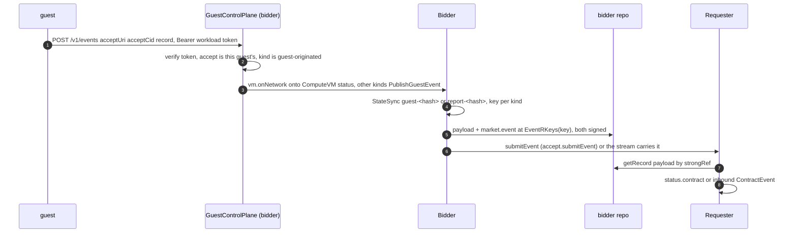
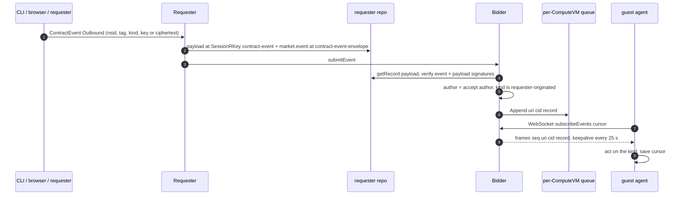
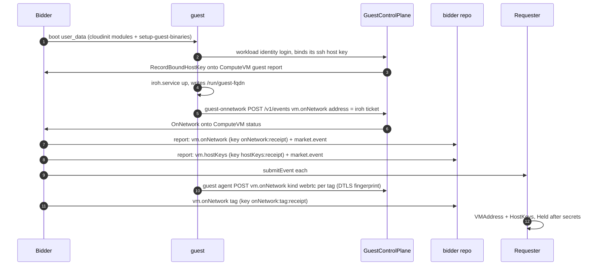
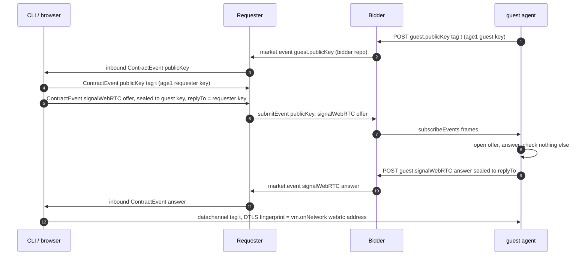
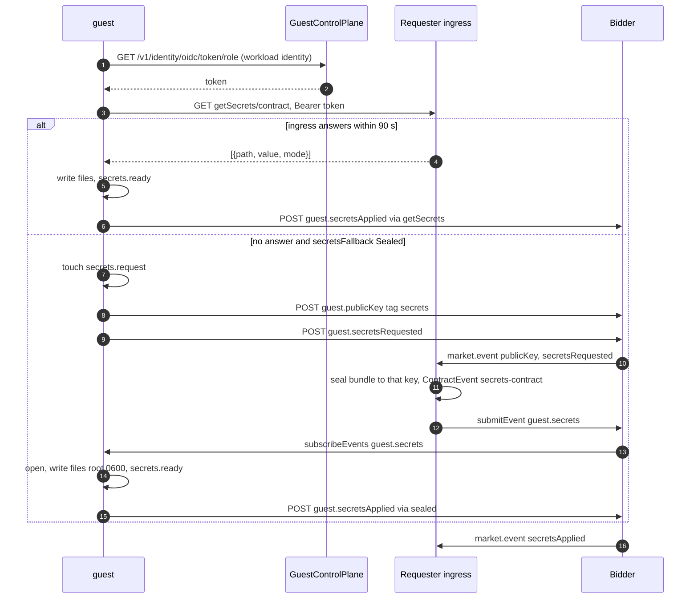
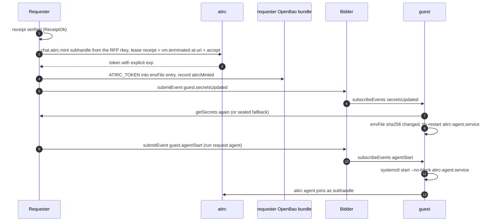

# guest-events: events under a receipt

- after the receipt ([market.md](market.md)), the bidder, the requester and the guest talk only through `market.event` records and two guest HTTP paths
- steps: [S7](README.md#step-s7) boot and vm events, [S8](README.md#step-s8) guest events and atirc, [S9](README.md#step-s9) release
- one row per lexicon: [lexicons-market.md](lexicons-market.md)
- constants: `internal/atproto/market/nsid.go`, `internal/atproto/market/guest.go`; guest side: `internal/guestagent` (binary `cmd/socialweb-guest-agent`); guest HTTP plane: `internal/services/guestcontrolplane`, `internal/guestidentity`
- names drop the prefix `com.publicdomainrelay.temp.` (`guest.publicKey` = `com.publicdomainrelay.temp.compute.events.guest.publicKey`)

## The Envelope

- every event is two signed records in the sender's repo: the payload (`compute.events.vm.*` or `compute.events.guest.*`) and `market.event {receipt, payload, createdAt, signatures}`
- `receipt` = strongRef to the bidder's `market.receipt`; `payload` = strongRef to the payload record in the same repo as the event
- the receiver reads the payload through the strongRef, checks its CID, its author and both signatures (`applyGuestEvent` in `internal/market/bidder/guestevents.go`)
- delivery: `market.submitEvent` to the other party, and the relay / Jetstream streams as fallback ([market.md](market.md#delivery-xrpc-callbacks-and-streams))
- the guest holds no repo key. the bidder signs and writes every guest-originated event in its own repo

## Who Sends What

| payload | originator | written in | consumer | file of the consumer |
|---|---|---|---|---|
| `vm.onNetwork` | guest (iroh ticket and https tunnel URL from the `guest-onnetwork` script, webrtc fingerprint from the guest agent) or bidder (sandbox) | bidder repo | requester: `status.contract.vmAddress`, `status.contract.networks` | `internal/market/requester/runner.go` `waitGuest` |
| `vm.hostKeys` | bidder (the host key the guest bound at its workload identity login) | bidder repo | requester: `status.contract.hostKeys` | same |
| `vm.sandbox` | bidder (deno sandbox ended) | bidder repo | requester: `status.contract.sandbox` | `internal/market/requester/events.go` |
| `vm.terminated` | bidder | bidder repo | requester: Released | `internal/market/requester/market.go` `FindTermination` |
| `vm.delete` | requester | requester repo | bidder: release | `internal/market/bidder/adapters.go` `applyRelease` |
| `guest.publicKey` | either side | sender repo | the other side | guest: `internal/guestagent/subscribe.go`; requester: inbound ContractEvent |
| `guest.signalWebRTC` | either side | sender repo | the other side | same |
| `guest.secrets` | requester only | requester repo | guest | `internal/guestagent/secrets.go` |
| `guest.secretsRequested` | guest only | bidder repo | requester: seals the bundle | `internal/market/requester/guestsecrets.go` |
| `guest.secretsApplied` | guest only | bidder repo | requester: condition `SecretsApplied` | `internal/market/requester/events.go` |
| `guest.secretsUpdated` | requester only | requester repo | guest: fetches the bundle again | `internal/guestagent/subscribe.go` |
| `guest.agentStart` | requester only | requester repo | guest: `systemctl start --no-block atirc-agent.service` | `internal/guestagent/agentstart.go` |
| `guest.requesterDid` | guest only | bidder repo | requester: `status.contract.guestRequester` | `internal/market/requester/association.go` |
| `guest.r2Start` | requester only | requester repo | guest: starts `socialweb-r2.service` | `internal/guestagent/association.go` |
| `guest.r2Release` | requester only | requester repo | guest: runs `socialweb-r2-release.service` | same |
| `guest.r2Released` | guest only | bidder repo | requester: `status.contract.r2Release` | `internal/market/requester/guestrequester.go` |
| `vm.started`, `vm.registerIdentity` | defined, no Go writer | none | none | `internal/atproto/market/nsid.go` constants only |

- guest-originated set: `market.IsGuestOriginatedEventNSID` (publicKey, signalWebRTC, secretsApplied, secretsRequested, requesterDid, r2Released). the guest control plane refuses any other kind (`guestEvent` in `internal/guestidentity/service.go`)
- requester-originated set: `market.IsRequesterGuestEventNSID` (publicKey, signalWebRTC, secrets, agentStart, secretsUpdated, r2Start, r2Release). the bidder refuses any other kind from a requester (`applyGuestEvent`)
- kinds the requester's submitEvent takes: `isGuestEventNSID` in `internal/market/requester/events.go`
- direction of `publicKey` and `signalWebRTC` comes from the author: requester-authored ones go to the guest, bidder-authored ones carry what the guest said

## Guest To Requester

- the POST body: `{acceptUri, acceptCid, record}`; the record has `$type` = the payload NSID and no signature (`internal/guestagent/events.go`)
- the bearer is the `Authorization` header only (`Guest.Events` in `internal/guestidentity/service.go`)
- answers: 200 `{ok, name}`; 401 `AuthenticationRequired` / `InvalidToken`; 400 `InvalidRequest`; 404 `UnknownGuest` / `UnknownAccept`; 503 `Unavailable`
- the bidder keys: `reportSyncKey` and `guestEventSyncKey` in `internal/market/bidder/syncs.go`; the rkeys: [market.md](market.md#rkeys)
- the bidder never opens a sealed body; it routes by NSID prefix

## Requester To Guest

- outbound ContractEvents (`socialweb.computer/v1alpha1`, cluster scoped, owned by the ComputeContract): made by the CLI (`internal/stack/request/webrtc.go`), the browser page, or the requester itself (`secrets-<contract>`, `secrets-updated-<hash>`)
- published by `publishContractEvent` in `internal/market/requester/contractevents.go`; field rules in `validateGuestFields` there
- inbound ContractEvents (guest `publicKey`, `signalWebRTC`) are named `InboundContractEventName(eventURI)`

### compute.guest.subscribeEvents

| item | value |
|---|---|
| route | `GET /xrpc/com.publicdomainrelay.temp.compute.guest.subscribeEvents` on the GuestControlPlane (`internal/services/guestcontrolplane/subscribe.go`) |
| auth | `Authorization: Bearer <workload identity token>`; names the ComputeVM (`guest.Authenticate`) |
| param | `cursor`: last `seq` seen. absent = oldest entry kept |
| frame | JSON text `{"$type": "...subscribeEvents#event", seq, uri, cid, record}`; `record.$type` is a `compute.events.guest.*` NSID |
| keepalive | an empty binary frame every 25 s (`SubscribeKeepalive`) |
| error | `FutureCursor`: the guest agent resets its cursor to 0 and reconnects (`internal/guestagent/subscribe.go`) |
| reconnect | backoff 2 s doubling to 30 s |

## Each Kind

| NSID tail | key fields | notes |
|---|---|---|
| `vm.onNetwork` | `kind` iroh / https / webrtc / sandbox, `address`, `tag` | kind absent: iroh without tag, https with tag (`market.OnNetworkKind`). webrtc address = the guest agent DTLS fingerprint `sha-256 AB:CD:...` |
| `vm.hostKeys` | `keys[] {type, publicKey, fingerprint}`, `observedAt` | at most 8 keys, an ed25519 key required (`internal/guestidentity/guestrecord.go`) |
| `vm.sandbox` | `exitCode`, `timedOut`, `stdout`, `stderr` | `compute.vm.kind: deno` only (`internal/market/bidder/sandbox.go`) |
| `vm.delete` | `reason` | requester writes `released` |
| `vm.terminated` | `reason`, `exitCode`, `observedAt`, `request` | `request` -> the `vm.delete` when `reason` is `deleted_on_request` |
| `guest.publicKey` | `kind: age-x25519`, `tag`, `key` (age1...) | one per tag per side; anything sealed for a tag goes to the other side's latest key |
| `guest.signalWebRTC` | `kind` offer / answer, `tag`, `ciphertext` | plaintext `{sdp, replyTo}`; non-trickle ICE, one offer, one answer |
| `guest.secrets` | `ciphertext` | age armored, at most 65536 bytes (`MaxGuestSecretsCiphertext`); plaintext = the getSecrets JSON array |
| `guest.secretsRequested` | none | only with `secretsFallback: Sealed` |
| `guest.secretsApplied` | `via` getSecrets / sealed, `count` | |
| `guest.secretsUpdated` | none | the bundle changed (atirc mint, association ref) |
| `guest.agentStart` | none | needs `spec.agent` (`contractevents.go`) |
| `guest.requesterDid` | `did` | did:plc only, never the authority's own DID (`market.ValidGuestRequesterDID`) |
| `guest.r2Start` | `name` (DNS label), `agent`, `hold` | needs `spec.association.fromGuest` |
| `guest.r2Release` | none | |
| `guest.r2Released` | `ok`, `message` | |

## Boot: hostKeys And onNetwork

- the iroh report unit and its script: `internal/guestseed/userdata.go` ("Report the guest iroh ticket to the market")
- one report per kind and tag: `report` in `internal/market/bidder/report.go` publishes only what `ComputeVMPublished` does not hold yet
- Held: iroh address + host keys; with a secretsRef and no sealed fallback, also the getSecrets fetch ([market.md](market.md#sequence-rfp-to-held))

## Sealed Signaling (webrtc tunnels)

- each side publishes a `guest.publicKey` (kind `age-x25519`) per tag
- the offer is sealed to the guest's latest key for the tag, plaintext `{sdp, replyTo}`; the answer is sealed to `replyTo`
- no record names its recipient: a reader trial-opens every signal for its tag and keeps the ones that open
- no private key, SDP, ICE candidate or IP address is ever in a record, a ContractEvent, a StateSync, kcp or a log
- CLI side: `run request proxy <name> --tag <tag>` (`internal/webrtcproxy`); STUN `stun:stun.cloudflare.com:3478` only, no TURN

## Secrets: getSecrets Or Sealed Fallback

- `spec.secretsRef` names a bundle `[{path, value, mode?}]` in the requester's OpenBao; mode octal, at most 0600 (`ParseSecretsBundle` in `internal/market/requester/secrets.go`)
- primary: getSecrets. `setup-secrets.service` exchanges its workload identity token and GETs `/xrpc/com.publicdomainrelay.temp.compute.secrets.getSecrets/<contract>` from the requester ingress ([lexicons-market.md](lexicons-market.md#computesecretsgetsecrets))
- the requester checks the token audience `api://ATProto?actx=<requester DID>` and the subject claim (`secretsState.fetch`)
- fallback: only when the requester's `spec.secretsFallback` is `Sealed`, and only on demand. never a sealed bundle unasked: published ciphertext stays on the protocol and can be broken later
- setup-secrets gives getSecrets 90 s (`cloudinit.SecretsFetchFallbackDeadlineSec`), then touches `/run/socialweb-guest-agent/secrets.request`; comms mode Firehose has no setup-secrets, the agent asks at once
- both paths end in `/run/socialweb-guest-agent/secrets.ready`; consumers order `After=` `cloudinit.SecretsReadyUnits`
- status: `status.contract.secretsRequested`, `status.contract.secretsApplied`, condition `SecretsApplied` reason `GetSecrets` or `SealedFallback`

- the requester reseals for a newer key while the request is unanswered (`sealGuestSecrets` in `internal/market/requester/guestsecrets.go`)
- a Firehose requester with `None` and a secretsRef fails the contract
- a bundle change (`guest.secretsUpdated`) makes the guest fetch again (`SECRETS_REFETCH=1 setup-secrets.sh`) or ask for the sealed fallback

## Agent Start And atirc Mint

- `spec.agent {envFile}` (default `/etc/atirc/atirc.env`) needs `spec.secretsRef`
- after `VerifyReceipt`, `ensureAtircToken` (`internal/market/requester/atirc.go`) mints with `chat.atirc.mint` ([outside.md](outside.md#chatatirc)), lease = `{receipt, termination: at-uri of the bidder's vm.terminated payload at EventRKeys(TerminationKey(receipt)), contract: accept uri}` (`contractLease`)
- the token goes into the bundle entry at envFile as `ATIRC_TOKEN`; getSecrets and the sealed fallback serve the bundle without that entry until it is minted
- every fresh mint publishes `guest.secretsUpdated`; the guest fetches again; `atirc-agent-env.path` runs `systemctl try-restart --no-block atirc-agent.service` when the envFile changed (never a start)
- `run request agent <name>` makes an outbound `guest.agentStart`; the guest agent runs `systemctl start --no-block atirc-agent.service`
- every mint is recorded under `atircMinted` in the bundle secret; status `status.atircRevokes` (Done, Pending, Abandoned)

- release: the leased token is revoked before `vm.delete` while its lease is alive; the rest in the background from a release marker ([market.md](market.md#revocation-ordering))
- when the VM ends without a release, atirc ends the token through its `vm.terminated` lease

## Guest Requester (R2) Events

- a contract with `spec.association.fromGuest` runs a requester inside the guest; full flow: [identity.md](identity.md#associations-plan-0036)
- `guest.requesterDid`: the guest reports the DID of its requester; the requester then reads `market.associationRequest` by one `getRecord` and writes the contract-scoped `market.association` ([lexicons-market.md](lexicons-market.md#marketassociation))
- `guest.r2Start` starts `socialweb-r2.service` as user `r2` (`run request r2 <name>`)
- release of the parent: `guest.r2Release` first, then wait for `guest.r2Released` (`GuestRequesterReleaseTimeout`), then atirc revokes, then `vm.delete`

## Never

- a guest never holds a repo key; a guest never posts `guest.secrets`, `guest.agentStart`, `guest.secretsUpdated`, `guest.r2Start` or `guest.r2Release`
- the bidder never opens a sealed body
- no private key, SDP, ICE candidate or IP address in any record, object or log
- no sealed bundle unasked
- no fourth guest transport (iroh, opentunnel https, webrtc only; [../SYSTEM.md](../SYSTEM.md#transports-three-never-add-one))

## See Also

- [../SYSTEM.md](../SYSTEM.md#guests), [market.md](market.md), [lexicons-market.md](lexicons-market.md), [identity.md](identity.md), [outside.md](outside.md)
- plans: `docs/plans/0034-webrtc-guest-transport.yaml`, `docs/plans/0035-atirc-agent.yaml`, `docs/plans/0036-record-association.yaml`
