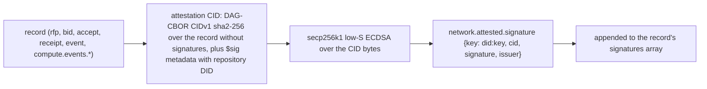

# identity: signatures, key claims, associations, sign-in

- who a repo DID is, which key signs for it, and which operator it belongs to
- lexicons: `lexicons/network/attested/`, `lexicons/com/publicdomainrelay/temp/badgeBlueKeys.json`; association rows in [lexicons-market.md](lexicons-market.md#marketassociation)
- rule (plan 0036): the authority is always the repo in the record's at-uri, never a record field or an issuer claim
- index: [README.md](README.md). sequence steps: [S0](README.md#step-s0), [S1](README.md#step-s1), [S5](README.md#step-s5), [S9](README.md#step-s9)

## Lexicons And NSIDs In This File

| NSID | type | rkey | used |
|---|---|---|---|
| `network.attested.signature` | object (and `#signatures` array) | - | inline on every market and compute event record |
| `network.attested.proof` | record, key `tid` | - | defined, not written |
| `network.attested.verify` | query | - | defined, not served or called |
| `com.publicdomainrelay.temp.badgeBlueKeys` | record, key `any` | see [below](#badgebluekeys) | signer key binding, ssh key claim |
| `link.ident.endorsement` | record, key `any` (ident.link `74d22dc`, vendored) | the agent DID | principal confirms an agent, [below](#associations-identlink) |
| `com.publicdomainrelay.temp.market.association` | record | the agent DID | the grant, [below](#associations-identlink) |
| `com.publicdomainrelay.temp.market.associationRequest` | record | [lexicons-market.md](lexicons-market.md#marketassociationrequest) | flow [below](#contract-scoped-association) |
| `com.publicdomainrelay.temp.requester.associateConfirm` | XRPC (no lexicon file) | - | OAuth scope only, see [below](#requesterassociateconfirm) |
| `com.publicdomainrelay.temp.market.bidderAssociation` | collection (no lexicon file) | - | OAuth scope only, see [below](#marketbidderassociation) |

## network.attested

### Signing

| step | code |
|---|---|
| attestation CID | `internal/atproto/market/attest.go` `CreateAttestationCID`, `DagCborCID` |
| sign inline | `attest.go` `SignInline`, `SignRecord`, `CreateSignedRecord`, `CreateSignedRecordAt` |
| market records | `internal/atproto/market/records.go` `createSigned`, `PutEvent` |
| bidder | `internal/market/bidder/bids.go`, `internal/market/bidder/adapters.go` |
| requester | `internal/market/requester/contractevents.go`, `internal/market/requester/runner.go` (vm.delete) |
| receipt | `attest.go` `CreateReceiptRecordAt`: `cid` = the attestation CID of the accept, plus an inline signature |

- records with a `signatures` field: `market.rfp`, `market.bid`, `bids.free`, `bids.x402`, `market.accept`, `accepts.free`, `accepts.x402`, `market.receipt`, `receipts.free`, `receipts.x402`, `market.event`, every `compute.events.vm.*` and `compute.events.guest.*`
- signing keys: secp256k1 JWK files, mode 0600 (`internal/atproto/market/keys.go` `LoadOrCreateSignerFile`)
  - bidder: `<stateDir>/attestation.jwk` (`internal/services/bidder/wiring.go`)
  - requester: `attestation-key.json`, else `repo-key.json` (`internal/market/requester/requester.go`); compose seeds both with the same key (`internal/app/compose/pds.go`)
- the public `did:key` (`Signer.PublicDID`) is the `keyId` of the signer key binding below

### Verifying

| function | checks |
|---|---|
| `VerifyInlineAttestation` (`attest.go`) | recompute the CID, ECDSA against `key` |
| `VerifyRecordSignatures` (`attest.go`) | the key is in the issuer's DID document, or bound by a `badgeBlueKeys` signer key binding |
| `VerifyRemoteProof` (`attest.go`) | used only by `VerifyReceipt` (`internal/atproto/market/contract.go`) |

- callers: `internal/atproto/market/contract.go`, `internal/market/participant/comms.go`, `internal/market/requester/inbox.go`, `internal/market/requester/events.go`, `internal/market/requester/runner.go`
- `network.attested.proof` (`CreateRemoteProofRecord`) has no caller outside tests. `network.attested.verify` is neither served nor called; only `network.attested.signature` is in the lexgen include list (`internal/atproto/market/nsid.go`)

## badgeBlueKeys

| field | value |
|---|---|
| NSID | `com.publicdomainrelay.temp.badgeBlueKeys` |
| type | record, key `any` |
| key fields | `keyId` (the bound key), `challenge` (the repo DID it binds to), `service`, `nonce`, `name`, `createdAt` |
| Go | `internal/atproto/market/badgeblue.go` |

One collection, two uses. Each has its own rkey and `service`.

| use | in repo of | rkey | `keyId` | `challenge` | `service` | written by | read by | step |
|---|---|---|---|---|---|---|---|---|
| signer key binding | the signer (bidder or requester) | `BadgeBlueKeysRkey(did, keyId)`: base58 of sha256(`did:keyId`)[:24], max 32 chars | signer `did:key` | the signer's repo DID | `bidder_attestation` (bidder), `market_requester` (requester) | bidder `internal/market/bidder/offering.go`; requester `internal/market/requester/identity.go` | `KeyBoundByBadgeBlueKey` from `participant/comms.go`, `requester/events.go` | S0, before the first signed record |
| ssh key claim | the user | stable `keyRkey` | the ssh key | the user DID | ssh | ssh.socialweb.computer `/keys` | ssh authorizer, one getRecord per offered key (`internal/sshtransport`) | ssh sign-in |

## Associations (identlink)

- design: [../design/ident-link-associations.md](../design/ident-link-associations.md); spec: https://ident.link
- Go: `internal/identlink` (walk, `AgentOf`, `Remote`: DID docs + `com.atproto.sync.getRecord`, CAR and MST verified); `internal/policyengine/trust` on it
- vectors: `internal/identlink/vectors.json` (byte-identical to atlibs-identlink), `go run ./hack/identlinkvectors internal/identlink/vectors.json` in `deploy/check.sh --fast`

| side | where | what |
|---|---|---|
| agent declares | agent DID doc `alsoKnownAs` | `https://ident.link/agent-of/<principal-did>` |
| principal confirms | principal repo `link.ident.endorsement`, rkey = agent DID | `{agent}` |
| principal grants | principal repo `market.association`, rkey = agent DID | `{agent, expiresAt?, contract?, createdAt}` |

- edge `A -> P` holds iff all three agree and the grant is live; pair without grant: untrusted
- contract-scoped grant: `expiresAt` required; dead once the contract is not Held (canonical receipt, no vm.delete, no vm.terminated); the accept must be in P's repo or a repo above P (`trust/association.go` `contractHeld`, checked after the walk to a fixpoint)
- PDS or PLC outage: the edge is unconfirmed, listed in `errors`, cached 5 s

### Walk

| item | value |
|---|---|
| `identlink.Walk(ctx, io, agent, Options{MaxDepth: 100, Budget: 256})` | `Result{Agent, Ancestors [{DID, Depth, ExpiresAt}], Roots, ExpiresAt, Truncated, Errors}` |
| roots | ancestors with no held edge up; a node that skipped a cycle or was truncated is not a root |
| `ExpiresAt` | min grant `expiresAt` along the path; walk: min over roots; none = standing |
| cache (`trust.Resolver`) | DID doc 5 min / 5 s; walk 5 min capped at the earliest ancestor `expiresAt` / 5 s with errors; `ApplyEvent` drops walks naming the DID |

| check | rule |
|---|---|
| policy snapshot `operatorOf` | a root both sides share, else the first root |
| tangled-vouch, mutuals | vouches between {self}+ancestors(self) and {cp}+ancestors(cp), at most 256 pairs, nearest first |
| `requireContract` | every edge to the root contract-scoped (non-contract grants count as absent) |
| bidder networked deno | roots(requester) meets roots(bidder) |
| bidder guest lifetime cap | walk `expiresAt` of the requester |
| requester discovery | roots(self) are operators; an operator's endorsed agents whose walk reaches it |
| MarketIdentity associated | its DID's walk has a root other than itself; `associationRef` pins the grant (rkey = the DID) and its walk must reach the grant's repo |

### Contract-scoped association

- the guest requester R2 is an agent of the renter for one contract: grant `contract` = the renter's `market.accept`, `expiresAt` = the contract deadline
- `market.associationRequest {principal, contract, nonce}` in the guest repo, rkey = principal DID: the principal endorses only the DID that answered this contract's nonce
- writers (requester `association.go`, compose `records.go`/`peer.go`, `agentpeer.go`) still write the old shapes until the writer cut-over
- guest events of this flow (`requesterDid`, `r2Start`, `r2Release`, `r2Released`): [guest-events.md](guest-events.md)

## requester.associateConfirm

- NSID `com.publicdomainrelay.temp.requester.associateConfirm`, constant `AssociateConfirmNSID` (`internal/app/compose/identity.go`)
- only an OAuth rpc scope: `RPCAssociateConfirm`, in `DIDKeyAssociatorOAuthScope` (`internal/atproto/oauth/scope.go`)
- meant as the fast path for an allow-listed operator (`docs/ARCHITECTURE.md`); no Go server or caller

## market.bidderAssociation

- NSID `com.publicdomainrelay.temp.market.bidderAssociation`, constant `CollectionBidderAssociation` (`internal/atproto/oauth/scope.go`)
- create scope on the bidder and desktop sets only. no lexicon file, no writer, no reader in Go

## Sign-In

- a MarketIdentity is a repo DID plus how the app reaches it (`api/v1alpha1/types_marketidentity.go`, `internal/marketidentity/atproto`, `internal/controllers/marketidentity`)

| mode | repo | sign-in | atproto calls |
|---|---|---|---|
| `localRepo` | the app's own Pds component | none | in-process PDS (`internal/pds/local`) |
| `pdsAccount` | a PDS account, password in the vault | app password | `com.atproto.server.createSession`, `refreshSession` |
| `oauthQr` | user's PDS | QR session transfer at qr.fedfork.com (5 min) | OAuth (DPoP), scope `DIDKeyAssociatorOAuthScope` |
| `oauthBrowser` | user's PDS | authorize URL in `status.pendingAction` | OAuth |
| `oauthDelegated` | user's PDS | session handed in by another app | OAuth |
| `oauthSessionProxy` | user's PDS | a session another component stored in OpenBao (`auth/atproto session/<did>`) | OAuth |

- OAuth sessions live only in the app's own OpenBao; the atproto auth plugin refreshes them
- granted scopes are read from the token response, never the access token's `scope` claim
- scopes per role and optional scopes: [outside.md](outside.md#oauth-scopes-per-role)
- scripted sign-in: `scripts/oauth-signin.ts`, [../oauth.md](../oauth.md)
- the QR transfer is signed with the CLI's did:key (`internal/marketidentity/atproto/oauth.go`, `internal/atproto/oauthclient/qr.go`)

## did:key Ingress

- apps without a public host (CLI requester, page, iOS, guest requester) still receive `submitBid`, `submitAccept`, `submitEvent` callbacks
- IngressProxy (`internal/services/ingressproxy`) registers with `xrpc.fedproxy.com` (the Go ingress relay, `internal/atproto/ingress`) as a `did:key`
- registration: `{key, nonce, signatures}` (`internal/atproto/ingress/protocol.go`); a service-auth `did:key` issuer is verified without a DID document (`internal/atproto/ingress/auth.go`); encoding in `internal/didkey`
- the callback is named in `submitBid` / `submitAccept` / `submitEvent` (a `did#serviceId` or an HTTP URL); for a stream listener with no reachable HTTP service the `ingress` strongRefs point at `com.publicdomainrelay.temp.ingress.webRTC` listen records: [lexicons-market.md](lexicons-market.md)
- a guest requester gets public ingress by default through the same relay (plan 0036)

## See Also

- [README.md](README.md), [policy.md](policy.md), [outside.md](outside.md), [market.md](market.md), [guest-events.md](guest-events.md)
- [../SYSTEM.md](../SYSTEM.md#identity-and-auth), [../bidder.md](../bidder.md) (identity + association)
