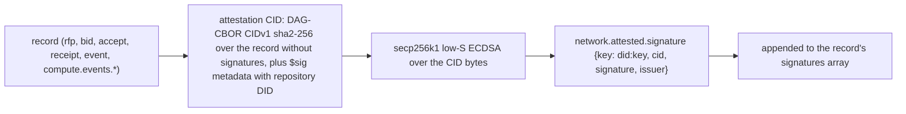
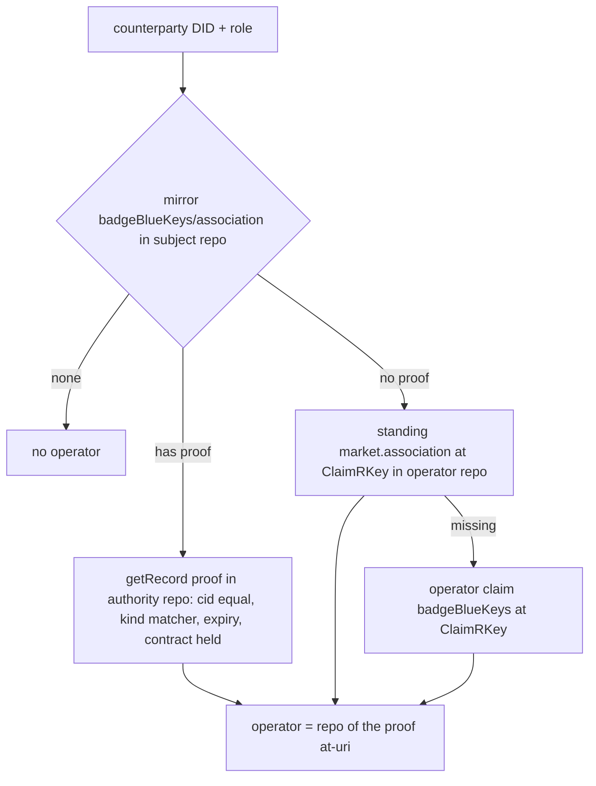
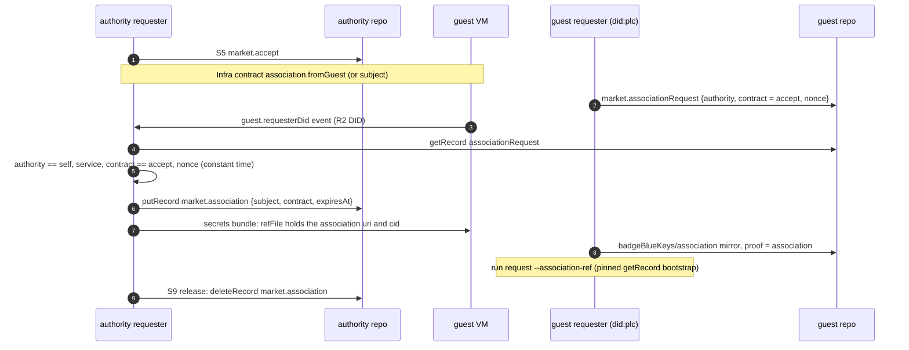

# identity: signatures, key claims, associations, sign-in

- who a repo DID is, which key signs for it, and which operator it belongs to
- lexicons: `lexicons/network/attested/`, `lexicons/com/publicdomainrelay/temp/badgeBlueKeys.json`; association rows in [lexicons-market.md](lexicons-market.md#marketassociation)
- rule (plan 0036): the authority is always the repo in the record's at-uri, never a record field or an issuer claim
- index: [README.md](README.md). sequence steps: [S0](README.md#step-s0), [S1](README.md#step-s1), [S5](README.md#step-s5), [S9](README.md#step-s9)

## Lexicons And NSIDs In This File

| NSID | type | rkey | used |
|---|---|---|---|
| `network.attested.signature` | object (and `#signatures` array) | - | inline on every market and compute event record |
| `network.attested.proof` | record, key `tid` | - | defined, not written |
| `network.attested.verify` | query | - | defined, not served or called |
| `com.publicdomainrelay.temp.badgeBlueKeys` | record, key `any` | three schemes, see [below](#badgebluekeys) | signer key binding, operator claim, association mirror, ssh key claim |
| `com.publicdomainrelay.temp.market.association` | record | [lexicons-market.md](lexicons-market.md#marketassociation) | flow [below](#associations-plan-0036) |
| `com.publicdomainrelay.temp.market.associationRequest` | record | [lexicons-market.md](lexicons-market.md#marketassociationrequest) | flow [below](#contract-scoped-association) |
| `com.publicdomainrelay.temp.requester.associateConfirm` | XRPC (no lexicon file) | - | OAuth scope only, see [below](#requesterassociateconfirm) |
| `com.publicdomainrelay.temp.market.bidderAssociation` | collection (no lexicon file) | - | OAuth scope only, see [below](#marketbidderassociation) |

## network.attested

### Signing

| step | code |
|---|---|
| attestation CID | `internal/atproto/market/attest.go` `CreateAttestationCID`, `DagCborCID` |
| sign inline | `attest.go` `SignInline`, `SignRecord`, `CreateSignedRecord`, `CreateSignedRecordAt` |
| market records | `internal/atproto/market/records.go` `createSigned`, `PutEvent` |
| bidder | `internal/market/bidder/bids.go`, `internal/market/bidder/adapters.go` |
| requester | `internal/market/requester/contractevents.go`, `internal/market/requester/runner.go` (vm.delete) |
| receipt | `attest.go` `CreateReceiptRecordAt`: `cid` = the attestation CID of the accept, plus an inline signature |

- records with a `signatures` field: `market.rfp`, `market.bid`, `bids.free`, `bids.x402`, `market.accept`, `accepts.free`, `accepts.x402`, `market.receipt`, `receipts.free`, `receipts.x402`, `market.event`, every `compute.events.vm.*` and `compute.events.guest.*`
- signing keys: secp256k1 JWK files, mode 0600 (`internal/atproto/market/keys.go` `LoadOrCreateSignerFile`)
  - bidder: `<stateDir>/attestation.jwk` (`internal/services/bidder/wiring.go`)
  - requester: `attestation-key.json`, else `repo-key.json` (`internal/market/requester/requester.go`); compose seeds both with the same key (`internal/app/compose/pds.go`)
- the public `did:key` (`Signer.PublicDID`) is the `keyId` of the signer key binding below

### Verifying

| function | checks |
|---|---|
| `VerifyInlineAttestation` (`attest.go`) | recompute the CID, ECDSA against `key` |
| `VerifyRecordSignatures` (`attest.go`) | the key is in the issuer's DID document, or bound by a `badgeBlueKeys` signer key binding |
| `VerifyRemoteProof` (`attest.go`) | used only by `VerifyReceipt` (`internal/atproto/market/contract.go`) |

- callers: `internal/atproto/market/contract.go`, `internal/market/participant/comms.go`, `internal/market/requester/inbox.go`, `internal/market/requester/events.go`, `internal/market/requester/runner.go`
- `network.attested.proof` (`CreateRemoteProofRecord`) has no caller outside tests. `network.attested.verify` is neither served nor called; only `network.attested.signature` is in the lexgen include list (`internal/atproto/market/nsid.go`)

## badgeBlueKeys

| field | value |
|---|---|
| NSID | `com.publicdomainrelay.temp.badgeBlueKeys` |
| type | record, key `any` |
| key fields | `keyId` (the bound key or subject DID), `challenge` (the repo DID it binds to, or the operator), `service` (the role), `nonce`, `proof` (strongRef, on a mirror), `name`, `createdAt` |
| Go | `internal/atproto/market/badgeblue.go`, `internal/policyengine/trust/trust.go`, `internal/app/compose/operator.go`, `internal/app/compose/records.go` |

One collection, four uses. Each has its own rkey and `service`.

| use | in repo of | rkey | `keyId` | `challenge` | `service` | written by | read by | step |
|---|---|---|---|---|---|---|---|---|
| signer key binding | the signer (bidder or requester) | `BadgeBlueKeysRkey(did, keyId)`: base58 of sha256(`did:keyId`)[:24], max 32 chars | signer `did:key` | the signer's repo DID | `bidder_attestation` (bidder), `market_requester` (requester) | bidder `internal/market/bidder/offering.go`; requester `internal/market/requester/identity.go` | `KeyBoundByBadgeBlueKey` from `participant/comms.go`, `requester/events.go` | S0, before the first signed record |
| operator claim | the operator | `ClaimRKey`: `<service>-<subject DID with : as ->` | the subject DID | the operator DID | `bidder_associate`, `requester_associate` | `internal/app/compose/operator.go`, `scripts/associate-bidder.ts` | `trust.claimHeld`, requester `discovery.go` `operatedBy` | S1 |
| association mirror | the subject | `association` (`trust.MirrorRKey`) | the subject DID (`status.did`) | the operator (`status.associations[0]`) | same as the claim | compose `ApplyAssociationRecord` (an AtprotoRecord fed from MarketIdentity status) | `trust.mirrorOf`, bidder `association.go`, requester `discovery.go` | S1 |
| ssh key claim | the user | stable `keyRkey` | the ssh key | the user DID | ssh | ssh.socialweb.computer `/keys` | ssh authorizer, one getRecord per offered key (`internal/sshtransport`) | ssh sign-in |

- `proof` on the mirror: the strongRef of the authority record that associates the subject (`status.associationRef`)
- an association counts only when both repos agree: the operator's claim (or association record) AND the subject's mirror. a mirror alone never associates
- a deleted or edited authority record revokes on the next trust refresh (trust cache TTL 5 min, `defaultTrustCacheTTL`)
- PDS outage: fail closed, logged
- OAuth scope: create, update, delete on requester and bidder; create only on desktop and compute SPA ([outside.md](outside.md#oauth-scopes-per-role))

## Associations (plan 0036)

- plan: `docs/plans/0036-record-association.yaml`; runbook: `docs/acceptance/0005-guest-requester-association.md`
- a subject is a requester or bidder repo DID; the authority (operator) declares it as its own
- verifiers: MarketBidder checks requesters, MarketRequester checks bidders. both in `internal/policyengine/trust`

| kind | record | matcher (`internal/policyengine/trust/association.go`) | default |
|---|---|---|---|
| `claim` | `badgeBlueKeys` operator claim | `keyId` == subject, `challenge` == authority, `service` == role | on |
| `association` | `market.association` in the authority repo | subject, service, contract, expiry | on |
| `bskyPost` | `app.bsky.feed.post` | text == template (default `associate {did}`) and one `app.bsky.richtext.facet#mention` with did == subject | opt-in |
| `delvePost` | `town.delve.feed.post` | same as bskyPost | opt-in |

### How an operator is resolved

- `trust.Resolver.ResolveOperatorDidFor` / `operatorOf` (`internal/policyengine/trust/trust.go`); results cached 5 min, errors 5 s
- scope lane and full lane of the policy both use it: [policy.md](policy.md#tangled-vouch)

### Standing association

- no `contract`, no `expiresAt`: valid until deleted or edited (cid pinned)
- rkey `<service>-<subject with : as ->` (same as the claim)
- a standing `badgeBlueKeys` claim is an independent standing grant: it associates the subject even when a contract-scoped association expired. an operator that wants scope-only association must not also hold a standing claim

### Contract-scoped association

The guest requester (R2) case: a requester rents a VM that runs another requester, and vouches for it only for the life of the contract.

| record | in repo of | rkey (`internal/atproto/market/guest.go` `ContractScopedRKey`) | written by |
|---|---|---|---|
| `market.associationRequest` | guest requester (subject) | `<service>-<sha256(authority)[:32 hex]>-<accept rkey>` | compose `ApplyAssociationRequestRecord` (`internal/app/compose/records.go`), from `spec.identity.associationRequest` {authority, contract, nonce} |
| `market.association` | authority requester | `<service>-<sha256(subject)[:32 hex]>-<accept rkey>` | `internal/market/requester/association.go` `ensureAssociation` |
| `badgeBlueKeys/association` (mirror, `proof` = the association) | guest requester | `association` | compose `ApplyAssociationRecord` |

- `market.association` fields: `subject`, `service` (`requester_associate`), `contract` (strongRef of the authority's `market.accept`), `expiresAt` (always, the contract deadline), `createdAt`
- valid only while: not past `expiresAt`, the contract ref resolves, the contract is still Held (canonical receipt, no vm.delete or vm.terminated) (`trust/association.go` `scopeHeld`, `contractHeld`)
- the bidder caps the guest lifetime at the association `expiresAt` (`internal/market/bidder/association.go` `associationExpiry`)

- `spec.association` takes `subject` or `fromGuest`, not both; `fromGuest` needs a `secretsRef` (`internal/market/requester/secrets.go`)
- guest DID must be a `did:plc` and not the authority's own DID (`internal/atproto/market/guest.go`)
- `refFile` default `/etc/socialweb-computer/association-ref` (`internal/infra/declaration.go`, `internal/atproto/cloudinit/agent.go`)
- the guest requester bootstraps from the pinned ref (`MarketIdentity spec.associationRef {uri, cid}`, `run request --association-ref`), not from the record watch
- release deletes the association: the only record deletion of the flow, a contract-scoped record the app wrote itself
- guest events of this flow (`requesterDid`, `r2Start`, `r2Release`, `r2Released`): [guest-events.md](guest-events.md)
- atirc side: the mint carries the association strongRef in its lease; the token exp is clamped to `expiresAt`: [outside.md](outside.md#chatatirc)

## requester.associateConfirm

- NSID `com.publicdomainrelay.temp.requester.associateConfirm`, constant `AssociateConfirmNSID` (`internal/app/compose/identity.go`)
- only an OAuth rpc scope: `RPCAssociateConfirm`, in `DIDKeyAssociatorOAuthScope` (`internal/atproto/oauth/scope.go`)
- meant as the fast path for an allow-listed operator (`docs/ARCHITECTURE.md`); no Go server or caller

## market.bidderAssociation

- NSID `com.publicdomainrelay.temp.market.bidderAssociation`, constant `CollectionBidderAssociation` (`internal/atproto/oauth/scope.go`)
- create scope on the bidder and desktop sets only. no lexicon file, no writer, no reader in Go

## Sign-In

- a MarketIdentity is a repo DID plus how the app reaches it (`api/v1alpha1/types_marketidentity.go`, `internal/marketidentity/atproto`, `internal/controllers/marketidentity`)

| mode | repo | sign-in | atproto calls |
|---|---|---|---|
| `localRepo` | the app's own Pds component | none | in-process PDS (`internal/pds/local`) |
| `pdsAccount` | a PDS account, password in the vault | app password | `com.atproto.server.createSession`, `refreshSession` |
| `oauthQr` | user's PDS | QR session transfer at qr.fedfork.com (5 min) | OAuth (DPoP), scope `DIDKeyAssociatorOAuthScope` |
| `oauthBrowser` | user's PDS | authorize URL in `status.pendingAction` | OAuth |
| `oauthDelegated` | user's PDS | session handed in by another app | OAuth |
| `oauthSessionProxy` | user's PDS | a session another component stored in OpenBao (`auth/atproto session/<did>`) | OAuth |

- OAuth sessions live only in the app's own OpenBao; the atproto auth plugin refreshes them
- granted scopes are read from the token response, never the access token's `scope` claim
- scopes per role and optional scopes: [outside.md](outside.md#oauth-scopes-per-role)
- scripted sign-in: `scripts/oauth-signin.ts`, [../oauth.md](../oauth.md)
- the QR transfer is signed with the CLI's did:key (`internal/marketidentity/atproto/oauth.go`, `internal/atproto/oauthclient/qr.go`)

## did:key Ingress

- apps without a public host (CLI requester, page, iOS, guest requester) still receive `submitBid`, `submitAccept`, `submitEvent` callbacks
- IngressProxy (`internal/services/ingressproxy`) registers with `xrpc.fedproxy.com` (the Go ingress relay, `internal/atproto/ingress`) as a `did:key`
- registration: `{key, nonce, signatures}` (`internal/atproto/ingress/protocol.go`); a service-auth `did:key` issuer is verified without a DID document (`internal/atproto/ingress/auth.go`); encoding in `internal/didkey`
- the callback is named in `submitBid` / `submitAccept` / `submitEvent` (a `did#serviceId` or an HTTP URL); for a stream listener with no reachable HTTP service the `ingress` strongRefs point at `com.publicdomainrelay.temp.ingress.webRTC` listen records: [lexicons-market.md](lexicons-market.md)
- a guest requester gets public ingress by default through the same relay (plan 0036)

## See Also

- [README.md](README.md), [policy.md](policy.md), [outside.md](outside.md), [market.md](market.md), [guest-events.md](guest-events.md)
- [../SYSTEM.md](../SYSTEM.md#identity-and-auth), [../bidder.md](../bidder.md) (identity + association)
