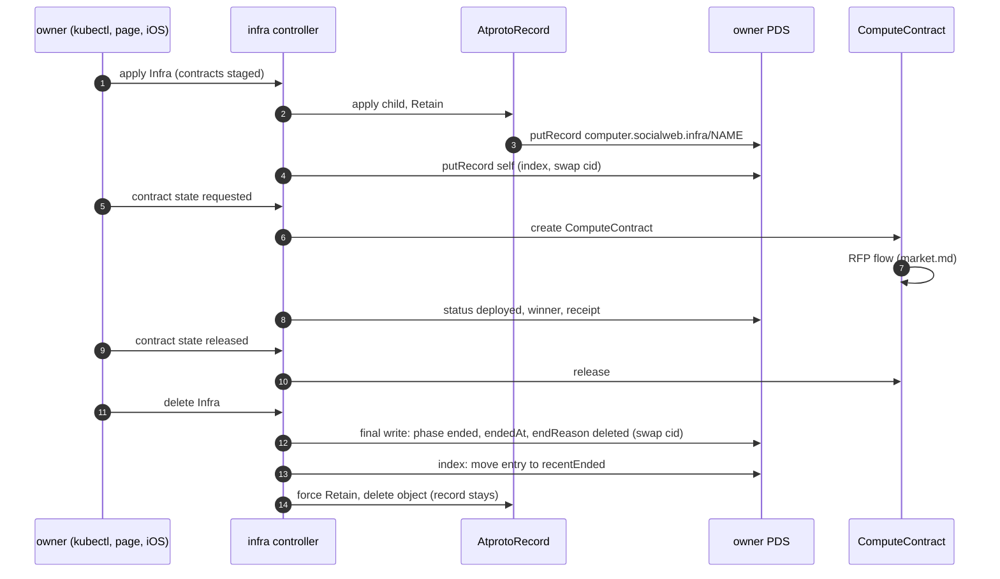

# infra: deployment records and the gateway cluster API

- lexicons: `lexicons/computer/socialweb/` and `lexicons/com/publicdomainrelay/temp/cluster/`
- an Infra or EphemeralInfra kcp object is a deployment; its record in the owner's repo is the same deployment, readable from any device
- the gateway serves tenant Kubernetes clusters over two XRPC families: `cluster.*` (lifecycle, kubeconfig) and `computer.socialweb.k8s.*` (apply, read a Job)
- index: [README.md](README.md). sequence step: [S2](README.md#step-s2) and [S9](README.md#step-s9)

## Lexicons In This File

| NSID | type | rkey | doc |
|---|---|---|---|
| `computer.socialweb.infra` | record | object name, successor rkey, `self` = index | [infra](#computersocialwebinfra) |
| `computer.socialweb.ephemeralInfra` | record | object name, successor rkey | [ephemeralInfra](#computersocialwebephemeralinfra) |
| `computer.socialweb.k8s.kubectlApplyServerSide` | procedure | - | [k8s](#computersocialwebk8s) |
| `computer.socialweb.k8s.getJob` | query | - | [k8s](#computersocialwebk8s) |
| `com.publicdomainrelay.temp.cluster.createCluster` | procedure | - | [cluster](#compublicdomainrelaytempcluster) |
| `com.publicdomainrelay.temp.cluster.getKubeconfig` | procedure | - | [cluster](#compublicdomainrelaytempcluster) |
| `com.publicdomainrelay.temp.cluster.listClusters` | query | - | [cluster](#compublicdomainrelaytempcluster) |
| `com.publicdomainrelay.temp.cluster.controlPlaneUp` | procedure | - | [cluster](#compublicdomainrelaytempcluster) |
| `com.publicdomainrelay.temp.cluster.controlPlaneDown` | procedure | - | [cluster](#compublicdomainrelaytempcluster) |
| `com.publicdomainrelay.temp.cluster.deleteCluster` | procedure | - | [cluster](#compublicdomainrelaytempcluster) |
| `com.publicdomainrelay.temp.cluster.revokeIdentity` | procedure | - | [cluster](#compublicdomainrelaytempcluster) |
| `com.publicdomainrelay.temp.cluster.listKubeconfigs` | query | - | [cluster](#compublicdomainrelaytempcluster) |
| `com.publicdomainrelay.temp.cluster.revokeKubeconfig` | procedure | - | [cluster](#compublicdomainrelaytempcluster) |
| `com.publicdomainrelay.temp.cluster.subscribeClusters` | subscription | - | [cluster](#compublicdomainrelaytempcluster) |

## Objects And Records

```mermaid
flowchart LR
  subgraph KCP["owner's kcp (CLI core, gateway, page, iOS)"]
    INF["Infra / EphemeralInfra"]
    AR["AtprotoRecord (child, Retain)"]
    CC["ComputeContract (one per contract in requested state)"]
    IC["InfraCollection / EphemeralInfraCollection"]
  end
  subgraph REPO["owner's repo"]
    REC["computer.socialweb.infra/RKEY"]
    IDX["computer.socialweb.infra/self (index)"]
  end
  INF -->|apply| AR
  AR -->|putRecord| REC
  INF -->|putRecord swap cid| IDX
  REC -->|pull (sync Both)| INF
  IDX -->|getRecord| IC
  IC -->|create child bound to uri| INF
  INF -->|state requested| CC
  CC -->|RFP flow| MKT["market.md"]
```

- the infra controller never writes the record itself: it applies a child `AtprotoRecord` with `DeletionPolicy: Retain`; the atprotorecord controller does the `putRecord` (`internal/controllers/infra/record.go`, `internal/controllers/atprotorecord/apply.go`)
- the index at `self` is written by the infra controller directly, compare-and-swap on the cid (`internal/controllers/infra/index.go` `mutateIndex`)
- the reverse direction is real: a changed record is pulled into the object spec; an InfraCollection reads `self` and creates one child object per live entry (`internal/controllers/infracollection/controller.go`)
- one ComputeContract per contract in state `requested` runs the RFP flow: [market.md](market.md)

| kcp kind | api | controller | record |
|---|---|---|---|
| Infra | `api/v1alpha1/types_infra.go` | `internal/controllers/infra` | `computer.socialweb.infra` |
| EphemeralInfra | `api/v1alpha1/types_infra.go` (`EphemeralInfraSpec`) | `internal/controllers/infra` | `computer.socialweb.ephemeralInfra` |
| InfraCollection, EphemeralInfraCollection | `api/v1alpha1/types_infracollection.go` | `internal/controllers/infracollection` | reads the index at `self` |
| AtprotoRecord | `api/v1alpha1` | `internal/controllers/atprotorecord` | any collection (here: the two above) |

- lifecycle and declaration logic (pure, no I/O): `internal/infra` (`declaration.go`, `lifecycle.go`, `sync.go`, `index.go`)
- generated record types: `internal/atproto/infra` (`nsid.go`, `zz_generated.lexicons.go`)
- registered in the CLI and gateway core with writer label `core` (`internal/stack/componentcore/controllers.go`) and in the iOS library with `embedded` (`pkg/embedded/embedded.go`)

## computer.socialweb.infra

| field | value |
|---|---|
| NSID | `computer.socialweb.infra` |
| type | record, key `any` |
| key fields | `contracts[]` (`#contract`), `status` (`#status`), `index` (only at `self`), `description`, `createdAt` |
| rkey | the object name; a successor rkey when that one is taken by an ended record ([rkeys](#rkeys)); `self` is the index |
| written by | the infra controller of the owner's kcp, via a child AtprotoRecord |
| read by | the same controller (pull, adopt), InfraCollection (index), any device of the owner |
| Go | `internal/atproto/infra`, `internal/controllers/infra`, `internal/infra` |
| step | [S2](README.md#step-s2) declare, [S9](README.md#step-s9) released / ended |

### `#contract`

| field | meaning |
|---|---|
| `name` | DNS-1123 label, unique in the record |
| `state` | `staged` (declared, no RFP), `requested` (run the RFP flow, hold the guest), `released` (release the guest) |
| `releaseRequestedAt` | with `released`: a newer time asks a failed release again |
| `vmName`, `computeKind` | `vm` (firecracker, the default) or `deno` (a deno sandbox that runs `userData` as its program) |
| `userData` | cloud-init `user_data`. public here: never a secret |
| `bidderDids`, `denyBidderDids` | bidder allow / deny lists |
| `sshAuthorizedKeys` | keys for the guest |
| `policy`, `policyArgs` | the policy workflow name and its args: [policy.md](policy.md#infra-contract-fields) |
| `vmReadyTimeoutSec` | readiness bound |
| `tunnels[]` | `tag`, `port` (guest 127.0.0.1), `transport` `opentunnel` (default, https URL) or `webrtc`, optional `server`, `shell.envFile` |
| `agent` | an atirc agent on the guest, `envFile` (default `/etc/atirc/atirc.env`); token arrives in the secrets bundle: [guest-events.md](guest-events.md) |
| `association` | a guest requester (R2): `subject` or `fromGuest`, `refFile` (default `/etc/socialweb-computer/association-ref`): [identity.md](identity.md#contract-scoped-association) |
| `guestTools` | tools the bidder installs from its own downloads |

### Contract state to ComputeContract

| record `state` | what the controller does (`internal/infra/lifecycle.go`, `internal/controllers/infra/contracts.go`) |
|---|---|
| `staged` | no ComputeContract; a finished one is deleted |
| `requested` | creates the ComputeContract when none exists; it runs the RFP flow |
| `released` | sets the ComputeContract's release; a `releaseRequestedAt` newer than the contract's own sends the release again; a `Failed` contract is released again |
| (object ends) | every contract is forced to `released` |

### `#status`

| field | values |
|---|---|
| `phase` | `pending`, `staged`, `deploying`, `deployed`, `releasing`, `released`, `degraded`, `ending`, `deleting`, `ended` |
| `contracts[]` (`#contractStatus`) | `name`, `phase` (`staged`, `requesting`, `deployed`, `releasing`, `released`, `failed`), `winner` (bidder DID), `receipt` (at-uri), `message` |
| `endedAt`, `endReason` | set once, when the deployment ends. `endReason` `deleted` on Infra |

- status comes from the observed object status; progress writes are rate limited (records policy: at most once a minute)

### `#index` (rkey `self`)

| field | meaning |
|---|---|
| `live[]` (`#indexEntry`) | `collection` (`computer.socialweb.infra` or `ephemeralInfra`), `rkey`, `createdAt`, `expiresAt` (EphemeralInfra), `addedAt`, `writer` |
| `recentEnded[]` (`#indexEnded`) | `collection`, `rkey`, `endedAt`, `endReason`; newest first |
| `updatedAt` | last write |

- one index per account, at `computer.socialweb.infra/self`, for both collections
- limits (`internal/infra/index.go`): at most 256 live entries (`IndexMaxLive`), 32 recent ended (`IndexMaxEnded`); an entry whose record is gone counts as gone after 10 minutes (`IndexGoneAfter`)
- `indexPass` runs on every reconcile: adds or refreshes the entry while the record is live, removes it once the record ended. `indexEnd` runs at deletion or unbind
- writes: `putRecord` with swap cid, `createRecord` when no index exists yet; retried on a swap mismatch
- a record with `index` is not a deployment; nothing else is ever written at `self`
- `writer`: the lexicon names `page:<origin host>`, `ios`, `gateway:<host>`, `cli`. this repo passes `core` (componentcore: CLI, gateway, bidder cores) and `embedded` (`pkg/embedded`, the iOS app); the label is trimmed to 64 characters

## computer.socialweb.ephemeralInfra

| field | value |
|---|---|
| NSID | `computer.socialweb.ephemeralInfra` |
| type | record, key `any` |
| key fields | `contracts[]` (`computer.socialweb.infra#contract`), `ttlSeconds` (required), `endWhen`, `status`, `createdAt` |
| rkey | the object name or a successor, as for Infra |
| written by / read by | as for Infra; listed in the same index at `computer.socialweb.infra/self` |
| Go | same packages |
| step | [S2](README.md#step-s2), [S9](README.md#step-s9) |

- `ttlSeconds`: kcp default 3600, minimum 60. `expiresAt` = `createdAt` + `ttlSeconds`
- `endWhen`: `complete` (default: ends when every contract is released) or `deadline` (ends only at `expiresAt`)
- `status.endReason`: `complete`, `deadline` or `deleted`
- an ended or expired record is never live again: re-creating the object takes a successor rkey

## Rkeys

- default rkey = the kcp object name. deterministic, never a TID (`internal/controllers/infra/record.go`)
- `spec.record.uri` set: its rkey is followed instead (bind to an existing record)
- successor rkeys (`internal/infra/declaration.go` `Successor`, `InSuccession`):

| n | rkey |
|---|---|
| 0 | `<name>` |
| 1 | `<name>-<first 8 hex of the object uid>` |
| 2..64 | `<name>-<uid8>-<n>` (`MaxSuccessors` = 64) |

- a fresh bind moves to the next successor when the record at the current rkey has ended, is past its TTL, or is the reserved `self`
- that covers an object deleted and re-created under the same name: the old record keeps its history, the new object gets a new rkey
- a stored URI stays bound while its rkey is still in the succession of the same name and uid

## Sync Modes

`spec.record.sync` on the object (`InfraRecordBinding`, `api/v1alpha1/types_infra.go`):

| mode | direction |
|---|---|
| `Both` (default) | kcp -> record and record -> kcp |
| `Publish` | kcp -> record only |

`internal/infra/sync.go` `Decide` picks one action per reconcile:

| action | when |
|---|---|
| Create | no record yet |
| Push | the kcp spec changed (or `Publish` and the record differs) |
| Pull | only the record changed (`Both`); server-side applied onto the spec |
| InSync | the record hash equals the spec hash |
| Conflict | both changed since the last stored declaration hash |
| Delete | `Both`, the bound record is gone: the kcp object is deleted |
| Ended | the record has ended: never written again |
| Reserved | the rkey is `self` |

## Lifecycle



## Never Deleted

- deleting the object runs `finalize` -> `finalWrite`: `phase ended`, `endedAt` (the deletion time), `endReason` (default `deleted`), written with swap cid (`internal/controllers/infra/record.go`)
- `unbindRecord` forces the child AtprotoRecord to `Retain` before it deletes the child object
- the atprotorecord finalizer never calls `deleteRecord` for `computer.socialweb.infra` or `ephemeralInfra` (`keptCollections`, `internal/controllers/atprotorecord/controller.go`)
- a deletion that gives up, or an orphaned repo, leaves the record with its last status
- one exception, the cluster mirror: an Infra with `spec.clusterRef` (the gateway's `nodes-<hex>`, `internal/controllers/nodeclaim/infra.go`) mirrors a tenant Cluster's nodes and is not a deployment anyone declared. Its end (delete, or unbind when the Cluster goes) pins the child AtprotoRecord to the record's cid, deletes the child, then deletes the record with swap cid (`dropMirror`); `indexEnd` drops its entry without a `recentEnded` line (`IndexChange.Forget`), and deletes `self` when no live or ended entry is left
- see [README.md](README.md#records-policy-all-families)

## computer.socialweb.k8s

| NSID | type | input | output |
|---|---|---|---|
| `computer.socialweb.k8s.kubectlApplyServerSide` | procedure | `cluster`, `manifest` (one object), `namespace`, `name`, `fieldManager` (default `socialweb-computer`), `force`, `dryRun` | `apiVersion`, `kind`, `name`, `uid`, `resourceVersion`, `generation`, `object` |
| `computer.socialweb.k8s.getJob` | query | `cluster`, `namespace`, `name`, `tailLines` (default 100, 64 KiB cap per log) | `phase` (`Pending`, `Running`, `Succeeded`, `Failed`), counts, `conditions`, `pods[].containers[].log` |

- served by the GatewayAPI: `internal/xrpcserver` (`K8sNSIDPrefix`), wired in `internal/gatewaymain/wiring.go` and `internal/services/gatewayapi/service.go`
- auth: bearer service-auth JWT, `lxm` = the NSID, `aud` one of the gateway audiences (`did:web:k8s.socialweb.computer`); `internal/atprotoauth/atprotoauth.go` `Verify`
- the gateway checks the revocation permit and that the cluster is Ready (`internal/gateway/tenantapi.go`), then applies as the account's own ServiceAccount (`internal/tenantapply/tenantapply.go`)
- no kubeconfig needed: apply a Job, then poll `getJob` until `Succeeded`
- callers: any atproto client with service auth (README curl and `goat account service-auth --lxm` examples)

## com.publicdomainrelay.temp.cluster

| NSID | type | input | output | does |
|---|---|---|---|---|
| `cluster.createCluster` | procedure | `name` | `phase` | create on read, then desired state running |
| `cluster.getKubeconfig` | procedure | `name`, `ttlSeconds` (default 28800, 60..86400, 0 is `noExpiry`, refused outside), `noExpiry` | `kubeconfig` (client cert, no exec, no token), `instance` | create on read (`spec.running=false`) |
| `cluster.listClusters` | query | - | `clusters[]` `{name, phase, running, instance, teardownBlocked, server}` | the caller's own clusters only (account from the token `iss`) |
| `cluster.controlPlaneUp` | procedure | `name` | `phase` | desired running; idempotent |
| `cluster.controlPlaneDown` | procedure | `name` | `phase` | desired not running; store retained |
| `cluster.deleteCluster` | procedure | `name` | `phase` `Draining` | teardown behind a finalizer gate; never blocks |
| `cluster.revokeIdentity` | procedure | `did`, `name` | `revoked[]` `{name, state}` | deny record first, then delete the ServiceAccount; grant kept as Revoked |
| `cluster.listKubeconfigs` | query | `name` | `kubeconfigs[]` `{serial, createdAt, notAfter, noExpiry, revoked, revokedAt}` | the ClusterClientCertificate records; no key |
| `cluster.revokeKubeconfig` | procedure | `name`, `serial` | `serial`, `revoked` | sets `spec.revoked`; the front refuses the cert |
| `cluster.subscribeClusters` | subscription | `name` | frames `#cluster`, `#member`, `#nodeClaim`, `#info` (`SnapshotComplete`) | connect snapshot, then changes |

- phases: `Unavailable` (cold, store kept), `Initializing`, `Ready`, `Draining`
- served by `internal/xrpcserver` (`NSIDPrefix` = `com.publicdomainrelay.temp.cluster.`); `subscribeClusters` verifies on the WebSocket upgrade (`internal/xrpcserver/subscribe.go`)
- served command: `socialweb-computer serve gateway xrpc`
- auth: the same service-auth check (`lxm` = the NSID)
- callers: `internal/gatewayhttp/cluster.go` `XRPCClusterGateway` (service auth per audience and NSID); the web `/api/clusters/*` routes call the gateway directly, not over XRPC
- OAuth scopes: `rpc:com.publicdomainrelay.temp.cluster.<method>?aud=*` in the gateway scope (`internal/app/compose/atprotoscope.go` `clusterScope`) and `K8sOAuthScope` (`internal/atproto/oauth/scope.go`). `revokeIdentity`, `subscribeClusters`, `listKubeconfigs` and `revokeKubeconfig` are not in those sets
- node scaling: a NodeClaim rents a market VM through the same RFP flow: [market.md](market.md); the system view: [../SYSTEM.md](../SYSTEM.md#tenant-kubernetes-clusters-gateway)

## See Also

- [README.md](README.md), [market.md](market.md), [policy.md](policy.md), [identity.md](identity.md)
- [../KCP.md](../KCP.md), [../quickstart-local.md](../quickstart-local.md) (kubectl apply Infra / EphemeralInfra), examples in `examples/infra`
