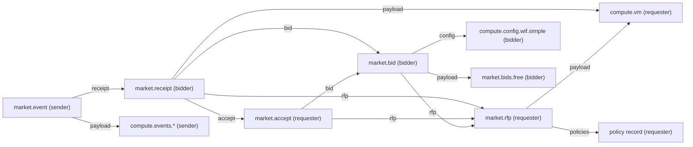
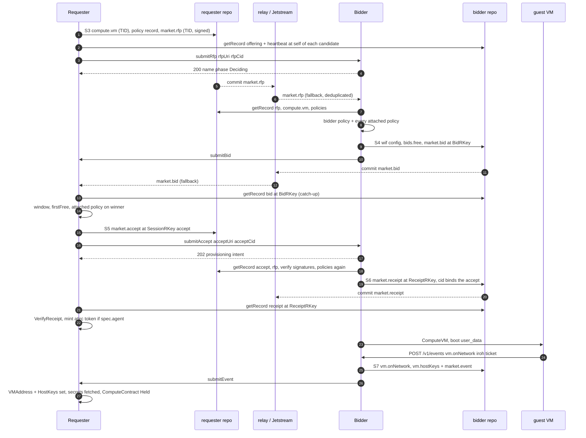
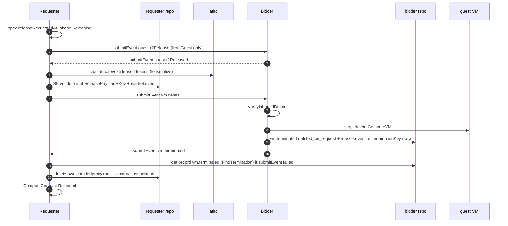

# market: the RFP flow

- how a requester rents a guest from a bidder over atproto records: rfp, bid, accept, receipt, event
- index of this tree: [README.md](README.md) (steps S0 to S9); one row per lexicon: [lexicons-market.md](lexicons-market.md); the events under a receipt: [guest-events.md](guest-events.md)
- NSID prefix of every record here: `com.publicdomainrelay.temp.`; names below drop it (`market.rfp` = `com.publicdomainrelay.temp.market.rfp`)
- constants: `internal/atproto/market/nsid.go`; record builders: `internal/atproto/market/records.go`, `internal/atproto/market/attest.go`
- requester side: `internal/market/requester` (component `internal/services/requester`); bidder side: `internal/market/bidder` (component `internal/services/bidder`)
- applications talk ONLY over these records and XRPC calls. a shared kcp is never a data channel ([../KCP.md](../KCP.md))

## Parties And Repos

| party | repo it writes | what it writes there |
|---|---|---|
| requester | its own (the MarketIdentity DID) | `compute.vm`, policy record, `market.rfp`, `market.accept`, `market.event` + its payloads (`compute.events.vm.delete`, requester `compute.events.guest.*`), `ingress.webRTC` listen + offer, contract-scoped `market.association` |
| bidder | its own | `market.offering`, `market.heartbeat`, `market.bid` + `market.bids.free` + `compute.config.wif.simple`, `market.receipt`, `market.event` + its payloads (`compute.events.vm.*`, guest-originated `compute.events.guest.*`), `ingress.webRTC` answer |
| guest | none. the guest holds no repo key | POSTs its events to the bidder, which signs and writes them ([guest-events.md](guest-events.md)) |

- every record lives in the repo of its author. no party writes into another party's repo
- a party reads the other side's records by `getRecord` through a strongRef or a stable rkey, never by `listRecords` scans

## Records Of One Contract

| step | record | repo | rkey | strongRefs it holds |
|---|---|---|---|---|
| [S3](README.md#step-s3) | `compute.vm` | requester | TID (`CreateRecord`) | none. `user_data` = cloud-init from `cloudinit.BuildUserData` |
| [S3](README.md#step-s3) | policy record `computer.socialweb.temp.policy.ghalite` | requester | TID | none ([policy.md](policy.md)) |
| [S3](README.md#step-s3) | `market.rfp` | requester | TID (`market.CreateRFP`) | `payload` -> `compute.vm`, `policies[]` -> policy record, `ingress[]` -> `ingress.webRTC` listen |
| [S4](README.md#step-s4) | `compute.config.wif.simple` | bidder | `<bid rkey>-config` | none |
| [S4](README.md#step-s4) | `market.bids.free` | bidder | `<bid rkey>-payload` | none |
| [S4](README.md#step-s4) | `market.bid` | bidder | `market.BidRKey` | `rfp` -> rfp, `config` -> wif config, `payload` -> bids.free |
| [S5](README.md#step-s5) | `market.accept` | requester | `SessionRKey("accept", ...)` | `rfp`, `bid`, `ingress[]`. no `payload` (the code passes none) |
| [S6](README.md#step-s6) | `market.receipt` | bidder | `market.ReceiptRKey` | `rfp`, `bid`, `accept`, `payload` -> the RFP's `compute.vm`; `cid` = attestation CID over the accept |
| [S7](README.md#step-s7)-[S9](README.md#step-s9) | `market.event` + payload | sender | per kind (below) | `receipt` -> receipt, `payload` -> the `compute.events.*` record |

- sources: `internal/market/requester/runner.go` (compute.vm, policy, rfp, accept, release), `internal/market/bidder/bids.go` `writeBidRecord`, `internal/market/bidder/adapters.go` `acceptContract`, `internal/market/bidder/submit.go` `createReceipt`
- `market.accepts.*` and `market.receipts.*` are defined lexicons that no Go code writes ([lexicons-market.md](lexicons-market.md#marketacceptsfree))

## Rkeys

Stable rkeys make every write idempotent and every read one `getRecord`. A restarted runner reads the record at its rkey before it writes (`existingSignedRecord`, `participant.EnsureRecordAt`).

| record | rkey | function | file |
|---|---|---|---|
| `market.bid` | `bid-` + first 20 hex of sha256(bidderDID NUL rfpURI `#` rfpCID) | `market.BidRKey` | `internal/atproto/market/records.go` |
| `market.bids.free`, `compute.config.wif.simple` | `<bid rkey>-payload`, `<bid rkey>-config` | `writeBidRecord` | `internal/market/bidder/bids.go` |
| `market.accept` | 13 chars of sha256("accept", repoDID, contract, rfpURI, rfpCID, bidURI, bidCID) over `234567a-z` | `acceptRKeyFor` -> `market.SessionRKey` | `internal/market/requester/secrets.go` |
| `market.receipt` | `receipt-` + first 32 hex of sha256(acceptURI LF acceptCID) | `market.ReceiptRKey` | `internal/atproto/market/attest.go` |
| `compute.events.vm.delete` | `SessionRKey("delete", receiptURI)` | `market.ReleasePayloadRKey` | `internal/atproto/market/records.go` |
| requester `market.event` of vm.delete | `SessionRKey("event", receiptURI)` | `destroyEnvelope` | `internal/market/requester/runner.go` |
| bidder event payload + `market.event` | `<prefix>-payload-<32 hex>`, `<prefix>-event-<32 hex>` of an idempotency key | `market.EventRKeys` | `internal/atproto/market/records.go` |
| `vm.terminated` payload + event | key `terminated:<receiptURI>`, prefix `termination` | `market.TerminationKey` | `internal/computevm/termination.go` |
| requester ContractEvent payload + event | `SessionRKey("contract-event", uid)`, `SessionRKey("contract-event-envelope", uid)` | `publishContractEvent` | `internal/market/requester/contractevents.go` |
| `market.offering`, `market.heartbeat`, `market.relays` | `self` | `OfferingRKey`, `HeartbeatRKey`, `RelaysRKey` | `internal/atproto/market/nsid.go` |
| requester `ingress.webRTC` listen | `webrtc` | `ingressDescriptor` | `internal/market/requester/requester.go` |
| contract-scoped `market.association`, `market.associationRequest` | `<service>-<first 32 hex of sha256(did)>-<accept rkey>` | `market.ContractScopedRKey` | `internal/atproto/market/guest.go` |

- the bidder's event idempotency keys (`internal/market/bidder/syncs.go`): `onNetwork:<receipt>`, `onNetwork:<tag>:<receipt>`, `hostKeys:<receipt>`, `terminated:<receipt>`, `guest:<nsid>:<tag>:<kind>:<n>:<receipt>` (n = 0, 1, ... per VM, nsid, tag and kind: a guest's n-th event of that stream), else `<nsid>:<receipt>`
- so a requester reads a guest's events send/recv style, one `getRecord` each: n = 0, 1, ... until one is not found (never `listRecords`)
- so anyone can find the bidder's `vm.terminated` of a receipt with one `getRecord`: `market.EventRKeys(market.TerminationKey(receiptURI))` (`FindTermination` in `internal/market/requester/market.go`; the atirc lease in `internal/market/requester/atirc.go` `contractLease`)
- the requester finds a receipt with one `getRecord` at `ReceiptRKey(acceptURI, acceptCID)` (`FindReceipt`) and a missed bid at `BidRKey` (`catchUpBids` in `internal/market/requester/bidcatchup.go`)

## strongRef Graph

- strongRef = `{uri, cid}` (`com.atproto.repo.strongRef`); a reader checks the CID it resolves equals the CID in the ref (`RepoStore.Resolve`)
- `market.event.payload` must be in the repo of the event author (`applyGuestEvent` in `internal/market/bidder/guestevents.go`)

## Signatures

- `market.rfp`, `market.bid`, `market.bids.*`, `market.accept`, `market.receipt`, `market.event` and every event payload carry `signatures` (`network.attested.signature`, [identity.md](identity.md#networkattested))
- inline signature: `market.SignInline` hashes the record + metadata `{$type, key, issuer}` + the repo DID into an attestation CID and signs its bytes (`internal/atproto/market/attest.go`)
- receipt binding: `CreateReceiptRecordAt` sets `receipt.cid` = attestation CID of the accept record, the receipt metadata and the accept repo DID. the requester checks it with `market.VerifyReceipt`; a bad one fails the contract `ReceiptInvalid` (`acceptReceipt` in `internal/market/requester/runner.go`)
- the bidder checks the RFP signature before it provisions (`acceptContract`), and the event + payload signatures of every requester event (`applyGuestEvent`)

## Discovery

| record | writer | reader | rule |
|---|---|---|---|
| `market.offering` at `self` | bidder (`internal/market/bidder/offering.go`) | requester (`market.ReadOffering`) | `appliesTo` must hold `compute.vm` (`market.OfferingApplies`); `endpoints[]` = where the market XRPC goes (`{kind, address}`: iroh a short ticket, node id and relay, no IPs; https an origin; the requester takes iroh first when it has dumbpipe, else https); `withdrawnAt` + empty `appliesTo` = withdrawn |
| `market.heartbeat` at `self` | bidder, every `HeartbeatInterval` (60 s) | requester (`market.HeartbeatCache`), `internal/marketpresence` | fresh while `createdAt` is at most `HeartbeatTTL` (300 s) old; `offering` names the offering (a legacy non-`self` rkey is read through it) |
| `market.relays` at `self` | no Go writer here | requester (`market.RelayURLsOf`) | extra relays to ask `listReposByCollection` |

- candidate bidders (`HTTPMarket.discover` in `internal/market/requester/market.go`): DIDs from `com.atproto.sync.listReposByCollection?collection=market.offering` on each relay (configured + `market.relays` of the trust roots, `internal/market/requester/discovery.go`), or the contract's `spec.bidderDids` only
- unnamed candidates without a fresh heartbeat are dropped (`dropNoHeartbeat`); `spec.denyBidderDids` are dropped
- discovery results are cached 20 s

## Delivery: XRPC Callbacks And Streams

Every record also reaches the other side two ways. The XRPC call is the fast path; the stream is the fallback and the only path with no inbound endpoint.

### Comms modes

| `spec.comms.mode` | requester ingress (submitBid, submitEvent) | streams |
|---|---|---|
| `XRPC` | yes | none |
| `Firehose` | none | relay + Jetstream |
| `Both` (requester default) | yes | relay + Jetstream |

- stream composer: `internal/app/compose/streams.go`; collections per role: `compose.MarketStreamCollections`
- requester streams carry only `market.bid`, `market.receipt`, `market.event`; bidder streams only `market.rfp`, `market.accept`, `market.event`
- payload records (`bids.free`, `compute.events.*`, ...) are never stream input. the reader fetches them through the strongRef
- one sink per role (`internal/eventstream/market.go`) drops a `uri|cid` seen in the last 15 s (`market_event_duplicate_dropped`)
- addressee index (`internal/atproto/market/addressee.go`, `internal/eventstream/addressees.go`): the requester keeps a bid whose `rfp` is one of its RFPs, a receipt whose `accept` is one of its accepts, an event whose `receipt` is one of its receipts. the bidder keeps every RFP, an accept whose `bid` is in its repo, an event whose `receipt` is in its repo. the rest: `market_foreign_dropped`
- the bidder's requester streams (`internal/app/compose/requesterstreams.go`): only while it has live ComputeVMs, filtered to those requester DIDs, `spec.resume: Recent`

### XRPC procedures

| NSID | served by | caller | body | answer | file |
|---|---|---|---|---|---|
| `market.submitRfp` | bidder ingress | requester | `{rfpUri, rfpCid, ingress?}` | 200 `{ok, name, phase: Deciding, ingress?}`; 409 `RFPClosed` after the bid window | `internal/services/bidder/routes.go` `handleSubmitRFP` |
| `market.submitBid` | requester ingress | bidder | `{uri, cid, record}` of the `market.bid` | 200 `{ok}`; 403 when the record is not the issuer's | `internal/services/requester/routes.go`, `Requester.SubmitBid` in `internal/market/requester/callbacks.go` |
| `market.submitAccept` | bidder ingress | requester | `{acceptUri, acceptCid, ingress?}` | 202 `{ok, id, acceptUri, acceptCid}` (`id` = the provisioning intent); the receipt follows as a record. the lexicon also allows `uri`, `cid`, `submitEvent`, `ingress` | `handleSubmitAccept` |
| `market.submitEvent` | both ingresses | the contract party that wrote the event | `{uri, cid, record}` of the `market.event` | 200 `{ok}`; 403 `Forbidden` when the sender is not the accept author (to a bidder) or the receipt author (to a requester) | `handleSubmitEvent`, `Requester.SubmitEvent` |

- auth: a service-auth JWT with `lxm` = the NSID; the token issuer is the caller (`AuthorizeCallback` in `internal/market/requester/callbacks.go`, `participant.Authorizer`)
- `market.AuthorizeRecord(issuer, uri)`: the submitted record must be in the issuer's repo
- the bidder answers submitBid too (it only parses the bid); the bidder routes exist only with inbound XRPC (`inboundXRPC`)
- the requester's submitEvent takes only event kinds a requester consumes (`isGuestEventNSID` in `internal/market/requester/events.go`)
- `submitBid` in the RFP, `submitEvent` in the accept and receipt: a DID service ref (`did#serviceId`, default ids `pdr_temp_market`, `pdr_temp_compute_event`) or an HTTP URL
- calls to a bidder go to its offering `endpoints[]` with service auth aud `<bidder DID>#pdr_temp_market` (hostname-free; the bidder also takes `#pdr_temp_compute_event`)
- a `webrtc` endpoint's address is base64url JSON `{did, listen}`: the bidder's `computer.socialweb.ingress.listen/<listen>` holds
  `{key (age), fingerprint (DTLS)}`; an offerer writes `computer.socialweb.ingress.offer/<bidder DID>.<tid>` (age-sealed `{sdp, replyTo}`)
  in its own repo, the bidder (offers reach it on its Jetstream and relay streams, collection filter) answers once at
  `computer.socialweb.ingress.answer/<offerer DID>.<tid>` (sealed `{sdp}`, deleted after 5 min) and serves HTTP/1.1 on each
  datachannel (keep-alive) to its market XRPC; offers older than 2 min are ignored
- `ingress[]` on the records and calls: `ingress.webRTC` listen/offer/answer records for a party whose HTTP endpoint is not reachable ([lexicons-market.md](lexicons-market.md#ingresswebrtc))

## Bid Window And Selection

- bidder side window: `market.RFPBidWindow` = 10 min from the RFP `createdAt`, else from its TID rkey (`internal/atproto/market/rfpwindow.go`). the lexicon has no expiry
- a closed RFP: submitRfp answers 409 `RFPClosed`, the stream sink drops it (`market_rfp_closed_dropped`), a Deciding Bid fails `BidWindowOver` (`bidder_rfp_closed`)
- one bid per RFP: the Bid object is named `market.BidRKey`; after its TTL (24 h, `BidTTLSeconds`) the bidder's own `market.bid` at that rkey is the fact (`bidder_rfp_already_bid`, `enqueueBid` in `internal/market/bidder/submit.go`)
- requester side window: `RequesterSpec.bidWindowSeconds` (default 30 s); the first policy-allowed free bid ends it (`collectBids` in `internal/market/requester/runner.go`)
- `status.chosen.reason`: `firstFree`, `bestWithinWindow`, `policy`, `resumed`; `status.bids` keeps at most 20 (`MaxRecordBids`)
- no bids: outcome `NoBids`; all denied: `BidsDenied`; winner denied by policy: `PolicyRejected`

## Policies Attached

- the requester writes its policy record first and puts its strongRef in `market.rfp.policies` ([policy.md](policy.md#rfp-policy-strongrefs))
- the bidder runs its own workflow and then every attached policy, before it bids and again on the accept (`b.policy.EvaluatePolicies` in `acceptContract`)
- the requester runs the attached policy on the winner before it writes the accept (`q.policy.Evaluate` in `runner.go`)
- a market policy always runs, both sides, every decision. no verdict skips a run ([../SYSTEM.md](../SYSTEM.md#policies))

## Sequence: RFP To Held

- waits (`internal/market/requester/requester.go`): receipt `DefaultReceiptTimeout` 5 min, iroh address `DefaultVMReadyTimeout` 120 s, host keys `DefaultHostKeysTimeout` 120 s, getSecrets fetch `DefaultVMReadyTimeout`
- Held needs the iroh address and the host keys (`waitGuest`, `runGuestAndHold` in `runner.go`); a sandbox (`compute.vm.kind: deno`) needs its `vm.sandbox` result instead
- the guest side of S7 and S8: [guest-events.md](guest-events.md)

## Release And Termination

1. a release request stamps `spec.releaseRequestedAt`; the runner enters `releaseContract` (`runner.go`)
2. guest requester first: `releaseGuestRequester` publishes `guest.r2Release` and waits for `guest.r2Released` (only with `spec.association.fromGuest`)
3. atirc tokens: `revokeBeforeDestroy` (`internal/market/requester/atirc.go`) revokes a leased token while its lease is alive
4. `destroyEnvelope`: `compute.events.vm.delete` at `ReleasePayloadRKey(receipt)` + `market.event` at `SessionRKey("event", receipt)`, both signed
5. `submitEvent` to the bidder; retried with `releaseRetryDelay` until the release deadline. no endpoint: the stream carries it
6. bidder: `applyRelease` -> `verifyInboundDelete` (event author = accept author, receipt is its own), `markReleaseRequested` records the release request on the Bid and ComputeVM, and the ComputeVM is deleted (`internal/market/bidder/adapters.go`, `internal/market/bidder/bids.go` `finishRelease`)
7. bidder: termination StateSync (`internal/computevm/termination.go`, adapter `atproto.market.event`) writes `compute.events.vm.terminated` `{reason: deleted_on_request, request -> the vm.delete}` + `market.event` at `EventRKeys(TerminationKey(receipt))`
8. requester: `Released` once submitEvent answered 2xx, or once the bidder's `vm.terminated` appears (`settleTerminated`)
9. requester deletes only its own contract-scoped records (`deleteContractRecords`: the `com.fedproxy.rbac` grant, the contract association)

- a guest that stops for any other reason gets `vm.terminated` with `request` unset and a reason from `market.VMTerminatedReasons` (`guest_poweroff`, `vmm_exited`, `oom`, `host_reboot`, `identity_mismatch`)
- a release whose destroy record or submitEvent keeps failing settles `Released` once the bidder's `vm.terminated` for that receipt appears
- a bidder also releases a VM whose contract-scoped association expired 10 min ago (ComputeVM `spec.associationExpiresAt`, [identity.md](identity.md#contract-scoped-association))

## Revocation Ordering

- no atirc token before a verified receipt (`contractLease`: "no atirc token is minted before it")
- each token is leased to the receipt and the bidder's `vm.terminated` at-uri, so atirc can kill it when the VM ends even if the requester is gone
- on release: guest requester contracts first, then the leased tokens (while the lease is alive), then `vm.delete`. a 401 saying the lease is not alive counts as revoked
- the rest of the revokes run in the background from a release marker in the bundle secret, capped at 24 h ([guest-events.md](guest-events.md#agent-start-and-atirc-mint))

## Records Policy

- user records are never deleted. no sweep, retention or GC of repo records
- the requester deletes only the contract-scoped records it wrote for that contract (rbac grant, association), never a record of another contract
- one `getRecord` at a deterministic rkey; `listRecords` only as a legacy fallback

## See Also

- [../SYSTEM.md](../SYSTEM.md#market-protocol): the market in one page; [../KCP.md](../KCP.md): the ComputeContract, Bid, ComputeVM and StateSync objects behind each record
- [guest-events.md](guest-events.md), [lexicons-market.md](lexicons-market.md), [policy.md](policy.md), [identity.md](identity.md), [outside.md](outside.md)
- `docs/ARCHITECTURE.md` section 15 for the decisions (stable rkeys, bid window, comms modes)
