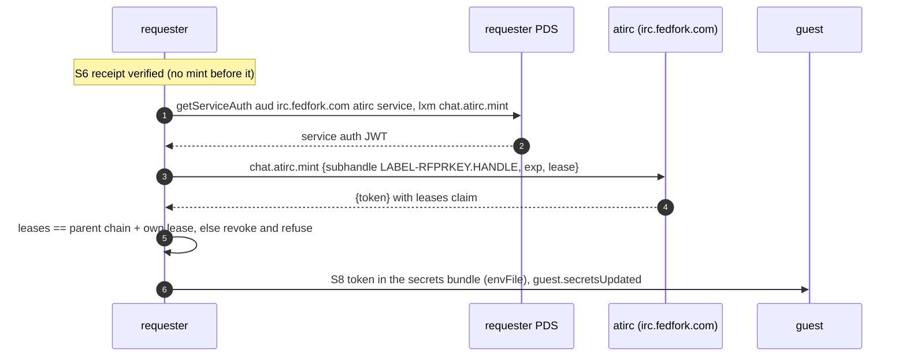

# outside: lexicons we use but do not own

- records and XRPC methods defined by atproto, Bluesky, tangled, atirc and fedproxy that socialweb-computer reads, writes or calls
- the OAuth scopes each role asks for, ours and theirs
- index: [README.md](README.md)

## At A Glance

| NSID | owner | type | we | Go | step |
|---|---|---|---|---|---|
| `sh.tangled.graph.vouch` | tangled | record | read (policy), write (market network operators) | `internal/policyengine/trust/trust.go`, `internal/app/compose/records.go` | S1 |
| `chat.atirc.mint` | atirc | procedure | call (requester) | `internal/market/requester/atirc.go`, `sessionatirc.go` | S8 |
| `chat.atirc.revoke` | atirc | procedure | call (requester) | same | S9 |
| `com.atproto.server.getServiceAuth` | atproto | query | call (every role), serve (in-repo PDS) | `internal/atproto/pdsclient/serviceauth.go`, `internal/atproto/xrpc/serviceauth.go` | S3 to S9 |
| `com.atproto.repo.getRecord` | atproto | query | call (everywhere), serve | `internal/atproto/pdsclient/client.go` | all |
| `com.atproto.repo.putRecord`, `createRecord` | atproto | procedure | call, serve | same | all |
| `com.atproto.repo.deleteRecord` | atproto | procedure | call (own contract-scoped records only), serve | same | S9 |
| `com.atproto.repo.listRecords` | atproto | query | call (legacy fallback, discovery), serve | same | - |
| `com.atproto.repo.applyWrites` | atproto | procedure | serve only (one custody call) | `internal/atproto/pds`, `internal/gateway/custody/signin.go` | - |
| `com.atproto.repo.strongRef` | atproto | object | vendored copy in `lexicons/com/atproto/repo/strongRef.json` | `internal/atproto/market` | all |
| `com.atproto.sync.subscribeRepos` | atproto | subscription | subscribe (relay, PDS), serve (relay, in-repo PDS) | `internal/events/relay`, `internal/atproto/relay`, `internal/atproto/pdsclient/subscribe.go` | S3 to S9 |
| `com.atproto.sync.getRepoStatus`, `getRepo`, `getLatestCommit`, `requestCrawl` | atproto | query / procedure | call, serve (relay, PDS) | `internal/eventstream/market.go`, `internal/atproto/relay` | - |
| `com.atproto.server.createSession`, `refreshSession`, `createAccount`, `describeServer`, `getSession`, `deleteSession` | atproto | procedure / query | call (password identities, dev accounts), serve | `internal/atproto/pdsclient/client.go`, `internal/pds/remote` | S0 |
| `network.bsky.jetstream.subscribeEvents` | Bluesky | subscription (Jetstream v2) | subscribe | `internal/events/jetstream`, `internal/controllers/jetstreameventsource` | S3 to S9 |
| `com.fedproxy.rbac` | fedproxy | record | write (requester), read (guest control plane) | `internal/market/requester/secrets.go`, `internal/guestidentity` | S5, S8 |
| `com.fedproxy.sshPublicKey` | fedproxy | record | scope only | `internal/atproto/oauth/scope.go` | - |

## sh.tangled.graph.vouch

| field | value |
|---|---|
| NSID | `sh.tangled.graph.vouch` (tangled's lexicon; no copy under `lexicons/`) |
| type | record |
| rkey | the subject DID |
| key fields | `subject`, `createdAt`; `kind` (a `denounce` is not a vouch) |
| written by | market network operator vouches, both directions (`internal/app/marketnetwork/vouches.go` -> compose `ApplyOperatorVouch`, an AtprotoRecord in the operator repo); people, from any tangled client |
| read by | `trust.Resolver.Vouches`: one getRecord at `at://<voucher>/sh.tangled.graph.vouch/<subject>`; requester discovery `vouchedBy` (listRecords) |
| step | [S1](README.md#step-s1); read at every policy decision ([S4](README.md#step-s4), [S5](README.md#step-s5)) |

- the default policy on both sides: [policy.md](policy.md#tangled-vouch)
- OAuth: `repo:sh.tangled.graph.vouch?action=create&action=update` is in the requester set but optional (`OptionalScopes`)

## chat.atirc

- the full protocol (token kinds, mint rules, leases, every `chat.atirc.*` NSID, frame shapes) lives in the atirc repo: `docs/protocol/atirc.md` (atirc `da089a0`, `git@tangled.org:did:plc:vtad4w7ujsvz7t6o6iuvmhjq`)
- here: only what socialweb-computer uses

| item | value |
|---|---|
| base | `https://irc.fedfork.com` (`DefaultAtircURL`) |
| aud | `did:web:irc.fedfork.com#atirc` (`AtircServiceAudience`) |
| call | `POST <base>/xrpc/<nsid>`, `Authorization: Bearer <service auth or parent token>`, 30 s timeout, 64 KiB response cap |
| mint input | `{subhandle, exp, lease?}` |
| mint output | `{token}` (no whitespace) |
| lease | `{receipt {uri, cid}, termination (the bidder's vm.terminated at-uri), contract (the accept at-uri), association? {uri, cid}}` |
| revoke input / output | `{subhandle}` / `{revokedAt}` |
| token env | `ATIRC_TOKEN`, `ATIRC_SUBHANDLE`, `ATIRC_EXP` |

### Mint

- issuer: the requester's own identity via service auth, or a parent atirc token (`spec.atircParentRef`, vault path `identity/atirc-parent`) for a guest requester; its child label is `vm`
- exp: min(now + 24 h, contract deadline, issuer exp). an ssh session token is capped at the session cap
- the guest requester (R2) token carries the association strongRef in its lease; atirc clamps its exp to the association `expiresAt`
- ssh gateway sessions: child `ssh-<rfp rkey>.<handle>`, sent as `LC_ATIRC_TOKEN` (`internal/market/requester/sessionatirc.go`); scope `rpc:chat.atirc.mint` + `rpc:chat.atirc.revoke` (`internal/app/compose/atprotoscope.go` `SshGatewayAtprotoScope`)
- every mint is recorded (path, subhandle, token, exp) under `atircMinted` in the contract's bundle secret

### Revoke

- before vm.delete, while the lease is alive (`revokeAtircToken`, `revokeBeforeDestroy`)
- bearer order (`revokeMinted`): service auth with lxm `chat.atirc.revoke` when the OAuth session was granted `rpc:chat.atirc.revoke` and the subhandle is below the requester handle; else the parent token; else the token itself
- a 401 "lease is not alive" counts as revoked (byLease); other 401s for the own token count as already revoked
- outcome in `status.atircRevokes` (Done, Pending, Abandoned after 24 h)
- orphan sweep on every requester start (`internal/market/requester/orphanrevoke.go`); skipped when the requester has no `vaultRef`

### What atirc checks (as this repo relies on it)

- mint needs an explicit `exp`, at most 24 h
- a leased token dies once its lease's `vm.terminated` record exists
- revoking a subhandle revokes everything below it; revoke answers 200 for any name in the caller's scope, so the requester sends a revoke only for the token's own `subhandle` claim
- a contract-scoped association ref needs `expiresAt`; the minted exp is clamped to it

## com.atproto.repo.strongRef

| field | value |
|---|---|
| NSID | `com.atproto.repo.strongRef` (atproto's; a vendored copy in `lexicons/com/atproto/repo/strongRef.json` so the embedded catalog resolves refs) |
| type | object `{uri (at-uri), cid}` |
| used in | `market.rfp` (`payload`, `policies[]`, `ingress[]`), `market.bid`, `market.accept`, `market.receipt`, `market.event`, `market.association` (`contract`), `badgeBlueKeys` (`proof`), `network.attested.proof` (`subject`) |
| Go | `internal/atproto/market` `StrongRef`, `StrongRefNSID` (generated with the market types) |

- a reader fetches the target with one getRecord and compares the cid where the flow pins it (attached policy, association proof)

## Service Auth

- every cross-service call carries an atproto service-auth JWT from `com.atproto.server.getServiceAuth` (`aud`, `lxm`, `exp`)

| lxm | aud | caller | verified by |
|---|---|---|---|
| `com.publicdomainrelay.temp.market.submitRfp`, `submitAccept`, `submitEvent` | the bidder's DID or `did#serviceId` | requester (`internal/market/requester/market.go`) | `internal/atproto/market/auth.go` via `participant/comms.go` |
| `market.submitBid`, `submitEvent` | the requester's DID or `did#serviceId` | bidder (`internal/market/bidder/submit.go`, `adapters.go`, `participant/serviceauth.go`) | same |
| `com.publicdomainrelay.temp.cluster.*` | gateway audience | `internal/gatewayhttp/cluster.go` | `internal/xrpcserver`, `internal/atprotoauth` |
| `computer.socialweb.k8s.*` | `did:web:k8s.socialweb.computer` | cluster owners | same |
| `chat.atirc.mint`, `chat.atirc.revoke` | `did:web:irc.fedfork.com#atirc` | requester | atirc |

- verifiers use indigo `auth.ServiceAuthValidator`, except the ingress relay (golang-jwt plus an `lxm` equality check, `internal/atproto/ingress/auth.go`)
- a `did:key` issuer (did:key ingress) signs locally, no PDS round trip (`internal/atproto/ingress/auth.go`): [identity.md](identity.md#didkey-ingress)
- the in-repo PDS serves getServiceAuth (`internal/atproto/pds/service_auth.go`)
- `atproto-proxy`: only forwarded as a header on ingress subscriptions; no client sets it
- the in-repo PDS's own session JWTs carry `scope` `com.atproto.access` / `com.atproto.refresh` (`internal/atproto/pds/auth.go`)

## Repo Reads And Writes

- one `getRecord` at a deterministic rkey beats a `listRecords` scan; `listRecords` remains only as a legacy fallback
- client: `internal/atproto/pdsclient` (getRecord, putRecord, createRecord, deleteRecord, listRecords, getRepo, getLatestCommit)
- payload records are read through the strongRef with getRecord, never taken from a stream

| deterministic rkey | where |
|---|---|
| bid `market.BidRKey`, termination `TerminationKey`, events `EventRKeys`, session `SessionRKey`, rbac `RBACRKey` | `internal/atproto/market/records.go` |
| receipt `receipt-<32 hex>` | `internal/atproto/market/attest.go` `ReceiptRKey` |
| badgeBlueKeys signer binding | `internal/atproto/market/badgeblue.go` |
| contract-scoped association / request | `internal/atproto/market/guest.go` `ContractScopedRKey` |
| offering, heartbeat, relays | `self` |
| infra, ephemeralInfra | object name or successor, index at `self`: [infra.md](infra.md#rkeys) |

| listRecords still used | why |
|---|---|
| `internal/guestidentity/rbac_reader.go` | accepts from before stable rbac rkeys (`RBACAtAcceptSince`) |
| `internal/market/requester/discovery.go` | trust lists (vouches) |
| `internal/ssh/ownersession/ownersession.go`, `internal/gateway/custody/signin.go`, `internal/atproto/market/http.go` | legacy and custody paths |

- deleteRecord: only on records the app wrote itself for a contract: the requester's `market.association` and `com.fedproxy.rbac` grants (`internal/market/requester/association.go`, `secrets.go`), a bidder outbox event it retracts (`internal/market/bidder/adapters.go`), an AtprotoRecord object whose policy is not Retain (`internal/controllers/atprotorecord/apply.go`). never on Infra records, never on someone else's records

| server | serves |
|---|---|
| `internal/atproto/pds` | the HTTP PDS: server, repo, sync, subscribeRepos (the app's own Pds component, dev networks) |
| `internal/pds/local` | in-process adapters over that PDS (`localRepo` identities) |
| `internal/pds/remote` | HTTP to a remote PDS through pdsclient (`pdsAccount`, OAuth) |
| `internal/services/requester/routes.go` | `repo.getRecord`, `repo.listRecords`, `server.describeServer` of the requester's repo |

## Streams

| source | NSID | filter | Go |
|---|---|---|---|
| our relay `https://relay.mini-cloud-0002.chadig.com` (or the network relay) | `com.atproto.sync.subscribeRepos` | repeated `wantedCollections` (max 100), `wantedDids` (max 10000) | `internal/events/relay`, `internal/controllers/relayeventsource` |
| Jetstream v2 `wss://jetstream.us-east.bsky.network`, `wss://jetstream.us-west.bsky.network` | `network.bsky.jetstream.subscribeEvents` | `collections`, `dids`, `kinds=commit` | `internal/events/jetstream`, `internal/controllers/jetstreameventsource` |
| a Jetstream URL ending in `/subscribe` | Jetstream v1 | `wantedCollections`, `wantedDids` | same |

- requester stream: `market.bid`, `market.receipt`, `market.event`; bidder stream: `market.rfp`, `market.accept`, `market.event` (`internal/app/compose/streams.go`)
- after a commit, `com.atproto.sync.getRepoStatus` on the relay finds the author's PDS, then getRecord there (`internal/eventstream/market.go`)
- the relay we run (`internal/atproto/relay`) serves describeServer, requestCrawl, subscribeRepos, getRepo, getRepoStatus, listRepos, listReposByCollection, getLatestCommit, listHosts, getHostStatus; its crawler dials each PDS's subscribeRepos
- detail of the market streams: [market.md](market.md)

## com.fedproxy

| NSID | rkey | written by | read by | purpose |
|---|---|---|---|---|
| `com.fedproxy.rbac` | `node.<accept rkey>` (`RBACRKey`) | requester (`internal/market/requester/secrets.go`) | guest control plane (`internal/guestcp/openbao/plane.go` -> `internal/guestidentity/grants.go`, `rbac_reader.go`) | roles `{role_name, definition {iss, aud, sub, policies}}` for the guest secrets and node-join JWT roles |
| `com.fedproxy.sshPublicKey` | - | nobody in Go | nobody | create scope in `ComputeSPAOAuthScope` only |

## Scope-Only Collections

- NSIDs that appear only as OAuth scopes: `com.publicdomainrelay.temp.auth.allowlist.rbacDid` (create, bidder and desktop sets), `com.fedproxy.sshPublicKey`, `com.publicdomainrelay.temp.market.bidderAssociation` ([identity.md](identity.md#marketbidderassociation)), `rpc:com.publicdomainrelay.temp.requester.associateConfirm` ([identity.md](identity.md#requesterassociateconfirm))

## OAuth Scopes Per Role

- sets: `internal/atproto/oauth/scope.go` (identities) and `internal/app/compose/atprotoscope.go` (the OpenBao atproto plugin of the gateway and ssh gateway)
- every set starts with `atproto`; a `repo:<nsid>?action=...` per collection; `rpc:<nsid>?aud=...` per method

| set | used by | repo (write) | rpc |
|---|---|---|---|
| `RequesterOAuthScope` | CLI and long-lived requesters (`internal/market/requester/requester.go`), `pkg/embedded` (iOS), requester client metadata (`internal/services/requester/routes.go`), dev requester identities (`internal/devcore`) | create+update: `compute.vm`, `market.rfp`, `market.accept`, `market.event`, `compute.events.vm.delete`, `vm.onNetwork`, `guest.publicKey`, `guest.signalWebRTC`, `guest.secrets`, `guest.agentStart`, `guest.secretsUpdated`, `guest.r2Start`, `guest.r2Release`, `policy.ghalite`, `policy.typescript`; create+update+delete: `com.fedproxy.rbac`, `badgeBlueKeys`, `market.association`, `market.associationRequest`, `computer.socialweb.infra`, `ephemeralInfra`; optional: `sh.tangled.graph.vouch` | `market.submitRfp`, `submitAccept`, `submitBid`, `submitEvent` (`aud=*`); `chat.atirc.mint`, `chat.atirc.revoke` (aud `did:web:irc.fedfork.com%23atirc`, revoke optional) |
| `BidderOAuthScope` | bidder identities (`internal/devcore`, bidder client metadata `internal/services/bidder/routes.go`) | create: `auth.allowlist.rbacDid`, `market.bid`, `bids.free`, `market.receipt`, `market.event`, `compute.config.wif.simple`, `compute.vm`, `market.rfp`, `market.accept`, `vm.delete`, `vm.onNetwork`, `vm.terminated`, `vm.hostKeys`, `guest.publicKey`, `guest.signalWebRTC`, `guest.secretsApplied`, `guest.secretsRequested`, `guest.requesterDid`, `guest.r2Released`, `com.fedproxy.rbac`, `market.bidderAssociation`, `policy.ghalite`, `policy.typescript`; create+update: `market.offering`, `market.heartbeat`; create+update+delete: `badgeBlueKeys`, `market.association` | the four `market.submit*` |
| `DesktopOAuthScope` | desktop client | create+update: `rbacDid`, offering, bid, bids, receipts, event, `wif.simple`, `com.fedproxy.rbac`, `bidderAssociation`; create: `badgeBlueKeys` | `submitBid`, `submitEvent` |
| `ComputeSPAOAuthScope` | compute SPA | create: `compute.vm`, `badgeBlueKeys`, `com.fedproxy.rbac`, `com.fedproxy.sshPublicKey` | `submitRfp`, `submitAccept` |
| `DIDKeyAssociatorOAuthScope` | `oauthQr` sign-in at qr.fedfork.com (`internal/stack/componentcore/controllers.go` `QRScopes`) | bidder + requester sets | + `requester.associateConfirm` |
| `K8sOAuthScope` | k8s requester | requester set | + `cluster.createCluster`, `listClusters`, `getKubeconfig`, `controlPlaneUp`, `controlPlaneDown`, `deleteCluster` |
| `OAuthScope` | the union | all of the above | all of the above |
| `GatewayAtprotoScope()` | gateway OpenBao atproto plugin and gateway session owners (`internal/app/gateway`) | compose `requesterScope` (a shorter requester list: no guest.agentStart/r2*, no vouch) + `heartbeat` | `market.submit*` + `cluster.*` |
| `SshGatewayAtprotoScope()` | ssh gateway OpenBao plugin and session owners (`internal/app/sshgateway`) | compose `requesterScope` | `market.submit*` + `chat.atirc.mint`, `chat.atirc.revoke` |

### Optional Scopes

- `OptionalScopes` = `rpc:chat.atirc.revoke?aud=did:web:irc.fedfork.com%23atirc`, `repo:sh.tangled.graph.vouch?action=create&action=update`
- `RequiredScopes` drops them from the identity's check (`internal/marketidentity/atproto/oauth.go`): a session granted without them stays Ready
- a missing optional scope -> `status.pendingAction {kind: signInAgain, reason: ScopeUpgrade}`; the feature that needs it falls back (revoke with the token itself)
- a new REQUIRED scope = SessionExpired for OAuth identities on rollout. plan the re-sign-in first
- granted scopes are read from the token response, never the access token's `scope` claim (the claim is an opaque `ref:<cid>` on bsky)
- a scope change is mirrored token for token in the other clients (typescript-helpers `lib/oauth-scope/mod.ts`, did-key-associator `generated/oauth-scope.js`, kcp-wasm `scripts/serve-public.ts`) per plan 0036

## See Also

- [README.md](README.md), [identity.md](identity.md), [policy.md](policy.md), [market.md](market.md)
- [../SYSTEM.md](../SYSTEM.md#service-auth), [../oauth.md](../oauth.md), [../ATIRC-WORKFLOW.md](../ATIRC-WORKFLOW.md)
