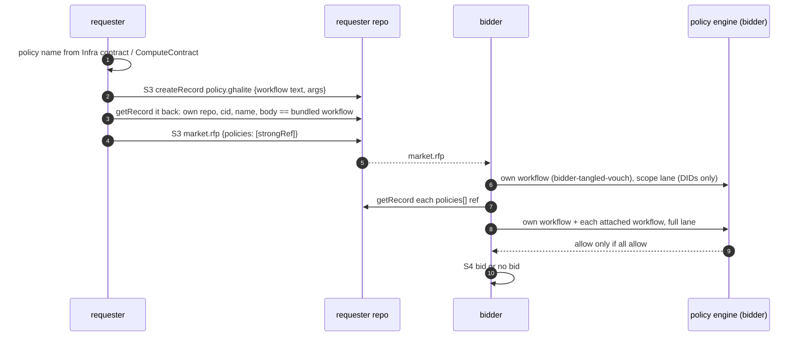

# policy: policy records, attached policies, tangled-vouch

- a market policy ALWAYS runs, both sides, both lanes (scope + full), every decision. no skip paths
- the requester publishes the workflow it runs as a record; the RFP strongRefs it; the bidder runs it next to its own
- caching lives inside the engine run, never across parties, never a skip
- index: [README.md](README.md). sequence steps: [S1](README.md#step-s1) (vouches), [S3](README.md#step-s3) (record + RFP), [S4](README.md#step-s4) (bidder runs), [S5](README.md#step-s5) (requester runs)

## Records And Fields

| NSID / field | type | rkey | written by | read by | Go | step |
|---|---|---|---|---|---|---|
| `computer.socialweb.temp.policy.ghalite` | record (no lexicon file) | TID (createRecord without rkey); one per contract, kept in `state.Policy` | requester | bidder (via the RFP strongRef), requester (re-check) | `internal/market/requester/policy.go` `BuildPolicyRecord`, `internal/market/requester/runner.go`, `internal/market/participant/policyrecord.go` | S3 |
| `market.rfp` `policies[]` | array of `com.atproto.repo.strongRef` | - | requester | bidder | `internal/atproto/market/records.go` `BuildRFP`, `CreateRFP` | S3 |
| `computer.socialweb.infra#contract` `policy`, `policyArgs` | strings | - | owner | requester (via the ComputeContract) | `internal/market/requester/runner.go` | S2 |
| `sh.tangled.graph.vouch` | record (outside) | subject DID | operators, users | both policies (trust snapshot) | `internal/policyengine/trust/trust.go` | S1 |
| `computer.socialweb.temp.policy.typescript` | record (no lexicon file) | - | nobody | denied | `internal/policyengine/registry/registry.go` | - |
| `com.publicdomainrelay.temp.market.policies.denoWorker` | record (no lexicon file) | - | nobody | denied | `internal/policyengine/registry/registry.go` | - |
| `computer.socialweb.temp.policy.wasm` | test fixture only | - | - | denied as an unknown type | `internal/policyengine/controller/records.go` | - |

- no policy field on `market.bid`, `market.offering` or `compute.*`. the bidder's own Bid object keeps `spec.policy {attached, verdict}` in kcp only

### `computer.socialweb.temp.policy.ghalite`

| field | value |
|---|---|
| `$type` | `computer.socialweb.temp.policy.ghalite` |
| `name` | the workflow name, e.g. `requester-tangled-vouch` |
| `workflow` | the full YAML text of the bundled workflow (or its name when there is no text) |
| `args` | `map[string]string`, from `policyArgs` |
| `requester` | the requester's market DID |
| `perspective` | `requester` |
| `policies` | `[{name, args?}]` |
| `createdAt` | datetime |

- `PolicyRecordWorkflow` reads `workflow` as a YAML string or an object and denies any other `$type` (`internal/market/participant/policyrecord.go`)
- typescript and denoWorker executors are registered as deny ("the policy engine is gha-lite only")
- OAuth: requester and bidder sets carry create (+ update on requester) for `ghalite` and `typescript`; none for denoWorker ([outside.md](outside.md#oauth-scopes-per-role))

## Infra Contract Fields

- `policy`: the workflow name. resolution: `cmp.Or(contract.Spec.Policy, cfg.PolicyWorkflow, DefaultPolicyWorkflow)`
- `PolicyWorkflowName` normalizes: `""` -> `requester-tangled-vouch`; `only-me` -> `requester-only-me`; `mutuals` -> `requester-mutuals`; `tangled-vouch` -> `requester-tangled-vouch`
- the name must be a bundled workflow, else the contract fails before the RFP
- `policyArgs`: a JSON object, parsed to `map[string]string` (`internal/market/participant/policy.go` `ParsePolicyArgs`)

## RFP Policy StrongRefs



- requester write path: `runner.go` step `creatingRfp`: `BuildPolicyRecord` -> `CreateRecord` -> `attachedPolicy` -> `rfpOptions.Policies` -> `market.CreateRFP`
- requester re-check `attachedPolicy` (`internal/market/requester/policy.go`): the record is in the requester's own repo, the cid matches, the name matches the contract, the body equals the bundled workflow byte for byte. `rfpPolicyRef` requires exactly one policy
- bidder: `EvaluatePolicies` (`internal/market/bidder/policy.go`) runs its own workflow (default `bidder-tangled-vouch`), then each RFP ref via `RepoStore.Resolve` (local getRecord or a foreign resolver), `PolicyRecordWorkflow`, `runs.Request{Workflow, Source: uri}`. first deny wins
- the bidder runs the attached workflow with `perspective=bidder` (`internal/market/bidder/bids.go`)
- a restarted runner reuses `state.Policy`; it does not write a second record

## Lanes And Modes

| lane | input | where |
|---|---|---|
| scope | DIDs only, RFP nil, `mode: scope` | bidder `bids.go`, `internal/policyengine/executor/ghalite.go` `Scope` |
| full | self, subject, counterparty, root requester DIDs, rfp, bid, accept, args, `mode: full` | bidder `bids.go` `fullInput`, `adapters.go`; `ghalite.go` `Execute` |

- executor: `GhaLite` (`internal/policyengine/executor/ghalite.go`), default timeout 30 s
- run path: `runs.Client.Run` creates a PolicyWorkflowRun and waits (`internal/policyengine/runs/client.go`)
- missing engine, evaluator or a non-boolean `allow` = deny

### Caching (inside the run)

| cache | key | TTL |
|---|---|---|
| trust snapshot seed | `trust/<counterpartyDid>` | per run |
| record | `rec/<uri>/<cid>` (`internal/policyengine/cache/cache.go`) | - |
| verdict | `policy/<name>/<rfp>\|<bid>\|<accept>[:argsHash]` | 30 s default |
| scope verdict memo | `internal/policyengine/controller/scopememo.go` | 30 s, plus a negative TTL |
| vouch, operator lookups | `trust.Resolver` ttlcache | 5 min, errors 5 s |

## Bundled Workflows

- embedded: `internal/policyengine/bundled-actions/embed.go` (`workflows/`, `tangy/`), looked up by `Workflow(name)` and `Lookup(uses)`
- every workflow is a `workflow_dispatch` wrapper with inputs `self-did`, `rfp`, `bid`, `accept`, `policy-args`, `mode`, `counterparty-did`, `perspective`, `subject-did`, `root-requester-did`, `cache-key`; it calls `tangy/policy-<name>@v1` and outputs `allow`, `violations`

| workflow | kind | decides |
|---|---|---|
| `bidder-tangled-vouch` | trust (bidder default) | the requester or its operator is vouched by the bidder or its operator |
| `requester-tangled-vouch` | trust (requester default) | the same, for the bidder, from the requester side |
| `bidder-mutuals`, `requester-mutuals` | trust | operators follow each other on Bluesky |
| `bidder-only-me`, `requester-only-me` | trust | the counterparty resolves to the own operator |
| `open` | trust | no restriction. only when named, never prod |
| `bid-payload` | work (requester) | the bid payload NSID is in `allowedPayloadNsids` (default `market.bids.free`) |
| `under-4-cpus` | work | the VM asks at most `maxCpus` vCPUs |

- the action infers its perspective from the `bidder-` prefix unless the `perspective` input says otherwise
- defaults: `api/v1alpha1/types_computevm.go` `BidderDefaultPolicy`, `RequesterDefaultPolicy`

## Tangled-Vouch

- default on both sides everywhere; `open` only if the user sets it
- a vouch is `sh.tangled.graph.vouch` at rkey = the subject DID in the voucher's repo; it counts when it exists and `kind != "denounce"`: [outside.md](outside.md#shtangledgraphvouch)
- both directions are needed for a deal: the bidder side vouches for the requester side and the requester side for the bidder side

```mermaid
flowchart LR
  SELF["self"] --> T["trusted = self + operator(self)"]
  CP["counterparty"] --> OPC["operator(counterparty) via identity.md"]
  T --> Q{"one getRecord per pair: trusted vouches counterparty or operator(counterparty)?"}
  OPC --> Q
  Q -->|yes| ALLOW["allow"]
  Q -->|operator(counterparty) is trusted| ALLOW
  Q -->|no| DENY["deny"]
```

- snapshot: `trust.BuildSnapshotWith` (`internal/policyengine/trust/trust.go`); depth 1, no transitive walk
- operator resolution (claims, associations, mirror proofs): [identity.md](identity.md#how-an-operator-is-resolved)
- who writes vouches: market networks declare operator vouches both ways (`internal/app/marketnetwork/vouches.go`, compose `ApplyOperatorVouch`); people write them from any client. the requester OAuth scope offers vouch write as an optional scope
- requester discovery lists the vouches of its trusted DIDs (`internal/market/requester/discovery.go` `vouchedBy`, a listRecords that skips `denounce` and takes rkeys starting `did:`)

## See Also

- [README.md](README.md), [identity.md](identity.md), [outside.md](outside.md), [market.md](market.md)
- [../SYSTEM.md](../SYSTEM.md#policies), `docs/ARCHITECTURE.md` (open by heading: policy engine)
