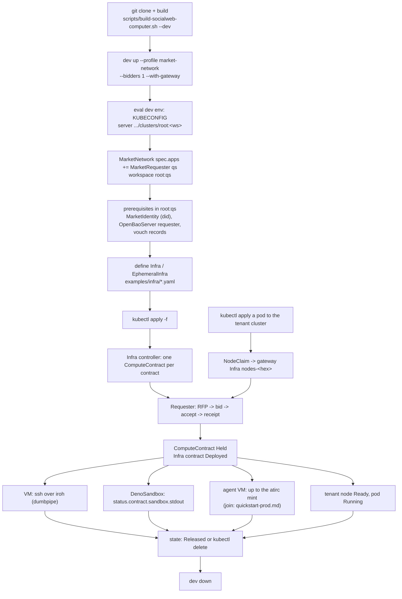

# Quickstart (local): your own market network, an Infra, and every kind of compute in it

- clone -> build -> `dev up` a market network -> apply prerequisites -> define Infra -> apply -> await -> use -> release -> `dev down`
- one local market network (one kcp, its own PLC, relay, PDSes, a bidder, a cluster gateway) on one Linux host; nothing here touches prod
- scenarios: firecracker VM, tenant Kubernetes cluster, Deno sandbox, VM with an atirc agent (up to the mint), all in one EphemeralInfra
- everything on this page is proven by acceptance [0012](acceptance/0012-infra-quickstart.md) on a local network
- example files: [../examples/infra/](../examples/infra/)
- against prod bidders (the browser page, the CLI per contract, the prod gateway, the agent join): [quickstart-prod.md](quickstart-prod.md)
- deeper: [../deploy/market-network/README.md](../deploy/market-network/README.md) (the network), [SYSTEM.md](SYSTEM.md), [KCP.md](KCP.md)



## 1. Clone And Build

- Linux host, run as the account that owns a subordinate uid range (here the VM account `test-0001`); `dev up` refuses root
- needs `/dev/kvm`, `kubectl`, `jq`, `ssh` on PATH

```bash
git clone https://github.com/publicdomainrelay/socialweb-computer-kcp
cd socialweb-computer-kcp
scripts/build-socialweb-computer.sh --dev --publish /var/tmp/qs   # or: make dev  (publishes to /var/tmp/swc)
SWC=/var/tmp/qs/bin/socialweb-computer
$SWC version
```

- the `--dev` build embeds every pinned asset: kcp, kine, OpenBao, dumbpipe, firecracker, vmexec, k3s, deno
- it refuses `--dumbpipe-path`; it runs its embedded dumbpipe

## 2. Start A kcp With A Market In It

```bash
I=qs                                    # instance name, unique on the host
ST=/var/tmp/qs-state                    # short: tenant socket paths must fit in 107 bytes
mkdir -p "$ST"
echo '{"bidder":{"kcp":{"handle":"{app}.qs.bob.test"}}}' > "$ST/app-values.json"
$SWC dev up --instance $I --profile market-network --host-backend proc --bidders 1 --with-gateway --compute-kinds vm,deno \
  --guest-image-source file:///var/lib/socialweb-computer/guest-image --vm-host-backend systemd-user \
  --app-values "$ST/app-values.json" --ready-timeout 90s --network-timeout 6m --state-dir "$ST"
$SWC dev status --instance $I --state-dir "$ST" | jq -r '.network.status.phase, (.network.status.apps[] | "\(.name) \(.phase)")'
```

- one kcp, workspace `root` holds `MarketNetwork network`; children: `root:bidder-1` (MarketBidder), `root:gateway` (Gateway + tenant cluster `tenant` at zero nodes)
- `--compute-kinds vm,deno` sets `spec.computeKinds` on every network bidder's MarketBidder (the same values and check
  as `run bidder --compute-kinds`); without it a network bidder serves `vm` only and a deno contract gets no bid
- `--guest-image-source` names a guest image dir (`image.json`, `rootfs.ext4`, `vmlinux`); without it `dev up` fetches the pinned one
- Ready when `.network.status.phase` is `Ready` (about 35 s on hat-8)
- `dev up` gives its own dev bidders a bidder policy of its choosing; the bidder also runs the contract's attached
  `requester-tangled-vouch` before it bids, so the vouches of section 4 are needed
- `dev up` waits through a component that is Failed for a moment (seen: gateway Requester "names no identity DID or handle"); it fails only when one stays Failed for a minute

## 3. kubectl Access

```bash
eval "$($SWC dev env --instance $I --state-dir "$ST")"   # KUBECONFIG, SOCIALWEB_KCP_HOST
k() { ws=$1; shift; kubectl --cache-dir "$ST/kcache" --server "$SOCIALWEB_KCP_HOST/clusters/$ws" "$@"; }
k root get workspaces
k root get marketnetworks.socialweb.computer network -o jsonpath='{.status.phase}{"\n"}'
```

- every app is a workspace of the one kcp: `root:<app>`, its components in `root:<app>:app`
- name kinds by full resource name (`infras.socialweb.computer`): several exports share short names
- `--cache-dir` throwaway: kubectl discovery caches outlive schema changes

## 4. Prerequisites

### A requester that stays up

An Infra lives in a requester's workspace; that requester's core reconciles it. Add one to the network:

```bash
k root apply --server-side --field-manager socialweb.computer/network-app/qs -f - <<'EOF'
apiVersion: socialweb.computer/v1alpha1
kind: MarketNetwork
metadata: {name: network}
spec:
  apps:
  - {name: qs, kind: MarketRequester, profile: market-network}
EOF
k root get marketnetworks.socialweb.computer network -o json | jq -r '.status.apps[] | select(.name=="qs") | "\(.phase) \(.did)"'
```

What it composes in `root:qs` (read them, do not write them):

| object | what to read |
|---|---|
| `MarketRequester app` | `status.phase` Ready, `status.did` |
| `MarketIdentity requester` | the requester's DID; mode `localRepo` (its own Pds component `pds` in `root:qs`) |
| `AtprotoRepo repo-<did with - for :>` | the requester's own repo |
| `OpenBaoServer requester` | `status.clients[name=requester]`: kv mount `requester`, cert auth role `requester` |
| `PolicyEngine` | runs every policy decision |

### Vouches

Default policy everywhere is tangled-vouch: the contract's attached policy `requester-tangled-vouch` and, on prod
bidders, `bidder-tangled-vouch`. Never set `policy: open`; it is insecure and not for user-facing use. Both
policies read `sh.tangled.graph.vouch` records: rkey = the subject DID, `record.subject` = that DID, any `kind`
but `denounce` counts.

| direction | record | in whose repo | why |
|---|---|---|---|
| bidder operator -> requester | rkey = requester DID | the bidder operator's repo | the bidder runs the RFP's attached policy before it bids, as itself: the requester must be in the bidder (operator) vouch graph; `bidder-tangled-vouch` asks the same |
| requester -> bidder | rkey = bidder DID (or its operator) | the requester's repo | the requester's own check of the bid: the bidder must be in the requester's vouch graph |

- verdicts and trust lookups are cached for 5 minutes (`defaultTrustCacheTTL`), denials too: write the vouches
  before the first Infra, or wait 5 minutes after a `not vouched`
- an Infra contract carries no `policy` field; the default applies
- `MarketBidder app` `status.did` is the bidder DID; `MarketIdentity bidder` `status.approvedAssociations` holds its operator

In the local network both records are kcp objects written through ComponentLinks:

- [vouch.yaml](../examples/infra/vouch.yaml), in `root:qs`: a ComponentLink that lets AtprotoRecords labelled
  `quickstart.socialweb.computer/vouch` write `sh.tangled.graph.vouch` to the requester's repo, and the record for the bidder
- [vouch-bidder-operator.yaml](../examples/infra/vouch-bidder-operator.yaml), in `root:bidder-1`: the bidder operator's
  record for the requester, through the network's link `link-records-operator` (label `apps.socialweb.computer/record-repo: operator`)

```bash
DID=$(k root:qs get marketrequesters.socialweb.computer app -o jsonpath='{.status.did}')
REPO=repo-$(echo "$DID" | tr ':' '-')
BID=$(k root:bidder-1 get marketbidders.socialweb.computer app -o jsonpath='{.status.did}')
NOW=$(date -u +%Y-%m-%dT%H:%M:%SZ)
sed -e "s/REPLACE-REQUESTER-REPO/$REPO/" -e "s/REPLACE-BIDDER-DID/$BID/" -e "s/2026-11-01T00:00:00Z/$NOW/" \
  examples/infra/vouch.yaml | k root:qs apply -f -
sed -e "s/REPLACE-REQUESTER-DID/$DID/" -e "s/2026-11-01T00:00:00Z/$NOW/" \
  examples/infra/vouch-bidder-operator.yaml | k root:bidder-1 apply -f -
k root:qs get atprotorecords.socialweb.computer vouch-bidder -o jsonpath='{.status.phase} {.status.uri}{"\n"}'
k root:bidder-1 get atprotorecords.socialweb.computer operator-vouch-requester -o jsonpath='{.status.phase} {.status.uri}{"\n"}'
```

On prod the same two records are written by people with their own accounts: [quickstart-prod.md](quickstart-prod.md) section 2.

### Secrets bundle (agent VMs only)

A contract with `spec.agent` needs `spec.secretsRef`: the requester writes the minted atirc token into that bundle and
the bidder hands the bundle to the guest. Write the bundle ([../examples/infra/agent-bundle.json](../examples/infra/agent-bundle.json),
one placeholder entry for the env file) into the requester's own OpenBao before applying:

```bash
D=$ST/dev/$I/apps/dev/$I-qs/openbaoservers/requester/openbao
BAO=$(find ~/.cache/socialweb-computer/runtime -maxdepth 2 -name bao -type f | head -1)
export BAO_ADDR=$(k root:qs get openbaoservers.socialweb.computer requester -o jsonpath='{.status.address}')
export BAO_CACERT=$D/tls/ca.crt BAO_CLIENT_CERT=$D/clients/requester/client.crt BAO_CLIENT_KEY=$D/clients/requester/client.key
BAO_TOKEN=$($BAO write -field=token auth/cert/login name=requester) \
  $BAO kv put -mount=requester contracts/einfra-quickstart-agent-agent1/secrets bundle=@examples/infra/agent-bundle.json >/dev/null
```

- the token lives only in that shell's environment for one command; nothing is printed
- the path must match `spec.secrets[].secretsRef.path` of the example

## 5. Define An Infra Or EphemeralInfra

Both kinds: group `socialweb.computer/v1alpha1`, export `computecontracts`, types in `api/v1alpha1/types_infra.go`.

| field | meaning |
|---|---|
| `spec.description` | free text, max 1024 |
| `spec.contracts[]` | one ComputeContract each; `name` (DNS label) + `state` + every ComputeContractTemplate field inline |
| `spec.contracts[].state` | `Staged` (default: nothing), `Requested` (apply the contract, run the RFP), `Released` (release it) |
| `spec.secrets[]` | `{contract, secretsRef: {mount, path}}`: becomes that contract's `spec.secretsRef`; never written to a record |
| `spec.nodes[]` | tenant cluster node join (`contract`, `ownerDid`, `nodeJoin`, `nodeClaimRef`); written by the NodeClaim controller, not by you |
| `spec.clusterRef` | the Cluster an Infra serves; set by the NodeClaim controller |
| `spec.record` | optional mirror to `computer.socialweb.infra` / `ephemeralInfra` in a repo (`repoRef`, `sync` Both or Publish, `uri`, `eventSourceRefs`) |
| EphemeralInfra `spec.ttlSeconds` | default 3600, min 60; ends at creation + ttl |
| EphemeralInfra `spec.endWhen` | `Complete` (default: ends when every requested contract is Released or Failed) or `Deadline` (only the ttl) |

ComputeContractTemplate fields used here (`api/v1alpha1/types_computecontract.go`):

| field | meaning |
|---|---|
| `vmName` | the guest name the RFP asks for |
| `sshAuthorizedKeys[]` | your public keys, for ssh as root |
| `userData` | cloud-init for `vm`; the Deno program for `deno` |
| `computeKind` | `vm` (default) or `deno` |
| `agent.envFile` | an atirc agent; default `/etc/atirc/atirc.env`; needs `spec.secrets` |
| `bidderDids[]`, `denyBidderDids[]` | pin or exclude bidders |
| `tunnels[]` | `{tag, port, transport opentunnel|webrtc}` |
| `policy`, `policyArgs` | leave out: the default `requester-tangled-vouch` applies |

Examples, one per scenario:

| file | kind | scenario |
|---|---|---|
| [vm.yaml](../examples/infra/vm.yaml) | Infra | one firecracker VM, your ssh key, a cloud-init marker |
| [k8s-cluster.yaml](../examples/infra/k8s-cluster.yaml) | Deployment | applied to the tenant cluster; its node comes from the gateway's Infra |
| [deno-sandbox.yaml](../examples/infra/deno-sandbox.yaml) | EphemeralInfra | one Deno program, `endWhen: Complete` |
| [agent-vm.yaml](../examples/infra/agent-vm.yaml) | EphemeralInfra | one VM with `spec.agent` and its secrets ref |
| [agent-start.yaml](../examples/infra/agent-start.yaml) | ContractEvent | `guest.agentStart` for the agent VM |
| [mixed.yaml](../examples/infra/mixed.yaml) | EphemeralInfra | vm1 + sbx1 + agent1 for 30 minutes (the browser page uses the same file) |
| [vouch.yaml](../examples/infra/vouch.yaml) | ComponentLink + AtprotoRecord | the requester's vouch for the bidder |
| [vouch-bidder-operator.yaml](../examples/infra/vouch-bidder-operator.yaml) | AtprotoRecord | the bidder operator's vouch for the requester |

## 6. Apply And Await

```bash
sed "s|ssh-ed25519 AAAAREPLACE-WITH-YOUR-PUBLIC-KEY you@laptop|$(cat ~/.ssh/id_ed25519.pub)|" examples/infra/vm.yaml > "$ST/vm.yaml"
k root:qs apply -f "$ST/vm.yaml"
k root:qs wait infras.socialweb.computer/quickstart-vm --for=jsonpath='{.status.phase}'=Deployed --timeout=3m
k root:qs get infras.socialweb.computer quickstart-vm -o json | jq '.status.contracts'
k root:qs get computecontracts.socialweb.computer -l infra.socialweb.computer/name=quickstart-vm
```

Phases:

| level | values |
|---|---|
| Infra / EphemeralInfra `status.phase` | Pending, Staged, Deploying, Deployed, Releasing, Released, Degraded, Ending, Deleting, Ended |
| `status.contracts[].phase` | Staged, Requesting, Deployed (contract Held), Releasing, Released, Failed |
| ComputeContract `status.phase` | Requesting, Held, Releasing, Released, Failed; `status.message` names the step |
| EphemeralInfra extra | `status.expiresAt`, `status.endedAt`, `status.endReason` (Complete, Deadline, Deleted) |

- child names: Infra `infra-<infra>-<contract>`, EphemeralInfra `einfra-<infra>-<contract>`
- `status.contracts[]` carries `computeContract`, `winner` (bidder DID), `receiptUri`, `message`
- `Degraded` + `no bids received within 30s`: no bidder bid. Read the bidder's Bids: `k root:bidder-1 get bids.socialweb.computer -o json | jq '.items[].status'`; `policy rejected ... not vouched` means a vouch is missing (section 4)
- a Failed contract stays Failed under `Requested`: set it `Released`, or delete and apply the Infra again

## 7. Use Each Resource

### VM: ssh over iroh

The contract reports the guest's iroh ticket and ssh host keys; ssh checks the keys strictly.

```bash
CC=infra-quickstart-vm-vm1
k root:qs get computecontracts.socialweb.computer $CC -o json > "$ST/cc.json"
TICKET=$(jq -r '.status.contract.vmAddress | sub("^iroh://"; "")' "$ST/cc.json")
ALIAS=$(jq -r '.status.contract.receipt.uri | ascii_downcase | gsub("[^a-z0-9]+"; "-") | ltrimstr("-") | rtrimstr("-")' "$ST/cc.json")
jq -r --arg a "$ALIAS" '.status.contract.hostKeys.keys[] | "\($a) \(.type) \(.publicKey)"' "$ST/cc.json" > "$ST/known_hosts"
DP=$(find ~/.cache/socialweb-computer/runtime -maxdepth 2 -name dumbpipe -type f | head -1)
ssh -i ~/.ssh/id_ed25519 -o IdentitiesOnly=yes -o ProxyCommand="$DP connect $TICKET 2>/dev/null" \
  -o StrictHostKeyChecking=yes -o UserKnownHostsFile="$ST/known_hosts" -o HostKeyAlias="$ALIAS" -o CheckHostIP=no \
  root@"$ALIAS" 'cat /root/quickstart; uname -m'
```

- prints `quickstart-vm-ok`, `x86_64`
- `2>/dev/null` on the ProxyCommand: dumbpipe prints its own ephemeral key on stderr
- `run request ssh <name> --contract <cc>` does the same for contracts of a `run request` invocation (`--transport webrtc` with a webrtc tunnel)

### Kubernetes cluster

A tenant cluster is not a contract you write. The gateway owns it; a pod that does not fit makes a NodeClaim, the
NodeClaim controller adds one entry to the cluster's Infra `nodes-<hex>` in `root:gateway`, and that entry rents a VM
that joins as a k3s node.

```bash
TK=$(find "$ST/dev/$I/apps/dev/$I-gateway/clusterprovider" -path '*-tenant/server/cred/admin.kubeconfig' | head -1)
kubectl --kubeconfig "$TK" apply -f examples/infra/k8s-cluster.yaml
k root:gateway get infras.socialweb.computer -l infra.socialweb.computer/cluster=tenant -o json \
  | jq '.items[] | {name: .metadata.name, phase: .status.phase, clusterRef: .spec.clusterRef, contracts: .status.contracts}'
kubectl --kubeconfig "$TK" wait --for=condition=Ready pod -l app=quickstart-k8s --timeout=5m
kubectl --kubeconfig "$TK" get nodes -o wide
kubectl --kubeconfig "$TK" logs deploy/quickstart-k8s
```

- prints `quickstart-k8s-ok`; the node is `<account>-tenant-node1`
- the Infra mirrors to `at://<owner did>/computer.socialweb.infra/nodes-<hex>` (`status.record.uri`)
- the NodeClaim is in the cluster's home workspace (`spec.clusterRef.workspace`): `status.phase`, `status.contract.winner.did`, `status.infra`

### Deno sandbox (needs a deno bidder)

`computeKind: deno` runs `userData` as a Deno program on the bidder host (no VM): `deno run --no-remote --deny-net
--deny-run --deny-ffi`, read and write of its own work dir only, at most 2 minutes. The ComputeVM gets backend
`DenoSandbox`. A bidder serves `deno` only when told to: `dev up --compute-kinds vm,deno` (section 2) sets it on the
network bidders.

```bash
k root:bidder-1 get marketbidders.socialweb.computer app -o jsonpath='{.spec.computeKinds}{"\n"}'   # ["vm","deno"]
k root:qs apply -f examples/infra/deno-sandbox.yaml
k root:qs wait ephemeralinfras.socialweb.computer/quickstart-deno --for=jsonpath='{.status.phase}'=Deployed --timeout=2m
k root:qs get computecontracts.socialweb.computer einfra-quickstart-deno-sbx1 -o jsonpath='{.status.contract.sandbox}{"\n"}'
```

- prints `{"exitCode":0,...,"stdout":"quickstart-deno-ok sum=10 on linux/x86_64\n"}`; `vmAddress` is `sandbox://<computevm>`
- the contract goes Held once the result is reported; set `state: Released` to release it
- `endWhen: Complete` ends the object in the reconcile that sees every requested contract Released or Failed
  (`infra_ephemeral_complete`); it is deleted then, not at `status.expiresAt`
- a released sandbox's ComputeVM is deleted like a VM's: termination StateSync (vm.terminated), sandbox stopped,
  finalizer dropped
- a bidder without `deno` in its kinds drops the RFP before bidding: `no bids received within 30s`

### Agent VM via atirc (up to the mint)

```bash
k root:qs apply -f examples/infra/agent-vm.yaml          # after the bundle of section 4
k root:qs wait ephemeralinfras.socialweb.computer/quickstart-agent --for=jsonpath='{.status.phase}'=Deployed --timeout=3m
k root:qs apply -f examples/infra/agent-start.yaml       # guest.agentStart
k root:qs get contractevents.socialweb.computer quickstart-agent-agent1-start -o jsonpath='{.status.phase}{"\n"}'
```

What happens:

- after the receipt the requester tries to mint a leased atirc token `<label>-<rfp rkey>.<handle>` at irc.fedfork.com and to
  write it into the bundle (`/etc/atirc/atirc.env`, 0600); a token is never in a kcp object, record or log
- the guest has `atirc-agent.service` installed and inactive; `guest.agentStart` (ContractEvent `direction: outbound`) is
  Submitted and queued for the guest
- locally the mint fails by design: the network requester (MarketIdentity `localRepo`) signs no atirc service auth, so the
  requester logs `requester_atirc_mint_failed ... the requester identity signs no service auth`, the guest boots with the
  placeholder env file and the agent has no token to join with
- the join needs a requester identity irc.fedfork.com resolves: [quickstart-prod.md](quickstart-prod.md) section 5; a local
  PDS identity that can mint is plan [0039](plans/0039-long-lived-requester.yaml) item D-AGENT-IDENTITY

### All in one

[mixed.yaml](../examples/infra/mixed.yaml): vm1, sbx1 and agent1 in one EphemeralInfra `quickstart` for 30 minutes
(`endWhen: Deadline`). Write the agent bundle to `contracts/einfra-quickstart-agent1/secrets` first, put your key in vm1,
apply, and read each contract as above (`einfra-quickstart-vm1`, `einfra-quickstart-sbx1`, `einfra-quickstart-agent1`).

## 8. Release And Clean Up

```bash
k root:qs patch infras.socialweb.computer quickstart-vm --type json \
  -p '[{"op":"replace","path":"/spec/contracts/0/state","value":"Released"}]'
k root:qs wait infras.socialweb.computer/quickstart-vm --for=jsonpath='{.status.phase}'=Released --timeout=2m
k root:qs delete infras.socialweb.computer quickstart-vm
kubectl --kubeconfig "$TK" delete -f examples/infra/k8s-cluster.yaml
$SWC dev down --instance $I --state-dir "$ST"
```

- `Released` keeps the object; delete releases every contract first (finalizer `infra.socialweb.computer/release`), then deletes the ComputeContracts and the record
- an EphemeralInfra deletes itself at its end (`Complete` or `Deadline`; see the `Complete` note in section 7)
- the tenant node: deleting the pod deletes the NodeClaim, the Infra entry goes `Released`, the VM goes; the provider waits about 2 minutes idle first
- `dev down` releases every VM the bidder still holds and removes the instance state

## Not Supported Locally Today

Each one is an item of plan [0039](plans/0039-long-lived-requester.yaml):

| gap | plan 0039 item |
|---|---|
| an atirc agent join from a local requester (needs a DID irc.fedfork.com resolves and service auth) | D-AGENT-IDENTITY, D-AGENT-INGRESS |
| creating a tenant cluster by writing an object: the gateway composes the cluster's Infra from NodeClaims; a Cluster you apply needs the gateway in your own requester kcp | C-GATEWAY-COMPOSE |
| applying an Infra against prod bidders from the CLI (no long-lived requester root outside the page and the iOS app) | A-RUN-REQUESTER ([quickstart-prod.md](quickstart-prod.md) section 6) |
