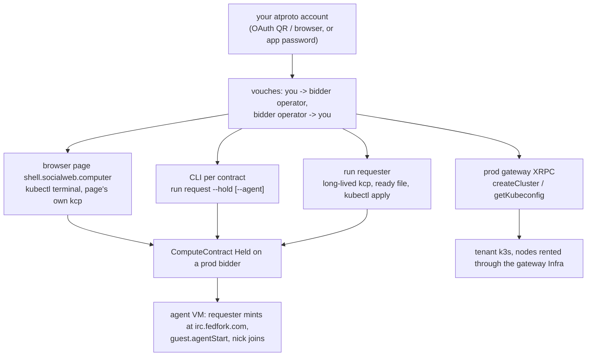

# Quickstart (prod): Infra and compute against prod bidders

- the same Infra / EphemeralInfra objects as [quickstart-local.md](quickstart-local.md), rented from prod bidders with a real
  atproto account
- prod means: prod bidders (each runs `bidder-tangled-vouch`), plc.directory, the did:key ingress relay at
  xrpc.fedproxy.com, the relay at relay.mini-cloud-0002.chadig.com, irc.fedfork.com for atirc, a real atproto account
- what works today: the browser page (section 3), the CLI per contract (section 4), the agent join (section 5), tenant clusters
  through the prod gateway (section 6), a long-lived requester from the CLI that `kubectl apply` works against (section 7,
  `run requester`)
- also on main: that requester installed as a systemd unit of its own account (section 7a, `install requester`) or as a
  HostProcess of an account's core (section 7b); the atirc agent from a local PDS or a pdsAccount identity is built
  (section 5) and not yet proven on prod
- also on main: your own tenant cluster in the requester kcp (section 8, `run requester --with-gateway`, plan
  [0039](plans/0039-long-lived-requester.yaml) item C-GATEWAY-COMPOSE), proven on a local network; a node from a remote
  prod bidder is the lead's run
- acceptance: [acceptance/0012-infra-quickstart.md](acceptance/0012-infra-quickstart.md) "Prod Step For The Agent Join" and
  "Prod Readings"; [acceptance/0013-mixed-prod.md](acceptance/0013-mixed-prod.md) for
  [../examples/infra/mixed-prod.yaml](../examples/infra/mixed-prod.yaml) on a bidder you configured; the runbook rules of [acceptance/README.md](acceptance/README.md) apply (announce on atirc first, release
  what you rent, no secret on any terminal)



## 1. Who Runs This

- you, with your own account, from your own host or browser; prod bidders and prod services are shared, so follow the
  acceptance rules: one driver per account, announce before a run, release everything you rent
- never set `policy: open`: the default `requester-tangled-vouch` (requester) and `bidder-tangled-vouch` (every prod bidder)
  always run
- credentials stay in owner-only files, sourced into the one command that needs them; never print a token, a password or a
  sign-in URL

## 2. Vouches On Prod

Both policies read `sh.tangled.graph.vouch` records (rkey = the subject DID, `record.subject` = that DID, any `kind` but
`denounce`). On prod they are records in people's own repos, written with any atproto client (`goat record create`):

| direction | who writes | record |
|---|---|---|
| bidder operator -> you | the bidder operator, in the operator's repo | rkey = your DID |
| you -> bidder operator (or the bidder DID) | you, in your repo | rkey = the operator's DID |

- read a bidder's operator from its MarketIdentity `status.approvedAssociations`, or ask the operator
- the bidder runs the RFP's attached policy as itself before it bids, so without the operator's record you see
  `no bids received within 30s` and, on the bidder, `policy rejected ... not vouched`
- verdicts are cached 5 minutes, denials too: write the records first
- check a record: `goat get "at://<operator did>/sh.tangled.graph.vouch/<your did>" | jq -r .kind` prints `vouch`
- when you operate the bidder yourself (`install bidder`, [bidder.md](bidder.md)), you write the operator record from the
  operator account; [../examples/infra/vouch-bidder-operator.yaml](../examples/infra/vouch-bidder-operator.yaml) applies in
  the bidder kcp of a bidder installed with `--bidder-operator-signin <operator handle>`: the operator signs in once
  by QR (scope: `sh.tangled.graph.vouch` writes only) and the record is written to the operator's repo
  ([bidder.md](bidder.md), Operator sign-in)

## 3. Browser Page: kubectl Terminal

The page `shell.socialweb.computer` runs a kcp and the requester in the browser (comms Firehose, sealed secrets fallback).
Its kubectl terminal applies the same files into the page's own kcp ([acceptance/0009-browser-page.md](acceptance/0009-browser-page.md)).

1. sign in with your account (OAuth)
2. in the terminal, paste the file with a heredoc (the page terminal has no repo checkout, so `-f agent-vm.yaml` finds
   no file): `kubectl apply -f - <<EOF` + the contents of `examples/infra/agent-vm.yaml` (or `vm.yaml`) + `EOF`
3. read `kubectl get ephemeralinfras.socialweb.computer -o yaml` until the contract is Deployed
4. the Agent button sends `guest.agentStart`; `ssh <contract>` opens a shell from the page terminal
5. `kubectl patch ... state Released` releases it

- proven on the page: `agent-vm.yaml` and `vm.yaml`, released by `kubectl patch ... state Released`; `mixed.yaml` (with
  the DenoSandbox `sbx1`) and release by deleting the object are not yet proven on the page

- page-rc142 and later write the ssh key and the agent secrets bundle for a kubectl-applied contract; on page-rc141 an
  `agent` contract failed at once and `ssh <contract>` had no key
- last pass: page-rc142, account hat, EphemeralInfra `qsprod`, Held in 41 s, `hat-<rkey>` joined, revoked, then Released
  (acceptance 0012 "Prod Readings")

## 4. CLI Per Contract: run request

`socialweb-computer run request` brings up a kcp of its own for one invocation, composes a MarketRequester root, rents one
contract and keeps the invocation under `--state-dir` (runbooks [0003](acceptance/0003-cli-webrtc-ssh.md),
[0004](acceptance/0004-vm-atirc-agent.md)).

```bash
SWC=socialweb-computer
R=~/.tmp/req; mkdir -p "$R"; chmod 700 "$R"
NAME=qs-vm-$(date +%s)
$SWC run request --state-dir "$R" --name "$NAME" --hold \
  --tunnel ssh:22:webrtc --transport webrtc --exec "uname -a; id" \
  -- --atproto-oauth-qr > "$R/$NAME.log" 2>&1 &
# sign in from the pendingAction url in the log (QR or a scripted sign-in); never paste it anywhere
$SWC run request ssh "$NAME" --state-dir "$R" --transport webrtc --exec "uname -m"
$SWC run request release "$NAME" --state-dir "$R"
```

- identity: `-- --atproto-oauth-qr` (QR), `-- --atproto-oauth` (browser), or an existing account with an app password
  (`-- --atproto-identity-mode pdsAccount --atproto-handle <handle> --atproto-pds-url <pds>`, the password from
  `--atproto-password` through the environment)
- `run request list`, `run request resume <name>`, `run request release <name>` manage the invocations it recorded
- one invocation is one contract; there is no `kubectl apply` of an Infra into it (section 7)

## 5. Agent VM: The atirc Join

The mint needs a requester identity irc.fedfork.com resolves and that signs service auth (lxm `chat.atirc.mint`, aud
`did:web:irc.fedfork.com#atirc`). irc.fedfork.com checks the JWT against the DID document from plc.directory, then the
handle: the first of up to 3 `alsoKnownAs` aliases whose DNS TXT `_atproto.<handle>` (else
`https://<handle>/.well-known/atproto-did`) names the DID. An agent token is leased, so irc.fedfork.com also reads the
receipt and the bidder's `vm.terminated` from the requester's PDS: that PDS must be reachable from the internet.

| identity | signs the mint with | log `requester_service_auth` `atircSigning` |
|---|---|---|
| OAuth (`--atproto-oauth-qr`, `--atproto-oauth`, the page, the iOS app) | the OAuth session; its granted scope holds `rpc:chat.atirc.mint` | `oauth` |
| existing account with an app password (`--atproto-identity-mode pdsAccount`) | the owner MarketIdentity (getServiceAuth on that account's PDS) | `owner-identity` |
| local PDS (`localRepo`) | its own Pds component, only when the DID is on `https://plc.directory` and the Pds is public through its ingress (a ComponentLink Requester -> Pds `pds.serviceauth`); otherwise none, with the reason in `atircReason` | `local-pds` or `none` |

- the market callbacks (submitBid, submitEvent, the RFP and accept signatures) are unchanged: this source signs only the
  atirc mint
- a `spec.agent` contract whose requester handle is `.local` (the default `localRepo` handle
  `<workspace>.requester.local`) or does not resolve to the requester DID is Failed before its RFP, with
  `refused: the atirc agent needs a requester handle that resolves to <did>: ...; start the requester with
  --atproto-handle <a domain you control> ...`; a plain VM contract of the same requester still runs
- a `spec.agent` contract whose `spec.secretsRef` path holds no bundle gets one from the requester: one entry at
  `agent.envFile` (`ATIRC_TOKEN=`, mode 0600), logged `requester_agent_bundle_placeholder`; no bao step is needed (the
  bao commands of [quickstart-local.md](quickstart-local.md) still work and win, a bundle that is there is kept). The path
  must be under `contracts/` of the requester mount

```bash
NAME=qs-agent-$(date +%s)
$SWC run request --state-dir "$R" --name "$NAME" --hold --agent -- --atproto-oauth-qr > "$R/$NAME.log" 2>&1 &
# sign in, wait for Held and requester_atirc_minted in the log
$SWC run request agent "$NAME" --state-dir "$R"     # guest.agentStart
# watch your channel with your own atirc token for the JOIN of <label>-<rkey>; prompt "<label>-<rkey>: uname -m"
$SWC run request release "$NAME" --state-dir "$R"
```

- the requester mints a leased token `<label>-<rfp rkey>.<handle>` after the verified receipt and writes it into the
  bundle (`/etc/atirc/atirc.env`, 0600); release revokes it before the bidder writes `vm.terminated`
- last pass: CLI, account alice, `aliceoa-<rkey>` joined and answered `x86_64` over atirc; revoked before vm.delete

## 6. Tenant Kubernetes Clusters: The Prod Gateway

The prod gateway at `k8s.socialweb.computer` owns tenant clusters. With service auth from your account (runbook
[0001](acceptance/0001-auth-modes.md) section 3):

```bash
xrpc procedure createCluster name="$CL"
xrpc query listClusters | jq -r --arg n "$CL" '.clusters[] | select(.name==$n) | .phase'   # until Ready
xrpc procedure getKubeconfig name="$CL" ttlSeconds:=28800 | jq -r .kubeconfig > "$W/kubeconfig"
chmod 600 "$W/kubeconfig"
kubectl --kubeconfig "$W/kubeconfig" apply -f examples/infra/k8s-cluster.yaml
```

- a pod that does not fit makes a NodeClaim; the gateway's Infra `nodes-<hex>` rents the node from a prod bidder
- your own tenant cluster without the prod gateway: section 8 (`run requester --with-gateway`)

## 7. A Long-Lived Requester From The CLI: run requester

`socialweb-computer run requester` (plan [0039](plans/0039-long-lived-requester.yaml) item A-RUN-REQUESTER) brings up the
same MarketRequester root as `run request` in a kcp of its own and keeps it up: no contract of its own, every listener on
port 0, state under `<state-dir>/requesters/<name>`. You `kubectl apply` Infra, EphemeralInfra or ComputeContract objects
against it, and its requester rents them from prod bidders under the default policy.

```bash
ST=~/.tmp/lr; mkdir -p "$ST"; chmod 700 "$ST"
$SWC run requester --name me --state-dir "$ST" -- --atproto-oauth-qr > "$ST/me.log" 2>&1 &
# sign in from the pendingAction url in the log (QR or scripts/oauth-signin.ts); never paste it anywhere
R=$ST/requesters/me/ready.json
until [ -s "$R" ]; do sleep 1; done                       # written atomically once the root is Ready
eval "$($SWC run requester env me --state-dir "$ST")"     # KUBECONFIG of the requester workspace, the DID
kubectl get marketrequesters.socialweb.computer app -o jsonpath='{.status.phase} {.status.did}{"\n"}'
sed "s|ssh-ed25519 AAAAREPLACE-WITH-YOUR-PUBLIC-KEY you@laptop|$(cat "$(jq -r .sshPublicKey "$R")")|" \
  examples/infra/vm.yaml | kubectl apply -f -             # pin a bidder with bidderDids when you need one
kubectl wait infras.socialweb.computer/quickstart-vm --for=jsonpath='{.status.phase}'=Deployed --timeout=3m
$SWC run requester ssh me --state-dir "$ST" --contract infra-quickstart-vm-vm1 --exec 'cat /root/quickstart'
$SWC run requester ssh me --state-dir "$ST" --contract infra-quickstart-vm-vm1 --transport webrtc --exec 'uname -m'
kubectl delete infras.socialweb.computer quickstart-vm    # releases the contract first
kill -INT %1                                              # Ctrl-C: stops the kcp, removes the ready file, keeps the state
```

- identity, after `--` (the MarketRequesterSpec options of `run request`, parsed by the same code): `--atproto-oauth-qr`,
  `--atproto-oauth`, or an existing account with an app password (`--atproto-identity-mode pdsAccount --atproto-handle
  <handle> --atproto-pds-url <pds>`, the password through the environment); without one it is a local PDS (`localRepo`,
  `--identity <name>` before `--` reuses a stored one); comms, ingress, requester ingress and `--secrets-fallback` too. A
  contract option (`--vm-name`, `--tunnel`, `--hold`, ...) is refused: contracts are kubectl objects here
- the ready file (`<dir>/ready.json`, and a second copy at `--ready-file <path>`): written to `<path>.tmp` then renamed,
  mode 0600, once the root is Ready; rewritten on every restart and when a field changes; removed on a clean stop.
  `{schema: 1, name, pid, startedAt, kcpUrl, kubeconfig, workspace, did, handle, identityMode, pdsUrl, ingress {pds,
  requester}, sshPublicKey}`: the bound kcp front, the path of a kubeconfig for the requester's workspace, the public
  ingress URLs from the Exposure status, the path of the requester's ssh public key; never a token, key or password. The
  same JSON (plus mode, network, instance, readyFile, restarted, seconds) is the summary on stdout
- foreground only: it blocks until Ctrl-C (or SIGTERM), then stops its kcp and keeps its state; `--fg` is accepted (the
  installed unit form). A second `run requester` on the same name is refused while the first holds `<dir>/owner.lock`
- restart: the same command (or the same command with nothing after `--`) adopts the units and keeps the DID, the vault
  and every contract; a Held contract stays Held across the restart and ssh works again (the A-RUN-REQUESTER
  reading below; fixed in rc158, proven on prod in acceptance 0013 A). `<dir>/requester.json` records
  the first start's network, `--identity` and options; a restart with other options is refused (start a new name)
- `run requester env <name>` prints `KUBECONFIG`, `SOCIALWEB_KCP_HOST`, `SOCIALWEB_KCP_WORKSPACE`, the DID and the ssh public
  key path from the ready file (`--json`); `run requester ssh <name> --contract <cc>` is the `run request ssh` code over
  any Held contract, with the requester's own key and `StrictHostKeyChecking=yes` against the guest's reported host keys
  (`--transport webrtc` needs a webrtc tunnel on the contract, as in `vm.yaml`)
- vouches: as section 2; the requester's own record for the bidder can be the `vouch.yaml` AtprotoRecord applied into
  this kcp (its repo is `repo-<did with - for :>`)
- proven (2026-11-01, own market network, `--network`, bidder policy `bidder-tangled-vouch`): ready 11 s, `vm.yaml`
  Deployed 20 s after the apply, ssh over iroh and webrtc printed `quickstart-vm-ok`; Ctrl-C and restart: same DID, ready
  file rewritten in 1.4 s, contract still Held, ssh again. The standalone path against prod bidders with an OAuth QR
  sign-in is the lead's run (acceptance rules)

### Ingress options per identity

Two ingresses, two jobs. Both go after `--` (rows of `deploy/apps/option-map.yaml`, app `market-requester`); the ready
file reports both public URLs (`ingress.pds`, `ingress.requester`).

- PDS ingress (`spec.ingress`, a local PDS only): makes the DID document's `atproto_pds` endpoint, the relay crawl, the
  bidders' record reads and irc.fedfork.com's lease reads reach the local PDS
- requester ingress (`spec.requesterIngress`, every identity): submitBid, submitEvent and getSecrets; the agent's
  `ATIRC_TOKEN` reaches the guest through getSecrets

| identity | PDS ingress | requester ingress | agent mint |
|---|---|---|---|
| OAuth QR / browser | none (the account's PDS is public) | as below | mints |
| pdsAccount (app password) | none (the account's PDS is public) | as below | mints through the owner MarketIdentity |
| localRepo (own Pds) | `--ingress-xrpc-host xrpc.fedproxy.com` (the did:key ingress relay; the standalone default, public URL `https://<did label>.xrpc.fedproxy.com`); `--ingress-provider opentunnel --ingress-opentunnel-command ... --ingress-opentunnel-route-name ...`; `--ingress-public-host <host>` (with `--ingress-relay-url <your relay>`) for `https://<did label>.<host>` behind your own edge | as below | mints only with the DID on plc.directory (standalone default `--plc-directory-url https://plc.directory`), that PDS ingress Ready, and `--atproto-handle <a domain you control>` whose DNS TXT `_atproto.<handle>` or `https://<handle>/.well-known/atproto-did` names the DID |

Requester ingress, every identity:

| option | effect |
|---|---|
| (none, comms `XRPC` or `Both`) | the app ingress (standalone: xrpc-subscription through xrpc.fedproxy.com) |
| `--requester-ingress-provider webrtc` (`--requester-ingress-webrtc-stun stun:...`) | bids, events and getSecrets over a webrtc datachannel |
| `--requester-ingress-provider xrpc-subscription`, `opentunnel` or `iroh` | the same endpoints through that provider |
| `--comms-mode Firehose` | no inbound endpoint at all: add `--secrets-fallback Sealed`, or a contract with `spec.secretsRef` (every agent contract) fails with "secrets need the requester ingress (getSecrets) or secretsFallback: Sealed" |

- a localRepo requester with a public handle, its PDS behind xrpc.fedproxy.com and the agent:
  `$SWC run requester --name me --state-dir "$ST" -- --atproto-handle me.example.org` (the defaults give
  plc.directory and xrpc.fedproxy.com); publish `did=<the ready file's did>` as DNS TXT `_atproto.me.example.org`
  before the first agent contract; the core log shows `requester_service_auth ... "atircSigning":"local-pds"`
- proven (2026-11-01, own market network, localRepo with the default `.local` handle, bidder policy
  `bidder-tangled-vouch`): `atircSigning` `none` ("the DID is on the network PLC"), no `pds.serviceauth` link;
  `agent-vm.yaml` with no bao step: placeholder bundle written (`/etc/atirc/atirc.env`, 0600), contract Failed
  `refused: ... --atproto-handle ...` with no RFP; `vm.yaml` of the same requester Deployed in 22 s, ssh printed
  `quickstart-vm-ok`. A real mint from a local PDS is the lead's prod run

### 7a. Installed: install requester (a systemd user unit of its own account)

`install requester` (plan 0039 B-INSTALL-REQUESTER, decisions D2 and D9) is the one explicit root step, the same steps as
`install bidder`: it creates the account, writes the units, `config.json` and the requester record, enables linger and
starts the unit. The unit runs the same process, `run requester --name %i --fg`, with `host-backend systemd-user` from
`config.json`: its core places the requester's kine, front and kcp slot as user units of that account
(`socialweb-kcp-req-<sha256(name)[:10]>-*`) and its HostProcesses and OpenBao beside them, all in `socialweb.slice`.

```bash
sudo $SWC install requester --name me --dry-run                 # prints every step; writes nothing
sudo $SWC install requester --name me                           # account swc-requester, unit socialweb-computer-requester@me
sudo $SWC install requester --account swc-req-t1 --name me -- --atproto-oauth-qr   # name the account; options after --
ST=/var/lib/socialweb-computer/swc-requester
sudo -u swc-requester $ST/bin/current/socialweb-computer run requester signin me --state-dir $ST   # the sign-in URL on stdout
sudo journalctl _UID=$(id -u swc-requester) _SYSTEMD_USER_UNIT=socialweb-computer-requester@me.service -f   # its log, as root
R=/var/lib/socialweb-computer/swc-requester/requesters/me/ready.json
sudo -u swc-requester kubectl --kubeconfig "$(sudo jq -r .kubeconfig "$R")" get marketrequesters.socialweb.computer app
```

- account: `swc-requester` by default; `--account <name>` creates that account when no install record and no user of that
  name exist; an existing account needs `--adopt-account` (refused otherwise, as for a bidder). The install record is
  `/var/lib/socialweb-computer/install-<account>.json` with role `requester` and the names
- `--name` (repeatable, comma-separated) names each instance; each is the unit `socialweb-computer-requester@<name>.service`
  (Type=notify, Slice=socialweb.slice, Restart=always, Delegate=yes) with its state in `<state>/requesters/<name>`. The
  unit sends READY=1 only after the ready file is written, so `TimeoutStartSec` is the ready budget plus one hour for a
  person to sign in; a start that times out restarts and shows a new sign-in URL. `install` waits for that start
- options after `--` are the MarketRequesterSpec options of `run requester`, parsed by the same code, written once per
  name into `<state>/requesters/<name>/requester.json` (the first start's options; a second install keeps the file and
  reports it FOUND). With no identity option the identity is `--atproto-oauth-qr` (D9): `run requester signin <name>` (as
  the account or root) reads the MarketIdentity `requester` from the requester's own kcp and prints its
  `pendingAction.url` on stdout (phase and expiry on stderr, `--json` for the object; nothing when Ready); drive it with
  `scripts/oauth-signin.ts --url "$(... run requester signin me ...)"`. `install` prints both commands before it starts
  the unit. The unit's log has the same URL, but only root reads it: the account is a system account (uid under 1000),
  journald stores its user units' lines in the system journal, and `journalctl --user` as the account opens no file;
  as root, `journalctl --user-unit` matches root's own uid, so name `_UID=<uid> _SYSTEMD_USER_UNIT=<unit>`
- an existing account with an app password (`-- --atproto-identity-mode pdsAccount --atproto-handle <h> --atproto-pds-url
  <pds>`): the password never goes into `config.json`, a flag, a unit or the requester record. After the unit started, as
  the account, `socialweb-computer run requester password me --state-dir <state> < <file>` reads it once from stdin and writes
  it into the requester's own OpenBao (`identity/requester/keys`, the SecretRef the MarketIdentity's keysRef names); the
  composer, waiting on "its account password", goes on
- `config.json`: `host-backend systemd-user`, `state-dir`, `asset-cache`, `ready-timeout`, `network-timeout`
  (and `unit-prefix` when given); never a password or a token
- second install: every step FOUND; `upgrade --binary <new> --sha256 <sum> --state-dir <state>` as the account switches
  `bin/current`, runs the new binary's `check-host -role requester` (the role comes from the install record, never read as
  a bidder) and restarts every enabled `socialweb-computer-requester@` unit; `rollback` the same way. The kcp units and the
  vault keep running across that restart; the core adopts them, so the DID and every Held contract survive
- reboot: linger starts the user manager, and the enabled kcp units and the requester unit come up again
- `uninstall requester --account <a>` (root) disables and stops the units, removes the unit files, linger and the drop-in,
  and keeps the state dir (the DID, the vault, the contracts) unless `--purge`
- `check-host -role requester`: the checks every role has (systemd, delegation, linger, cgroup v2, socket path, boot id,
  oomd); no kvm, no subids
- proven (2026-11-01, this host as root, throwaway account `swc-req-t1`, localRepo against an own market network's PLC):
  `--dry-run` printed 33 steps; the install created the account and was active 25 s after `enable --now`, ready file
  and `kubectl get marketrequesters` Ready as the account; with no identity option the identity was oauthQr, AwaitingScan
  with a pendingAction URL, and the unit stayed activating (no READY before the ready file); a second install was all
  FOUND; `upgrade` as the account read the role from the record, restarted only the requester unit, kept the DID and left
  the kcp and OpenBao units adopted (same InvocationID); a restart of `user@<uid>` (the reboot path through linger) was
  Ready again in 10 s with the same DID; `run requester password` wrote the vault path; `uninstall` kept the state dir
  and the account, `--purge` removed both. `install bidder --dry-run` and `install gateway --dry-run` print the same
  steps before and after this change. A real reboot and an OAuth QR install against prod bidders are the lead's runs

### 7b. Same account: a kubectl-applied HostProcess (no root, no new user)

When the account already runs a core (an installed requester, or a dev host instance), a second requester needs no root
and no new account: apply [`examples/infra/requester-hostprocess.yaml`](../examples/infra/requester-hostprocess.yaml) into
that core's kcp. The core places it as one more unit (placement supervisor) in `socialweb.slice`; it runs the same process,
`run requester --name lr2 --state-dir <dir> --fg`, which brings up its own kcp under that unit.

```bash
export KUBECONFIG=$(sudo jq -r .kubeconfig "$R")                # the core that places it
P=socialweb-hp-req-$(printf %s me | sha256sum | cut -c1-10)-  # the HostProcess prefix of the installed requester me
sed -e "s|REPLACE-HP-PREFIX|$P|" -e "s|REPLACE-STATE-DIR|$HOME/lr2|g" examples/infra/requester-hostprocess.yaml | kubectl apply -f -
kubectl get hostprocess requester-lr2 -o jsonpath='{.status.phase}{"\n"}'   # Running once the ready file is written
kubectl delete hostprocess requester-lr2                        # SIGTERM: stops its kcp and keeps its state dir
```

- the unit must start with the core's HostProcess prefix (`<unit-prefix>hp-<key>-`; an installed requester's key is
  `req-<sha256(name)[:10]>`, a dev instance's is its short id: read it from `kubectl get hostprocesses`), or the core
  refuses it ("is not under")
- no root prunes it: a root renders and checks only its own set's HostProcesses by name (`compose.SetWorkloads`,
  `compose.CheckWorkloads`), adopts only objects labelled with its owner, and `status.gc` only counts an unowned
  HostProcess as an orphan; it never deletes one. The core adopts the unit by name and InvocationID across its own restart
- the sign-in URL: `run requester signin lr2 --state-dir <dir>`, or the unit's journal (`journalctl --user -u <unit>` for a
  normal account; for a system account such as swc-requester only root reads it, `journalctl _UID=<uid>
  _SYSTEMD_USER_UNIT=<unit>`); a password never goes into the argv
- proven (2026-11-01, as test-0001, own market network, localRepo against the network PLC): applied into the core of an
  installed-form requester, the HostProcess was Running with its ready file after 18 s, in `socialweb.slice`, and its
  kubeconfig read the MarketRequester Ready; a restart of that core left it adopted (same InvocationID) with the core's
  kcp, kine and OpenBao units; `kubectl delete` stopped it in under 1 s, removed the ready file and kept its state dir

Still planned in plan 0039:

- its live pass: [../examples/infra/mixed-prod.yaml](../examples/infra/mixed-prod.yaml) (vm1, sbx1, agent1 pinned to one
  bidder, no policy field) by acceptance [acceptance/0013-mixed-prod.md](acceptance/0013-mixed-prod.md) (item
  ACC39-MIXED-PROD; written, not yet run on prod)

## 8. Your Own Tenant Cluster: run requester --with-gateway

`run requester --with-gateway` (plan 0039 item C-GATEWAY-COMPOSE) composes the gateway into the requester's own kcp. One
identity: the MarketRequester's Requester rents the cluster's nodes under your DID and the default policy; there is no
second sign-in, no gateway PDS, no gateway Requester and no web app.

```bash
$SWC run requester --name me --state-dir "$ST" --with-gateway -- --atproto-oauth-qr > "$ST/me.log" 2>&1 &
until jq -e .gateway "$ST/requesters/me/ready.json" >/dev/null 2>&1; do sleep 1; done
$SWC run requester cluster me --cluster c1 --state-dir "$ST"         # account + home workspace and the Cluster
TK=$($SWC run requester kubeconfig me --cluster c1 --state-dir "$ST") # once the Cluster is Ready
kubectl --kubeconfig "$TK" apply -f examples/infra/k8s-cluster.yaml
kubectl --kubeconfig "$TK" wait --for=condition=Ready pod -l app=quickstart-k8s --timeout=5m
kubectl --kubeconfig "$TK" logs deploy/quickstart-k8s                # quickstart-k8s-ok
kubectl get infras.socialweb.computer                                # nodes-<hex>, in the requester workspace
kubectl --kubeconfig "$TK" delete deployment quickstart-k8s          # the node scales to zero, its contract Released
```

- what it composes: a Gateway root `gateway` of profile `requester` with `spec.requesterRef` naming the MarketRequester
  `app`, in the requester's own workspace. It composes no PlanAccount, Pds, Requester, identity or web app of its own, only
  a nodes-only GatewayAPI (`spec.nodesOnly`): the NodeClaim binding and the meshd and node-agent downloads, nothing else
  is served. The NodeClaim controller writes the cluster's Infra `nodes-<hex>` into the requester workspace, the
  requester runs its ComputeContracts as your DID with `requester-tangled-vouch`, the node join bundles go to the
  requester's own vault (`requester/contracts/<contract>/bundle`, served by getSecrets), and the Infra record mirrors to
  your repo (`computer.socialweb.infra/nodes-<hex>`, Retain: never deleted)
- the cluster provider runs in the `run requester` process and serves only the clusters of your DID; in a local
  market network `--with-gateway` is refused when the network has a gateway child (`dev up --with-gateway`), whose
  provider serves every Cluster of the network's kcp
- the cluster's k3s, kine, OpenBao, front and links are
  HostProcesses of the requester's core (`kubectl get hostprocesses.socialweb.computer`), with state under
  `<instance state>/clusterprovider` (the ready file's `gateway.clusters`)
- a Cluster lives in a home workspace `root:<account>:<cluster>` of your DID: `run requester cluster` makes the account
  workspace, its AtprotoIdentity, the home workspace and the Cluster `{account: <did>, running: true}`; delete the
  Cluster there to tear it down
- the ready file is written only once the Gateway is Ready too, with `gateway {workspace, name, clusters}` in its first
  write, so `run requester cluster` right after `until [ -s ready.json ]` finds it; `requester.json` records
  `withGateway`, so a restart keeps the gateway and the clusters
- preflight: cgroup v2, user manager delegation, one subuid/subgid range and setuid newuidmap/newgidmap (the
  `check-host -role gateway` fixes); a dev build or a release build (k3s and external-secrets are embedded)
- proven (2026-11-01, own market network, `--network`, bidder policy `bidder-tangled-vouch`, both vouches): Gateway
  Ready 3 s after the requester, `run requester cluster` Ready in 17 s with 11 HostProcesses in the requester workspace,
  the NodeClaim's Infra `nodes-<hex>` in `root:<requester>` and its contract Held in 21 s (owner DID, attached
  `requester-tangled-vouch`, SecretsApplied GetSecrets), the pod logged `quickstart-k8s-ok`, the node scaled to zero and
  the contract Released 2.5 min after the Deployment was deleted, the Infra record stayed in the repo; Ctrl-C and
  restart with nothing after `--`: the same DID, the gateway Ready 9 s after the start, the Cluster still Ready, k3s
  `/readyz` ok, every cluster HostProcess adopted by unit name and InvocationID but the cluster OpenBao (restarted in
  place). The first node join of a fresh network waited about 4 min for the bidder's guest OIDC discovery to report its
  configured issuer (it reported `https://127.0.0.1:0` until then)
- a node on a remote bidder: the node fetches `socialweb-meshd` and `socialweb-node` from
  `<base>/downloads/<sha256>/<name>` and checks the sha256 its contract pins (`spec.nodeJoin.meshd`, `nodeAgent`).
  The base is `--node-download-base` (env `SOCIALWEB_NODE_DOWNLOAD_BASE`), by default the public bucket the bidders
  already read guest images from, where CI publishes the pinned downloads tree by sha256 (the `publish` job, prefix
  `downloads/`, content-addressed: an object is never replaced). With `--network` the default is unused and the node
  fetches from the requester's local Exposure, as the network's bidders share its host; a dev build whose `rust/` or
  `cmd/socialweb-node` differs from a published commit has pins the bucket does not hold. Proven on a local network
  (2026-11-01): with the flag the node contract's `nodeJoin` names the bucket and the pins of the released tree, the
  node's bootstrap reached `<bucket>/downloads/<sha256>/socialweb-node-x86_64` (HTTP 404 until CI publishes it), and a
  guest fetched a published object from the bucket and matched its manifest sha256. Proven on prod (rc159, acceptance
  0013 C): the node of cluster `c1` on hat-7 (a remote bidder) fetched both from the bucket and joined; the pod ran
- the node reaches the k3s API and the cluster OpenBao over iroh: each is a dumbpipe `listen-tcp` HostProcess of the
  requester's core whose ticket names the public n0 relay and the host's addresses, so a node on any host dials it
  through the relay when no direct path opens (a guest cannot reach its own bidder host's addresses through the fence,
  so the same-host proof already takes an internet path); the node's join bundle comes by getSecrets over the
  requester ingress, and the cluster OpenBao checks the node's token against the bidder's public OIDC issuer

## Not Supported On Prod Today

| gap | where it is planned |
|---|---|
| an atirc agent from a local PDS identity: built, not yet proven against irc.fedfork.com (a pdsAccount identity is proven on rc161) | plan 0039 D-AGENT-IDENTITY |
| `vouch-bidder-operator.yaml` on an installed bidder whose operator did not set `--bidder-operator-signin`, or before the QR page (qr.fedfork.com) asks for `repo:sh.tangled.graph.vouch` | operator setting; the QR page's scope |
| deno on a prod bidder unless its operator ran `run bidder --compute-kinds vm,deno` or `install bidder --compute-kinds vm,deno`; pin such a bidder with `bidderDids` | operator setting |
