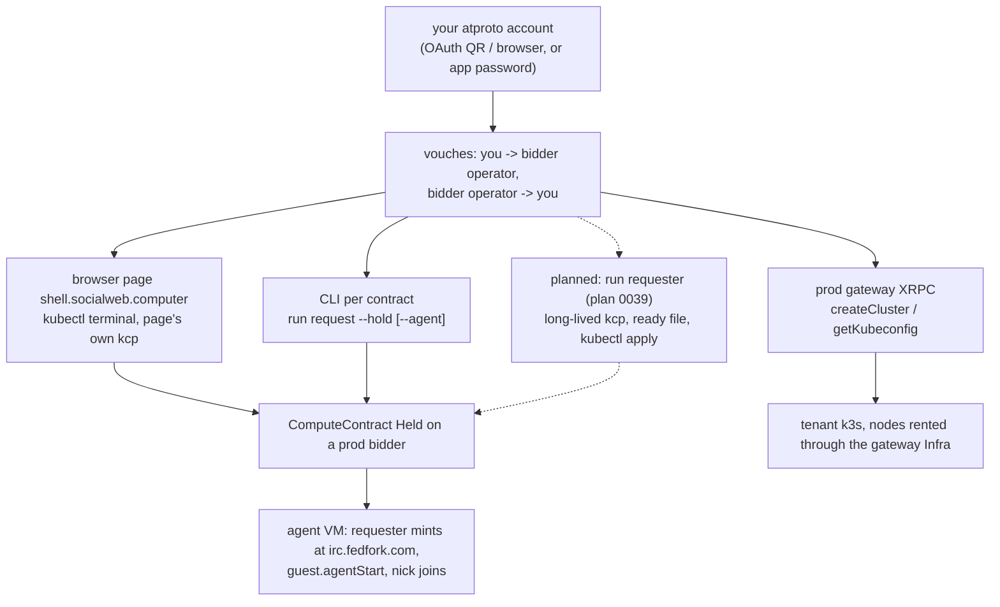

# Quickstart (prod): Infra and compute against prod bidders

- the same Infra / EphemeralInfra objects as [quickstart-local.md](quickstart-local.md), rented from prod bidders with a real
  atproto account
- prod means: prod bidders (each runs `bidder-tangled-vouch`), plc.directory, the did:key ingress relay at
  xrpc.fedproxy.com, the relay at relay.mini-cloud-0002.chadig.com, irc.fedfork.com for atirc, a real atproto account
- what works today: the browser page (section 3), the CLI per contract (section 4), the agent join (section 5), tenant clusters
  through the prod gateway (section 6)
- what is planned: a long-lived requester you run from the CLI or install as a systemd unit, so `kubectl apply` works against
  prod bidders from your own host (section 7, plan [0039](plans/0039-long-lived-requester.yaml)); not implemented yet
- acceptance: [acceptance/0012-infra-quickstart.md](acceptance/0012-infra-quickstart.md) "Prod Step For The Agent Join" and
  "Prod Readings"; the runbook rules of [acceptance/README.md](acceptance/README.md) apply (announce on atirc first, release
  what you rent, no secret on any terminal)



## 1. Who Runs This

- you, with your own account, from your own host or browser; prod bidders and prod services are shared, so follow the
  acceptance rules: one driver per account, announce before a run, release everything you rent
- never set `policy: open`: the default `requester-tangled-vouch` (requester) and `bidder-tangled-vouch` (every prod bidder)
  always run
- credentials stay in owner-only files, sourced into the one command that needs them; never print a token, a password or a
  sign-in URL

## 2. Vouches On Prod

Both policies read `sh.tangled.graph.vouch` records (rkey = the subject DID, `record.subject` = that DID, any `kind` but
`denounce`). On prod they are records in people's own repos, written with any atproto client (`goat record create`):

| direction | who writes | record |
|---|---|---|
| bidder operator -> you | the bidder operator, in the operator's repo | rkey = your DID |
| you -> bidder operator (or the bidder DID) | you, in your repo | rkey = the operator's DID |

- read a bidder's operator from its MarketIdentity `status.approvedAssociations`, or ask the operator
- the bidder runs the RFP's attached policy as itself before it bids, so without the operator's record you see
  `no bids received within 30s` and, on the bidder, `policy rejected ... not vouched`
- verdicts are cached 5 minutes, denials too: write the records first
- check a record: `goat get "at://<operator did>/sh.tangled.graph.vouch/<your did>" | jq -r .kind` prints `vouch`
- when you operate the bidder yourself (`install bidder`, [bidder.md](bidder.md)), you write the operator record from the
  operator account; [../examples/infra/vouch-bidder-operator.yaml](../examples/infra/vouch-bidder-operator.yaml) works today
  only inside a local market network (the network's `operator` repo link); on an installed bidder it is plan 0039 item
  F3-BIDDER-OPERATOR-REPO

## 3. Browser Page: kubectl Terminal

The page `shell.socialweb.computer` runs a kcp and the requester in the browser (comms Firehose, sealed secrets fallback).
Its kubectl terminal applies the same files into the page's own kcp ([acceptance/0009-browser-page.md](acceptance/0009-browser-page.md)).

1. sign in with your account (OAuth)
2. in the terminal, paste the file with a heredoc (the page terminal has no repo checkout, so `-f agent-vm.yaml` finds
   no file): `kubectl apply -f - <<EOF` + the contents of `examples/infra/agent-vm.yaml` (or `vm.yaml`) + `EOF`
3. read `kubectl get ephemeralinfras.socialweb.computer -o yaml` until the contract is Deployed
4. the Agent button sends `guest.agentStart`; `ssh <contract>` opens a shell from the page terminal
5. `kubectl patch ... state Released` releases it

- proven on the page: `agent-vm.yaml` and `vm.yaml`, released by `kubectl patch ... state Released`; `mixed.yaml` (with
  the DenoSandbox `sbx1`) and release by deleting the object are not yet proven on the page

- page-rc142 and later write the ssh key and the agent secrets bundle for a kubectl-applied contract; on page-rc141 an
  `agent` contract failed at once and `ssh <contract>` had no key
- last pass: page-rc142, account hat, EphemeralInfra `qsprod`, Held in 41 s, `hat-<rkey>` joined, revoked, then Released
  (acceptance 0012 "Prod Readings")

## 4. CLI Per Contract: run request

`socialweb-computer run request` brings up a kcp of its own for one invocation, composes a MarketRequester root, rents one
contract and keeps the invocation under `--state-dir` (runbooks [0003](acceptance/0003-cli-webrtc-ssh.md),
[0004](acceptance/0004-vm-atirc-agent.md)).

```bash
SWC=socialweb-computer
R=~/.tmp/req; mkdir -p "$R"; chmod 700 "$R"
NAME=qs-vm-$(date +%s)
$SWC run request --state-dir "$R" --name "$NAME" --hold \
  --tunnel ssh:22:webrtc --transport webrtc --exec "uname -a; id" \
  -- --atproto-oauth-qr > "$R/$NAME.log" 2>&1 &
# sign in from the pendingAction url in the log (QR or a scripted sign-in); never paste it anywhere
$SWC run request ssh "$NAME" --state-dir "$R" --transport webrtc --exec "uname -m"
$SWC run request release "$NAME" --state-dir "$R"
```

- identity: `-- --atproto-oauth-qr` (QR), `-- --atproto-oauth` (browser), or an existing account with an app password
  (`-- --atproto-identity-mode pdsAccount --atproto-handle <handle> --atproto-pds-url <pds>`, the password from
  `--atproto-password` through the environment)
- `run request list`, `run request resume <name>`, `run request release <name>` manage the invocations it recorded
- one invocation is one contract; there is no `kubectl apply` of an Infra into it (section 7)

## 5. Agent VM: The atirc Join

The mint needs a requester identity irc.fedfork.com resolves and that signs service auth (lxm `chat.atirc.mint`, aud
`did:web:irc.fedfork.com#atirc`): an OAuth account with `rpc:chat.atirc.mint` in its granted scope (the CLI with
`--atproto-oauth-qr`, the page, the iOS app). A local network requester (`localRepo`) cannot
([quickstart-local.md](quickstart-local.md) section 7).

```bash
NAME=qs-agent-$(date +%s)
$SWC run request --state-dir "$R" --name "$NAME" --hold --agent -- --atproto-oauth-qr > "$R/$NAME.log" 2>&1 &
# sign in, wait for Held and requester_atirc_minted in the log
$SWC run request agent "$NAME" --state-dir "$R"     # guest.agentStart
# watch your channel with your own atirc token for the JOIN of <label>-<rkey>; prompt "<label>-<rkey>: uname -m"
$SWC run request release "$NAME" --state-dir "$R"
```

- the requester mints a leased token `<label>-<rfp rkey>.<handle>` after the verified receipt and writes it into the
  bundle (`/etc/atirc/atirc.env`, 0600); release revokes it before the bidder writes `vm.terminated`
- last pass: CLI, account alice, `aliceoa-<rkey>` joined and answered `x86_64` over atirc; revoked before vm.delete

## 6. Tenant Kubernetes Clusters: The Prod Gateway

The prod gateway at `k8s.socialweb.computer` owns tenant clusters. With service auth from your account (runbook
[0001](acceptance/0001-auth-modes.md) section 3):

```bash
xrpc procedure createCluster name="$CL"
xrpc query listClusters | jq -r --arg n "$CL" '.clusters[] | select(.name==$n) | .phase'   # until Ready
xrpc procedure getKubeconfig name="$CL" ttlSeconds:=28800 | jq -r .kubeconfig > "$W/kubeconfig"
chmod 600 "$W/kubeconfig"
kubectl --kubeconfig "$W/kubeconfig" apply -f examples/infra/k8s-cluster.yaml
```

- a pod that does not fit makes a NodeClaim; the gateway's Infra `nodes-<hex>` rents the node from a prod bidder
- running the gateway (cluster control plane and node market) inside your own requester is plan 0039 item C-GATEWAY-COMPOSE

## 7. Planned: A Long-Lived Requester From The CLI (plan 0039)

Not implemented. This section is the target shape; plan [0039](plans/0039-long-lived-requester.yaml) holds the items, and
the acceptance runbook `docs/acceptance/0013-mixed-prod.md` (item F-MIXED-PROD, not written yet) will prove it.

```bash
ST=~/.tmp/lr; mkdir -p "$ST"; chmod 700 "$ST"
$SWC run requester --name me --state-dir "$ST" --ready-file "$ST/ready.json" -- --atproto-oauth-qr &
until [ -s "$ST/ready.json" ]; do sleep 1; done          # written atomically once the root is Ready
export KUBECONFIG=$(jq -r .kubeconfig "$ST/ready.json")
kubectl get marketrequesters.socialweb.computer app -o jsonpath='{.status.did}{"\n"}'
kubectl apply -f examples/infra/mixed-prod.yaml           # VM + deno + agent against your bidder
```

- `run requester` (item A-RUN-REQUESTER): one MarketRequester root in a kcp of its own, in the foreground, every listener
  on port 0; the ready file names the bound kcp address, the kubeconfig path, the workspace, the DID and handle, and the
  requester ingress URL; the state dir survives restarts (the same DID, contracts, vault)
- identity: OAuth QR or browser, an existing account on a remote PDS with an app password, or a local PDS (items
  A-RUN-REQUESTER, D-AGENT-IDENTITY)
- `install requester` (item B-INSTALL-REQUESTER): the same root as a systemd user unit in `socialweb.slice` of an account
  that install creates when asked, with `config.json` and `upgrade`, as `install bidder` does
- the gateway in the same kcp (item C-GATEWAY-COMPOSE): `kubectl apply` a Cluster, its k3s control plane runs as
  HostProcesses of the requester's core, and its nodes are rented by the same requester
- the atirc agent (items D-AGENT-IDENTITY, D-AGENT-INGRESS): which identity mints, and the ingress options
  (`--requester-ingress-provider`, `--ingress-xrpc-host`, `--ingress-public-host`, opentunnel) for a local PDS
- `examples/infra/mixed-prod.yaml` (item F-MIXED-PROD, not written yet) is the file the acceptance applies

## Not Supported On Prod Today

| gap | where it is planned |
|---|---|
| `kubectl apply` of an Infra against prod bidders from your own host (no long-lived CLI requester root outside the page and the iOS app) | plan 0039 A-RUN-REQUESTER, B-INSTALL-REQUESTER |
| a tenant cluster without the prod gateway | plan 0039 C-GATEWAY-COMPOSE |
| an atirc agent from a local PDS identity | plan 0039 D-AGENT-IDENTITY, D-AGENT-INGRESS |
| `vouch-bidder-operator.yaml` on an installed bidder | plan 0039 F3-BIDDER-OPERATOR-REPO |
| deno on a prod bidder unless its operator ran `run bidder --compute-kinds vm,deno`; pin such a bidder with `bidderDids` | operator setting |
